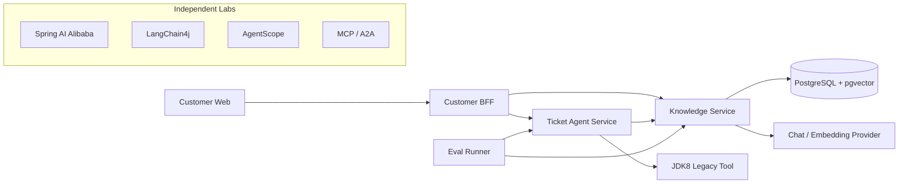

# Java AI 应用开发实战

**Learn Java AI · 沿一条客户服务链路，学会把模型接进真实 Java 业务系统。**

[](docs/course/README.md)
[](docs/course/README.md)
[](LICENSE)
[](https://github.com/DavidDingXu/learn-java-ai/actions/workflows/verify.yml)

面向有 Spring Boot 经验的 Java 后端工程师的完整开源课程。52 篇文章、原理插图、七个可运行阶段和完整项目，贯穿模型调用、企业 RAG、客户咨询、受控工单 Agent、JDK8 老系统接入、评测、安全与上线治理。

**[完整课程目录](docs/course/README.md) · [从导读开始](docs/course/01-column-introduction.md) · [运行阶段源码](learning-stages/README.md) · [工程文档](docs/README.md) · [参与贡献](CONTRIBUTING.md)**

## 一条业务主线学到底


客户咨询退款政策，知识服务返回带引用的回答；证据不足时升级工单；Agent 规划受控动作，人工确认后交由 JDK8 系统执行；整条链路使用同一组身份、业务接口、评测数据和追踪规则。

## 课程路线

| 阶段 | 文章 | 学到什么 | 可运行源码 |
| --- | --- | --- | --- |
| [系统边界与第一条调用](docs/course/README.md#module-01) | 01–06 | 划清身份、服务和 JDK8 边界，跑通模型调用 | [阶段 01](learning-stages/stage-01-system-boundaries/README.md) |
| [模型调用工程化](docs/course/README.md#module-02) | 07–12 | 处理 Prompt、结构化输出、流式响应、韧性与评测 | [阶段 02](learning-stages/stage-02-model-engineering/README.md) |
| [企业 RAG](docs/course/README.md#module-03) | 13–21 | 完成文档生命周期、权限检索、引用和增量索引 | [阶段 03](learning-stages/stage-03-enterprise-rag/README.md) |
| [客户咨询与工单升级](docs/course/README.md#module-04) | 22–25 | 串联 BFF、会话、回答反馈和转人工 | [阶段 04](learning-stages/stage-04-customer-consultation/README.md) |
| [受控 Agent 与老系统接入](docs/course/README.md#module-05) | 26–34 | 落实 Tool 边界、人工确认、幂等与 JDK8 调用 | [阶段 05](learning-stages/stage-05-controlled-agent/README.md) |
| [评测、安全与上线治理](docs/course/README.md#module-06) | 35–39 | 建立安全回归、观测、配置与发布回滚流程 | [阶段 06](learning-stages/stage-06-production-readiness/README.md) |
| [框架与协议迁移](docs/course/README.md#module-07) | 40–52 | 比较 Provider、LangChain4j、AgentScope、MCP 与 A2A | [阶段 07](learning-stages/stage-07-framework-boundaries/README.md) |

全部 52 篇全文见 [课程目录](docs/course/README.md)。每篇文末都能跳到前后章节和对应阶段源码；读到哪里，就从该阶段的 `Application`、HTTP 文件和 README 开始运行，再对照完整实现。

## 先读哪几篇

- 第一次接触 Java AI 应用：[学习地图](docs/course/01-column-introduction.md) → [系统分工](docs/course/02-system-context.md) → [第一条模型调用](docs/course/04-first-model-call.md)。
- 已经能调用模型：从 [企业知识库](docs/course/13-document-domain.md) 开始，重点看 [TopK 之前的权限过滤](docs/course/17-acl-before-topk.md) 和 [RAG 评测](docs/course/21-rag-evaluation.md)。
- 正在建设 Agent：从 [Agent 边界](docs/course/26-agent-boundary.md) 开始，串起 [人工确认](docs/course/30-approval-receipt.md)、[幂等与审计](docs/course/31-action-consistency.md) 和 [工单业务链](docs/course/33-ticket-agent-case.md)。
- 准备接入公司系统：结合 [运行配置](docs/course/38-runtime-configuration.md)、[上线核对](docs/course/39-release-checklist.md) 和 [生产运行手册](docs/README.md) 逐项替换适配器与基础设施。

## 核心能力

- **企业知识服务**：文档版本、租户与部门 ACL、增量索引、pgvector、混合检索、引用校验和 RAG 评测。
- **客户咨询链路**：Customer Web、BFF、SSE、会话、反馈、重试和幂等工单升级。
- **受控工单 Agent**：结构化规划、Tool 参数校验、风险分级、人工确认、幂等执行、未知结果对账和审计时间线。
- **存量系统接入**：Java 8 客户端只依赖 OpenAPI 和 JSON，不与 Java 21 服务共享 DTO 或框架依赖。
- **质量与安全**：模型、检索、Agent 和安全评测，Micrometer Trace 与 Metric，低敏日志、并发限制、依赖检查和跨平台发布门禁。
- **框架与协议实验**：Spring AI Alibaba、LangChain4j、AgentScope、MCP 和 A2A 在独立 reactor 中验证，不污染主应用依赖。

## 系统架构



服务之间通过版本化 HTTP/OpenAPI 接口协作，不共享领域 JAR，也不跨服务访问数据库。系统上下文、完整时序和数据所有权见[架构文档](docs/README.md#架构与决策)。

## 快速开始

本机准备 JDK 21 或更高版本，并用 IntelliJ IDEA 打开项目根目录。第一次体验只需要启动 Knowledge Service，不必先安装数据库、身份平台或其他中间件。

```bash
git clone https://github.com/DavidDingXu/learn-java-ai.git
cd learn-java-ai
```

把根目录的 `config/application-default.example.yml` 复制为 `config/application-default.yml`，填写 API Key、Base URL、Chat 模型和 Embedding 模型。后一个文件已被 Git 忽略，也是整套项目唯一需要维护的本地配置。

然后直接运行：

- `services/knowledge-service` 中的 `KnowledgeServiceApplication`；
- 启动成功后访问 `http://localhost:8081/actuator/health`；
- 再调用 `POST http://localhost:8081/api/v1/knowledge/answers` 观察真实模型回答。

macOS、Windows 的步骤相同，IDE 项目 SDK 都选择 JDK 21。

## 启动本地应用

Knowledge Service 和 Ticket Agent Service 会自动加载根目录的共享模型配置，不需要再设置环境变量或启动参数。

本地默认使用固定身份，三个服务之间通过真实 HTTP 调用；会话、Agent 任务、确认、审计和写 Tool 使用进程内实现。因此第一次运行不需要 JWT、身份平台、Redis、Kafka 或数据库，也不会用固定答案代替模型调用。

需要体验完整咨询与工单链路时，在 IDE 中依次运行三个启动类：

1. `KnowledgeServiceApplication`；
2. `TicketAgentServiceApplication`；
3. `CustomerBffApplication`。

默认端口为 8081、8082 和 8080。可以先检查服务组装与健康状态：

```bash
curl http://localhost:8081/actuator/health
```

Customer Web 的独立运行方式见 [apps/customer-web/README.md](apps/customer-web/README.md)。完整配置说明见[运行配置](docs/runbooks/runtime-configuration.md)。

## 调用真实模型

Knowledge Service 启动后，直接请求业务接口：

```bash
curl --fail-with-body \
  -H 'Content-Type: application/json' \
  -d '{"question":"退款通常多久到账？"}' \
  http://localhost:8081/api/v1/knowledge/answers
```

Windows PowerShell：

```powershell
Invoke-RestMethod -Method Post `
  -Uri "http://localhost:8081/api/v1/knowledge/answers" `
  -ContentType "application/json" `
  -Body '{"question":"退款通常多久到账？"}'
```

响应中的 `answer`、`model` 和 `citations` 来自真实运行链路。生产 API Key、数据库密码、JWT 材料和客户端密钥必须由 Secret Manager、Vault 或部署平台 Secret 覆盖，不能进入 Git、镜像层或日志。

## 手动验证完整 RAG

完整 RAG 与“模型接口能调用”不是一回事。当前实现需要以下条件同时成立：

- PostgreSQL 已安装 `vector` 和 `pg_trgm` 扩展，数据库账号可以执行 Flyway 迁移和业务读写；
- 同一个 OpenAI 兼容 Provider 能完成 Chat 与 Embedding 调用；如果它不提供 Embedding，再使用 Ollama 替代这一项；
- 至少上传并发布一份文档，再由索引 Worker 生成 Chunk 和向量；
- 查询使用 `tenant-a / local-user / support` 这组本地固定身份，ACL 必须允许该身份读取文档。

本地文件对象存储已经内置，首次联调不需要 MinIO、Redis、Kafka 或身份平台。Query Rewrite 和 Rerank 默认关闭，也不是跑通主链路的前置条件。

配置好 Provider 和专用 PostgreSQL 后，把 Knowledge Service 的运行模式切换为完整 RAG：

```yaml
java-ai:
  knowledge:
    mode: postgres-rag
    postgres:
      jdbc-url: jdbc:postgresql://localhost:5432/java_ai_knowledge
      username: java_ai_knowledge
      password: replace-with-your-database-password
```

修改后重新运行 `KnowledgeServiceApplication`，不需要额外 Profile 或 JWT。PostgreSQL/pgvector 的安装、手动启停、建库和恢复见 [RAG 本地准备](docs/runbooks/rag-prerequisites.md)，完整业务步骤见[知识文档导入](docs/runbooks/knowledge-ingestion.md)。

## 接入公司基础设施

项目不提供一个含义模糊的“生产开关”。本地实现和公司实现遵循相同接口，需要哪项能力就替换对应适配器：

- Knowledge Service：将 `java-ai.knowledge.mode` 改为 `postgres-rag`，再按需把固定身份换成公司鉴权；
- Ticket Agent Service：需要重启恢复和多实例并发时，将 `java-ai.persistence.mode` 改为 `jdbc`；有真实 Legacy Tool 后，再将写 Tool 改为 HTTP；
- Customer BFF：接入公司身份平台时，将固定身份改为 JWT，并将本地委托改为 OAuth2 Token Exchange；
- 多实例部署：把 Knowledge Service 的本地原文存储，以及 Customer BFF 的进程内会话和限流替换为共享实现。

模型和数据库参数统一写入根目录 `config/application-default.yml`，各服务 `application.yml` 只保留版本化的业务默认值。生产 API Key、数据库密码、JWT 材料和客户端密钥必须由 Secret Manager、Vault 或部署平台 Secret 覆盖。完整配置和接入边界见[运行配置](docs/runbooks/runtime-configuration.md)。

## 模块说明

| 路径 | 职责 | 构建边界 |
|---|---|---|
| [`services/knowledge-service`](services/knowledge-service/README.md) | 文档、检索、RAG 与引用 | Java 21 主 reactor |
| [`services/ticket-agent-service`](services/ticket-agent-service/README.md) | 工单 Agent、Tool、确认与审计 | Java 21 主 reactor |
| [`apps/customer-bff`](apps/customer-bff/README.md) | 客户身份委托、会话与协议聚合 | Java 21 主 reactor |
| [`quality/eval-runner`](quality/eval-runner/README.md) | 模型、检索、Agent 与安全评测 | Java 21 主 reactor |
| [`apps/customer-web`](apps/customer-web/README.md) | 客户咨询前端 | Node.js 24 独立构建 |
| [`integrations/jdk8-client`](integrations/jdk8-client/README.md) | Java 8 存量系统客户端 | JDK 8 独立构建 |
| [`labs`](labs/README.md) | 框架迁移与 MCP/A2A 互操作 | 与主应用隔离的代码实验 |
| [`learning-stages`](learning-stages/README.md) | 专栏七个阶段的可运行学习切片 | 独立 reactor，不进入主应用依赖 |
| [`contracts`](contracts/README.md) | OpenAPI、JSON Schema 与接口样例 | 契约源文件 |
| [`datasets`](datasets/README.md) | Golden Set 与安全回归数据 | 版本化数据集 |

三个服务共享 Java 21 依赖基线。labs、JDK8 客户端与 Customer Web 保持独立边界，避免框架实验依赖、Java 8 字节码和前端工具链污染主项目。

## 技术基线

- 主 reactor：Java 21、Spring Boot 4.1.0、Spring AI 2.0.0。
- labs：Spring AI Alibaba 1.1.2.3、LangChain4j 1.18.1、AgentScope 2.0.2、MCP Java SDK 2.0.0、A2A Java SDK 1.2.0.Final。
- Java 8 客户端：独立 Java 8 模块。

依赖版本与选择边界见[版本基线](docs/version-baseline.md)。

## 生产接入边界

仓库提供 PostgreSQL/Flyway、JWT、模型和下游 HTTP 适配器，但拥有这些实现不等于项目已经适配任意公司的生产环境。以下能力需要在目标环境完成：

- 接入公司 IdP、密钥系统、对象存储、网关和真实 Legacy Tool；
- 将 Customer BFF 的进程内会话与限流替换为共享实现；
- 验证数据库迁移、备份恢复、并发容量、告警、回滚和未知结果对账；
- 使用真实业务分布维护评测数据、阈值和安全案例。

本机启动成功或单次模型调用都不能代替这些验收。

## 文档与社区

- [七个阶段的可运行源码](learning-stages/README.md)：读到哪一段，就直接运行对应 `Application`。
- [按专栏阶段阅读最终实现](docs/reader-code-path.md)：跑通学习切片后，再进入主工程看对应包和类。
- [文档导航](docs/README.md)：架构、ADR、Runbook、数据集与验证档案。
- [贡献指南](CONTRIBUTING.md)：开发环境、改动边界和 Pull Request 检查项。
- [安全策略](SECURITY.md)：漏洞报告范围与私密报告方式。
- [支持说明](SUPPORT.md)：使用问题、缺陷和功能建议分别如何反馈。
- [行为准则](CODE_OF_CONDUCT.md)：社区协作边界。

项目采用 [Apache License 2.0](LICENSE)。


## 完整学习内容

```text
docs/course/       52 篇完整文章、分阶段目录和章节导航
docs/assets/       正文配图、运行截图和可编辑图源
learning-stages/   七个可独立运行的学习阶段
services/          Knowledge Service 与 Ticket Agent Service
apps/              Customer BFF 与 Customer Web
quality/           评测与安全回归
integrations/      JDK8 老系统客户端
labs/              框架与协议隔离实验
```

课程正文、插图与示例代码按 [Apache License 2.0](LICENSE) 开放。文章勘误和复现问题见 [贡献指南](CONTRIBUTING.md)。

## 相关课程

| 课程 | 适合谁 | 学习重点 |
| --- | --- | --- |
| [程序员 AI Coding 进阶实战](https://github.com/DavidDingXu/learn-ai-coding) | 已有开发经验的程序员 | 上下文、SDD、测试调试、Skill 与完整需求交付 |
| [AI Coding 团队化实战](https://github.com/DavidDingXu/ai-coding-for-teams) | 技术负责人、架构师、研发效能团队 | 共享运行时、团队规则、验证治理与协作 |
| [Java AI 应用开发实战](README.md) | Java / Spring Boot 后端工程师 | 模型调用、RAG、受控 Agent 与生产接入 |
