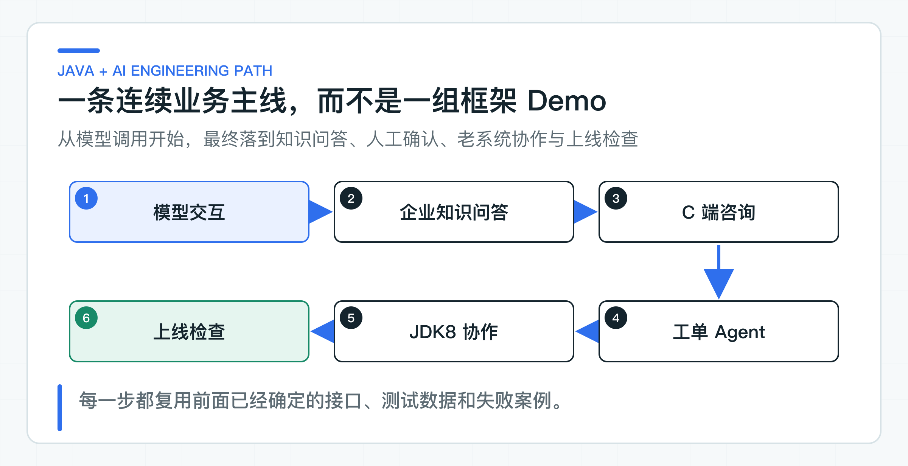
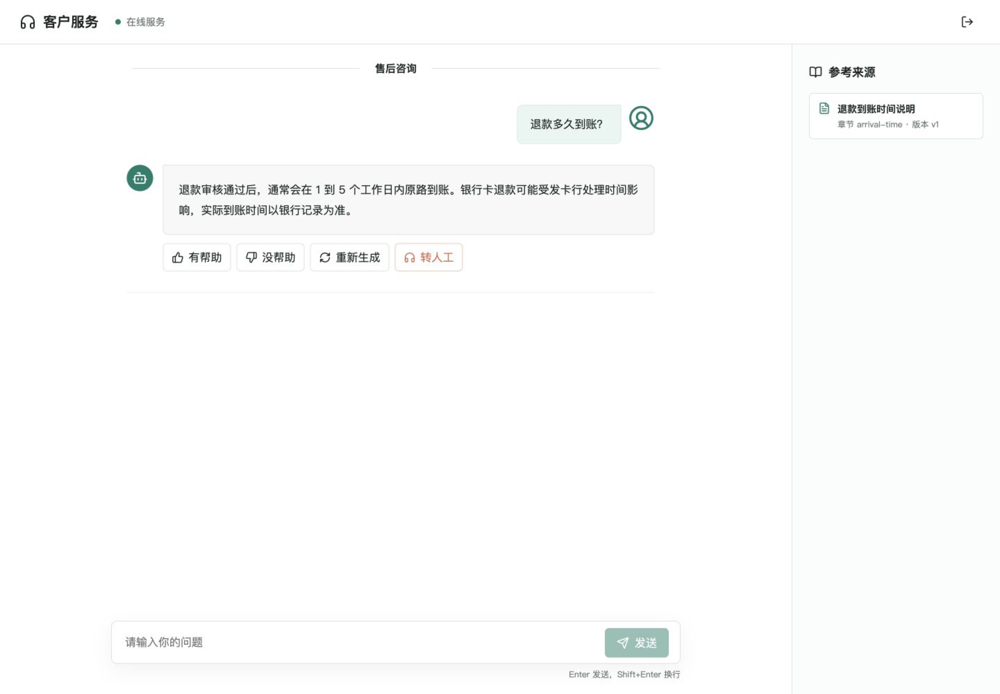

# 专栏介绍：Java 后端怎样系统学习 AI 应用开发落地

Java 后端工程师转向 AI 应用开发，第一道门槛通常不是模型训练，而是怎样把一个不稳定的模型接进原有业务系统。只背框架 API 很快，等到身份、数据、失败处理和上线要求一起出现，前面的 Demo 往往要推倒重来。

这套专栏就沿着一条客户服务链路往下做。客户先问退款政策，知识服务返回带引用的回答；证据不足时创建工单；能规划步骤并选择工具的 Agent 给出受控建议；真正修改业务状态前，客服仍要回到 JDK8 系统确认。模型只是链路中的一个依赖，Java 代码继续掌握身份、规则和最终写入。



项目里既有 Java 服务，也有面向客户的 Web 页面。下面这张图来自配套 Customer Web 的实际运行界面：回答正文、参考来源、反馈、重新生成和转人工共用同一次回答记录，前端不直接访问知识库或工单服务。

<!-- visual-origin: screenshot: column/assets/reports/customer-web-browser-qa.md -->


## 从业务链开始，而不是从框架 API 开始

传统 Java 业务系统希望输入、规则和输出尽量确定。模型则是概率系统：同一个问题可能得到不同表达，输出可能被截断，也可能生成看似合理却并不存在的事实。这两类系统接在一起，不能只靠一个 SDK 封装解决。

项目一开始就要回答三个具体问题。退款政策、订单和工单状态分别由哪个系统负责？模型提出建议后，哪些检查必须由 Java 代码和业务人员完成？回答出错时，能否根据文档版本、检索结果、调用链追踪（Trace）和评测样例找到原因？

后面的提示词（Prompt）、检索增强生成（Retrieval-Augmented Generation，RAG）、Agent 和发布运维都沿着这条退款咨询链路继续开发。前面定下的接口字段、身份传递和追踪方式，会直接用于后面的知识检索、工单升级和老系统执行，不会每讲一个框架就另起一套示例。

AI 应用最容易学偏的地方，是把框架能力当成业务能力。

会调用 `ChatClient`，不代表回答可信；接入向量库，不代表 RAG 有权限隔离；模型能选择业务工具（Tool），不代表可以修改订单；服务能启动，也不代表能上线。公司真正关心的是另一组问题：身份从哪里来，数据属于谁，错误怎样返回，模型输出怎样校验，链路怎样追踪，变更怎样回归。

因此，整套内容沿一条真实业务链展开，不按 Spring AI API 清单排列：

```text
真实模型调用
  -> 带证据的企业知识回答
  -> C 端自助咨询与工单升级
  -> 受控 Agent 和人工确认
  -> JDK8 老系统执行
  -> 评测（Eval）、调用链追踪（Trace）、安全、发布与回滚
```

## 一条业务主线贯穿 52 篇

整套内容共 52 篇，文章顺序就是系统逐步长出来的顺序。每一段都复用前面已经确定的业务对象、接口和失败处理，不会把同一个概念换成另一套 Demo 重讲。

七段能力路线分别解决模型调用、企业 RAG、客户咨询、受控 Agent、老系统协作和上线治理中的具体问题。

每一段结束后，项目都会多出一组可以直接观察的能力：先是可维护的模型调用，再是可信 RAG、C 端咨询、受控 Agent、老系统协作和上线治理。后面的模型服务商（Provider）与框架实验继续使用同一组业务接口和风险边界，比较结果才有迁移价值。

七个阶段各有独立的可运行 module。打开阶段入口中的 `Application`，可以先观察这一段涉及的输入、状态和结果，不必一开始就在完整项目的数百个类中寻找本篇新增的部分。企业 RAG 还可以按第 13-21 篇的篇号逐步运行，前一步产生的文档、索引任务和检索状态会成为后续步骤的输入。

进入一个阶段后，先看该阶段 README 列出的启动类和 HTTP 文件。第一次只沿 Controller、应用服务、领域对象和基础设施适配器这一条调用链阅读；确认接口返回和状态变化后，再回到完整项目比较后续阶段增加了什么。这样既能看到系统逐步演进，也不会把尚未讲到的最终实现误认为本篇前置知识。

## 能带走的工程能力

完成整套内容后，可以独立判断并实现以下工作：

- 在 Spring Boot 服务中接入模型，同时把 SDK 类型限制在基础设施层；
- 设计带文档生命周期、权限过滤、引用和质量评测的企业 RAG；
- 构建面向 C 端的流式咨询与工单升级链路；
- 让 Agent 只负责规划和选择 Tool，把权限、状态、幂等和人工确认留给业务系统；
- 让 JDK8 项目通过稳定的 HTTP 接口使用 AI 服务，而不是被迫升级整套技术栈；
- 用固定评测样例集、调用链追踪、聚合指标（Metric）、日志和发布回滚把 AI 功能纳入日常工程流程。

迁移到公司项目时，可以复用业务端口、接口设计、失败分支和测试方法。模型、身份平台、数据权限、服务目标（Service Level Objective，SLO）与基础设施参数必须按目标环境重新验证。

除了实现功能，还要能根据业务约束说明为什么这样设计。学完整条主线后，可以结合项目代码解释四类常见问题：

- 为什么 Spring AI 或其他模型 SDK 的响应对象不应直接成为业务接口；
- 为什么 RAG 要先做租户与文档权限过滤，再参与候选排序和答案生成；
- 为什么 Agent 可以选择 Tool，却不能自行决定写权限、跳过人工确认或处理重复执行；
- 为什么单元测试、真实模型验证和目标环境验收是三种证据，发布与回滚分别依据什么结果。

这些问题会落实到后面的接口、测试和运行结果中。完成整条链路后，可以用同一套判断方法设计技术方案、参加架构评审和排查线上问题。

## 开始前的准备

不需要提前学习模型训练或 Transformer 的数学推导。涉及 Token、上下文窗口、文本向量（Embedding）、采样和工具调用（Tool Calling）时，正文会先解释它们如何影响当前业务设计，再进入代码。

开始前只需准备完整 JDK 21 和 Git。读到老系统接入部分时再准备 JDK 8；运行 Customer Web 时再安装 Node.js，不需要一开始配齐所有工具。

普通服务在 IDE 中直接运行对应的 `main` 方法，再通过 HTTP、页面或 Trace 观察结果。

运行第一条真实模型调用前，先复制根目录的 `config/application-default.example.yml`，并命名为 `config/application-default.yml`。然后填写 API Key、Base URL 和模型名。这个文件已被 Git 忽略，也是七个阶段共用的唯一读者配置。生产环境仍应由 Secret Manager、Vault 或部署平台 Secret 覆盖相同配置键。

配套代码统一维护在 [java-ai-engineering-practice](https://github.com/DavidDingXu/learn-java-ai)。仓库保存的是完整实现，不是 52 份重复 Demo；README 中的阶段式代码导航会标出当前只需要看的入口类，其余目录可以暂时忽略。克隆后直接导入 IDE，文章中的普通源码链接会打开 `main` 分支的当前实现：

```bash
git clone https://github.com/DavidDingXu/learn-java-ai.git
cd learn-java-ai
```

把代码迁移到公司项目前，还要记录公司的身份从哪里来，文档由谁发布，业务写操作经过哪些确认步骤，日志和 Trace 进入哪套平台。示例中的模型、身份平台、数据权限、SLO 和基础设施参数不能原样照搬；目标环境的这些答案会决定需要替换哪些适配器、接口和配置。

---

[课程首页](../../README.md) · [完整目录](README.md) · [从一次客户咨询看系统分工：知识服务、工单 Agent 与 JDK8 老系统 →](02-system-context.md)

动手实践：[本阶段可运行源码](../../learning-stages/stage-01-system-boundaries/README.md)
