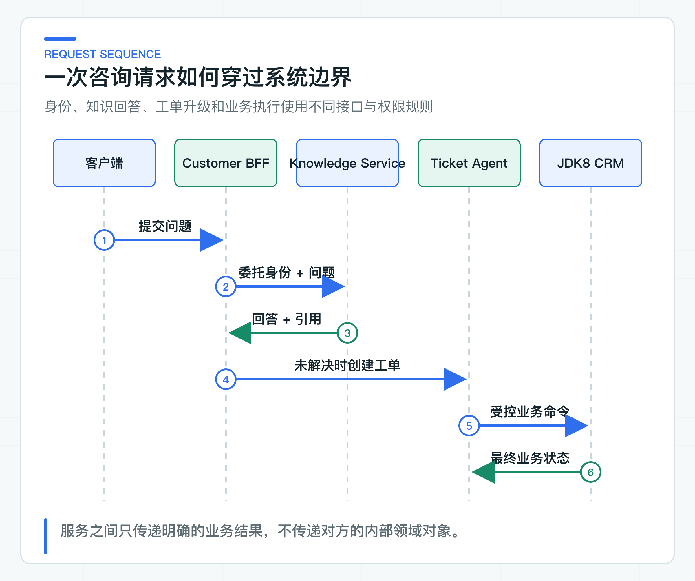
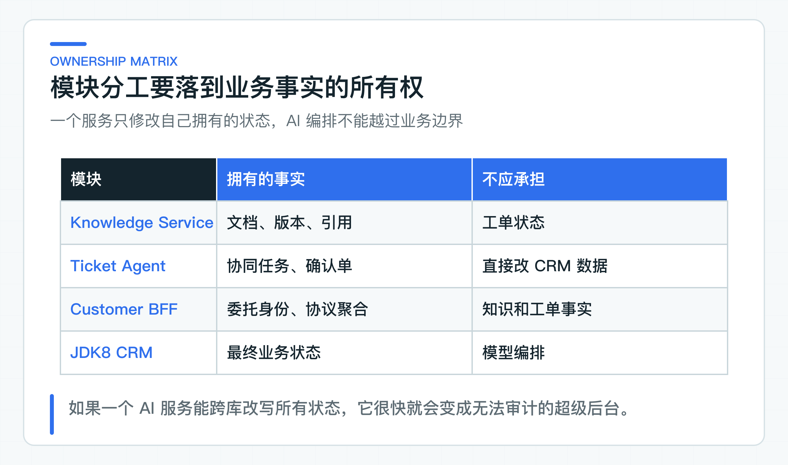

# 从一次客户咨询看系统分工：知识服务、工单 Agent 与 JDK8 老系统

客户问“退款审核通过后多久到账”，表面上只是一次问答，真正处理时却会穿过知识、身份、工单和订单系统。知识服务可以解释制度，订单状态仍要回业务系统查询；涉及退款动作时，最终决定留给客服和原有 JDK8 系统。

先把这次咨询走完，再画服务边界，会比先决定拆几个微服务可靠得多。每个系统拥有哪些事实、能执行哪些动作，也会随之变得清楚。

## 一次退款咨询里，先分清事实、推理和执行

客户的问题是：“退款已经审核通过，为什么还没有到账？”

看起来只需要调用一次模型，实际至少涉及四类信息：公司的退款政策、客户身份与租户、订单或支付状态、回答能否被追踪。政策可以进入知识服务，订单状态属于业务系统；模型可以整理信息，但没有权限凭空查询订单，更不能声称已经退款。

如果一开始把所有逻辑塞进一个聊天接口，系统很快会出现三个问题：渠道层保存知识副本，AI 服务绕过业务系统写数据，不同模块对同一身份各说各话。

这条业务链有三种性质完全不同的工作。退款政策、订单状态和工单状态是可审计的业务事实；对问题的理解、证据组织和工单分类属于概率推理；创建查询任务、更新工单或发起退款则是会产生副作用的执行。

这三类工作不应由同一个“智能客服服务”混合承担。业务事实必须有系统记录，能回答当前值、修改人、修改时间和变更原因。概率推理必须可以拒答，也必须能被评测。写操作则要经过权限、当前状态、幂等键和必要的人工确认。

这个区分会直接改变接口设计。知识服务返回的是带引用的政策回答，而不是“退款已到账”这类业务事实。需要查订单时，它返回升级信号，而不是伪造查询结果。Ticket Agent 产生的是受控任务或 Tool 意图，CRM 返回的才是最终业务状态。

## 五个系统各自负责什么

Customer BFF 是面向前端的后端服务（Backend for Frontend，BFF），负责渠道鉴权、委托身份和协议聚合。它可以把客户端令牌换成面向下游服务的令牌，但不保存知识文档，也不直接调用模型。

Knowledge Service 负责知识上下文、检索、引用和回答。Spring AI 只出现在它的基础设施适配器中。回答必须带实际参与推理的证据，缺少证据时应拒答或给出升级信号。

Ticket Agent Service 负责工单协同、Tool 选择、确认任务和审计。它可以建议“查询订单”或“申请人工复核”，但不拥有 CRM 数据库写权限。

公司原有的 JDK8 CRM 是工单状态和最终业务写入的系统记录。客服人员在原终端核对身份、状态和参数，确认后才执行高风险动作。配套项目只实现 Java 8 客户端与接口契约，具体 CRM 业务仍由公司现有系统负责。

Eval Runner 独立读取数据集，通过公开 HTTP 接口评测知识服务和 Agent。它不能依赖服务内部类，也不能直接读生产数据库。

所有权不等于“这个服务代码里有一张表”。它意味着该服务对事实的含义、校验、变更和审计负责。Ticket Agent 可以保存一个“等待人工确认”的协同任务，但它不能自己把 CRM 工单改成“已退款”。后者必须由 CRM 依据当前状态和业务规则做决定。

这也是为什么不让 AI 服务跨库查询和修改数据。跨库读会绕过服务本身的权限和语义，跨库写更会让幂等、审计和补偿失去责任人。短期看少写一个 HTTP 接口，长期看却会让每次业务变更都变成多服务联合排查。

## 第一版先用 HTTP/OpenAPI

这条链路中的每次调用都有明确的发起方、接收方、超时和返回值。同步 HTTP 足够表达当前语义，也便于 JDK8 系统接入。

消息中间件只有在出现真实需求时才值得引入，例如削峰、跨事务投递、事件扇出或失败重放。没有这些问题时，先加入 Kafka、事件表和补偿任务，只会在业务链尚未跑通前增加运维成本。

服务间共享的是版本化 OpenAPI、JSON Schema、错误码和测试夹具，不共享领域 JAR，也不跨服务访问数据库。这样做会多写一些 DTO，但每个接口由谁维护、变更后谁负责兼容，会更清楚。

同步 HTTP 不是“架构不够先进”，它只是在当前业务语义下更容易管理。调用方可以对超时、错误码和响应内容做立即决策，JDK8 客户端也不需要引入新的消费端运行时。当后面出现长时间索引任务、可重放业务事件或必须解耦的通知扇出时，再为那个明确问题引入异步机制。

服务边界也不等于必须独立部署。初期团队可以把 Knowledge 和 Ticket 放在同一个进程的不同模块中，只要它们的数据、用例和依赖方向仍然清晰。是否拆分部署单元，应由团队所有权、发布节奏、容量差异和故障隔离需求决定，不由架构图上的盒子数量决定。

仓库里的 [系统上下文](https://github.com/DavidDingXu/learn-java-ai/blob/main/docs/architecture/system-context.md) 和 [服务所有权矩阵](https://github.com/DavidDingXu/learn-java-ai/blob/main/docs/architecture/service-ownership.md) 记录了这些职责划分。

## 请求成功和失败时分别怎么走

在完整联调路径中，客户令牌先在 BFF 校验并换取委托身份。Knowledge Service 再次校验令牌，根据当前租户和权限加载知识，返回回答、引用、模型元数据和 Trace ID。客户端据此展示答案和来源。仓库已经实现这条 HTTP 链路，但公司身份平台、真实 CRM 和生产网络仍需在目标环境接入。

失败路径更能说明架构是否成立：

| 失败情况 | 谁处理 | 不能怎样处理 |
|---|---|---|
| 客户令牌无效 | Customer BFF | 不能继续调用下游碰运气 |
| 委托令牌受众不匹配 | Knowledge/Ticket | 不能相信 BFF 自报身份 |
| 没有可引用依据 | Knowledge Service | 不能生成无来源结论 |
| 需要查询订单 | Ticket/CRM | 不能让知识模型假装查过订单 |
| 工单已关闭 | CRM/Ticket | 不能继续执行写操作 |
| 重复确认请求 | Ticket/JDK8 Client | 不能重复修改业务状态 |

这些分支不是“上线治理”才补的内容。它们会反过来决定接口字段、错误码、幂等要求和服务所有权。

对调用方而言，失败至少要分成四类：请求本身无效，应由用户修正；身份或权限不成立，必须立即终止；证据不足，应拒答或升级；依赖系统暂时不可用，才可能进入受控重试或稍后处理。这四类不能统一包装成 `500 AI_SERVICE_ERROR`，否则 BFF 和客服终端只能一律提示“系统忙”。

### 同步调用也有一致性问题

这条链路不需要分布式事务把 Knowledge、Ticket 和 CRM 锁在一起。知识回答是读操作，创建工单和 CRM 写入各自由所有服务在本地事务中完成。跨服务一致性依靠明确状态、幂等键和可查询结果，不依靠一个覆盖全链路的大事务。

例如 Customer BFF 请求 Ticket Agent 创建工单时发生超时，BFF 不能直接认定创建失败，也不能换一个幂等键重新创建。当前接口允许用原幂等键重试同一请求，Ticket Agent 会返回第一次创建的任务；它没有额外提供“按幂等键查询”接口。公司若需要独立对账查询，应在接口中明确增加，而不是让调用方猜测执行结果。

跨服务调用还要传递业务请求号，它与 Trace ID 职责不同。Trace ID 用于观测一次技术链路，重试后可能变化；业务请求号或幂等键用于识别同一业务意图，在重试和跨系统查询中必须稳定。将两者混用，会让日志可追踪，但业务仍可能重复执行。

对于后续异步索引任务，同样遵循这个原则。文档版本在本地事务中保存，索引任务有独立状态和可重试记录。索引失败不会把已保存文档伪装成不存在，也不会让一个半成品新索引立即替换当前可用版本。

## 知识问答和工单共用一条业务主线

企业知识库和智能工单都是合适的落地场景，但各做一套互不相干的示例，最终只会得到两个框架 Demo。把它们放进同一业务链，才能看见知识回答怎样升级工单、身份怎样跨服务传递、Agent 怎样受业务系统约束。

C 端场景也保留在主线中。它迫使项目处理 SSE、薄 BFF、会话、反馈和拒答，而不是只做一个给内部员工使用的问答页面。

### 请求上下文需要保留哪些信息

跨服务传递信息时，最容易走向两个极端。一个是只传一段问题文本，下游无法判断租户、操作者和请求来源；另一个是把上游的完整用户对象、会话对象和框架 SecurityContext 序列化给下游。前者丢失安全上下文，后者把服务耦合在一起。

身份通过签名的委托令牌传递，问题和业务参数放在请求 DTO 中，Trace 串联一次跨服务调用。下游会独立验证令牌，再按自己的业务规则处理请求；排查问题时，则可以根据 Trace 找到 BFF、Knowledge 和 Ticket 的相关日志。

问题正文、Prompt 和文档片段不能直接放进 Metric 标签。它们基数高，可能包含个人或公司敏感信息，还会让观测存储成本失控。指标只保留固定操作名、结果类型、运行模式和低基数错误类别；需要调试的业务内容进入有权限、有脱敏和保留周期的日志或专用记录。

这个设计还影响超时预算。客户端等待 15 秒，不代表 BFF、Knowledge 和 Provider 可以各自使用 15 秒。请求需要一个端到端总预算，上游保留响应和取消时间，下游才能合理设置模型超时。否则每层都在“自己的超时内”，客户感知却可能是几十秒。

对应的取消信号也应向下传播。客户已经关闭页面，BFF 若只丢弃响应而不取消 Knowledge Service 的订阅，后者仍会继续占用模型连接和 Token。这种问题在功能测试里不明显，在真实 C 端并发里却会直接变成成本和容量问题。

因此，系统上下文图不是为了展示模块数量。它应让团队能沿着一次请求问清身份从哪里来、数据由谁保存、超时由谁分配、取消怎样传播，以及失败最终要返回给谁。

## 落到现有系统时替换哪些部分

可以直接复用的是职责划分：BFF 不保存知识，AI 服务没有最终业务写权限，JDK8 系统通过版本化接口协作，Eval 只调用公开接口。

需要按公司替换的是服务拆分粒度、身份平台、CRM 接口和部署形态。小团队可以先把 Knowledge 与 Ticket 放在同一个可部署应用中，只要内部模块所有权仍清晰；大型团队也不该因为组织多就提前拆出没有独立数据和发布需求的空服务。

一张有用的系统图，应该让团队在正常请求和失败发生时都能说清：数据来自哪里，模型处理哪一步，动作由谁执行，问题交给哪个服务处理。盒子画得多，并不会自动得到这些答案。

数据库、向量检索、Agent 和观测系统都要服从这张所有权图。组件可以替换，业务事实由谁负责不能跟着技术选型改变。某个组件找不到明确所有者时，应先检查职责是否拆错，不要用共享数据库或通用服务掩盖问题。

先确定所有权，再决定进程、部署和框架。框架选择必须服从这张边界图：主线框架承担正式业务能力，其他框架在相同接口和数据条件下比较，不能各自重建一套业务链路。

---

[课程首页](../../README.md) · [完整目录](README.md) · [← 专栏介绍：Java 后端怎样系统学习 AI 应用开发落地](01-column-introduction.md) · [Spring AI 为什么做主线，其他框架放在哪里 →](03-framework-selection.md)

动手实践：[本阶段可运行源码](../../learning-stages/stage-01-system-boundaries/README.md)
