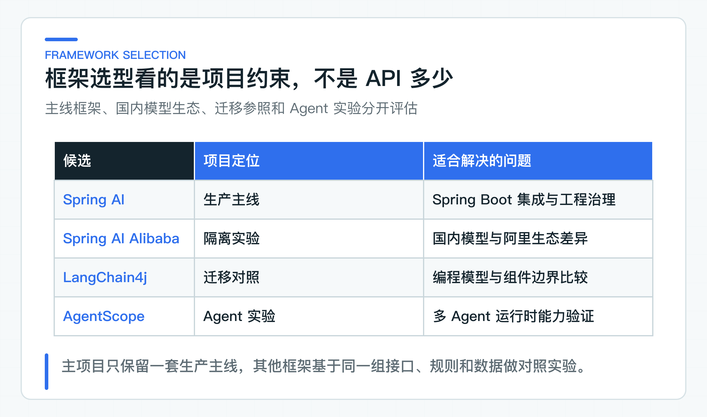

# Spring AI 为什么做主线，其他框架放在哪里

目标团队的主系统已经运行在 Spring Boot 上，所以主项目选择 Spring AI。依赖管理、Security、WebFlux、Micrometer 和测试方式都能沿用，团队不必为了接模型再建立一套陌生的工程体系。这是基于现有技术栈的选择，不是框架排行榜。

Spring AI Alibaba、LangChain4j 和 AgentScope 放在独立实验模块里，每个模块只验证与它相关的一段业务边界。需要作出正式选型时，再让候选实现对齐同一接口、模型、数据集和断言。这样比较的才是改造范围、运行结果和维护成本，而不是谁的示例代码更短。

## 先确认现有系统和版本基线

框架选型常见的错误，是先列一张功能表。表里放上对话（Chat）、检索增强生成（RAG）、工具调用（Tool）、会话记忆（Memory）和模型上下文协议（MCP）。谁支持得多，谁就胜出。

公司落地还要看另一半成本：版本是否能进入现有 Spring Boot 基线，异常能否映射成业务错误，指标能否接入现有观测平台，安全上下文能否贯穿异步链路，升级后谁负责回归，退出时业务代码要改多少。

对于已经采用 Spring Boot 的团队，Spring AI 的优势主要在工程融合。它让模型能力留在熟悉的 Bean、配置和可观测体系中。`ChatClient` 是 Spring AI 的模型调用客户端，但业务层不应因此直接依赖它。

框架选型至少要回答五个问题：

1. 它是否兼容当前的 Spring Boot、JDK 和依赖版本基线。
2. 模型、向量库、Tool 和观测能力能否保留业务需要的元数据。
3. 异常、超时和取消能否映射成项目现有的错误与恢复语义。
4. 框架升级后，团队能否使用固定数据集做回归。
5. 两年后替换框架时，需要重写多少业务代码。

这些问题比“一行代码实现 RAG”更重要。示例代码短，往往只说明默认值多，不说明默认值是否符合公司的身份、数据、服务目标（SLO）和运维要求。框架真正的成本，往往在接入第二个模型供应商（Provider）、第一次超时、第一次升级和第一次数据越权排查时才出现。



### 新服务为什么采用 Spring AI 2.0

项目基线是 Java 21、Spring Boot 4.1.0 和 Spring AI 2.0.0。[Spring AI 2.0.0](https://spring.io/blog/2026/06/12/spring-ai-2-0-0-GA-available-now/) 已正式发布，面向 Spring Boot 4.0、4.1 和 Spring Framework 7。新的 Boot 4 服务因此直接采用 2.0，不再先引入 Spring AI 1.1 的旧 API。

Spring AI 2.0 的 `ChatClient` 通过 `ToolCallingAdvisor` 处理 Tool 调用循环，也允许应用关闭自动执行并自行控制循环。不过，项目没有把写操作注册成可由框架自动执行的 Tool。工单模型只返回结构化 Tool 意图，应用继续完成参数校验、风险判断、人工确认、幂等控制和审计记录。这样更换模型 Provider 时，写操作规则不会跟着改变。

这项选择只适用于新的 Boot 4 服务。运行在 Spring Boot 3.5 上的存量系统可以继续使用 Spring AI 1.1，也可以通过 OpenAPI 和 JWT 调用独立的 Boot 4 AI 服务。是否升级旧系统，应根据依赖、序列化和回归成本决定，而不是只看框架版本。

## 用业务端口隔离框架差异

主线应用层定义的是 `KnowledgeAnswerModel`，表达“根据当前身份有权访问的知识生成回答”。Spring AI 适配器负责把项目请求转成框架消息、调用参数和结构化输出，再把 Provider 元数据映射回项目类型。

```java
public interface KnowledgeAnswerModel {
    Mono<ModelAnswerDraft> answer(GroundedPrompt prompt);
}
```

这层端口看似多写了一个接口，却保留了三个重要边界：业务代码不知道 Provider 协议，单元测试不需要真实模型，迁移框架时不用改 Controller 和应用服务。

这里需要避免另一个极端：为了“解耦”定义一套和任何业务都无关的通用模型抽象。如果端口只剩 `String generate(String prompt)`，它虽然不依赖 Spring AI，但同时也丢掉了引用、拒答、Token、结束原因和流式取消等必要语义。好的端口应该稳定，但不应该空洞。

因此项目按用例定义端口。知识回答端口接受分区后的用户输入和授权知识上下文，返回带引用和模型元数据的草稿。工单规划端口返回受控步骤和 Tool 意图。它们都可以由 Spring AI 实现，却不需要伪装成同一种业务。

对应取舍记录在 [Spring AI 主线架构决策记录（ADR）](https://github.com/DavidDingXu/learn-java-ai/blob/main/docs/adr/0001-spring-ai-mainline.md)。

### 通用模型网关只处理平台能力

模型调用表面上都是“输入字符串，返回字符串”，业务接口却不只是文本进出。

知识回答需要引用和拒答；RAG 还要携带检索证据；流式接口有取消与心跳；Tool Calling 涉及参数和副作用；Agent 需要状态、步骤和人工确认。把它们压成一个全局 `generate()` 方法，会丢掉最重要的业务语义。

项目只在具体业务用例中配置模型调用。知识回答端口可以有自己的超时和并发限制，也可以只对没有业务副作用、且错误明确可重试的调用重试；写操作 Tool 必须使用另一套策略。这样配置更分散，但责任清楚。

这不意味着公司不需要统一模型接入平台。大型团队往往需要统一处理 Provider 凭证、配额、模型路由、费用和审计。平台负责这些公共接入与运维能力，不应替代业务应用里的知识回答、工具执行等业务接口。平台可以将请求路由到不同模型，却不应决定知识回答什么时候必须有引用，也不应决定写 Tool 是否需要人工确认。

应用与平台之间的边界应保持窄且稳定。应用向平台传递模型请求和可观测上下文，平台返回完整的模型响应、用量和 Provider 错误。应用再根据知识回答、RAG、Tool 或 Agent 的实际语义做校验和恢复。把这两层混在一起，模型网关会停留在概念层，后续业务链路也找不到可复用的调用边界。

## 用隔离实验比较其他框架

Spring AI Alibaba 实验覆盖 DashScope 真实调用、在线 Embedding 与 Rerank，以及 Graph 确认路由。它进入独立的 Maven 聚合构建，避免 Boot 3.5、Spring AI 1.1 这一组依赖影响主项目。

LangChain4j 实验覆盖 AI Services、带访问范围的 RAG 和只读 Tool，每条路径都有可直接运行的入口。它展示的是同一业务能力如何落在另一套框架上，不代表整条主系统已经迁移。

AgentScope 实验先使用 `Toolkit` 查找 Tool，再把身份和权限上下文交给 `PermissionEngine` 做裁决；随后让两个真实模型专员并行取证，由汇总 Agent 生成结论。任一必要专员失败时，协调器会返回 `HUMAN_REQUIRED`。MCP 注册和 Agent 间任务协议（Agent-to-Agent，A2A）仍只覆盖各自的协议边界，写 Tool 也不会绕过权限与人工确认。

这三类框架不是主线的必选依赖。它们用于回答一个实际问题：在公司已有技术约束下，什么时候值得迁移，什么时候继续保留现有实现。

形成正式选型结论前必须固定变量。同一个问题、同一份知识、同一个模型和同一组断言下，只替换框架适配器，才能看出结构化输出、异常语义、调用链（Trace）接入和代码边界的差异。如果换框架时连 Prompt、模型和数据集一起换，得到的只是两个无法比较的 Demo。

实验模块不进入生产主工程的 Maven 聚合构建，避免候选框架的依赖影响主项目。当前三个实验覆盖的能力片段不同，因此只能说明局部适配方式，不能直接排出框架高低。正式比较业务效果时，要固定 HTTP 入口、数据集、模型和报告格式，再让候选实现覆盖同一用例。

### 哪些信号值得重新评估主线

满足下面任一条件时，换框架或直接使用 Provider SDK 都是合理选择：

- 公司已经有统一 AI 平台，身份、配额、路由、审计和服务等级协议（SLA）都由平台接口统一规定；
- 业务需要的 Provider 能力无法通过 Spring AI 或窄适配器保留；
- 另一框架实现同一业务接口、运行同一数据集后，表现出可重复的质量或维护成本优势；
- 当前 Spring Boot 与 Spring AI 版本组合无法满足安全和长期维护要求。

“API 更顺手”不足以支撑生产迁移。迁移至少要重新检查依赖树、错误映射、调用链、固定评测样例集（Golden Set）和回滚路径。

还有一种常被忽略的选择：不使用综合框架，只针对某个供应商写一个窄 Provider 适配器。如果业务只需要很少的模型能力，而供应商的特有协议又对效果至关重要，这个方案可能比引入完整框架更稳。代价是团队要自己承担请求映射、超时、可观测和升级兼容。选型应比较总成本，而不是对框架名称表态。

## 让组件和依赖跟着业务能力进入

Spring AI 是主线框架，不代表 PostgreSQL、pgvector、对象存储、OpenTelemetry 和数据库迁移工具要在第一天全部进入项目。每个组件都等到业务问题真正需要时再加入。

例如固定政策文件问答不需要先上 PostgreSQL。文档生命周期和增量索引出现后，数据库才有明确职责；需要持久化向量检索后，pgvector 才值得进入。组件跟着业务能力进入，比一开始罗列“企业级全家桶”更接近公司项目。

当前主项目中，Spring AI 只进入 Knowledge 和 Ticket 的模型适配器，pgvector 只进入 Knowledge 的检索代码。三套候选框架位于独立实验项目，不加入业务服务的 Maven 构建，从而避免不同版本组合发生依赖冲突。

## 把选型结果变成可复现决策

如果公司已经使用 LangChain4j，不需要因为这里以 Spring AI 为主线就立即迁移。先把现有实现放到业务端口背后，再补齐固定数据集、错误映射、调用链和依赖树记录。当前框架能满足这些条件，继续使用通常比为了技术统一而重写更合理。

如果公司还没有主线框架，可以从一个有明确输入、输出和坏案例的用例开始小范围对比。不要先建一个面向全公司的框架封装层，再去寻找业务使用方。没有明确用例时，团队无法知道哪些元数据必须保留，也无法定义正确的超时、重试和安全策略。

框架选型的最终产物不应只是一页 PPT，而应包含一个可运行用例、一组固定断言、一份依赖树和测试报告，以及一条可回退的迁移路径。这些材料齐全后，“选哪个框架”才从偏好问题变成工程决策。

公司里做完选型后，还应把决策条件写进 ADR：当时的 Spring Boot 基线、目标 Provider、数据集、主要风险和重新评估触发条件。没有这份记录，一年后团队只会记得“当时选了 Spring AI”，却不知道当初的约束是否仍然存在。

### 提前验证依赖和退出成本

依赖版本管理也是退出成本的一部分。AI 框架通常会带入 HTTP 客户端、观测、序列化和响应式依赖。引入前要在 IDEA 的 Maven 依赖视图中检查与 Spring Boot 依赖清单（BOM）的组合，升级时查看 Netty、Jackson 或观测组件是否被连带替换。一个框架 API 很好用，却迫使整个公司应用升级关键基础库，总成本可能并不划算。

可以在对照实验中检查框架是否容易替换：保持 HTTP 接口、业务端口和固定评测集不变，只用另一套框架实现适配器。目的不是立即迁移，而是检查框架类型有没有泄漏到业务代码。如果对照实现必须修改业务 DTO 和 Controller，当前分层就没有隔离好框架差异。

框架分层确定后，项目用 Spring AI 跑通第一条真实模型调用，同时检查业务端口之外是否还残留 `ChatClient`、`ChatResponse` 等框架类型。

---

[课程首页](../../README.md) · [完整目录](README.md) · [← 从一次客户咨询看系统分工：知识服务、工单 Agent 与 JDK8 老系统](02-system-context.md) · [先跑通第一条真实调用：从 ChatClient 到可维护的垂直链路 →](04-first-model-call.md)

动手实践：[本阶段可运行源码](../../learning-stages/stage-01-system-boundaries/README.md)
