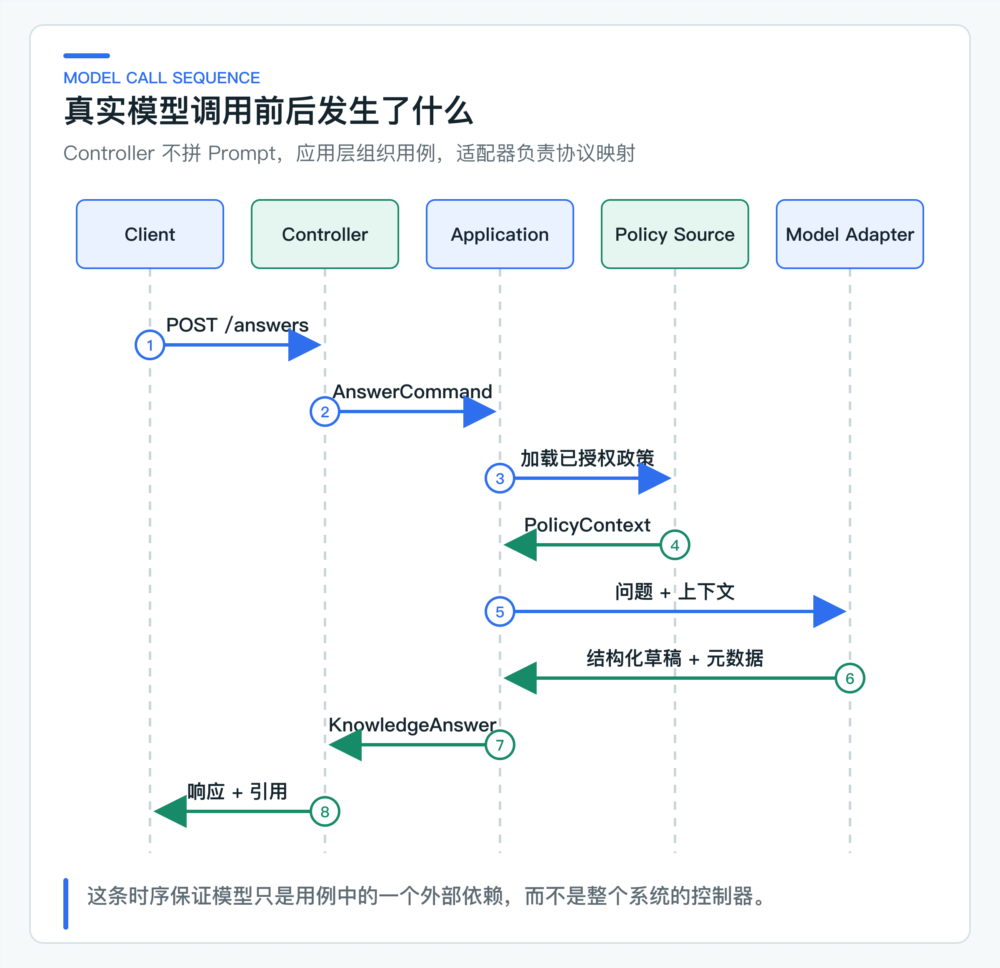

# 先跑通第一条真实调用：从 ChatClient 到可维护的垂直链路

Controller 里调用一次 `ChatClient`，十几行代码就能看到模型回答。麻烦从第二步开始：政策从哪里加载，模型返回的引用是否存在，超时发生在哪一段，框架对象能不能直接暴露给前端。

项目把第一次调用拆成一条短链路。Controller 只接收问题，应用服务加载服务端政策，Spring AI 适配器负责模型协议。对外响应保留引用、模型名、Token 用量、结束原因和 Trace ID。本地运行的模型参数集中在项目级 YAML 中，业务代码不读取密钥。

## 先把业务响应定下来

业务需要的不是一段裸文本。知识回答至少包含这些信息：

```json
{
  "answer": "退款审核通过后，一般需要 1 到 5 个工作日到账……",
  "citations": [
    {
      "documentId": "refund-policy",
      "version": "v1",
      "sectionId": "arrival-time",
      "title": "退款到账时效"
    }
  ],
  "refused": false,
  "model": "provider-model",
  "usage": {
    "promptTokens": 1023,
    "completionTokens": 95,
    "totalTokens": 1118
  },
  "finishReason": "stop",
  "traceId": "..."
}
```

引用让客户端能展示依据；`refused` 区分回答和拒答；模型名与 Token 用量用于成本和回归分析；Trace ID 是一次分布式调用的追踪标识，用于关联服务日志。第一版响应就保留这些字段，后面接入 RAG、评测和观测时不必重新设计接口。

这层接口还要隔离框架类型。`ChatResponse` 适合框架内部传递，不适合直接作为 HTTP 响应。它包含框架元数据和 Provider 差异，版本升级时字段结构也可能变化。一旦前端、工单服务或评测工具依赖它，框架升级就会迫使所有调用方一起修改接口。

业务响应只保留调用方需要的字段。例如引用用项目自有的 `documentId + version + sectionId` 表达，而不暴露向量库返回类型。`finishReason` 映射成小写字符串，未知值也只做大小写归一，不在适配器里猜测业务含义。这样替换模型或框架时，调用方接口不用跟着改变。

## 把模型当作不稳定的外部依赖

模型调用在工程上更接近支付、地图或第三方风控服务，不是一个稳定的本地函数。请求可能超时，Provider 可能限流，响应可能缺字段，模型还可能在格式正确的情况下返回错误事实。因此它需要端口、超时、错误映射、观测和回归评测。

与普通 HTTP 依赖相比，模型还多一层不确定性：协议成功不等于业务结果可信。HTTP 200 只能说明 Provider 接受并处理了请求，后面还要检查输出是否完整、引用是否存在、拒答是否符合规则。这也是应用服务和模型适配器需要分层的原因。

超时和限流之外，第一条调用还要控制 Token 预算。模型限制和计费依据 Token，不是 Java 字符数。系统规则、政策上下文、用户问题和输出格式都会占用上下文窗口，因此不能只按问题长度估算输入。

输入不能挤满整个窗口，还要为回答预留输出空间。`temperature` 只能调整生成的随机性，不能替代经过权限过滤的知识、引用和业务校验。

预算还要同时考虑并发和限流。单次请求没有超过上下文窗口，不代表服务一定可用；高峰期的请求 Token、输出 Token 和并发数可能分别触发 Provider 配额。第一条链路就应记录输入、输出和总 Token，后续才能按租户、场景和模型建立成本基线。

## Controller 与模型适配器的分工

[KnowledgeAnswerController](https://github.com/DavidDingXu/learn-java-ai/blob/main/learning-stages/stage-02-model-engineering/services/knowledge-service/src/main/java/com/xiaoding/javaai/knowledge/answer/web/KnowledgeAnswerController.java) 只做请求校验、命令转换和响应映射。它不加载文档，不拼 Prompt，也不知道 Spring AI。

```java
@PostMapping(consumes = MediaType.APPLICATION_JSON_VALUE,
             produces = MediaType.APPLICATION_JSON_VALUE)
Mono<KnowledgeAnswerResponse> answer(
        @Valid @RequestBody KnowledgeAnswerRequest request,
        Authentication authentication
) {
    return useCase.answer(command(request, authentication))
            .map(KnowledgeAnswerResponse::from);
}
```

代码只截取当前 Controller 的同步入口。`command(request, authentication)` 会先通过 `KnowledgeAccessScopeProvider` 得到受信的租户、用户和部门范围。它再将这些范围与会话上下文、生效时间一起转换成应用命令。

默认配置使用固定身份适配器，生产环境可以换成 JWT、Session、网关身份或公司权限服务。内置的 classpath 政策文件会向所有固定身份返回同一段内容，只建立接口边界，不能证明租户隔离；接入真实检索后，访问范围才会进入查询条件。

上下文加载和模型调用分别记录 Micrometer Observation，也就是一次可观测操作的计时和上下文记录。这样可以区分数据源耗时与 Provider 耗时。



这条时序里，Controller 只看到 `AnswerKnowledgeQuestionCommand`，应用服务只依赖两个业务端口。政策内容由服务端数据源加载，用户输入与政策上下文分区传递。Spring AI 的 Message、Options 和响应元数据都由适配器转换。

这样拆分还能精确设定超时和 Observation。上下文加载慢时应查数据源，模型调用慢时应查 Provider、输入 Token 和并发配额。如果整条链只有一个 `answer` 耗时，上线后只能看到“接口慢”，却无法决定下一步排查哪个依赖。

链路另一端的 [SpringAiKnowledgeAnswerModel](https://github.com/DavidDingXu/learn-java-ai/blob/main/learning-stages/stage-02-model-engineering/services/knowledge-service/src/main/java/com/xiaoding/javaai/knowledge/answer/infrastructure/SpringAiKnowledgeAnswerModel.java) 组装系统规则和用户消息，使用结构化输出 Converter 生成格式说明并解析结果，再把回答与模型元数据映射成项目自有类型。Converter 只解决格式提示和解析，引用是否有效仍由业务校验完成。

Provider SDK 或 Spring AI 类型没有越过基础设施包。业务层测试可以传入一个假的 `KnowledgeAnswerModel`，不需要联网，也不会消耗 Token。

## 用真实 API 检查模型调用链

第一条垂直链路必须访问真实模型。先复制项目根目录的 `config/application-default.example.yml`，并命名为被 Git 忽略的 `config/application-default.yml`。再填写统一的 API Key、Base URL 和模型名：

```yaml
spring:
  ai:
    openai:
      api-key: replace-with-your-api-key
      base-url: https://api.openai.com/v1
      max-retries: 0
      chat:
        model: gpt-4.1-mini
```

`max-retries: 0` 关闭 OpenAI SDK 自带的 HTTP 重试，避免它与应用层重试叠加。使用 OpenAI 兼容服务时，只在这一个本地文件修改 `api-key`、`base-url` 和模型名。

仓库中的 Key 是不可用占位值。填入真实值后不能提交，也不能分享到聊天、截图或构建产物中。生产环境必须使用 Secret Manager、Vault 或部署平台 Secret 覆盖 `spring.ai.openai.api-key`。

在 IDE 中打开 [KnowledgeServiceApplication](https://github.com/DavidDingXu/learn-java-ai/blob/main/learning-stages/stage-02-model-engineering/services/knowledge-service/src/main/java/com/xiaoding/javaai/knowledge/KnowledgeServiceApplication.java)，直接运行它的 `main` 方法。该应用会从项目根目录或模块目录加载同一份模型配置，默认监听 8081。日志显示应用启动后，先打开 `http://localhost:8081/actuator/health` 确认进程存活，再用 IDE 的 HTTP Client 发起真实问答：

```http
POST http://localhost:8081/api/v1/knowledge/answers
Content-Type: application/json

{
  "question": "退款审核通过后多久到账？"
}
```

这次操作启动的是完整 Knowledge Service，不是一个单测或单独的冒烟类。请求到达 Controller 后，会经过受信身份映射、固定政策上下文、Spring AI 模型适配器、结构化输出解析和引用校验。响应中应同时出现回答、引用、模型名、Token 用量和结束原因；缺任何一类字段，都不能只看 HTTP 200 就认为链路正常。

默认启动不连接 PostgreSQL、JWT 鉴权、向量索引和文档导入链路，避免数据库或身份配置错误掩盖第一次模型接入问题。完整 RAG 联调在后续章节切换到 `postgres-rag`；公司鉴权也应在目标环境替换固定身份适配器。

## 一次成功回答还不够

以退款到账问题为例，响应除了回答正文，还应带回政策引用、模型名、Token 用量和结束原因。HTTP 200 只代表模型供应商完成了协议处理；引用缺失、输出截断或结束原因异常，仍属于业务失败。

当前 HTTP 层已经区分模型未配置、调用超时、断路器打开、并发已满和模型输出不合格。Provider 异常也会归一成稳定错误。限流返回 `MODEL_RATE_LIMITED`，持续不可用返回 `MODEL_PROVIDER_UNAVAILABLE`，请求被拒绝返回 `MODEL_PROVIDER_REQUEST_REJECTED`。这些错误码由项目维护，不会把 Provider 的异常类名或原始消息透传给调用方。

这类冒烟检查只覆盖模型调用、结构化映射和引用回传，不代表多租户身份、向量检索、SSE 或容量已经可用。为了比较不同时间的结果，运行记录至少保留模型、Prompt 版本、代码版本和关键参数。

真实调用和日常回归需要分开。真实模型受网络、限流、模型升级和生成随机性影响，不应进入每次本地构建。否则一次 Provider 抖动就能让与本次改动无关的构建失败，密钥也会被带进更多开发环境。真实冒烟适合在首次接入、模型切换、适配器升级和发布前显式执行。

日常回归则用固定返回结果的 `KnowledgeAnswerModel` 假实现覆盖拒答、无引用、结构错误和异常映射。这个假实现不模拟模型质量，只负责让每条业务分支都能稳定重现。两类检查的问题不同：一类问“真实接口能否正确交互”，另一类问“业务规则是否会回归”。

失败分支也要返回可区分的结果。没有配置模型时，当前实现返回 `MODEL_NOT_CONFIGURED`。Provider 响应缺少结果、结构化内容无法解析或引用不合格时，返回 `MODEL_OUTPUT_INVALID`。超时、断路器打开和并发已满也分别映射成稳定错误。

现在看起来错误类型不少，但它们会直接决定调用方能否区分“稍后重试”“修改请求”“转人工”和“系统配置错误”。统一返回一句“AI 服务异常”，会把所有恢复责任推给前端和客服。

迁移到公司项目时，可以复用 Controller 的职责划分、业务端口和响应字段设计。固定政策文件、密钥管理、超时与模型参数需要按公司环境替换。

模型调用进入 HTTP 链路后，首先要补的是经过验证的身份。租户、用户和权限不能由请求体声明，必须来自验签后的安全上下文。

---

[课程首页](../../README.md) · [完整目录](README.md) · [← Spring AI 为什么做主线，其他框架放在哪里](03-framework-selection.md) · [多租户、身份和权限为什么不能相信请求参数 →](05-delegated-identity.md)

动手实践：[本阶段可运行源码](../../learning-stages/stage-02-model-engineering/README.md)
