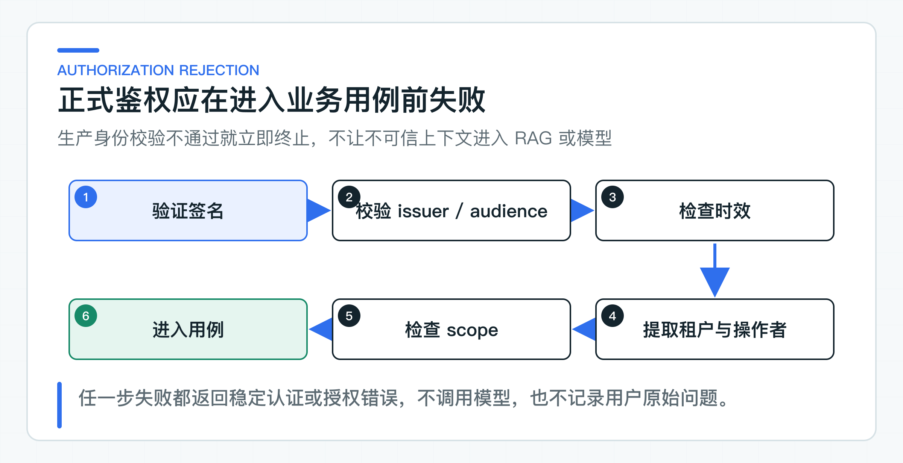

# 多租户、身份和权限为什么不能相信请求参数

假设知识问答接口允许请求体传入 `tenantId` 和 `userId`。本地联调会很顺畅，调用方也容易构造请求，但任何人都可以把这两个值改成另一个租户。接口有鉴权注解，数据仍可能越权。

因此，请求体只保留问题和会话信息。租户、用户和部门范围必须由服务端身份组件提供，再作为不可变的 `KnowledgeAccessScope` 进入检索。这个身份组件可以对接公司已有的登录态、网关或 JWT，但不能相信调用方临时传来的身份字段。

## 认证与授权分两步完成

认证回答“调用者是谁，这份凭证是否值得信任”。授权回答“这个身份能否在当前租户、当前资源和当前时间执行某个操作”。签名正确只能完成前者的一部分，不能直接得出“可以查询所有知识”。

多租户系统还需要区分主体和操作者。客户可能是业务主体，Customer BFF 是中间调用方，客服人员也可能在受授权情况下代替客户发起请求。如果令牌只有一个 `userId`，审计时就很难说清“数据属于谁”和“这次操作由谁发起”。

### 请求参数只能表达业务意图

假设接口长这样：

```json
{
  "tenantId": "tenant-b",
  "userId": "user-1002",
  "question": "查询退款政策"
}
```

如果服务直接用 `tenantId` 过滤知识，攻击者只要改一个字段，就可能读取其他租户的数据。即便前端不会这样做，也不能把前端行为当作安全边界；接口可能被脚本、内部服务或错误配置直接调用。

请求头里的 `X-Tenant-Id` 和 `X-User-Id` 也有同样问题。除非它们由受信网关签名并在服务端重新验证，否则只是另一种可伪造输入。

## 默认固定身份不依赖身份平台

Knowledge Service 默认使用固定身份。运行 RAG 不依赖身份提供方，也无需生成 Token 或配置 issuer 和密钥。只有将 `java-ai.security.mode` 切换为 `jwt` 时，才需要补齐公司身份系统的验签参数。

Knowledge Service 默认注册 [FixedKnowledgeAccessScopeProvider](https://github.com/DavidDingXu/learn-java-ai/blob/main/learning-stages/stage-02-model-engineering/services/knowledge-service/src/main/java/com/xiaoding/javaai/knowledge/security/FixedKnowledgeAccessScopeProvider.java)。它固定返回 `tenant-a`、`local-user` 和 `support` 部门，不读取请求头或请求体，也不需要生成 Token。

Controller 依赖的是 `KnowledgeAccessScopeProvider`，而不是 JWT 字段。将 `java-ai.security.mode` 改为 `jwt` 后，同一接口切换到 `JwtKnowledgeAccessScopeProvider`。迁移到公司项目时，也可以换成网关身份、Session 或内部权限服务适配器。RAG 应用层只接收已经建立好的访问范围。

固定身份适合本地联调，不能直接用于正式部署。它不验证真实用户，也无法表达撤权、角色变化或服务间委托关系。完整 RAG 联调可以继续使用固定身份；接入公司环境时，再将身份适配器替换为真实鉴权系统。

## 生产环境把公司身份映射成访问范围

项目同时提供 JWT（JSON Web Token）身份适配器。Knowledge Service 验证签名、签发方、受众、有效期和权限，再把 `tenantId`、`sub` 与 `departmentIds` 映射成 `KnowledgeAccessScope`。公司接入时应保留这一适配边界，Claim 名称则按现有身份系统映射。

跨服务调用还要区分业务主体和调用服务。用户令牌若只面向 Customer BFF，就不应原样转发给所有下游。公司已经有 Token Exchange、网关签名或内部服务身份时，直接接入现有方案。没有现成机制时，本地固定身份仅用于联调；正式环境仍需选择可验证、可撤销的短期委托机制。

下游不能因为令牌来自内网就放弃验证。内网路由、反向代理头和服务名称都不是密码学身份证据。每个资源服务仍然要验证签名、issuer、audience、时效和必需声明，再建立自己的 `SecurityContext`。

Knowledge Service 的 [DelegatedJwtConfiguration](https://github.com/DavidDingXu/learn-java-ai/blob/main/learning-stages/stage-02-model-engineering/services/knowledge-service/src/main/java/com/xiaoding/javaai/knowledge/security/DelegatedJwtConfiguration.java) 负责验签和声明校验，`SecurityConfiguration` 再检查接口所需的 scope。两处合起来会检查：

- 签名、签发方和过期时间；
- `aud` 是否包含当前服务；
- `sub` 和 `tenantId` 是否存在；
- 委托操作者是否符合预期；
- 权限是否包含 `knowledge:answer`。

令牌通过验签但缺少 scope 时返回 403；令牌缺失、签名错误或受众不匹配时返回 401。身份校验在业务代码之前完成，Controller 不接触 Token，也不接收租户参数。



这个顺序很重要。如果先查向量库或调模型，再在返回前做权限判断，未授权请求已经消耗了资源，还可能通过耗时、命中数量或错误差异泄露信息。认证和粗粒度授权应尽可能在昂贵调用前完成。

## 多租户过滤进入查询条件

内置的 classpath 政策文件会向所有固定身份返回同一段内容，因此不能验证租户数据隔离。切换到真实检索适配器后，租户、用户和部门范围必须进入文档查询端口，并在 TopK 检索前形成强制过滤条件。

正确方向是：

```text
受信身份组件提供 tenant / subject / department
  -> AccessScope
  -> 文档元数据过滤
  -> 向量或关键词检索
  -> 只把有权访问的上下文交给模型
```

不能先做全库 TopK，再在 Java 中删除无权结果。这样既可能泄漏标题和分数，也会让无权文档挤占 TopK 名额，导致有权内容召回不足。

身份适配器先生成项目自有的 `KnowledgeAccessScope`，再将它作为检索端口的必填参数。检索适配器负责把租户、部门、文档状态和有效时间编译进 SQL 或向量库过滤表达式。这样业务层不依赖 JWT、Session 或网关字段，基础设施层也不能忘记权限条件。

## 失败分支比成功登录更重要

固定身份路径需要检查两个容易被忽略的行为：无 Token 请求可以进入业务用例，调用方伪造 `X-Tenant-Id` 或 `X-User-Id` 也不能改变固定身份。JWT 适配器另行覆盖无令牌、错误签名、错误受众、过期、缺少租户和权限不足等情况。

生产适配器的失败类别记录在 [JWT 边界案例](https://github.com/DavidDingXu/learn-java-ai/blob/main/learning-stages/stage-02-model-engineering/datasets/security/jwt-boundary-cases-v1.jsonl) 中。项目的 HTTP 安全测试会在 Controller 之前断言 401 或 403，并确保无权请求不会先调用向量库和模型。公司采用其他鉴权协议时，也应保留相同的失败测试，只替换凭证构造方式。

还要验证请求体夹带身份字段的情况。最稳妥的做法是请求 DTO 根本不定义 `tenantId`、`userId` 和角色字段，并在 JSON Schema 中禁止额外属性。存量接口若暂时不能删除这些字段，也只能忽略其授权含义、记录安全事件并安排迁移，绝不能让它们覆盖 `SecurityContext`。

## 身份凭证不承载完整权限模型

JWT、Session 或网关身份适合提供主体、租户和粗粒度权限。具体到某个部门、文档或工单的权限变化更快，也可能需要立即撤销。把全量 ACL 塞进凭证，会造成权限更新延迟，也容易让不同服务产生不同解释。

更常见的组合是：令牌提供受信主体和粗粒度范围，业务服务根据自己的访问控制列表（Access Control List，ACL）或策略数据做细粒度判断。这个过程仍然要在检索 TopK 之前完成。如果权限数据在独立策略中心，Knowledge Service 需要明确缓存、超时和策略中心不可用时的处理。对敏感知识，默认应是拒绝访问，不是在授权系统故障时放行。

如果公司使用 JWT，密钥轮换也是生产身份链的一部分。资源服务通过 JSON Web Key Set（JWKS）获取公钥时，需要处理缓存、`kid` 切换和身份服务短时不可用。采用 Session 或网关身份时，则要验证会话撤销、签名头防伪和网关绕过等对应风险。

### 授权结果也会过期

请求进入服务时通过授权，不代表整个长时间任务期间权限永远有效。例如 Agent 先生成一个写操作建议，几分钟后由客服确认，期间用户可能被移出租户、客服角色可能被撤销，工单也可能已关闭。执行 Tool 时必须重新校验当前身份、权限和业务状态。

这是典型的“检查时与使用时”时间差问题。只在 Agent 规划阶段做一次授权，再把结果保存成 `authorized=true`，会让过期权限在后续执行中继续生效。更稳妥的做法是确认单保留当时的主体、操作者和目标信息，Tool 执行器再根据当前已验证身份和业务状态判断一次。

对纯读取请求，一次请求内的短时权限缓存可以减少外部策略查询，但缓存键必须包含主体、租户、资源和动作，生命周期不应超过业务可接受的撤权延迟。对高风险写操作，通常应避免使用长时间授权缓存。

服务间身份也不能与用户委托身份混为一个字段。BFF 作为客户端应用需要证明自身，同时传递被委托用户。下游审计应能区分“哪个服务调用”、“代表哪个主体”和“由哪个人或渠道触发”。只保留 `sub` 会让这三种身份关系模糊。

## 落地时只替换身份适配器

应保留的是信任方向：客户端输入不产生身份，业务查询只使用受信身份组件给出的 `KnowledgeAccessScope`，权限过滤在检索和模型调用之前完成。

需要替换的是 `KnowledgeAccessScopeProvider` 的正式实现。它可以读取 Spring Security 中已经验证的 JWT，也可以调用公司统一权限服务。设备、渠道、组织或数据域等额外范围仍由服务端建立，不应塞回问题请求体。

迁移时先盘点现有系统的身份链，不要先把示例 JWT 搬进项目。需要确认入口服务已经提供什么可信身份，租户和组织权限由哪个系统记录，下游是否允许直接验证，哪些写操作需要再次查询当前权限。答案明确后，再实现一个对应适配器。

日志与审计也要分开。认证日志可记录 issuer、audience、结果和低基数失败原因，不记录完整令牌。业务审计记录主体、操作者、租户、资源和结果，用于回答“谁在什么时候看到或操作了什么”。两类记录的保留期、权限和脱敏要求通常也不同。

模型看到什么数据，仍然由原系统的身份与授权规则决定。一个实用检查是：删掉请求体中的身份字段后，服务能否只凭受信身份上下文完成授权。不能做到，说明调用方输入仍在影响权限判断。

权限系统不可用时，敏感知识和写操作应默认拒绝，不能为了可用性自动放行。服务还要返回稳定错误码和清晰的人工处理入口，让运维与客服能区分授权故障、凭证过期和模型不可用。

---

[课程首页](../../README.md) · [完整目录](README.md) · [← 先跑通第一条真实调用：从 ChatClient 到可维护的垂直链路](04-first-model-call.md) · [JDK8 老系统不升级：先划清现代 AI 服务与老系统边界 →](06-jdk8-boundary.md)

动手实践：[本阶段可运行源码](../../learning-stages/stage-02-model-engineering/README.md)
