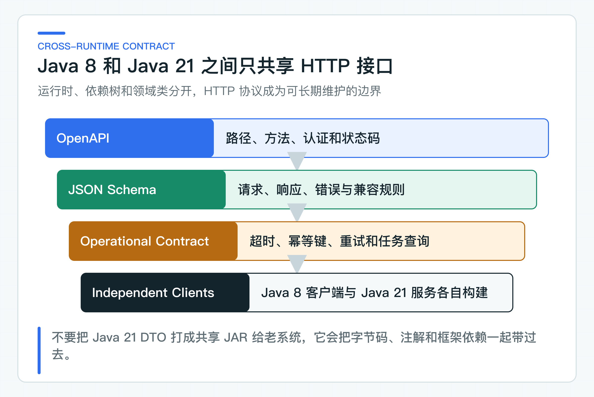

# JDK8 老系统不升级：先划清现代 AI 服务与老系统边界

JDK8 老系统也能使用 AI，不必先完成一次风险很高的整库升级。模型、RAG 和 Agent 编排放在独立的 Java 21 服务中，老系统继续通过熟悉的 HTTP 接口使用这些能力。

配套代码保留了一个真正用 JDK8 编译的客户端，专门检查 DTO、认证、超时和错误映射。现代服务可以持续演进，跨系统的 JSON 字段和错误语义则要照顾发布节奏最慢的老客户端。

## 独立 AI 服务更适合老系统

公司里的 JDK8 系统可能依赖旧版容器、内部中间件、商业组件或多年未升级的框架。升级影响的不只是语法，而是构建插件、字节码、TLS、反射、序列化和运行容器。

如果目标只是让客服系统使用 AI 建议，强行升级整套技术栈会把一个业务改造变成基础设施迁移。周期更长，回滚也更难。

把 AI 能力放进独立 Java 21 服务，可以让两边按自己的节奏演进。代价是必须提前定清 JSON 字段、状态码、超时、重试和版本兼容规则。

阶段 01 的 [KnowledgeServiceApplication](https://github.com/DavidDingXu/learn-java-ai/blob/main/learning-stages/stage-01-system-boundaries/services/knowledge-service/src/main/java/com/xiaoding/javaai/knowledge/KnowledgeServiceApplication.java) 是单独的 Java 21 进程入口。老系统只通过 HTTP 使用它，不会把 Spring AI 或 Java 21 字节码装进自己的 JVM。

在同一个 JVM 里，类型错误通常会在编译或测试时暴露。跨 HTTP 之后，两端只能看到 JSON、状态码和超时。字段被重命名、枚举新增了值、时间格式改变或错误响应缺字段，都可能到运行时才发现。老系统发布窗口少，一次不兼容变更可能要等几周才能修复。

因此，接口上的每个字段都要有明确语义。新增可选字段只有在旧客户端允许未知字段，或消费者兼容测试已经通过时才算安全；删除字段、改变字段类型或改变旧枚举的含义，则需要发布新版本接口。服务端应在兼容期内同时支持新旧版本，等全部老客户端升级后再移除旧路径。

### 先确定接入形态

JDK8 系统接入 AI 常见有三种形态。

| 形态 | 适用情况 | 主要问题 |
|---|---|---|
| 老系统直接调用模型 | 一次性内部试验，数据和权限要求很低 | Prompt、密钥、重试和模型差异会散落到老系统 |
| 独立 AI 服务 | 需要 RAG、Agent、评测、统一安全和持续演进 | 多了一次网络调用，必须管理接口兼容与故障隔离 |
| 离线任务或消息协作 | 处理时间长、允许异步、公司已有可靠消息平台 | 状态、重复投递、补偿和运维成本更高 |

主线采用第二种，核心依据是模型调用、知识检索和 Agent 编排的依赖升级速度明显快于老 CRM。把它们放在独立服务中，老系统不需要认识 Spring AI、ChatModel、Message、向量库或 Tool 注解，只消费稳定业务能力。

异步不是默认答案。如果一个查询能在用户可接受的时间内完成，同步 HTTP 更简单。只有处理时间确实超过网关预算，或者任务需要等待人工确认时，才值得改成提交任务后查询状态。公司已经有成熟消息平台，也不代表第一版必须增加消息链路。

## 老系统和 AI 服务各自保留业务责任

老系统继续拥有员工登录、岗位权限、订单和工单事实、最终业务写入以及原有降级流程。现代 AI 服务拥有模型适配、Prompt、RAG、Agent 状态、评测和模型侧观测。两边都可以校验请求，但不能同时成为同一业务状态的权威写入方。

| 能力 | JDK8 老系统 | 现代 AI 服务 |
|---|---|---|
| 员工会话与页面权限 | 负责 | 只接收经过验证的委托身份 |
| 订单、退款、CRM 工单 | 最终数据拥有方 | 通过受控 Tool 查询或提交命令 |
| Prompt、模型与 Token 预算 | 不持有 | 负责 |
| 知识检索与引用 | 展示结果 | 负责检索、权限过滤和引用校验 |
| 高风险动作 | 展示确认并保留员工决策 | 给出结构化建议，不能越过确认 |
| AI 不可用时的业务处理 | 保留人工流程 | 返回稳定失败，不伪造成功结果 |

这张表比“接口用 REST 还是 RPC”更重要。协议可以替换，数据所有权和最终决策权不能含糊。若 AI 服务直接修改老系统核心表，或者老系统开始自行拼 Prompt 调模型，边界很快会失效。

### HTTP 接口只暴露业务能力

老系统只需要“读取 Agent 任务”“查看待确认动作”“提交员工确认”这类业务 API。返回值包含任务状态、确认单、动作结果和稳定错误，不直接暴露 Provider 原始 JSON。

接口中不能出现 Spring AI 类型、Java 21 `record`、服务内部实体或数据库字段。JDK8 客户端拥有自己的 DTO，现代服务可以自由调整内部框架，只要网络接口仍兼容。这样才能做到一边升级模型或框架，另一边不跟着重新发布。

身份也不能从普通业务字段取得。`tenantId`、员工角色和部门范围应来自已经验证的令牌或公司认可的服务认证。请求体只表达业务输入。否则调用方修改一个 JSON 字段，就可能把 AI 查询或动作切到其他租户。

OpenAPI、Java 8 DTO、HTTP 客户端、Token、超时和错误映射都建立在同一条原则上：跨运行时接口表达稳定业务语义，任何一端的框架类型都不能成为双方共同依赖。

## 从用户流程设计故障隔离

AI 服务比普通 CRUD 更容易出现长延迟、限流、模型不可用和非确定输出。老系统不能把所有客服线程长期阻塞在一次模型请求上，也不能在 AI 失败时让原业务一起不可用。

先看用户流程允许什么。知识建议失败时，可以提示暂时不可用，让客服按原流程处理；高风险写动作失败时，只能停止并查询真实状态，不能绕过确认或把失败当成功。同步等待超过页面预算的任务，应变成可查询状态，而不是继续放大读取超时。

服务之间还要避免共同故障。AI 服务熔断时，CRM 的订单查询和人工处理仍应可用；CRM 回滚时，AI 服务不能要求同时回滚。若两边必须同日发布、同日回退，说明接口仍然泄露了内部实现或缺少兼容窗口。

连接池、具体超时值和读写重试规则属于 Java 8 客户端实现。确定这些参数前，架构边界要先给出总等待预算、可降级路径、长任务形态和结果未知时的人工处理入口。

## 写动作进入可追踪的业务链路

查询建议和执行动作不是同一风险。AI 服务可以读取授权信息并生成候选动作，但真正修改订单、退款或工单时，仍要经过业务系统权限、状态校验和人工确认。

网络超时也不能简单解释为“没有执行”。写请求可能已经到达老系统，只是响应丢失。重复提交会产生第二次副作用，所以写接口从第一版起就要使用稳定幂等键。幂等记录应位于真正拥有写操作的一侧，不能只在页面或单个客户端进程里记一次。

结果未知必须成为一个明确状态，但这不要求第一版就引入复杂工作流。当前 JDK8 客户端在确认请求超时后抛出 `ConfirmationOutcomeUnknownException`，保留原幂等键，而且不会自动重试。调用方可以读取任务状态，或用原键重试同一确认请求；当前接口没有提供“只凭幂等键查询动作”的端点。公司需要独立对账时，应显式补充查询接口，不能重新生成一把键再次执行。

## 老系统接入的安全与兼容边界

### 模型凭证和业务数据不进入老系统

把 AI 服务拆出去后，模型密钥、知识库凭证和 Tool 访问令牌不进入老系统配置。这样可以缩小密钥分发范围，也便于统一轮换和审计。老系统只持有调用业务 API 所需的受控凭证。

发送给 AI 服务的数据仍要最小化。不要因为接口在内网，就把完整订单、证件号、聊天记录和内部备注全部拼进请求。现代服务应按用例只接收必要字段，并在进入 Prompt、日志、Trace 和评测集前分别做数据分类与脱敏。

服务端必须再次校验身份和权限。老系统页面已经判断员工可见，不代表下游可以跳过校验；页面、网关和服务资源端承担的是不同防线。对于服务间委托身份，还要同时区分调用服务和最终员工，不能用一个高权限服务账号替代所有终端用户。

### 最慢的客户端决定兼容窗口

现代服务可能每周发布，JDK8 应用可能几个月才有一次变更窗口。接口兼容期必须覆盖线上最旧客户端，而不是只覆盖服务端当前版本。删除字段、改变类型、收紧枚举或修改错误含义，都可能让旧客户端在运行时失败。

新增可选字段也不一定自动安全。旧客户端若启用了严格反序列化，新增字段同样可能失败。因此，公司项目要保存一组旧客户端兼容测试：让真实 JDK8 DTO 解析新响应，并验证未知错误能够进入保守分支。静态接口检查只能发现一部分问题。

当确实需要破坏性变化时，发布新版本路径或媒体类型，在迁移期内同时支持新旧接口；只有确认旧客户端已经退出，才能删除旧版本。不要让服务端内部重构变成跨团队紧急升级。

## JDK8 边界现在先固定什么

这个阶段先固定 HTTP/OpenAPI 边界，不提前展示后面才会出现的工单执行客户端。JDK8 老系统只需要知道稳定 URL、请求 DTO、错误码、幂等键和超时语义；它不引用服务端领域类，也不引入 Spring AI。

真正接入受控动作时，客户端库会放在独立的 JDK8 模块中，由老系统自己的启动入口调用。这里先把边界说清，是为了防止团队为了“代码复用”把 Java 21 字节码、框架对象或内部领域模型传进老系统。

`jdk8-client` 是由现有系统调用的客户端库，不是独立应用，因此不增加没有业务入口的启动类。接入受控 Agent 时，在 IDEA 中为这个独立模块选择 JDK8，再从老系统调用入口观察任务读取、确认提交和超时未知。字节码检查只能守住 Java 版本，目标环境里的 TLS、证书、HTTP 代理、DNS、服务发现和令牌获取仍要单独确认。

## 接口设计前要确认的七件事

1. 老系统继续拥有哪部分业务事实和最终写权限。
2. AI 服务提供的是同步查询、长任务还是受控写命令。
3. AI 不可用时，原业务是否仍能人工完成。
4. 身份如何从员工传到 AI 服务，哪些字段禁止由请求体提供。
5. 两边能否独立发布、独立回滚，并覆盖最旧客户端兼容期。
6. 结果未知时由谁查询真实状态，谁禁止自动重复执行。
7. 模型密钥、知识数据和日志中的敏感内容分别由谁管理。

这些问题有明确答案后，再把边界落实为 OpenAPI、Java 8 DTO、连接池、认证和错误分类。配套客户端已经实现任务读取、确认提交、超时未知和稳定错误映射；真正接入公司 CRM 时，仍要用现有网络栈、令牌来源和业务状态重新验证。接口语义先定下来，可以减少老系统反复跟随服务端修改。

---

[课程首页](../../README.md) · [完整目录](README.md) · [← 多租户、身份和权限为什么不能相信请求参数](05-delegated-identity.md) · [一次模型调用内部发生了什么：Message、Options、Token 与响应元数据 →](07-model-call-metadata.md)

动手实践：[本阶段可运行源码](../../learning-stages/stage-02-model-engineering/README.md)
