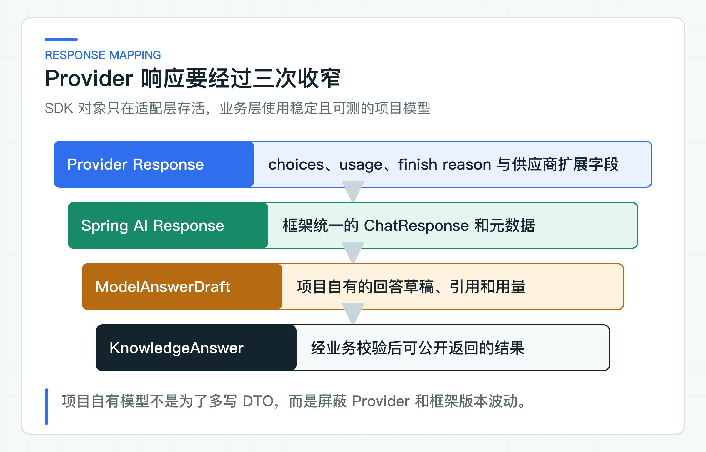

# 一次模型调用内部发生了什么：Message、Options、Token 与响应元数据

`ChatClient` 返回的正文最容易被看到，也最容易让人忽略其他信息。等到响应被截断、Token 突然增加或模型供应商（Provider）切换时，只有一段文本的业务日志几乎帮不上忙。

适配器会同时取出 Message、Options、模型名、Token 用量和结束原因，再映射成项目自己的响应类型。业务层不依赖 Spring AI 对象，却能用这些字段分析调用成本、识别异常，并比较前后两次模型结果。

## 先把消息角色和调用参数分开

### Message 角色会影响模型行为

System Message 表达稳定规则，例如只能依据当前授权政策回答、证据不足时拒答、不得声称执行了业务动作。User Message 承载当前问题、授权知识上下文和输出格式要求。

二者分开不是为了代码好看。Provider 会按角色处理消息；测试也能明确验证系统规则是否存在，以及用户输入是否用标签与系统规则分开。把全部内容拼成一个字符串，会让规则、数据和用户指令混在一起。

当前适配器的调用形态是：

```java
chatClient.prompt()
        .system(prompt.systemInstruction())
        .user(buildUserMessage(prompt, outputConverter.getFormat()))
        .call()
        .responseEntity(outputConverter);
```

角色分层还不够，每条 Message 中的内容来源也要可追溯。System Message 来自版本化资源，政策上下文来自经过授权的数据源，用户问题来自当前请求。三者虽然最终都会变成 Token，但它们在应用中的信任等级和审计责任完全不同。

对于多轮对话，历史 Assistant Message 也不能自动升级为事实。上一轮模型可能已经说错，本轮把它作为“可信背景”会让错误继续放大。需要保留对话时，对话历史和系统查询到的事实应明确分开。

### Options 由调用用例决定

模型名、temperature、最大输出长度和 Provider 扩展参数属于基础设施配置。业务用例可以提出“需要确定性回答”或“允许多少输出”的要求，但不应该散落具体 Provider 字段。

项目当前只开放已经有明确用途的运行参数。每增加一个可配置项，就增加一组兼容、默认值和回归责任。公司项目应从明确需求出发，例如合规回答要求低随机性，或成本预算需要限制输出 Token。

参数还需要区分业务级意图和 Provider 级实现。业务可以提出“回答应稳定”、“最多输出 800 字”或“允许调用某类 Tool”，适配器再把这些要求映射为 temperature、max tokens 和 Provider 具体开关。把 Provider 字段直接放进 Controller 请求，会让客户端绕过成本和安全策略。

配置变更也是模型行为变更。即使 Prompt 和代码没动，temperature、输出上限或 Provider 推理开关改变，固定评测集（Golden Set）的结果也可能变化。因此这些参数要进入版本记录，不能只存在运维人员的临时配置里。

## 只向业务层暴露需要的响应信息

[ModelAnswerDraft](https://github.com/DavidDingXu/learn-java-ai/blob/main/learning-stages/stage-02-model-engineering/services/knowledge-service/src/main/java/com/xiaoding/javaai/knowledge/answer/application/ModelAnswerDraft.java) 与 [ModelUsage](https://github.com/DavidDingXu/learn-java-ai/blob/main/learning-stages/stage-02-model-engineering/services/knowledge-service/src/main/java/com/xiaoding/javaai/knowledge/answer/application/ModelUsage.java) 是项目自己的应用类型。Spring AI 的 `ChatResponse`、`Usage` 和 Provider metadata 只在适配器中出现。

这样做带来两个直接收益。业务校验不依赖框架；替换 Provider 时只需要重新验证适配器的元数据映射。

模型返回的用量信息（usage）可能缺失。有些 OpenAI 兼容客户端会把“整个 usage 不存在”映射成 `0/0/0`，适配器必须重新识别这种情况。当前知识回答链路把全 0 视为元数据不可用并拒绝结果；usage 存在但个别分项缺失时，才将该分项记为 0。两种情况不能混为一谈。



映射时要完整保留模型名、Token 和结束原因（finish reason），因为它们会用于成本统计、故障定位和版本对比。Provider 内部的临时调试字段可以留在适配器日志，不需要向 Controller 暴露。

映射层也是处理版本差异的位置。不同 Provider 对缓存 Token、推理 Token、内容过滤和请求 ID 的表达不同。项目不需要为最小公分母丢掉所有扩展信息，但只有已经被业务、成本统计或审计使用的字段，才值得加入对外响应。

### 结束原因不能一律当作成功

`stop` 通常表示模型正常结束；长度限制、内容过滤、Tool 调用或未知原因需要不同处理。不能把所有结束状态都当作成功文本。

项目把结束原因规范为小写字符串，保留未知值，而不是定义一个看似完整但会随 Provider 扩展失效的枚举。业务层可以对已知风险值做判断，报告仍能记录新值。

`length` 或同类结束原因通常意味着输出被上限截断。对普通文本，它可能只是句子没写完；对 JSON，它往往直接变成无法解析。安全过滤则需要区分 Provider 拒绝、项目业务拒答和上游政策拦截，三者对用户提示和评测统计的含义不同。

未知 finish reason 不应被映射成 `stop`。它应保留原值，并根据当前场景采用保守处理。这样 Provider 增加新结束类型时，系统至少会留下可排查证据，不会把风险响应伪装成正常完成。

## 元数据映射错误怎样暴露

自动化测试要固定项目内部的元数据映射：模型名不能丢失，输入、输出和总 Token 要保持一致，未知 finish reason 不能伪装成 `stop`。当前协议夹具覆盖正常 `stop` 响应和 usage 整体缺失两条路径：

这项测试通过本地 OpenAI 兼容 HTTP 夹具检查模型名、三类 Token、结束原因和缺失 usage 的拒绝行为，不访问真实模型。未知 finish reason 的保留策略已经实现在适配器中；更换 Provider 时还应把目标 Provider 的未知值样本加入兼容测试。

模型首次接入、版本升级或更换 Provider 时，还要执行在线 API 调用，确认实际返回的模型名、usage、结束原因和内容审核状态能被当前适配器完整保留。结果应写入兼容性验证报告，不要把一次成功响应直接当作长期兼容结论。

自动化测试负责稳定回归，真实调用负责发现供应商行为差异。线上业务请求本身也应持续记录低敏元数据，出现异常时才能定位到具体模型和结束原因。

在线验证不能只看回答文本。还要核对流式与非流式返回是否使用同一模型名，usage 是否包含缓存或推理 Token，内容过滤时能否取得稳定结束原因，限流和超时是否保留 Provider request id。字段缺失时应明确记录 unknown，不能用零值伪装成供应商已经返回。

这些字段还要区分“每次请求记录”和“适合聚合为指标”。模型名、运行模式、结果类型和低基数 finish reason 可以用于指标维度。调用链 ID（Trace ID）用于定位单次请求，不应当作指标标签。问题正文和 Prompt 只能进入受控记录，不参与时序指标聚合。

对 Token 成本做分析时，应优先保留 Provider 返回的原始分类和总数。不同 Provider 对系统消息、缓存输入和推理过程的计费方式可能不同，业务代码不应自己用字符数反推“精确 Token”。估算值可以用于请求前的上限保护，需要和实际 usage 明确区分。

记录这些元数据时，还要控制日志范围。可以记录模型、Token、finish reason、延迟、执行模式和 Trace ID。问题正文、完整 Prompt、政策原文、密钥和用户身份不应成为普通日志或指标标签。

需要排查内容问题时，可以在受控审计存储中保存脱敏样本，并设置权限、保留周期和删除机制。直接把全部 Prompt 打进应用日志，开发阶段很方便，生产环境会迅速变成数据风险。

### Provider 字段按原始语义保留

很多 Provider 会返回自己的 request ID。它用于向供应商排查限流、超时、计费和内容过滤，与应用 Trace ID 不是一个东西。Trace ID 串联公司内部链路，Provider request ID 定位供应商内部请求。运行记录可以同时保留两者，但不应把 Provider ID 直接作为对外业务请求号。

usage 字段同样需要阅读当前 Provider 的具体语义。某些模型会分开输入、缓存输入、输出和推理 Token，某些兼容接口只返回三个总数字。项目可以定义统一的 prompt、completion 和 total，但不能在没有依据时将推理 Token 硬塞进 completion，否则成本分析会与供应商账单对不上。

当 usage 缺失时，用 0 作为对外数值会被误解为“这次调用没有成本”。当前链路因成本与审计要求选择拒绝；对不要求精确计费的场景，也可以返回可空值或单独的 `usageAvailable=false`，但不能把未采集到的数据写成真实零值。

元数据映射应使用真实响应样本做兼容测试。模型升级、Provider 切换或 Spring AI 升级后，先检查模型名、usage、finish reason 和 request ID 是否仍然能被保留，再看回答文本。文本正常却元数据丢失，会在成本结算和线上故障时才暴露。

### 更换 Provider 时检查哪些字段

项目自有结果模型、缺失值处理原则和适配器隔离可以复用。Provider 扩展字段需要按业务增加，例如缓存 Token、推理 Token、区域、请求 ID 或安全过滤结果。

不要把扩展字段全部塞进一个 `Map<String, Object>`。影响成本、错误处理或审计的字段应有明确类型，并配套兼容测试。

迁移到公司项目时，可以先抓取一份脱敏的真实 Provider 响应，根据当前版本的 Spring AI 类型跟踪映射过程。需要特别确认 usage 缺失、未知 finish reason、内容过滤和空 choices 的处理。这些边缘响应比正常 `stop` 结果更能检验适配器是否可靠。

如果公司通过统一 AI 平台调用模型，也应要求平台保留这些元数据。只返回一段文本的平台接口，会让下游应用无法做成本、截断和安全原因分析。

这些字段是后续评测能够比较模型与 Prompt 变化的基础。缺失它们，团队就只能对回答文本做主观判断。

---

[课程首页](../../README.md) · [完整目录](README.md) · [← JDK8 老系统不升级：先划清现代 AI 服务与老系统边界](06-jdk8-boundary.md) · [Prompt 的工程边界：模板、版本、授权知识与提示注入 →](08-prompt-boundaries.md)

动手实践：[本阶段可运行源码](../../learning-stages/stage-02-model-engineering/README.md)
