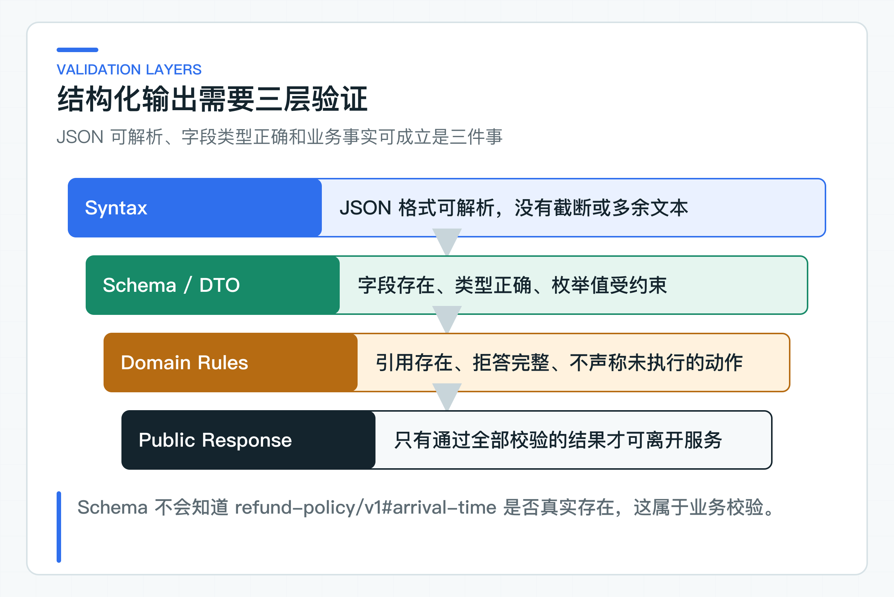

# 结构化输出为什么会失败：Schema、DTO 和业务校验

模型返回的 JSON 能被 Jackson 解析，很多实现就直接进入业务流程。这里最容易埋下假成功：引用 ID 不存在、金额越界，或者模型写了“工单已创建”，系统却从未调用创建接口。

项目把检查分成三层。Schema 限制字段形状，DTO 完成 Java 类型转换，业务校验再核对引用、拒答原因和动作权限。JSON 合法只是第一关。

## JSON 合法不代表业务正确

结构化输出很容易给开发者一种错觉：当 JSON 能反序列化为 Java 对象，数据就已经可以使用。实际上，它和用户提交的表单、外部系统回调或上传文件一样，都是进入业务系统的外部输入。类型匹配只是进入系统的第一道门。

模型生成的 `sectionId` 可以完全符合字符串格式，却指向一个并不存在的章节；`actionType` 可以是合法枚举，却不适用当前工单状态；金额可以是正数，却超过原订单可退金额。这些问题只有进入真实业务上下文才能判断。

因此，结构化输出的目标不是让模型直接生成可持久化实体。更稳妥的流程是先生成草稿，经过应用校验和必要的人工确认，再构造真正的业务命令。草稿和已执行事实在类型和存储上都应分开。

### Schema 只约束数据形状

Spring AI 的 `BeanOutputConverter` 会根据目标类型生成格式约束，并把模型响应转换成结构化对象：

```java
record StructuredKnowledgeAnswer(
        String answer,
        List<String> citedSectionIds,
        boolean refused,
        String refusalReason
) {}
```

这一层可以发现缺字段、类型不匹配和无法解析的 JSON。它不能判断 `citedSectionIds` 是否真的来自本次检索，也不知道“已经退款”是不是事实。

把 Converter 当成最终校验，是结构化输出最常见的误用。

## Provider DTO 与业务 DTO 分开

Provider 响应先转换成基础设施层的 `StructuredKnowledgeAnswer`，再映射成项目自有的 `ModelAnswerDraft`。应用层不依赖 Spring AI Converter 或 Provider JSON。

项目 DTO 同时携带模型、usage 和 finish reason。这样业务校验可以判断元数据是否缺失，Web 层也不需要认识框架类型。

字段设计应尽量具体。状态使用枚举或明确布尔字段，金额使用带单位的数值对象，引用使用稳定 ID。一个大而全的 `Map` 会把错误推迟到运行时，也让 JSON Schema 失去意义。

基础设施 DTO 应贴近模型输出形状，应用模型应贴近业务语义。前者允许使用可空字段接收模型的不完整输出，后者在构造时就应建立更强不变式。如果直接让 Converter 构造领域实体，无效数据就可能绕过工厂方法和业务校验。

两层映射还能清晰处理默认值。模型没有返回 `refusalReason`，不能在反序列化时默认填一句“无法回答”，这会掩盖 Prompt 或模型输出问题。应用映射层应看到缺失值，再由业务校验决定拒绝这次草稿。



## 业务校验拦住假成功

[KnowledgeAnswerValidator](https://github.com/DavidDingXu/learn-java-ai/blob/main/learning-stages/stage-02-model-engineering/services/knowledge-service/src/main/java/com/xiaoding/javaai/knowledge/answer/application/KnowledgeAnswerValidator.java) 当前执行这些检查：

- 回答不能为空，长度不能超过 1200 个字符；
- 模型元数据和 usage 对象必须存在；
- 每个引用都必须属于本次授权知识上下文；
- 非拒答回答至少有一个有效引用；
- 拒答必须提供原因；
- 未执行“退款”“创建工单”等动作时，回答不能声称已经完成。

关于业务动作的这条规则很重要。模型擅长生成符合语气的完整答复，也可能为了“帮到用户”而补出并未发生的业务动作。代码必须把事实边界锁住。

校验顺序应从成本低、确定性高的规则开始。先检查必填字段、长度和元数据，再检查引用是否属于当前上下文，仅在必要时访问业务存储或权限系统。这样可以尽早拒绝明显无效结果，也能让错误原因保持稳定。

多个错误同时存在时，对外不必返回全部内部细节。例如无效引用和未授权动作同时出现，公开接口可返回稳定的“模型结果不可接受”，详细失败项进入受控日志和评测报告。错误信息本身也可能泄露文档存在性和权限规则。

### 结构化结果不能直接触发 Tool

结构化输出可以表达一个行动建议，却不等于 Tool 已经被授权执行。模型生成 `actionType=CREATE_TICKET`，应用层还要检查当前问题是否允许升级、目标租户和客户是否一致、是否已有重复工单，然后才能构造创建命令。

对高风险写操作，结构化草稿最多进入确认单。确认单展示规范化参数、风险和当前业务状态，由有权限的人员确认后，Tool 执行器再次检查状态和幂等键。这条链路把“模型建议”与“业务事实已变更”明确分开。

## 错误输出先拒绝，再决定是否修复

当前代码没有自动发起 JSON 修复请求。解析失败、未知引用、缺少拒答原因或伪造业务动作都会直接进入稳定校验错误，不让草稿离开 Knowledge Service。

这个选择的代价是偶发格式错误不会在当前请求内自动恢复，好处是调用次数、延迟和失败语义都很清楚。未知引用、无权动作和状态冲突本来就不应交给模型“修正”，因为第二次生成也无法创造缺失的授权或业务事实。

如果已经进入流式响应，更不能在输出一半后静默重试，否则客户端会收到重复或互相矛盾的内容。

如果后续数据显示大量失败只是可修复的 JSON 截断，可以为“尚未输出任何客户内容”的同步请求设计一次受控修复。它必须共享原请求的总超时和 Token 预算，并且只修正格式。如果引用不存在，重试可能只是换一个假引用；如果模型声称已执行业务动作，系统应记录坏案例并拦截。

自动修复还会影响评测口径。如果第一次输出失败，第二次修复成功，报告应同时记录首次失败率、修复成功率、总延迟和额外 Token。只统计最终成功，会隐藏模型输出质量下降和成本上升。

### 反例是结构化输出测试的主体

[KnowledgeAnswerServiceTest](https://github.com/DavidDingXu/learn-java-ai/blob/main/learning-stages/stage-02-model-engineering/services/knowledge-service/src/test/java/com/xiaoding/javaai/knowledge/answer/application/KnowledgeAnswerServiceTest.java) 会构造未知引用、缺少引用、缺少拒答原因和虚假动作等结果，验证它们不能进入公开响应。

确定性的协议映射测试负责检查 OpenAI 兼容响应能否正确转换为 DTO；真实模型调用和固定评测集（Golden Set）则检查在线响应能否经过同一套业务校验。前者防止升级后字段映射发生意外变化，后者观察真实模型行为，二者职责不同。

这组测试检查确定性校验规则。真实模型评测则在共享测试环境中运行固定数据集，检查在线响应能否通过同一条校验链。接入订单、金额和 Tool 后，还要增加状态、权限、幂等和副作用断言。

## 先在业务层定义结果契约

从业务动作反推字段，而不是从模型容易生成什么反推接口。每个字段都应有所有者、来源和验证规则。

例如工单建议需要 `actionType`、`targetId`、`reason`、`riskLevel` 和 `requiredConfirmation`。模型可以生成建议，但 `targetId` 必须属于当前租户，`actionType` 必须在允许列表中，高风险动作必须强制确认。

Schema 能让模型更容易交付正确形状，业务代码才决定这份结果是否有资格进入系统。

字段设计还要考虑未来兼容。枚举新增值会不会让旧客户端反序列化失败，可选字段缺失时是否有安全默认值，错误原因是否可以稳定映射，都应通过兼容测试固定下来。结构化输出只解决模型到服务的一段转换，仍然要服从整个系统的版本和安全规则。

公司项目还应为结构化输出建立稳定的失败类型，例如格式无效、业务规则不满足、权限不足和输出被截断。它们用于评测聚合、告警和调用方恢复，不直接暴露 Converter 异常或 Provider 原始错误类名。

线上观测要同时看解析失败率和业务拒绝率。前者突然上升，常见原因是模型、Prompt、Schema 或输出上限变化；后者上升，可能是检索证据质量下降，也可能是业务规则更严。把两者合并成一个“AI 错误率”，会丢失最有价值的定位信息。

结构化结果的原始草稿是否保留，要根据数据敏感程度决定。对需要追溯的高风险场景，可以在受控存储中保留脱敏草稿、验证结果和 Trace ID；普通应用日志只记录失败类型和低基数元数据。不应为了方便排查将用户问题和完整模型输出永久打印到普通日志。

### Schema 演进要同时检查模型

为 DTO 新增一个字段，对 Java 代码可能是向后兼容的，对模型却意味着输出要求已经改变。新字段的名称、描述、必填性和枚举值都会影响模型生成。因此 Schema 变更要同时经过编译测试、Provider 协议测试和真实模型 Golden Set，不能只看 Jackson 能不能反序列化。

必填字段增加的风险最高。旧 Prompt 和旧模型可能不知道要生成新字段，结果是解析失败率突然上升。更稳妥的演进顺序是先将字段作为可选值引入，完成 Prompt 和模型回归，确认线上填充率后再收紧为必填。但涉及安全的字段不能依赖可空默认值放行，必须在应用校验中采用保守策略。

枚举值也要将“模型不认识”和“应用不认识”分开。应用可以为未来值保留 `UNKNOWN` 映射，防止升级 Provider 后直接崩溃；但模型输出 `UNKNOWN` 不代表业务可以继续执行。对 Tool 和状态变更，未知类型应被拒绝并进入坏案例，不走默认分支。

不要在同一个对外 DTO 中同时混放模型草稿、校验详情和业务结果。模型草稿属于内部不可信数据，校验详情可能包含安全规则，公开结果只应包含已通过的回答、引用和稳定错误。这种类型隔离会让代码审查更容易发现“未校验草稿直接返回”的捷径。

公开响应还需要验证，确保它不会暴露模型草稿中被拒绝的字段。校验失败后应返回项目定义的稳定错误，不能将原始 JSON 或 Converter 异常信息原样透传给客户端。

这条校验链会继续复用到 Tool 和 Agent 场景。不同之处是业务规则更严格，涉及副作用的输出必须在执行前被拦截。

---

[课程首页](../../README.md) · [完整目录](README.md) · [← Prompt 的工程边界：模板、版本、授权知识与提示注入](08-prompt-boundaries.md) · [流式输出原理与实现：SSE、取消、心跳、断连和 TTFT →](10-sse-streaming.md)

动手实践：[本阶段可运行源码](../../learning-stages/stage-02-model-engineering/README.md)
