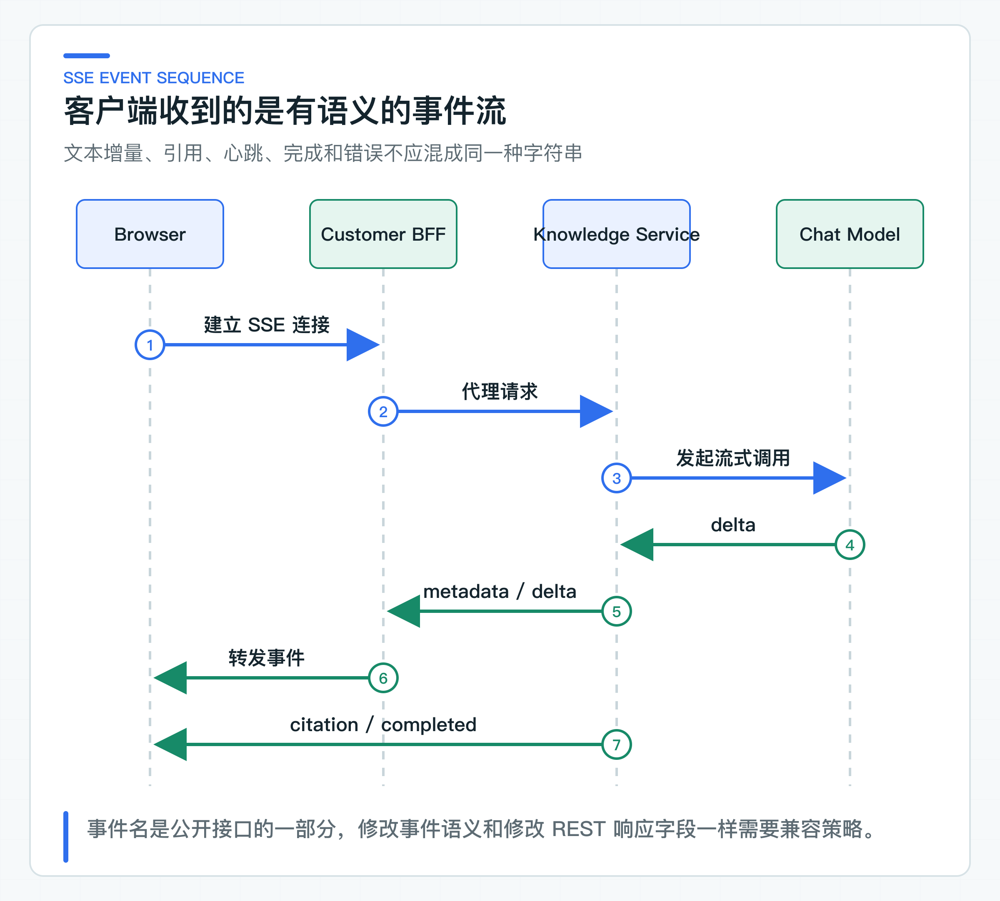
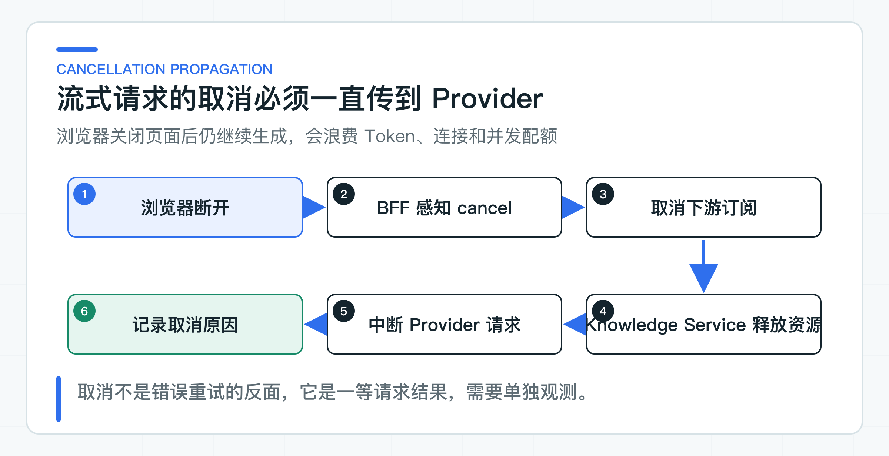

# 流式输出原理与实现：SSE、取消、心跳、断连和 TTFT

用户看到文字逐步出现，只是流式接口最表面的一层。服务端还要处理连接建立、心跳、引用、完成、异常和客户端断开；其中任何一个状态含糊，前端都可能一直转圈，或者把半段回答当成成功结果。

TTFT 表示首个 Token 到达时间（Time to First Token），它反映用户需要等多久才能看到第一段内容。项目用 SSE（Server-Sent Events，服务器发送事件）定义稳定的事件名和顺序。客户端断开时，取消信号继续传到上游模型。连接已经输出字节后，服务不会自动重试并再次发送答案开头。

## 选择 SSE，也要承担长连接成本

知识回答主要是服务端向客户端单向推送，客户端只需发起一次 HTTP 请求。SSE 使用普通 HTTP，也能被 Spring WebFlux 直接表达，适合文本回答场景。

WebSocket 更适合高频双向通信。若只是为了逐字显示答案，引入连接状态、双向协议和额外网关配置，收益不高。

浏览器原生 `EventSource` 只发起 GET 请求，并自带重连处理。项目需要提交较长的问题正文和 JSON 请求，因此使用 `POST /api/v1/knowledge/answers/stream`。

浏览器端要用 `fetch` 的 `ReadableStream` 或支持 POST 的 SSE 客户端解析 `text/event-stream`。取消、重连和游标传递也要由该客户端显式实现。

若必须使用原生 `EventSource`，可以先用 POST 创建短时请求，再用不含敏感问题正文的 GET 地址订阅结果。

SSE 的简单主要体现在客户端协议，不代表服务端可以忽略流式资源管理。每个流会长时占用一条 HTTP 连接，同时占用 Provider 并发、内存缓冲和 Token 预算。因此流式接口需要独立的并发上限、超时、取消和慢客户端处理。

## 事件名和顺序属于接口契约

[AnswerStreamEvent](https://github.com/DavidDingXu/learn-java-ai/blob/main/learning-stages/stage-02-model-engineering/services/knowledge-service/src/main/java/com/xiaoding/javaai/knowledge/answer/application/AnswerStreamEvent.java) 定义六类事件：

| 事件 | 用途 |
|---|---|
| `metadata` | 先返回 Trace ID 和 Prompt 版本 |
| `delta` | 返回增量文本 |
| `heartbeat` | 长时间无 Token 时保持连接可见 |
| `citation` | 返回模型声明、且通过本次上下文校验的引用 |
| `completed` | 返回模型元数据、TTFT、拒答标记和拒答原因 |
| `error` | 以稳定错误码结束事件流 |

前端不应根据某段 JSON 猜测事件类型。[Knowledge Service OpenAPI](https://github.com/DavidDingXu/learn-java-ai/blob/main/learning-stages/stage-02-model-engineering/contracts/openapi/knowledge-service-v1.yaml) 描述了 `text/event-stream` 响应和六类 payload 的 `oneOf` 结构。

当前 OpenAPI 没有把每一帧的 SSE `event:` 名与 payload Schema 结构化绑定。BFF 和客户端可以根据 Schema 生成或校验数据 DTO，事件名与 DTO 的对应关系仍要写在客户端代码中，并用兼容测试固定。



`metadata` 先于文本增量发送，让客户端从一开始就拿到 Trace ID 和 Prompt 版本。`citation` 在正文结束后发送，客户端不需要从 delta 文本解析引用。`completed` 表示这条流已经通过最终校验，并且回答已在业务上成功结束；HTTP 连接关闭本身不能代替完成事件。

`completed` 中的元数据也必须真实。当前链路在最后一个模型片段到达后仍拿不到 usage 时，会发送 `error` 并结束，不会用 `0/0/0` 伪装成成功完成。客户端可以保留已经收到的 delta，但必须把这次回答标记为不完整。拒答同样是成功结果：`completed.refused=true`，并且 `refusalReason` 不能为空。

### 先解析模型决策，再发送回答正文

模型返回的字符流不能直接变成客户端的 delta。否则回答已经显示到一半，服务端才发现模型引用了不存在的 `sectionId`，引用校验就失去了拦截价值。

项目要求模型先输出一段内部决策头，再输出给客户看的正文：

```text
<answer-decision>{"citedSectionIds":["arrival-time"],"refused":false,"refusalReason":null}</answer-decision><answer-text>退款通常在 1 到 5 个工作日到账。
```

这段决策头不会进入 SSE。[StreamingAnswerHeaderParser](https://github.com/DavidDingXu/learn-java-ai/blob/main/learning-stages/stage-02-model-engineering/services/knowledge-service/src/main/java/com/xiaoding/javaai/knowledge/answer/infrastructure/StreamingAnswerHeaderParser.java) 会先缓冲它。Provider 可能把标签或 JSON 拆在任意两个网络分块之间，因此解析器不能假设“一个 chunk 就是一行完整 JSON”。只有决策头解析成功，并且其中的引用都属于本次 `PolicyContext`，正文才会作为 delta 向下游发送。

正文结束后，[StreamingKnowledgeAnswerService](https://github.com/DavidDingXu/learn-java-ai/blob/main/learning-stages/stage-02-model-engineering/services/knowledge-service/src/main/java/com/xiaoding/javaai/knowledge/answer/application/StreamingKnowledgeAnswerService.java) 会组装完整的 `ModelAnswerDraft`。草稿包含文本、引用决策、拒答字段和模型元数据，然后交给与非流式回答相同的 `KnowledgeAnswerValidator`。未知引用或缺少决策会直接结束为 `error`；正文、usage 或业务动作校验失败时也不会发送 `completed`。

这里校验的是引用 ID 是否属于本次上下文，以及拒答结构是否完整。它不能仅凭一个合法 `sectionId` 证明答案中的每句话都由该片段支持，语义正确性还需要后续的 RAG 评测和高风险字段校验。

错误发生在尚未写出响应头时，服务仍可以返回标准 HTTP 错误。一旦 SSE 已经开始，HTTP 状态通常已经确定，后续错误只能通过 `error` 事件表达。这要求客户端同时理解连接级失败和事件级失败。

## 延迟和连接资源要分别治理

### TTFT 单独反映首字等待

总延迟包含上下文加载、排队、模型首 Token 和剩余生成时间。用户对流式体验最敏感的是首个 Token 到达时间（Time to First Token，TTFT）。

[StreamingKnowledgeAnswerService](https://github.com/DavidDingXu/learn-java-ai/blob/main/learning-stages/stage-02-model-engineering/services/knowledge-service/src/main/java/com/xiaoding/javaai/knowledge/answer/application/StreamingKnowledgeAnswerService.java) 在订阅开始时记时，第一个非空 delta 到达时记录首 Token 时间，完成事件中返回 `ttftMillis`。

如果没有任何 delta，TTFT 为 `-1`，而不是伪造 0。监控平台可以将这种情况与正常慢响应分开处理。

TTFT 还可以拆成应用排队、权限与上下文加载、连接 Provider、Provider 生成首 Token、网关刷新事件五段。只记录服务端收到首 Token 的时刻，不一定代表用户真正看到内容的时间。

这也是为什么需要端到端客户端指标。前端可以记录请求发出、连接建立、metadata 到达和首个 delta 渲染的时间。服务端 Trace 和客户端性能数据通过请求 ID 关联后，才能判断问题在模型、BFF、网关缓冲还是前端渲染。

总耗时和 TTFT 要分开设目标。一个长回答可能 TTFT 很短但总生成需要十几秒，用户仍然感觉系统在工作；另一个回答总耗时只有五秒，前四秒完全没有反馈，用户却容易重复提交或离开。产品体验、并发容量和 Token 成本需要同时看这两类指标。

当前知识回答即使拒答，也要输出一段面向用户的说明，因此成功拒答同样会产生首个 delta。若最终仍没有可见文本，`ttftMillis=-1` 只说明没有正文；由于完整回答校验要求正文非空，这条流会以 `error` 结束，而不会被统计成正常拒答。

### 断开连接要取消上游调用

WebFlux 的 `Flux` 订阅在客户端断开时会被取消。Spring AI 流式适配器直接返回上游 `Flux<ChatResponse>`，没有把数据先收集成完整字符串，因此取消信号可以继续向 Provider 客户端传播。

测试会订阅若干事件后主动取消，并验证上游收到取消。这个行为同时减少无效 Token 和连接占用。



取消链路中任何一层把 `Flux` 提前 `collectList()`、转成阻塞字符串或放进无界缓冲，都可能切断上游取消。BFF 作为流式代理时也要保持端到端响应式链路，不要为了便于改写响应而先缓存完整回答。

取消不应记录为普通服务错误。用户主动关闭页面、网络中断和应用超时产生的取消，对运维判断的含义不同。至少要单独统计正常完成、主动取消、上游错误和超时，否则大量用户中途离开会被误报成 Provider 故障。

### 处理心跳、慢客户端和代理超时

项目每 10 秒发送一次 `heartbeat`。它只说明连接仍存活，不改变回答状态，也不重置业务超时。网关、负载均衡和浏览器对空闲连接有不同限制；代理缓冲、空闲超时、压缩和连接截断必须在真实网络路径测试。

模型生成速度高于客户端消费速度时，缓冲会开始累积。响应式链路可以传播背压，但具体 Provider 客户端和 HTTP 库是否真正停止读取，需要通过实际测试确认。无界缓冲会在长回答和大量慢连接下转化为内存问题。

反向代理和网关可能为了压缩或聚合响应而缓冲 SSE，结果是服务端持续发送 delta，浏览器却几秒后一次收到整块数据。TTFT 在服务内看起来正常，用户感知仍然很慢。上线验证必须从真实浏览器穿过 CDN、网关和 BFF，不能只用服务本机 `curl` 判断流式体验。

心跳间隔要小于链路中最短空闲超时，又不应密集到产生大量无效流量。项目使用 10 秒只是开发基线，生产值要根据网关、负载均衡和浏览器路径实测。

## 输出开始后不再自动重试

在发送第一个 delta 前重试，仍有机会保持客户端语义一致；一旦字节已经写出，重新调用模型可能产生不同开头。客户端无法判断哪些片段应该丢弃。

因此，流式链路遇到异常后发送 `error` 事件并结束。需要恢复时，由客户端基于明确的请求 ID 重新发起，而不是让服务端在同一流里静默拼接第二次回答。

重新发起不等于恢复原流。模型的第二次生成可能与第一次不同，客户端应清空或明确标记未完成回答，再展示新请求。如果业务希望“继续生成”，就需要保存明确的会话状态和已经展示给用户的文本，不能依赖 SSE 断点自动推测。

原生 `EventSource` 重连时会使用 `Last-Event-ID`；基于 `fetch` 的 POST 客户端不会自动获得这套行为，需要自己保存并发送游标。即使客户端带回游标，如果应用没有持久化每个 delta，也不能声称支持断点续传。为了恢复极少数中断回答而持久化每个 Token，往往会带来过高存储和复杂度。当前接口在中断后结束请求，由客户端明确重新发起。

## 客户端按事件维护状态

客户端至少需要 `CONNECTING`、`STREAMING`、`COMPLETED`、`FAILED` 和 `CANCELLED` 几种状态。收到 `metadata` 后进入正式流式展示，`delta` 只在 `STREAMING` 状态追加，`completed` 固化引用、拒答状态和用量，`error` 保留已收到内容但标记结果不完整。连接直接断开且没有完成事件，也应视为失败。

事件处理要能容忍心跳和未来新增的非关键事件，却不能忽略已知事件的必填字段。客户端遇到未识别事件可以记录并继续，遇到无效 `delta` 或 `completed` 则应终止并提示协议错误。这是 SSE 接口向后兼容的基本规则。

前端页面离开、用户点击停止和新问题替换旧问题，都要主动取消当前连接。如果只忽略后续 UI 更新，后台请求仍然会继续消耗资源。

### SSE 事件顺序必须稳定

Controller 测试检查响应媒体类型和事件名。应用测试检查 `metadata -> delta -> citation -> completed` 的顺序，同时覆盖拒答、未知引用、缺少决策和取消。解析器测试还会故意把决策头拆成多个 Provider chunk。[SSE 协议结果](https://github.com/DavidDingXu/learn-java-ai/blob/main/docs/reports/lesson-10-sse-streaming.md) 列出了事件序列和取消行为，排查客户端兼容问题时可以对照查看。

公司接入目标 Provider 后，还要实际执行断连、慢客户端、网关缓冲、长回答和浏览器后台挂起测试。流式代码正确，只是整条链路成立的一个条件。

生产检查还要包含连接数与文件描述符上限、应用优雅停机、发布期间旧连接怎样结束，以及 BFF 与 Knowledge Service 两层超时是否一致。滚动发布时若直接切断所有长连接，用户会将正常发布感知为大量回答失败。

更稳妥的停机流程是先停止接收新流，给已建立的连接一个有上限的排空时间，到期后发送可识别错误并取消上游。这个过程需要在发布脚本和容器终止宽限中同时配置。

发布演练应统计被中断的流数量和客户端最终感知，不只检查新实例是否健康。

对线上问题的排查也应从事件序列开始：是否收到 metadata，第一个 delta 何时到达，有没有 completed 或 error，以及连接关闭前是否传播了取消。只查 HTTP 200 无法解释一条流为什么不完整。

事件顺序和终止原因才是流式协议的真正结果。

---

[课程首页](../../README.md) · [完整目录](README.md) · [← 结构化输出为什么会失败：Schema、DTO 和业务校验](09-structured-output.md) · [超时、并发保护、重试和降级：为什么不需要万能模型网关 →](11-model-resilience.md)

动手实践：[本阶段可运行源码](../../learning-stages/stage-02-model-engineering/README.md)
