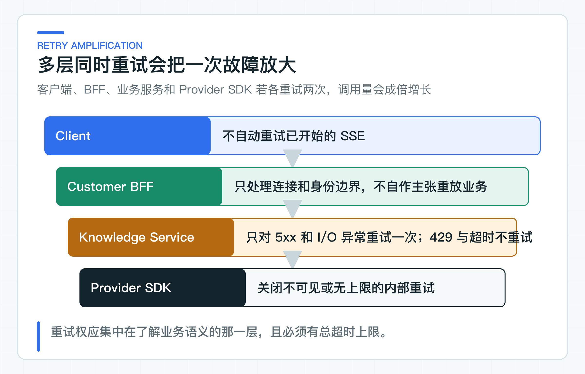

# 超时、并发保护、重试和降级：为什么不需要万能模型网关

给所有模型调用套一组重试和超时参数，看起来省事，实际会混淆读写语义。知识问答遇到 Provider 5xx 或网络 I/O 异常时，可以在总时限内重试一次；退款确认超时却可能已经执行，再发一次请求就有重复写入风险。

因此，项目把并发保护和断路器绑定在 `KnowledgeAnswerModel` 适配器上，重试和整轮超时则在同一条 Reactor 链中组合。知识问答拥有独立的时间与并发预算，异常再映射成调用方能处理的 HTTP 状态和错误码。项目不再增加一层包办所有 AI 调用的网关。

这里的并发保护是并发准入，不是按 QPS 计数的速率限制。两者都能拒绝过量请求，控制目标和算法却不同，不能把 Bulkhead 当成固定窗口限流器。

## 先按故障类型组合四种控制

Bulkhead（舱壁隔离）限制同时进入模型调用的请求数，避免 Provider 变慢时耗尽应用资源。当前示例上限为 20；代码将并发名额耗尽映射为 `MODEL_BUSY`。

整轮超时控制一次同步模型生成最多可以占用多久。当前上限是 30 秒，这个时间包括首次调用、重试间隔和第二次调用，不是每次尝试都重新获得 30 秒。这里的“整轮”指一次 `KnowledgeAnswerModel` 调用，不包括此前的知识检索；完整 HTTP 请求仍需要上层端到端预算约束。代码将超时映射为 `MODEL_TIMEOUT`，调用方可以决定稍后再试或转人工。

Retry 只应处理明确可重试、且没有业务副作用的异常。Spring AI 2.0 的 OpenAI 适配器底层使用官方 Java SDK。项目把 SDK 的 `max-retries` 设为 0，再在模型适配器内对 `InternalServerException` 和 `OpenAIIoException` 最多重试一次。429、整轮超时和结构化结果校验失败都不会触发第二次模型调用。

CircuitBreaker（断路器）在统计窗口内的失败率达到阈值后暂时拒绝新调用。代码将断路器打开映射为 `MODEL_CIRCUIT_OPEN`，让调用方能区分下游持续故障与单次超时。

这四类策略会互相影响。重试链放在 30 秒整轮超时之内，因此第二次调用只能使用剩余时间；Bulkhead 和 CircuitBreaker 作为外层 AOP 策略，观察的是完整的一次同步模型调用。项目用可计数的本地 Provider 测试确认 503 会最多重试一次，429 和整轮超时都只发起一次 Provider 请求。

Bulkhead 的上限不是 Provider 配额的简单拷贝。假设应用有 5 个实例，每个实例允许 20 个并发，整个集群就可能同时发起 100 次调用。如果 Provider 只允许 60 个并发，应用内部的“20”并不安全。需要结合实例数、扩缩容上限、预留配额和其他业务共享情况计算。

并发上限还要与平均延迟和目标吞吐量一起看。平均模型调用 4 秒，单实例并发 20，理想情况下每秒也只能完成约 5 次请求。延迟上升到 8 秒时，同样并发的吞吐量几乎减半，排队和拒绝会迅速增加。这也是为什么并发限制需要和降级一起设计。

超时后要确认上游请求是否真正被取消。如果应用已经向客户端返回超时，Provider 调用却仍然在后台继续，并发名额和 Token 仍在消耗。当前测试已确认超时后不会发起第二次请求，也不会产生 Reactor 的丢弃异常日志。Provider 连接、底层线程和并发名额是否在真实网络中及时释放，仍需要结合所用 HTTP 客户端做压测和运行观测。

### 重试先看操作有没有副作用

假设 SDK、应用层和网关分别允许 3、3、2 次尝试，一次用户请求最坏可能触发 18 次模型调用。延迟、Token 消耗和 Provider 压力会同时放大。

项目只保留一层显式重试，并关闭 SDK 内部重试。当前异常列表与 OpenAI 官方 Java SDK 绑定；如果替换 Provider 适配器，这份列表也要重新校验。示例只对 Provider 5xx 和网络 I/O 失败做一次短延迟重试；429 直接转换为 `MODEL_RATE_LIMITED`，避免在 Provider 已经过载时继续放大请求。结构化结果校验失败同样不会反复请求模型。

重试次数要在总超时预算中计算。当前 Knowledge Service 把首次调用、100 毫秒等待和可能的第二次调用一起限制在 30 秒内。BFF 和 Eval Runner 的 Knowledge HTTP 等待上限是 35 秒。

上游因此能给错误映射和网络传输留出空间，慢请求也不会因为重试获得两份 30 秒预算。如果公司链路需要跨网关、BFF 和下游共享剩余预算，应继续传递统一截止时间（deadline），而不是让每层各自重新计时。

对 429 或 Provider 过载，立即重试往往会让拥塞更严重。当 Provider 协议和业务等待时间都允许时，可以在调用方按 `Retry-After` 安排下一次独立请求。当前的 C 端问答更看重快速反馈，所以服务内不对 429 做退避等待，而是立即返回可识别的忙状态。

### 排队同样占用整体等待预算

当到达速率持续高于服务完成速率时，排队只会将拒绝推迟为更长等待，不会创造额外容量。模型平均耗时突然从 3 秒上升到 9 秒，相同并发上限下的可完成 QPS 会降到原来约三分之一。如果应用仍然无限接受新请求，结果会是超时、客户端重试和队列继续放大。

因此 Bulkhead 之前的等待队列必须有上限和等待时间。对 C 端问答，快速返回“当前繁忙”往往比让请求在队列中等到客户端超时更可控。对后台批处理，可以使用持久化任务队列，但那是可查询、可重试和可限速的异步任务，不是在 HTTP 线程里无限等待。

限流还要考虑公平性。一个大租户或批量任务不应占满全部模型并发，让其他租户无法使用。可以在平台层按租户和业务线分配配额，应用层再为交互请求、评测和后台索引保留不同并发池。这种隔离会比一个全局限流数字更接近真实业务优先级。

在观测上，要分开“进入队列”、“获得调用资格”和“被拒绝”。只记录 Provider 延迟，会忽略应用内部排队已经耗尽超时预算。队列深度、等待时间、并发名额使用率和拒绝率应一起查看。

### 降级结果不能冒充正常回答

知识服务不可用时，可以返回缓存的静态帮助入口、明确拒答或转人工信号。不能用一段看似合理的固定文本冒充本次问题的答案。

降级结果必须有可识别字段，例如执行模式、错误码或来源类型。调用方只有知道当前拿到的是降级结果，才能调整 UI 和业务流程。

对于涉及订单状态、金额和写操作的场景，宁可停止，也不能用过期缓存或猜测结果继续执行。

降级策略要区分内容来源。静态帮助入口可以在模型不可用时始终展示；经过审核且带版本的常见问答缓存，可以在明确适用范围内返回；上一次用户的动态回答、过期订单状态和模型临时生成文本，不能当作通用降级。

客户端需要知道当前是否降级。这个信息不一定要暴露内部 Provider 故障，但应通过稳定来源类型、执行模式或错误码让 UI 调整展示。否则用户会把一段通用帮助文字当成针对自己订单的实时结论。

## 按业务端口配置故障策略

[SpringAiKnowledgeAnswerModel](https://github.com/DavidDingXu/learn-java-ai/blob/main/learning-stages/stage-02-model-engineering/services/knowledge-service/src/main/java/com/xiaoding/javaai/knowledge/answer/infrastructure/SpringAiKnowledgeAnswerModel.java) 的 Bulkhead 和 CircuitBreaker 注解共用策略名 `knowledgeAnswer`，整轮超时和重试也由这个适配器完成。这表示故障保护只作用于“基于授权知识生成回答”这一类调用。

注解写在方法上，不代表切面一定生效。Spring Boot 4 项目需要引入 `spring-boot-starter-aspectj`，目标类也必须能被 Spring 代理。配套项目显式引入了这个 Starter，并让模型适配器保持可代理；真实 Spring 上下文测试还会确认注入的 `KnowledgeAnswerModel` 确实是 AOP 代理。只检查源码里有没有注解，发现不了依赖缺失或 `final` 类导致的运行时问题。

RAG 检索、Embedding、Rerank、Tool 查询和高风险写操作会拥有不同的并发预算、超时和重试条件。一个全局模型网关很难保留这些差异，最后通常演变成大量 if/else 和通用字符串错误。

公司已有统一 AI 网关时仍然可以使用。平台层负责统一认证、配额、路由和审计，应用层继续保留业务超时、错误语义和副作用规则。两层职责不同，不冲突。

判断顺序应先看是否已经对外产生可见结果，再看调用是否有副作用，然后才判断错误是否暂时。SSE 已经输出 delta，即使后面遇到连接超时，也不应在同一流中重试。写操作的网络超时可能发生在服务端已执行之后，没有幂等保护时也不能盲目重试。

断路器的作用是在故障持续时快速失败，给下游恢复空间。它不会让已经失效的模型变得可用，也不应用一个全局断路器同时隔离 Chat、Embedding 和 Rerank。不同能力的 Provider、超时和业务降级不同，应有独立策略和指标。

半开状态允许少量试探请求验证下游是否恢复。试探并发太大会在 Provider 刚恢复时立即再次压垮，太小又会延长恢复时间。这个参数需要根据实例数、请求量和 Provider 恢复特性调整，不能照抄示例默认值。

## 从配置回归走到容量验证

[ModelResilienceContractTest](https://github.com/DavidDingXu/learn-java-ai/blob/main/learning-stages/stage-02-model-engineering/services/knowledge-service/src/test/java/com/xiaoding/javaai/knowledge/answer/ModelResilienceContractTest.java) 同时检查实际配置和适配器注解。它确认 OpenAI SDK 不额外重试，Bulkhead 和 CircuitBreaker 都绑定到 `knowledgeAnswer`，整轮超时、最大尝试次数、重试间隔和并发上限也由配置契约固定下来。

[ProviderProtocolFixtureTest](https://github.com/DavidDingXu/learn-java-ai/blob/main/learning-stages/stage-02-model-engineering/services/knowledge-service/src/test/java/com/xiaoding/javaai/knowledge/answer/ProviderProtocolFixtureTest.java) 启动真实 Spring 上下文，确认模型适配器已经被 AOP 代理。它还用本地模拟 Provider 验证四条关键行为：一次 503 后重试成功，连续 503 只调用两次，429 不重试，慢响应超时后不会发起第二次请求或留下 Reactor 丢弃异常。

行为测试把整轮超时缩短到 1 秒以控制执行时间，`application.yml` 中的 30 秒由配置契约单独检查。`KnowledgeAnswerExceptionHandlerTest` 另外确认 Provider 限流、持续不可用和请求被拒绝都会转换为稳定错误码，而不会把 Provider 原始消息透传给调用方。这些测试不评估生产容量，也不证明超时后的底层连接和线程已在所有 HTTP 客户端中及时释放。

接入公司项目前，还要通过可观测的上游验证取消与连接释放，并发发起超过上限的请求验证拒绝行为，再用连续故障验证断路器打开和半开恢复。30 秒和 20 并发只是本地默认值，不是生产容量结论。

错误映射必须在 Resilience4j 之外保持稳定。它的异常类名可能随版本和配置变化，客户端只应看到 `MODEL_BUSY`、`MODEL_TIMEOUT` 和 `MODEL_CIRCUIT_OPEN` 等项目错误。这样替换故障处理组件或将策略移到平台时，对外错误码不需要同步改变。

### 默认参数只是本地起点

默认的 30 秒整轮超时和 20 并发用于限制本地调用受网络长尾影响的范围。缺少目标 Provider 的服务目标、业务并发、实例数和线程模型时，这两个数字不能当作生产容量结论。

生产参数应由超时预算倒推：客户端、网关、BFF、知识服务和 Provider 各占多少；并发上限则要结合实例数、Provider 配额、平均时延和降级策略压测。

压测不应只对一个固定快速响应的假模型发流量。至少要模拟正常延迟、长尾延迟、429、连续 5xx、慢恢复和超时后仍不取消几类行为。这样才能看到并发拒绝、断路器开启、半开试探和实际下游调用量是否符合预期。

运维告警至少要分开并发拒绝率、超时率、重试放大倍数、断路器状态和 Provider 错误类型。只看总体 5xx 会丢失故障阶段：并发拒绝增加说明容量已经紧张，断路器打开说明下游失败已经持续，重试倍数上升则可能正在进一步放大故障。

参数调整应记录原因、数据和回滚值。一次临时把超时翻倍，可能降低表面超时率，同时让连接占用、排队和用户等待更严重。没有配套容量数据时，放宽超时不应被当作故障修复。

公司已有网关限流时，应用内的并发限制仍然有必要。网关通常按租户、应用或总 QPS 保护平台，应用内并发限制则保护当前实例的连接、内存和其他业务请求。两者的拒绝错误要可区分，否则运维无法判断是 Provider 配额不足，还是单个应用实例已经过载。

如果知识回答与普通 CRUD 共享同一个线程池或连接资源，模型变慢时可能拖垮整个服务。并发隔离的真正目标是让 AI 依赖故障不扩散到健康功能，不只是限制模型调用数。

每个参数都应来自业务等待预算、Provider 配额、压测结果或明确的故障恢复目标。找不到依据的数字，只能当作开发默认值；参数写得再完整，也不能说明它适合当前流量。

生产中还要定期重新验证这些依据。模型延迟、Provider 配额、应用实例数和流量结构变化后，原来合理的超时、并发上限和断路器窗口也可能不再适用。

任何一次大幅调整都应记录旧值、调整依据、观察周期和回滚方式，并用相同压测场景重新验证，避免在故障期间反复靠猜测改参数。

---

[课程首页](../../README.md) · [完整目录](README.md) · [← 流式输出原理与实现：SSE、取消、心跳、断连和 TTFT](10-sse-streaming.md) · [真实模型调用之后：怎样建立评测基线与可观测性 →](12-eval-observation.md)

动手实践：[本阶段可运行源码](../../learning-stages/stage-02-model-engineering/README.md)
