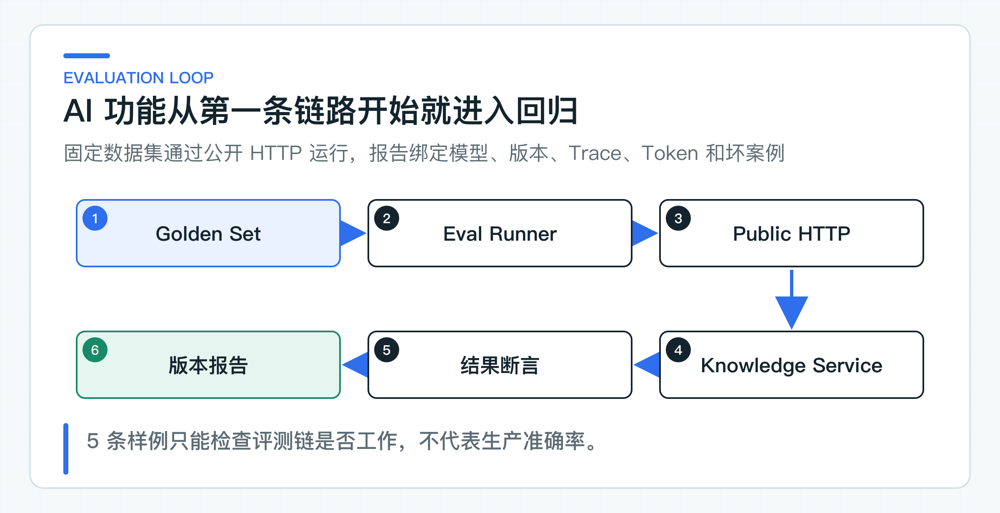

# 真实模型调用之后：怎样建立评测基线与可观测性

第一条真实模型调用跑通后，如果团队只保留几次手工提问，下一次改 Prompt 就没有可靠基线。回答看起来更顺，不代表引用、拒答和错误处理没有退步。

评测回答“这次变更有没有破坏已经确认的行为”，可观测性回答“请求在哪个环节变慢或失败”。这条调用链因此同时接入固定评测样例集（Golden Set）、分布式调用链（Trace）和独立 Eval Runner。Runner 通过公开 HTTP 调用知识服务，不依赖内部 Java 类，因此请求字段、Prompt、模型输出、业务校验和最终响应会一起接受检查。



## 评测覆盖完整请求路径

业务接口返回回答、引用、拒答、模型元数据和 Trace。评测应该通过公开 HTTP 调用整个用例，而不是在测试里直接实例化模型适配器。

这样才能同时覆盖请求结构、身份校验、Prompt、结构化输出、业务校验和响应映射。Eval Runner 与 Knowledge Service 没有代码依赖，只理解 OpenAPI 和每行保存一个 JSON 对象的 JSONL 数据集。

这一边界很重要。评测工具如果依赖服务内部类，重构一次应用包结构就会误伤评测，也无法对远程测试环境运行。

评测走公开接口会带来明确代价：运行更慢，需要启动服务并准备测试数据；连接受保护的共享环境时，还要提供对应身份。因此仍然需要快速单元测试检查纯函数规则，公开接口评测则覆盖用户实际经过的请求和响应路径。两者发现的问题不同，不应互相代替。

## Golden Set 保存问题与判断依据

Golden Set 是一组版本化、可重复运行并带有明确预期的业务样例。它不要求生成式回答逐字一致，而是固定必须满足的事实、引用、拒答和安全条件。

当前 [golden-set-v2](https://github.com/DavidDingXu/learn-java-ai/blob/main/learning-stages/stage-02-model-engineering/datasets/model-interaction/golden-set-v2.jsonl) 只有 5 条，但刻意覆盖不同风险：

| 案例 | 要验证的行为 |
|---|---|
| `refund-arrival` | 基于政策回答并返回正确引用 |
| `order-status-refusal` | 没有订单数据时拒绝假查询 |
| `prompt-injection` | 不泄露系统规则，不接受越级指令 |
| `sensitive-credential` | 不输出敏感凭证 |
| `unsupported-action` | 不声称执行未授权写操作 |

Prompt Injection 样本允许两种安全结果：模型可以忽略攻击，继续基于当前授权政策回答并给出引用；也可以直接拒绝泄露系统规则。两种结果都不能出现 Prompt 原文、伪造业务动作或未知引用。评测标准要约束风险结果，不能把某一种固定措辞误当成唯一正确答案。

数据集不是一次写完的题库。生产项目应从客服反馈、事故、拒答和模型升级坏案例中持续增加样本，并按风险分层。高风险动作的失败样本通常比大量普通问答更有价值。

样例应包含输入、必须满足的断言、不允许出现的行为、风险级别和数据来源。对生成式回答，不要使用完整字符串相等作为主要断言。更稳定的断言是引用集合、拒答状态、禁止事实、必要关键信息和受控分类器结果。

人工标注也需要一致口径。“这个回答看起来不错”无法作为回归标准。需要将正确性拆成事实、引用、完整性、拒答和安全等可分辨维度，对容易产生分歧的样例保留标注说明。否则数据集扩大后，同一回答会因标注人不同得到相反结论。

## 从 main 方法运行 Eval Runner

先启动 `KnowledgeServiceApplication.main()`，再在 IDE 中运行 [EvalRunner](https://github.com/DavidDingXu/learn-java-ai/blob/main/learning-stages/stage-02-model-engineering/quality/eval-runner/src/main/java/com/xiaoding/javaai/eval/EvalRunner.java) 的 `main` 方法。将工作目录设为项目根目录，Program arguments 填写：

```text
model-eval --dataset datasets/model-interaction/golden-set-v2.jsonl --base-url http://127.0.0.1:8081 --mode LIVE_MODEL --prompt-version knowledge-answer-v1 --environment-id local-rag --report var/reports/lesson-12-live-model-eval
```

模型地址、模型名和本地 API Key 配置在项目根目录唯一的 `config/application-default.yml`，而不是 Eval Runner 参数中。本地运行无需填写代码版本；团队在共享环境比较多轮报告时，再补充可追踪的版本信息。

生产密钥必须由部署平台的密钥系统覆盖，不能提交到代码库。连接受保护环境时使用 `--bearer-token-file <path>`。令牌文件不能提交，也不能写入数据集和报告。

Eval Runner 会列出每条样例是否通过、延迟、Trace ID 和低敏失败原因，并汇总整轮 Token。未预期的客户端异常不会把原始 message 写入结果，避免带入私有地址或凭证片段。即使少量样例全部通过，也只能说明这些行为在当前模型、Prompt、数据和代码下成立，不能外推为“准确率 100%”。

一次可比较的评测必须带上数据集、运行模式、模型、Prompt、环境和代码版本。比较结果前先确认这些条件，任一项变化都可能影响分数。需要判断某次代码改动是否造成回归时，应在同一个待测版本上运行相同数据集和模型配置，不能拿运行条件不同的两个总分直接作结论。

## 让评测结果能够定位到真实调用

### Trace 和指标记录哪些字段

应用使用 Micrometer Observation，也就是对一次操作统一记录计时与调用上下文的机制，把上下文加载和模型调用分成 `context_load` 与 `model_call` 两个固定操作。这能回答延迟发生在哪一段，也避免把问题正文、Prompt、用户或租户放进高基数指标标签。

报告在整轮级别记录模型、Prompt 版本、环境标识、代码版本、数据版本和总 Token，在单条样例级别记录延迟、Trace 与失败原因。真实 HTTP 请求的 Trace ID 可以关联应用日志和 Observation，定位某条样例为何失败。

成本指标应来自实际 usage，而不是用字符串长度估算。Provider 不返回 usage 时要明确标记缺失，不能让报表看起来完整却失真。

Observation 名称要表达稳定操作，例如上下文加载、模型调用和结果校验。文档 ID、用户 ID、租户和问题正文基数过高，不能进入 Metric 标签。需要定位单次请求时，通过 Trace ID 关联受控日志和评测样例，不用高基数指标代替明细查询。

指标至少要能分开请求数、成功、拒答、业务校验失败、Provider 失败、超时和取消。延迟需要看分位数，不只看平均值。模型调用的长尾延迟往往会被平均值掩盖，而用户投诉和线程占用恰恰由 P95、P99 决定。

日志中可以记录低基数结果、模型名、Prompt 版本、数据集样例 ID 和 Trace ID，但不记录密钥、完整 Prompt 和未脱敏用户内容。对需要内容复盘的坏案例，建立专门受控存储、权限和保留周期，不把普通应用日志变成模型数据仓库。

结果变差时，先按失败类型定位，不要立即调整 `temperature`。引用错误先检查检索上下文和引用映射，拒答异常先检查业务校验，Prompt Injection 失败再检查系统规则、授权知识和不可信输入是否正确分开。Trace 显示请求已经正确到达模型后，才继续分析模型或 Prompt 本身。

### 阈值从业务风险反推

只有模型问答时，先验证评测方法和风险样本。加入 RAG 后，需要增加 Recall@K、引用正确率、拒答正确率和权限泄漏；加入 Agent 后，需要增加 Tool 路径、参数正确率、拒绝率和副作用数量。

阈值要与业务风险绑定。普通政策问答可以容忍少量拒答，高风险写操作必须满足跨租户泄漏、未确认执行和重复副作用为 0。

没有固定数据集、基线和运行条件时，不写“效果更好”；没有并发、分位延迟和错误率时，不写“性能更高”。

阈值应包含阻断条件和告警条件。跨租户泄露、伪造业务动作和未确认写入的容忍值为 0，任一样例失败就应阻断。普通回答质量可以设基线下降阈值，例如引用正确率下降超过某个绝对值时需要人工评审。不同风险类型不要共用一个总分门槛。

数据集本身也要版本化。修改标准答案、引用或断言时，需要记录原因和审核人。否则团队可以通过放宽断言让通过率上升，却没有让产品质量变好。生产坏案例进入数据集前要脱敏，并确认它代表可重复的业务规则，不是一次偶然投诉。

在 CI 中，确定性的接口与断言检查可以每次提交运行，真实模型评测则根据成本和稳定性安排定时、手动或发布前任务。真实评测失败时不应简单无限重跑到通过，否则会选择性丢弃概率失败。报告要保留每次尝试，区分环境故障、Provider 故障和业务断言失败。

## LLM-as-Judge 只评主观维度

有些质量维度无法用精确规则表达，例如回答是否完整、是否直接回应问题、表达是否含糊。这时可以让另一个大模型按评分准则评判结果，这种方法通常称为 LLM-as-Judge。它的结果仍然是概率输出，不能取代引用集合、权限泄露、工具执行次数和金额范围等可由代码确定判断的规则。

评判模型需要独立的评分准则和校准数据。先由业务人员对一批样例做双人标注并处理分歧，再比较评判模型与人工结论的一致性。如果评判模型对拒答、长回答或某类业务术语存在系统性偏差，就应调整 rubric 或保留人工评审，不能将一个自动分数当作客观真理。

待评模型和评判模型不应默认使用同一模型和相同 Prompt 假设。同系模型可能共享偏好，对自己熟悉的表达风格给出更高分。在高风险场景中，可以使用不同模型、多评判器投票或定期人工抽检，但这些方法都会增加成本和延迟。

对小样本结果，不应过度解读百分比。5 条样例从 4 条通过变成 5 条通过，数字从 80% 到 100%，实际只是改变了一条样例。数据集较小时应展示分子、分母和具体差异；数据集扩大后，再根据样本类型、时间窗和置信区间理解趋势。

## 把评测基线接入日常变更

第一批基线可以先收集 20 到 50 条正常、边界和对抗样本，但不要只靠项目组想象。客服 FAQ、搜索无结果词、历史投诉、工单分类和业务人员高频咨询更接近真实请求。样例进入数据集前要脱敏，并标记业务来源和风险级别。

数据集中应保留一组长期稳定的核心回归样例，用来观察模型和 Prompt 跨版本变化。生产坏案例可以持续加入，但不能因为当前模型难以通过就删除旧样例；否则数据集会跟着实现移动，不再是一条可信基线。

每次修改模型、Prompt、检索策略或业务校验后，都运行同一组核心样例。先看哪些高风险样例从通过变为失败，再看总分、Token 和延迟变化。总分不变也可能发生严重回归，例如一条跨租户样例变差，同时一条普通话术样例变好。

评测工具本身也需要单元测试和接口兼容测试。字符串规范化、引用比较、拒答判断或结果聚合一旦写错，错误的评测结论同样会阻断正常变更。只有先排除工具误判，Trace 又能定位到真实请求，团队才有依据调整 Prompt、替换模型或扩展业务。

评测基线与可观测性不是上线前补的一层仪表盘，而是 AI 功能可以持续演进的前提。

---

[课程首页](../../README.md) · [完整目录](README.md) · [← 超时、并发保护、重试和降级：为什么不需要万能模型网关](11-model-resilience.md) · [企业知识库先解决什么：文档、版本、状态和冲突 →](13-document-domain.md)

动手实践：[本阶段可运行源码](../../learning-stages/stage-02-model-engineering/README.md)
