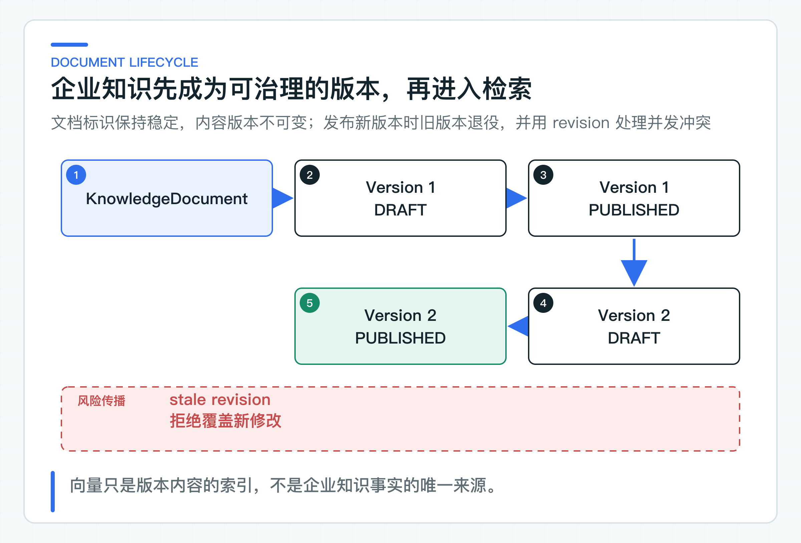

# 企业知识库先解决什么：文档、版本、状态和冲突

知识库上线后，第一次修改《退款政策》就会暴露真正的难题：新内容是覆盖旧记录，还是保留一个新版本？索引尚未生成时，线上查询继续使用哪一版？两个人同时点击发布，又该以谁的操作为准？

这些问题都发生在向量检索之前。文本向量（Embedding）和检索增强生成（Retrieval-Augmented Generation，RAG）可以提升内容的查找与使用效率，却不能替系统管理文档身份、版本和生效状态。

因此，要先把文档当成业务资产，再把 Chunk 和向量看作可以重建的检索产物。顺序理清以后，引用、灰度发布、回滚和追溯才有稳定的落点。

## 先看清 13—21 篇怎样连成一条链

这一段不是九个分散的知识点。把 Knowledge Service 切换到 `postgres-rag` 后，同一份文档会依次经过下面这些状态：

| 篇目 | 当前操作 | 能观察到的结果 |
|---|---|---|
| 13 | 建立文档与不可变版本 | 文档身份和内容版本不再混在一行数据里 |
| 14 | 上传并发布一份政策 | 原文、摘要、发布状态和 ACL 一起落下 |
| 15 | 按标题与条款切分 | 每个 Chunk 保留文档、版本和结构元数据 |
| 16 | 生成 Embedding 并写入 pgvector | 向量只属于明确的文档版本和模型版本 |
| 17 | 带租户、用户和部门范围检索 | 无权内容不会先进入 TopK 再被隐藏 |
| 18 | 组合向量、关键词和 Rerank | 候选集合在同一权限范围内融合 |
| 19 | 用检索证据生成回答 | 回答只能引用本次候选集合中的 Chunk |
| 20 | 发布新版本并重建索引 | 旧索引继续服务，新索引完整后再切换 |
| 21 | 用固定问题集回放 | 召回率、坏案例和延迟都有可比较结果 |

第一次动手只走最短路径。在项目根目录唯一的 `config/application-default.yml` 中填写 Chat、Embedding 和专用 PostgreSQL。Chat 与 Embedding 默认共用一个 OpenAI 兼容 API Key 和 Base URL。

如果这个远程接口不提供 Embedding，再按 RAG 准备文档只把 `spring.ai.model.embedding` 改为 `ollama`。业务层的 `java-ai.knowledge.embedding.mode` 始终保持 `provider`，Java 代码不变。

然后运行 `KnowledgeServiceApplication`，打开阶段目录中的 `rag-learning-journey.http`。这份文件按顺序调用真实上传、发布、索引、检索和问答接口，每个请求都能单独观察响应与状态变化。

Spring AI 会让当前 Embedding Provider 输出 1536 维向量，检索响应和评测报告会记录实际模型名。`local-hash` 仍可用于排查工程链路，但它不理解文本语义，报告也不会把它标记为质量证据。Query Rewrite、Rerank、JWT、对象存储替换都不是首次跑通的前置条件。

## 一份政策同时走两条时间线

一份《退款政策》不会在上传后立刻成为线上答案的依据。它通常会经历起草、审核、生效、替换和退役。与此同时，系统还要完成文本解析、切分、向量生成和索引写入。

这是两条时间线：一条是业务生命周期，另一条是索引处理过程。它们会相互影响，但不是同一件事。



比如，新版本已经通过业务审核，但向量生成失败了。合理的处理不是让用户查到一半新、一半旧的内容，而是保留当前可服务的旧版本，修复新版本的索引任务，确认检索就绪后再切换。

反过来，索引成功也不代表内容已被批准发布。尚在草稿状态的内容即使已经生成向量，线上检索也必须排除它。

## 四层数据承担不同职责

要让知识库能够更新、回滚和追溯，至少要分清四层数据。

`KnowledgeDocument` 是长期存在的业务对象。它回答这份知识属于哪个租户、叫什么、由谁建立，以及当前发生过多少次受控修改。

`DocumentVersion` 保存某一次确定的内容事实，包括内容摘要、对象存储键、媒体类型、创建人、状态和生效时间窗口。

`DocumentChunk` 是版本内容按某套切分策略生成的检索证据单元。Embedding 则是 Chunk 在特定模型、维度和归一化策略下的数学表示。

这四层数据的重建能力不同。文档和版本是原始业务数据，必须进入备份、审计和保留策略，不能从向量表倒推恢复。Chunk 可以根据原始版本和切分策略重建；Embedding 可以根据 Chunk 和模型配置重建。

这个差别会影响备份、容灾和故障修复。向量索引损坏时，应该重跑索引任务，而不是修改已发布文档的内容来迁就索引。更换 Embedding 模型时，新旧模型可以针对同一批 Chunk 生成两套索引，经过固定数据集评测后再切换查询路由。如果向量直接挂在文档表上，也没有模型版本，这种升级很难灰度，出问题时也找不到干净的回退点。

### 文档身份与内容版本分开保存

《退款政策》是一个长期稳定的业务对象，具体条款却会持续变化。因此，文档标识负责保持业务连续性，版本记录每次确定的内容。

```text
KnowledgeDocument: refund-policy
  Version 1: 已发布，当前线上检索使用
  Version 2: 草稿，等待审核与索引准备
```

如果每次上传都创建一个全新文档，权限、引用、问答反馈和审计会分散在多个 ID 上。业务人员说“回退退款政策”时，系统甚至不知道哪些 ID 属于同一份制度。

如果只保留一行数据并在每次上传时覆盖，问题更大。线上产生错误答案后，团队无法还原当时的原文，引用中的版本号也失去意义。

[KnowledgeDocument](https://github.com/DavidDingXu/learn-java-ai/blob/main/learning-stages/stage-03-enterprise-rag/services/knowledge-service/src/main/java/com/xiaoding/javaai/knowledge/document/domain/KnowledgeDocument.java) 作为聚合根管理版本。它统一判断重复内容、并发 revision 和发布切换，避免这些规则散落在 Controller、Service 和 SQL 脚本中。

### 已被引用的版本保持不变

一个版本参与切分、Embedding 或线上问答后，它就成了一段可被引用的历史事实。再去修改原内容，会造成同一个版本号对应两份文本：对象存储中是新文本，向量库里仍是旧向量，旧回答的引用也无法核对。

所以，修改制度时要创建新版本，而不是编辑已存在版本的内容。新版本先处于 `DRAFT`，审核通过后再发布。新版本成为 `PUBLISHED` 时，旧发布版本进入 `RETIRED`；索引任务是否完成由另一套状态记录。

当前实现使用 SHA-256 内容摘要识别同一文档下的重复内容。完全相同的字节不会被包装成一个假的新版本。数据库中的 `(tenant_id, document_id, content_hash)` 唯一约束则是并发写入时的最后一道保护。

这里要留意，字节摘要只能证明原始内容完全相同。换行符、空格或文档属性变化，都会产生新摘要。是否还要做语义去重，要由公司的内容管理规则决定。即使增加规范化摘要，也应另存一个字段，不要覆盖用于审计的原始内容摘要。

## 发布时同时守住业务与检索一致性

### 业务状态和索引进度分别记录

`DRAFT`、`PUBLISHED`、`RETIRED` 表达的是业务对一份内容的认可程度。“等待解析”、“正在生成向量”、“索引失败”描述的是技术任务进度。

如果把它们塞进同一个状态字段，很快就会出现 `PUBLISHED_BUT_INDEXING`、`APPROVED_INDEX_FAILED` 之类混合状态。审批流程每多一步，索引任务每多一种重试情况，枚举数量都会翻倍。最终没人能说清某个状态到底允不允许被检索。

公司项目中应该保留两套状态。文档版本状态由知识领域管理；解析、切分、Embedding 和入库由索引任务管理。查询再通过一个明确的检索版本指针，只读取已经完整建好的索引。这样新版本可以先完成业务发布，旧索引继续服务，直到新索引完整写入并切换。

这样做还有一个直接好处：索引任务可以重试、补偿和全量重建，不会反向篡改文档的业务状态。

### revision 用来识别并发修改

假设 A 和 B 同时打开《退款政策》，两人读到的 revision 都是 0。A 先添加 Version 2，聚合 revision 增加为 1。B 仍然携带 `expectedRevision=0` 提交发布。此时服务必须拒绝 B，让他重新读取最新文档后再决定如何处理。静默覆盖 A 的修改，属于数据丢失，不是“后提交者优先”。

```java
document.addVersion(
        expectedRevision,
        contentHash,
        objectKey,
        mediaType,
        actorId,
        now
);
```

领域层在任何状态变化前检查 revision。如果请求过期，聚合保持原样，不会出现“状态已改、异常才抛出”的半成品。

到了 PostgreSQL，revision 不能只是 Java 对象中的检查。仓储更新语句应当同时带上租户、文档 ID 和预期 revision：

```sql
UPDATE knowledge_document
SET revision = revision + 1,
    updated_at = :updatedAt
WHERE tenant_id = :tenantId
  AND document_id = :documentId
  AND revision = :expectedRevision;
```

受影响行数为 0，才能确认数据库中的版本已经变化，应该返回明确的冲突错误。先 `SELECT` 检查、再无条件 `UPDATE`，两条 SQL 之间仍然存在并发窗口。

### 一次发布应在同一事务内完成

发布 Version 2 至少包含两个状态变化：Version 1 转为 `RETIRED`，Version 2 转为 `PUBLISHED`。文档 revision、READ ACL 和对应的 `PENDING` 索引任务也要同时写入。

这些更改必须在同一数据库事务内完成。如果先退役旧版本，后发布新版本，而第二步写入失败，线上就会短暂出现没有可用版本的状态。如果先发布新版本，后退役旧版本，则可能同时存在两个发布版本。

应用层要用事务保证原子性，数据库还要提供结构性保护。Flyway 迁移使用部分唯一索引，限定同一租户、同一文档最多只有一个 `PUBLISHED` 版本：

```sql
CREATE UNIQUE INDEX ux_document_version_single_published
    ON document_version (tenant_id, document_id)
    WHERE status = 'PUBLISHED';
```

业务校验负责给出可理解的错误，数据库约束负责兜住多实例并发、程序缺陷和非预期写入。两者不重复。只有 Java 层校验，承受不了多实例并发；只有唯一约束，用户得到的只会是一段难以理解的 SQL 异常。

发布事务不负责调用 Embedding。外部模型请求耗时长，也不能和数据库锁放在同一事务里。Worker 完整写入新分块后，再在同一个短事务中更新 `document_search_version`。新索引失败时，已有文档继续使用上一版索引，不会出现一半新、一半旧的结果。

这里选择的是“已有索引优先保持可用”。如果合规制度要求生效时刻必须与新内容严格一致，公司项目应先构建待发布索引，再把业务版本、ACL 和检索版本一起切换；不能在新版本未就绪时继续返回旧政策。

### 发布之后还要判断生效时间

`PUBLISHED` 表示内容已获得发布资格，`effectiveFrom` 和 `effectiveUntil` 决定什么时候对查询生效。

促销规则可能今天审批通过，明天零点才生效；合规通知也可能在固定日期自动失效。如果只看 `PUBLISHED`，预发布内容会被提前召回，过期政策也可能继续进入模型上下文。

当前代码只有 `DRAFT`、`PUBLISHED` 和 `RETIRED`，发布新版本时会立即把旧版本改为 `RETIRED`。因此，公开发布接口只支持立即生效。`DocumentPublicationService` 会在修改领域状态之前拒绝未来的 `effectiveFrom`，返回参数错误，避免旧版本先退役而新版本尚未生效。

公司需要排期发布时，应增加 `SCHEDULED` 或 `APPROVED` 状态，由调度任务在生效时刻执行版本切换。另一种选择是先完成新索引，再在生效时刻原子切换业务版本和检索版本。

发布时必须保证 `effectiveUntil` 晚于 `effectiveFrom`。检索时还要把当前时间条件下推到数据库查询，与租户、文档状态和 ACL 一起在 TopK 之前过滤。先召回过期向量，再期望模型识别“这条政策已经失效”，是把应用和数据库能确定的规则推给不确定的模型。

### 审批流程留在领域边界之外

审批不一定要由知识服务自己实现。很多公司已经有 OA、内容管理平台或合规审批中心，没必要在 AI 项目里再造一套通用流程引擎。

外部系统可以完成起草、会签和审批，知识服务接收带有来源业务号、审批人、授权主体和幂等键的发布命令。知识服务仍然要自己检查租户、发布权限、revision、生效窗口和当前版本状态。“OA 已经审批”不等于知识领域可以放弃自己的一致性规则。

如果公司没有现成审批系统，也应先按业务需要增加最小状态，例如 `DRAFT -> PENDING_APPROVAL -> APPROVED`，而不是立即引入一个重型流程平台。审批节点、驳回原因和代办查询真正复杂到无法由领域状态表达时，再让流程引擎介入。

## 旧文档按版本模型迁移

公司项目很少是从一张空表开始。原始文档可能分散在文件服务器、Wiki、OA 附件和业务数据库中。迁移时不要直接将这些文件批量写入向量库，否则一旦发现重复、废弃或越权内容，很难找到它在业务上的所有者。

更稳妥的做法是先做文档资产盘点，为每份文档确定租户、业务标识、所有者、来源系统、当前有效版本和访问范围。无法确认所有者或有效性的文档进入待审核区，不直接发布。

接下来先导入 Document 和 Version，保留原始来源标识与字节摘要。然后再分批生成 Chunk 和 Embedding，通过固定问题集、引用核对和权限用例验证。新索引没有通过核验前，查询流量不要切过去。

迁移完成后还需要对账：源系统有多少份有效文档，新系统建立了多少 Document 和 Version，多少份被判定为重复，多少份因权限或有效性不明而被隔离。没有对账报告的“全量导入成功”，通常只能说明脚本没有报错。

## 四条领域规则怎样落进代码

领域行为集中在 [KnowledgeDocument](https://github.com/DavidDingXu/learn-java-ai/blob/main/learning-stages/stage-03-enterprise-rag/services/knowledge-service/src/main/java/com/xiaoding/javaai/knowledge/document/domain/KnowledgeDocument.java) 和 [DocumentVersion](https://github.com/DavidDingXu/learn-java-ai/blob/main/learning-stages/stage-03-enterprise-rag/services/knowledge-service/src/main/java/com/xiaoding/javaai/knowledge/document/domain/DocumentVersion.java) 中。阅读代码时重点看四条规则：

1. 新内容必须以新版本加入，不开放已有版本的内容修改入口。
2. 同一文档下的相同内容摘要会被拒绝。
3. 所有变更都要提供预期 revision，过期请求在修改状态之前失败。
4. 发布新版本会退役当前发布版本，且生效结束时间必须晚于开始时间。

测试会验证新旧版本切换、重复内容拒绝、过期 revision 不修改聚合、无效生效时间窗口这四类行为。这里验证的是领域规则，不包括多实例下的数据库并发。

### 落到现有系统时保留这些边界

可以直接复用的是建模思路：Document 与 Version 分离，版本内容不可变，业务状态与索引状态分离，revision 保护聚合修改，生效时间进入检索条件。

公司落地时还需要按现有系统补齐审批来源、发布权限、数据分类、保留周期、删除规则和来源系统标识。若与 OA 或 CMS 对接，发布命令还要有幂等和审计，防止外部系统重试时重复推进 revision。

当前代码提供 JDBC 仓储、HTTP 上传与发布接口、revision 冲突保护，以及业务发布状态、ACL 和索引任务的事务写入。Worker 完整写入 pgvector 分块后才切换检索版本。公司项目仍要按现有系统补充审批集成、排期发布、目标 PostgreSQL 并发验证、严格生效策略、历史索引清理和迁移对账。

企业知识库要先能回答“这份知识是什么、哪个版本有效、为什么会被发布”，然后才轮到“怎样更快地搜到它”。

---

[课程首页](../../README.md) · [完整目录](README.md) · [← 真实模型调用之后：怎样建立评测基线与可观测性](12-eval-observation.md) · [文档上传链路：对象存储、内容校验、隔离和解析失败 →](14-document-upload.md)

动手实践：[本阶段可运行源码](../../learning-stages/stage-03-enterprise-rag/README.md)
