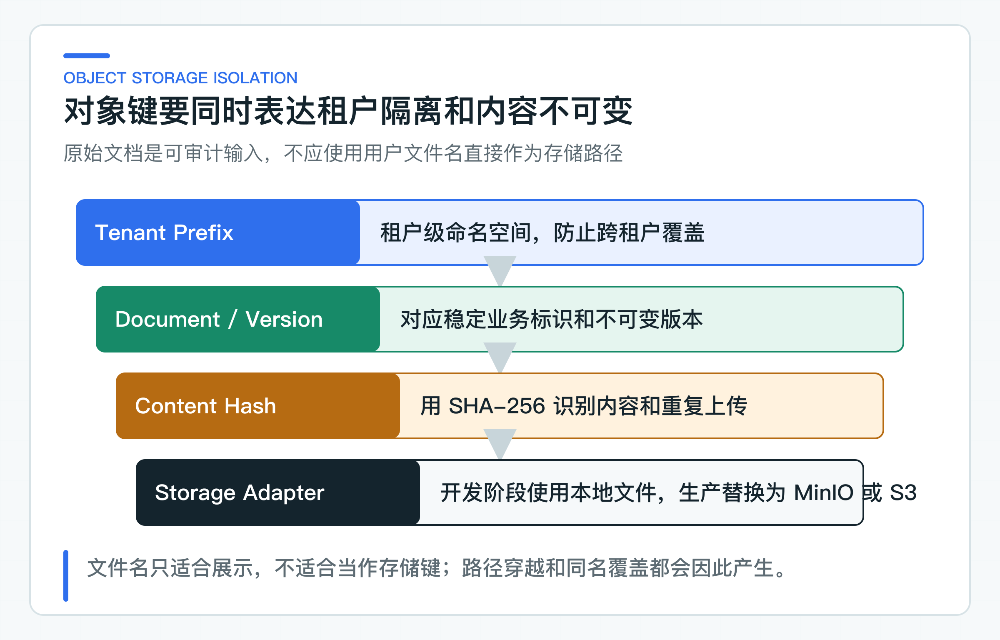
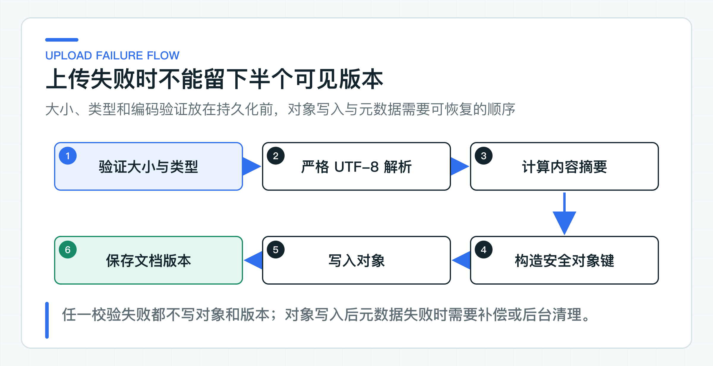

# 文档上传链路：对象存储、内容校验、隔离和解析失败

一个名为 `refund-policy.md` 的上传文件，可能根本不是 Markdown；请求声称它属于当前租户，对象键里却夹带了另一个租户的路径；对象已经写入存储，数据库事务又可能在最后一步回滚。

所以，文档上传真正要处理的不是 `MultipartFile` 怎么落盘，而是收到的字节能否信任、由谁拥有、何时算入库成功，以及中途失败后怎样收拾现场。

MinIO、OSS 或 S3 只是存储适配器。输入校验、租户隔离、重复提交和失败恢复，才是这条链路需要长期保持稳定的部分。

## 先定义文档何时可以进入知识库

公司项目中常见的错误是：Controller 拿到文件后，直接调对象存储 SDK，成功后往数据库插一条记录。这段代码很短，却没有说清文件在什么时候算“可用”，也没有处理存储成功、数据库失败这类必然会出现的中间状态。

一条完整的知识文档入库链路，应该有明确的先后关系：

```text
身份与租户上下文
  -> 请求大小和业务配额
  -> 格式与内容校验
  -> 受控解析
  -> 内容摘要与重复判定
  -> 对象写入
  -> 文档版本持久化
  -> 进入后续切分与索引
```

这个顺序先执行成本最低的检查：超过上限的文件不进入解析器，不支持的格式不计算向量。只有通过内容校验的字节才进入永久存储，避免每个失败请求都留下待清理对象。

[上传用例](https://github.com/DavidDingXu/learn-java-ai/blob/main/learning-stages/stage-03-enterprise-rag/services/knowledge-service/src/main/java/com/xiaoding/javaai/knowledge/document/application/DocumentUploadService.java) 在应用层按顺序执行这些步骤：先限制大小和媒体类型，再调用内容解析端口，然后计算 SHA-256、向领域对象申请新版本，最后写对象并保存聚合。Controller 不需要知道对象存储 SDK，领域对象也不需要知道文件落在本地文件系统还是 OSS Bucket。

### 文件类型要从内容中确认

请求里的 `Content-Type: text/plain` 由调用方提供，文件名后缀也可以随意修改。把 `malware.exe` 改名为 `refund-policy.md`，不会让它变成 Markdown。

当前代码只接受 `text/markdown` 和 `text/plain`，单个文件不超过 5 MiB，并要求内容是合法 UTF-8。对纯文本来说，这比根据 `.md` 后缀放行更可靠，但仍不能被称为“文件安全检测”。

一旦支持 PDF、Word、PPT 或压缩包，校验必须分层：

- 请求层校验 `Content-Length`、并发数和租户配额，避免大文件先占满应用内存。
- 格式层检查 magic bytes 和文件结构。Magic bytes 只能证明“像某种格式”，不能证明文件无害。
- 容器格式要限制解压后总大小、文件数、嵌套层数和单项压缩比，否则会被压缩炸弹拖垮。
- Office 文档要识别宏、外部链接和嵌入对象；加密 PDF 要明确拒绝还是进入人工处理，不能让解析器无限等待密码。
- 恶意代码扫描和内容合规检查要在隔离区完成，通过后才能转入可见的正式对象前缀。

这些限制不应只配在 Nginx 或网关。网关可以做粗粒度拦截，业务服务仍要保留自己的大小、格式和租户配额校验。内部调用、网关配置变更或补数脚本都可能绕开外层限制。

### 解析任务需要独立的资源边界

文档解析不只是读出字符串。PDF 可能有几千页，Office 包含压缩容器，OCR 会占用 CPU 和 GPU，某些文件还会触发解析库的极端分支。如果它们和普通 API 请求共用同一个无上限线程池，一个异常文件就可能影响所有查询接口。

当前 [UTF-8 文本解析器](https://github.com/DavidDingXu/learn-java-ai/blob/main/learning-stages/stage-03-enterprise-rag/services/knowledge-service/src/main/java/com/xiaoding/javaai/knowledge/document/infrastructure/Utf8TextDocumentContentParser.java) 只处理纯文本。它把 malformed input 和 unmappable character 都配置为 `REPORT`，遇到非法字节立即抛出 `DocumentParsingException`。这个细节很重要：Java 某些便捷转换会用替换字符吞掉非法编码，表面上返回了文本，实际的金额、条款编号或标题可能已经损坏。后面的切分和向量化不会修复这些数据。

当公司开始支持复杂文档时，可以保留 [内容解析端口](https://github.com/DavidDingXu/learn-java-ai/blob/main/learning-stages/stage-03-enterprise-rag/services/knowledge-service/src/main/java/com/xiaoding/javaai/knowledge/document/application/port/DocumentContentParser.java)，把实现替换为 Apache Tika、公司文档解析平台或独立沙箱服务。对复杂格式，更稳妥的做法是限制 CPU、内存、文件数和执行时间，并让解析失败与用户请求线程解耦。“上传成功”可以只表示已接收，而不是已经可检索。

## 由服务端掌握对象身份和租户边界

用户上传的原始文件名可以用于展示和审计，但不能直接成为存储路径。文件名可能包含 `../`、绝对路径、控制字符、同形异义字符或过长名称，也可能在不同操作系统上产生不同解释。

当前对象键由租户 ID、文档 ID、内容摘要和受控后缀组成：

```text
tenant-a/knowledge/refund-policy/<sha256>.md
```

这个结构能从键名上分开租户和文档，也使同一内容的重试仍然命中同一个键。但键名分层不等于权限隔离。生产环境还需要同时满足：

- `tenantId` 来自已验证的身份上下文，不相信请求体自报的租户。
- 查询和删除对象时重新带上租户条件，不接受一个裸 `objectKey` 就直接访问。
- Bucket Policy 或 IAM 权限只授予知识服务所需的前缀和操作，不给应用账号整个存储账户的管理员权限。
- 对外下载使用短时效签名 URL 或由服务端代理，不把长期凭证交给前端。



[本地文件存储适配器](https://github.com/DavidDingXu/learn-java-ai/blob/main/learning-stages/stage-03-enterprise-rag/services/knowledge-service/src/main/java/com/xiaoding/javaai/knowledge/document/infrastructure/LocalFileDocumentObjectStore.java) 把配置根目录转为绝对规范路径，每次写入时再对目标路径做 `normalize`，并检查结果仍在根目录下。`../outside.txt` 这类路径会被拒绝。写入时先在同目录创建临时文件，完成后优先原子移动到目标位置，文件系统不支持时改用普通替换。

这个适配器用于验证对象键、路径穿越防护和写入语义。接入 MinIO、OSS、COS 或 S3 后，还要检查权限、加密、重试和故障恢复。

### SHA-256 只识别相同字节

`DocumentUploadService` 对原始字节计算 SHA-256，并保存为 `sha256:<hex>`。这个摘要有三个直接用途：

第一，识别同一份文档内容是否被重复上传。[文档聚合](https://github.com/DavidDingXu/learn-java-ai/blob/main/learning-stages/stage-03-enterprise-rag/services/knowledge-service/src/main/java/com/xiaoding/javaai/knowledge/document/domain/KnowledgeDocument.java) 会在同一文档的历史版本中检查摘要，相同内容不会创建第二个版本。这里的去重范围是单个文档聚合，不是跨租户全局去重。跨租户复用物理对象会引入侧信道、删除语义和密钥归属问题，不应只为省存储空间就默认开启。

第二，构造稳定对象键。同一租户、同一文档和同一字节内容会生成同一键，使网络超时后的重试更容易做成幂等写入。

第三，用于审计和完整性比对。后续解析、重新索引或对象迁移时，可以重算摘要，判断拿到的是否还是原始字节。

但 SHA-256 不做病毒扫描，不判断内容是否合规，也不能判断两份排版不同的文档在语义上是否一样。它只回答“字节是否相同”。把内容摘要写进审计记录很有价值，把它当成安全结论则是概念混淆。

## 让对象存储与数据库失败可以恢复

对象存储调用和 PostgreSQL 提交分属两个系统。在 Java 方法上加 `@Transactional`，只能回滚数据库资源，不会自动删掉已上传的对象。同样，对象写入失败时，数据库是否已经产生记录，取决于你的执行顺序和状态设计。

当前实现采用“先对象、后仓储”的顺序：解析和领域校验通过后，先调用 `DocumentObjectStore.put`，成功后再执行 `repository.save`。这使得解析失败和对象写入失败时都不会保存文档聚合，但数据库保存失败时，对象已经存在，会成为孤儿对象。



这不是换一下两行代码的顺序就能消失的问题。如果先插数据库再上传，对象写入失败时又会留下指向空对象的业务记录。工程上要接受跨系统的最终一致，并让中间状态可见、可重试、可清理。

公司项目通常会组合下面几种手段：

1. 对象键保持确定性，同一业务请求重试不会不断创建新对象。
2. 对象写入和删除必须幂等。请求超时不等于服务端没有写成功，重试前不能依赖本地异常做最终判断。
3. 为文档版本设计可区分的处理状态，只有对象、数据库和必要校验都完成后，才允许进入后续索引。
4. 保存失败时可以尝试补偿删除，但删除本身也可能失败，所以不能只有 `catch` 里的一次删除。
5. 定期对比对象清单与数据库引用，清理超过保护期且无业务引用的孤儿对象。清理任务要有租户范围、审计记录和删除上限，不能一次扫描后直接批量删除。

并发上传会让问题更明显。两个请求同时基于修订号 3 创建新版本，它们都可能写入对象，但数据库的乐观锁只能允许一个提交。失败的那一方仍可能留下孤儿。因此，预期修订号解决的是业务并发冲突，孤儿清理解决的是跨存储副作用，两者不能相互代替。

### 文件进入存储前先完成应用层检查

文件进入存储前，应用层先完成以下检查：

- 上传大小上限为 5 MiB，且在解析和存储前拒绝。
- 只接受 `text/markdown` 和 `text/plain`，非法 UTF-8 不使用替换字符降级。
- 用 SHA-256 标识原始字节，同一文档的重复内容不会新建版本。
- 对象键由服务端生成，包含租户、文档和内容摘要，不使用用户文件名作为路径。
- 本地适配器会防止路径穿越，并通过临时文件和移动降低留下半文件的风险。
- 解析失败时不写对象、不保存文档；对象存储失败时不执行仓储保存。

项目默认使用本地文件适配器，尚未提供 S3、OSS、COS 或 MinIO 实现，也没有加入 PDF、Office 沙箱解析和孤儿对象清理任务。迁入公司项目时，需要按实际存储与文档类型补齐这些能力。

## 通过 HTTP 走一遍上传结果

Knowledge Service 提供 multipart 上传接口。本地默认使用固定身份，租户是 `tenant-a`，操作人是 `local-user`；接口不接收调用方自报的身份字段。

阶段 03 的 `rag-learning-journey.http` 使用固定文件 `refund-policy-chunking-v1.md` 调用这个接口。执行 `02-upload-readable-policy` 后先看到 `documentId`、`versionNumber`、内容哈希和 revision；发布请求才会返回 `indexTaskId`。身份由本地适配器提供，不需要额外生成 Token。

下面的 HTTP 与 `.http` 文件调用同一个 Controller，方便读者对照 OpenAPI；在 IDEA 中直接点击对应请求即可。

```bash
curl --fail-with-body \
  -F 'metadata={"title":"退款政策","expectedRevision":0};type=application/json' \
  -F 'file=@datasets/knowledge/refund-policy-chunking-v1.md;type=text/markdown' \
  http://localhost:8081/api/v1/knowledge/documents/refund-policy/versions
```

Windows PowerShell 使用同一个接口：

```powershell
curl.exe --fail-with-body `
  -F 'metadata={"title":"退款政策","expectedRevision":0};type=application/json' `
  -F 'file=@datasets/knowledge/refund-policy-chunking-v1.md;type=text/markdown' `
  http://localhost:8081/api/v1/knowledge/documents/refund-policy/versions
```

首次上传返回 `201 Created`：

```json
{
  "documentId": "refund-policy",
  "versionNumber": 1,
  "contentHash": "sha256:198c3ab03da00426c42505839d45cd19af4f9b0c1c6d40976b146f69620abb54",
  "revision": 1
}
```

上传同一文档的下一版时，`expectedRevision` 必须使用上一次写操作返回的 `revision`。旧 revision、重复内容和并发覆盖返回 `409`；不支持的媒体类型或非法 UTF-8 返回 `400`；超过 5 MiB 返回 `413`。这组状态码让调用方能够区分“修改已经过期”“文件本身不合法”和“请求超过容量限制”，而不是把所有失败都当成一次可重试的上传异常。

接口定义见 [Knowledge Service OpenAPI](https://github.com/DavidDingXu/learn-java-ai/blob/main/learning-stages/stage-03-enterprise-rag/contracts/openapi/knowledge-service-v1.yaml)，完整启动参数见 [知识写入运行手册](https://github.com/DavidDingXu/learn-java-ai/blob/main/docs/runbooks/knowledge-ingestion.md)。

## 输入拒绝与对象写入怎样表现

上传大小、媒体类型、重复内容、非法 UTF-8、租户对象键、路径穿越和本地文件写入都有确定性边界。对应代码可以直接查看 [上传用例](https://github.com/DavidDingXu/learn-java-ai/blob/main/learning-stages/stage-03-enterprise-rag/services/knowledge-service/src/test/java/com/xiaoding/javaai/knowledge/document/application/DocumentUploadServiceTest.java)、[本地存储适配器](https://github.com/DavidDingXu/learn-java-ai/blob/main/learning-stages/stage-03-enterprise-rag/services/knowledge-service/src/main/java/com/xiaoding/javaai/knowledge/document/infrastructure/LocalFileDocumentObjectStore.java) 和 [UTF-8 解析器](https://github.com/DavidDingXu/learn-java-ai/blob/main/learning-stages/stage-03-enterprise-rag/services/knowledge-service/src/main/java/com/xiaoding/javaai/knowledge/document/infrastructure/Utf8TextDocumentContentParser.java)。

请求跑通后，读者已经看到真实上传、对象键生成和版本写入。这里仍使用本地对象存储，也没有制造数据库事务故障、网络超时和孤儿清理场景；接入具体基础设施后，还要补齐这些故障路径。

上传成功还必须对应一个可查询状态。文档可以进入知识库前，必须能查到租户、文档版本、原始字节摘要、对象键、创建人和处理状态。某个步骤失败时，系统还要知道上一步留下了什么，是应该重试、补偿，还是等待对账任务清理。只返回“上传成功”无法回答这些问题。

## 替换对象存储时补齐生产边界

[对象存储端口](https://github.com/DavidDingXu/learn-java-ai/blob/main/learning-stages/stage-03-enterprise-rag/services/knowledge-service/src/main/java/com/xiaoding/javaai/knowledge/document/application/port/DocumentObjectStore.java) 隔离了业务用例与厂商 SDK。把它实现为 S3、OSS、COS、MinIO 或公司内部对象平台时，应用层和领域层不需要重写。但生产适配器必须明确下面这些行为：

| 能力 | 需要明确的工程约束 |
|---|---|
| 写入 | 小文件是否单次上传，大文件是否分片，重试是否会产生重复对象 |
| 完整性 | 上传后如何校验大小、ETag 或自定义 SHA-256，不把厂商 ETag 一律当成 MD5 |
| 权限 | 服务账号可以访问哪些 Bucket 和前缀，下载链接的时效和受众是什么 |
| 加密 | 是否使用服务端加密、KMS 密钥归属和轮换策略，敏感租户是否独立密钥 |
| 删除 | 补偿删除是否幂等，保留期、法务冻结和版本化 Bucket 如何处理 |
| 观测 | 记录耗时、字节数、错误码和租户维度，但不在日志里输出文档原文和长期签名 URL |
| 对账 | 如何找到孤儿对象和空引用，清理前的保护期和审计要求是什么 |

对象存储客户端的超时也要分开配置：连接超时控制建立连接能等多久，读写超时控制单次 I/O，整体请求时间则要和上游超时、分片策略、重试次数一起评估。简单地把 SDK 默认重试叠加在应用层重试上，会放大延迟和存储压力。

接入真实对象存储后，测试还要验证超时后的幂等重试、上传后完整性校验、权限不足、补偿删除失败和孤儿对账。只有本地文件测试通过，不能说明这些厂商 SDK 与网络边界已经成立。

只要这些边界没有说清，接入再成熟的对象存储也只是把不确定的文件存得更久。

---

[课程首页](../../README.md) · [完整目录](README.md) · [← 企业知识库先解决什么：文档、版本、状态和冲突](13-document-domain.md) · [文档切分为什么影响召回：标题、条款、元数据和粒度 →](15-document-chunking.md)

动手实践：[本阶段可运行源码](../../learning-stages/stage-03-enterprise-rag/README.md)
