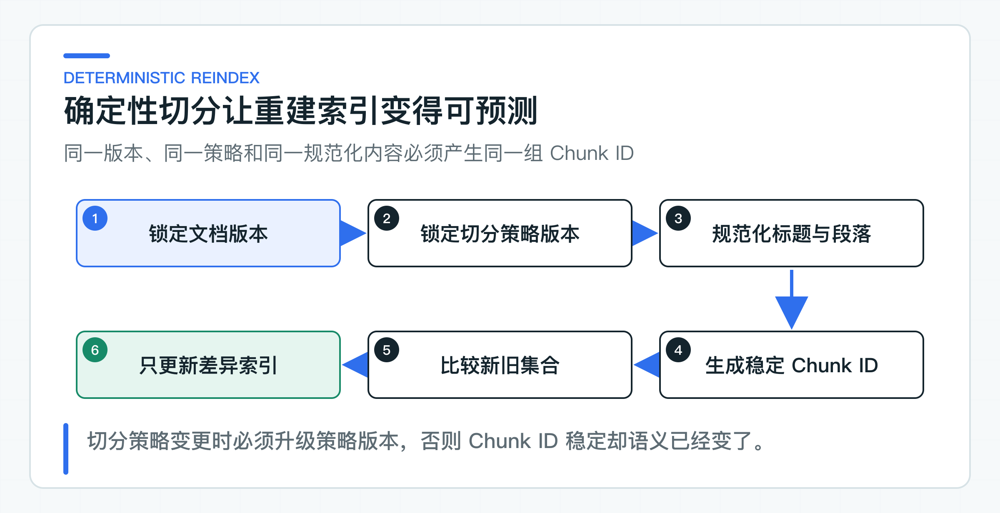

# 文档切分为什么影响召回：标题、条款、元数据和粒度

做 RAG 时，团队往往先讨论 Embedding 模型和向量库。等到“退款多久到账”只召回一句“一到五个工作日”，却丢了适用条件，才发现问题其实出在更早的文档切分。

向量数据库检索的不是整份制度，而是切分后的文本块（Chunk，下文简称 Chunk）。切得太碎，条件和结论会分家；切得太大，无关内容又会稀释相似度。后面的重排（Rerank）和大模型只能使用已经拿到的文本，无法补回切分时丢掉的上下文。

下面用退款政策实现一个确定性的 Markdown 切分器：保留标题路径和条款编号，优先沿段落和句子边界拆分，并为每个 Chunk 生成稳定标识。先把一种文档格式做准，比一开始兼容所有格式更容易验证效果。

## 先把 Chunk 定义成可引用的证据

用户问“退款多久能到账”，系统至少要找回三个信息：适用的退款场景、到账时限、超期后的处理方式。如果原文如下：

```text
# 售后政策

## 退款
第十条 退款审核通过后，款项原路退回。

### 到账时间
银行卡通常需要一到五个工作日。超过五个工作日仍未到账，请联系人工客服。
```

固定每 500 个字符切一刀，可能把“退款审核通过后”留在前一个块，把“一到五个工作日”放到后一个块。向量检索命中后一块时，模型拿到了时间，却丢了生效前提。更糟的是，如果命中内容只有一句“一到五个工作日”，调用方无法向用户说明它属于哪份政策、哪个条款。

合格的 chunk 至少应满足下面几项约束：

- 文本本身能够表达一项相对完整的事实或规则；
- 标题、条款和文档版本能够还原这项事实的业务位置；
- 租户、文档等标识可以参与权限过滤和引用组装；
- 同一输入重复处理时，chunk 边界和标识保持一致；
- 切分规则发生变化时，新旧索引不会悄悄混用。

因此，切分结果不能只是 `List<String>`。企业知识库还需要根据 Chunk 做权限过滤、引用定位和索引迁移，孤立字符串无法提供这些信息。

## 沿着文档结构寻找切分点

原始文档通常同时包含标题、段落、条款、列表和表格。它们在视觉上都属于“文本”，但在检索中的处理方式并不相同。

### 标题要成为上下文

标题不是装饰。`退款 / 到账时间` 和 `提现 / 到账时间` 的正文可能都写着“一到五个工作日”，只对正文做 Embedding 很容易混淆。标题路径应该进入 chunk 元数据；构造检索文本时，也可以把标题与正文一起送入 Embedding 模型，例如：

```text
售后政策 > 退款 > 到账时间
银行卡通常需要一到五个工作日。
```

标题是否拼进最终向量文本，属于索引策略，不应该由文档解析器偷偷决定。解析阶段负责恢复结构，切分阶段负责形成证据块，索引阶段再决定哪些字段参与 Embedding。职责分开后，后续才能单独比较“只嵌入正文”和“标题加正文”的召回效果。

### 条款编号要单独保存

制度类文档常用“第十条”“3.2.1”标识规则位置。条款编号对语义相似度帮助有限，却对引用、审计和人工核对很重要。把它从正文中识别出来并存为 `clause`，前端就能展示“《售后政策》第十条”，而不必从模型答案里反向解析。

当前实现识别以中文“第×条”开头的段落。公司制度如果还包含罗马数字、章/节编号或自定义编号，应当在统一解析层扩展规则，而不是散落在检索和回答代码中。

### 列表不能丢掉引导句

列表经常依赖前面的引导句：

```text
以下情况不支持七天无理由退货：
1. 已拆封的软件；
2. 定制商品；
3. 超过保质期的食品。
```

如果每个列表项单独成块，检索到“定制商品”时，系统可能不知道它属于“不支持退货”的例外。更稳妥的做法是保留引导句，并按列表项分组；当列表很长时，每组都重复必要的引导信息。这里的重复是为了保持语义，不等同于无差别的窗口重叠（overlap）。

### 表格要先恢复表头语义

表格不能直接按换行切。单独一行“华东｜1—3 天｜顺丰”没有列名，离开表头后几乎无法理解。常见做法是把行转换成带字段名的文本：

```text
区域：华东；预计时效：1—3 天；承运商：顺丰。
```

复杂表格还要处理合并单元格、跨页表头和脚注。这些属于解析器能力，不放进当前 Markdown 切分器。切分器接收的应该是结构稳定、编码统一的中间文本，而不是原始 PDF 字节。

## 用元数据管理 Chunk 的来源和生命周期

[DocumentChunk](https://github.com/DavidDingXu/learn-java-ai/blob/main/learning-stages/stage-03-enterprise-rag/services/knowledge-service/src/main/java/com/xiaoding/javaai/knowledge/document/application/DocumentChunk.java) 没有把 chunk 建模成一段孤立文本，而是携带以下字段：

| 字段 | 作用 |
|---|---|
| `chunkId` | 识别一次确定性切分产生的证据块 |
| `tenantId` | 隔离租户数据，参与后续检索过滤 |
| `documentId` | 定位来源文档 |
| `documentVersion` | 区分同一文档的不同业务版本 |
| `chunkPolicyVersion` | 区分不同切分规则生成的索引 |
| `ordinal` | 保留 chunk 在当前文档版本中的顺序 |
| `headingPath` | 还原标题层级，辅助检索和引用 |
| `clause` | 保存制度条款位置 |
| `text` | 交给索引和回答链路的正文证据 |

这些字段不是为了让对象看起来“完整”。它们分别服务于不同环节：`tenantId` 用于数据隔离，文档和版本用于发布控制，标题与条款用于引用，策略版本用于索引迁移，顺序号则为相邻块扩展提供依据。

权限本身不应该只塞进 Chunk。部门、角色、用户授权通常有独立生命周期，应由访问控制列表（ACL）和检索条件管理。Chunk 保留稳定的文档归属，查询时先完成权限过滤，再计算 TopK；不能先跨租户取回相似结果，再在 Java 内存里删除无权限数据。

### 切分器怎样处理标题、段落与超长文本

[PolicyDocumentChunker](https://github.com/DavidDingXu/learn-java-ai/blob/main/learning-stages/stage-03-enterprise-rag/services/knowledge-service/src/main/java/com/xiaoding/javaai/knowledge/document/application/PolicyDocumentChunker.java) 按下面的顺序处理：

1. 把 CRLF 和 CR 统一为 LF，消除常见的跨平台换行差异；
2. 识别 Markdown 的一级到六级标题，维护当前 `headingPath`；
3. 遇到空行或新标题时结束当前段落，形成候选块；
4. 候选块超过长度上限时，优先在句号、问号、感叹号和分号后切分；
5. 单个句子仍然超长时，才改用硬切分；
6. 为最终块补齐元数据并计算 `chunkId`。

构造参数有明确下限：

```java
public PolicyDocumentChunker(int maxCharacters) {
    if (maxCharacters < 20) {
        throw new IllegalArgumentException("maxCharacters must be at least 20");
    }
    this.maxCharacters = maxCharacters;
}
```

这里的 `maxCharacters` 是当前实现的工程参数，不是推荐的生产值。它让切分算法可以独立验证，也便于后续替换为基于 Token 的长度估算器。

[ChunkDocumentCommand](https://github.com/DavidDingXu/learn-java-ai/blob/main/learning-stages/stage-03-enterprise-rag/services/knowledge-service/src/main/java/com/xiaoding/javaai/knowledge/document/application/ChunkDocumentCommand.java) 同时要求文档版本、策略版本和正文合法。调用方必须显式传入 `chunkPolicyVersion`，避免切分策略升级后仍沿用旧索引身份。

## 用模型预算和检索结果校准切分策略

连续实验使用本篇的 `PolicyDocumentChunker` 处理固定退款政策。稍后控制台里的 `VECTOR TopK`、`HYBRID TopK` 和评测报告都会展示稳定 Chunk ID。修改标题、条款或切分策略后，读者能直接看到哪些期望 Chunk 发生了变化，而不是只看一段静态切分示例。

Java 的 `String.length()` 返回 UTF-16 code unit 数量。大多数常用汉字占一个 code unit，部分生僻字符和 Emoji 会占两个。它既不等于用户理解的“字数”，也不等于模型 Token 数。

Token 由具体 tokenizer 决定。同一段中文在不同 Embedding 模型下可能得到不同 Token 数；英文单词、标点、数字和中英混排也会改变比例。生产系统如果只按字符数控制，很可能出现两类偏差：有些块远小于模型上限，浪费可用上下文；另一些块看起来不长，实际 Token 已接近模型限制。

更实用的做法是分两层控制：

- 解析和初步切分使用字符上限，保证实现简单、处理成本可控；
- 写入向量库前使用目标 Embedding 模型对应的 tokenizer 复核，超限时再按语义边界细分。

还要给标题、元数据前缀和模型编码留出空间。假设模型最大输入是 8192 Token，不应把正文上限直接设为 8192，因为最终送入模型的文本可能还会拼接标题路径、文档名称或字段标签。

### 稳定 ID 支撑增量更新

随机 UUID 能保证唯一，却不能说明两个 chunk 是否来自同一份内容。文档重新解析后，每个块都会拿到新 UUID，索引任务无法判断哪些向量可以复用，只能整份删除、整份重建。

当前 `chunkId` 由以下材料计算 SHA-256：

```text
tenantId | documentId | documentVersion | chunkPolicyVersion
| ordinal | headingPath | text
```

各字段采用长度前缀编码后再计算完整 SHA-256，避免字段内容本身包含分隔符时产生相同输入串；摘要加上固定前缀后作为 Chunk ID。换行先经过规范化，所以同一内容分别使用 Windows 和 Unix 换行时，测试能够得到相同结果。这里的“稳定”有严格范围：同一输入、同一策略和同一业务身份下可重复计算。文档内容发生变化，ID 可以随之变化。



这个定义对增量索引很重要。索引任务可以重新切分目标版本，把新旧 `chunkId` 做集合比较：

- 两边都存在的 ID 不需要重新计算向量；
- 只在新集合出现的 ID 需要新增；
- 只在旧集合出现的 ID 需要删除；
- `chunkPolicyVersion` 改变时，按新策略建立独立批次，全部写入成功后再切换检索版本。

不过当前 ID 包含 `ordinal`。如果在文档前部插入一个新块，后续块顺序号改变，即使正文没变，ID 也会跟着变化。这套方案保证确定性重建，但不保证文档编辑后获得最高的向量复用率。

公司文档很大、重建成本较高时，可以进一步把“内容身份”和“展示顺序”拆开：使用章节稳定标识、规范化文本指纹和局部位置生成内容 ID，把 `ordinal` 作为可更新属性保存。代价是必须处理重复段落、段落移动和标题改名的歧义。是否值得引入这套复杂度，要看索引规模、更新频率和 Embedding 成本，不能只因为“增量索引”四个字就提前设计。

### 只在上下文确实断裂时使用 overlap

滑动窗口常见的做法是让相邻 chunk 重复一部分文本。例如每块 500 Token，重叠 100 Token。它能缓解句子刚好落在边界两侧的问题，但副作用同样明显：

- 向量数量增加，写入和存储成本上升；
- TopK 里容易出现多段高度重复的内容；
- 重排模型把名额浪费在重复证据上；
- 引用结果看起来有多条，实际来自同一段文字；
- 文档修改后，受影响的窗口范围扩大。

政策和制度文档通常有清晰标题、条款和段落，可以先按结构切分，不设置全局 overlap。需要跨块上下文时，可以先检索命中块，再根据 `ordinal` 向前或向后扩展一个相邻块。这样主检索结果不含重复窗口，只有在回答组装阶段才补上下文。

两种方式解决的问题不同。overlap 在索引阶段预先复制上下文，相邻扩展在查询阶段按需补充。连续叙事、操作手册可能适合少量 overlap；制度条款更适合结构切分加相邻扩展。选择依据应该是坏案例，而不是框架默认值。

### 从检索结果反推切分参数

“每块多少 Token 最好”没有脱离业务数据的答案。售后政策、产品说明书和会议纪要的结构完全不同，同一个参数不可能同时最优。

调参前先准备一组带标准证据的问题。除了参考答案，每个问题还要标出期望命中的文档、版本、标题路径和条款。然后对不同策略重复构建索引，至少观察这些指标：

| 指标 | 要回答的问题 |
|---|---|
| Evidence Recall@K | 前 K 个结果是否覆盖期望证据 |
| MRR（Mean Reciprocal Rank） | 用首个正确证据排名的倒数衡量它是否足够靠前 |
| 证据完整率 | 命中块是否同时包含结论、条件和例外 |
| 重复率 | TopK 中有多少内容是 overlap 造成的重复 |
| 无关上下文比例 | 交给大模型的文本有多少与问题无关 |
| 引用准确率 | 答案引用能否回到正确文档版本和条款 |

参数比较至少应覆盖块长度、是否携带标题、句子边界、overlap 大小和相邻扩展数量。只看最终答案“像不像正确”不够，因为大模型可能凭参数知识答对，却没有使用企业证据。检索评测先判断证据是否找对，回答评测再判断模型是否忠实使用证据，两层问题要分开定位。

一个常见现象是：增大 chunk 后 Recall@K 上升，但无关上下文也增加，最终回答反而更容易忽略细节；缩小 chunk 后相似度更集中，却把适用条件拆丢。评测的价值就在这里，它不会给出放之四海而皆准的数字，但能告诉你当前业务在哪个方向开始变差。

## 切分策略怎样按文档类型扩展

[PolicyDocumentChunkerTest](https://github.com/DavidDingXu/learn-java-ai/blob/main/learning-stages/stage-03-enterprise-rag/services/knowledge-service/src/test/java/com/xiaoding/javaai/knowledge/document/application/PolicyDocumentChunkerTest.java) 验证三件事：切分后不丢标题路径、条款和版本元数据；换行符差异不改变 chunk ID；超长段落拆分后，每块都不超过策略上限。

这组测试检查切分结果是否可重复。参数是否适合公司文档，还要加入真实 PDF、Word、表格和列表样本，并把检索坏案例放进评测集。

### 接入现有知识库时的改造点

可以直接复用 `DocumentChunk` 的字段设计、策略版本、确定性 ID，以及“先恢复结构、再做切分”的处理顺序。下面这些能力需要按真实数据补齐：

- PDF、Word、网页和扫描件的结构化解析，包括 OCR、表格和跨页标题；
- 与目标 Embedding 模型一致的 tokenizer 和输入上限检查；
- 列表、表格、代码块、FAQ 等文档类型的专用切分策略；
- 基于租户与文档权限的索引过滤和引用返回；
- 切分策略灰度、索引批次切换、失败重试和旧索引清理；
- 用真实问题集持续评估召回、重复证据和引用质量。

不要一开始就把所有文档塞进同一个“智能切分器”。先为文档建立统一的结构化中间模型，再按文档类型选择策略，问题会清楚得多。切分器的好坏最终不由代码行数判断，而由它能否稳定找回完整、可授权、可引用的业务证据判断。

---

[课程首页](../../README.md) · [完整目录](README.md) · [← 文档上传链路：对象存储、内容校验、隔离和解析失败](14-document-upload.md) · [向量检索原理与 pgvector 实现 →](16-pgvector-search.md)

动手实践：[本阶段可运行源码](../../learning-stages/stage-03-enterprise-rag/README.md)
