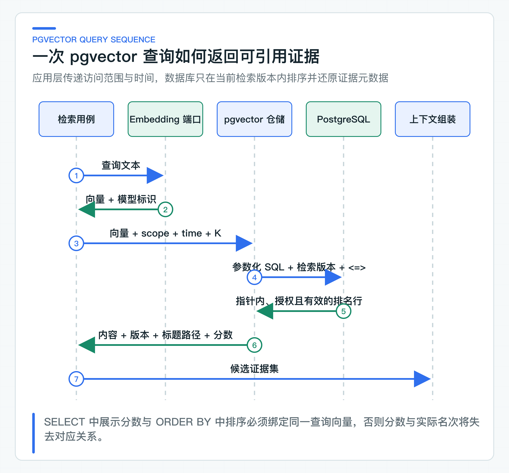

# 向量检索原理与 pgvector 实现

第一条 pgvector 查询通常很快就能跑通：文本转成向量，SQL 按距离排序，再取前几条结果。真正麻烦的是，它即使配置错了也不一定报错，只会悄悄返回一批看似相关、实际不可靠的内容。

例如，入库和查询使用了不同的文本向量模型（Embedding 模型），数据库列维度、距离函数与索引算子没有配套，SQL 仍可能执行。结果里如果又丢了文档版本和条款位置，应用连“这段内容从哪里来”都回答不了。

下面把这条链路逐层拆开，从向量含义、pgvector 查询到 Java 端口，说明哪些配置要一起版本化，以及怎样判断检索结果是否值得交给大模型。

## 完整 RAG 联调需要哪些组件

这一篇直接观察第 13 篇连续实验输出的 `向量 TopK`。结果来自 PostgreSQL 的向量距离查询，向量默认由统一远程 Provider 生成。`local-hash` 只保留为故障排查选项；远程接口没有 Embedding 时，才改用本地 Ollama API。

要把“上传文档 -> 生成向量 -> 检索证据 -> 模型回答”整条链路跑通，当前项目需要：

| 组件 | 在链路中的作用 | 是否可由本地实现替代 |
|---|---|---|
| PostgreSQL + `pgvector` | 保存 Chunk 向量并执行相似度检索 | 完整联调不可替代 |
| PostgreSQL `pg_trgm` | 支持当前混合检索中的关键词候选 | 当前 Schema 需要 |
| Embedding | 为文档和问题生成同一向量空间中的 1536 维向量 | 默认复用统一远程 Provider |
| Chat Provider | 根据检索证据生成回答或拒答 | 只测检索时可不启用 |
| 知识文档与 ACL | 提供可检索内容和权限样本 | 仓库提供示例文档 |
| 入站身份 | 生成租户、用户和部门访问范围 | 本地使用固定身份 |

本地联调不需要先部署身份平台、Redis、Kafka 或 MinIO。将 `java-ai.knowledge.mode` 改为 `postgres-rag` 后，数据库和检索使用真实实现。业务层 Embedding 模式保持 `provider`，具体 Provider 由 `spring.ai.model.embedding` 选择。入站身份仍固定为 `tenant-a / local-user / support`。

`vector` 与 `pg_trgm` 由数据库管理员在专用学习库中预先创建，应用账号不需要超级权限。Knowledge Service 启动时会检查这两个扩展；缺失时直接列出管理员需要执行的 SQL，再停止启动，避免等到索引请求才暴露数据库准备不完整。

上传、发布、索引和问答步骤集中放在阶段 03 的 `.http` 文件和“知识文档导入”Runbook 中。统一远程接口不支持 Embedding 时，RAG 准备文档提供 Ollama 的单项替代配置；它仍通过相同的 Spring AI `EmbeddingModel` 接口工作。

## 先说清向量检索能做什么

Embedding 模型把文本映射为固定维度的浮点向量。语义相近的文本，在所选距离度量下通常更接近。向量数据库做的事情，是从大量候选向量中找出离查询向量较近的一小批 Chunk。

它没有判断政策是否有效，也没有判断用户是否有权阅读，更不能证明某段内容足以回答问题。向量相似度只表达当前模型表示空间中的接近程度。

以“退款多久到账”为例，模型可能把它编码到“退款时效”“原路退回”“审核完成后到账”附近。它也可能召回“退货申请时限”，因为两段文字共享大量售后语义。后续应用仍要结合关键词、业务状态、权限、重排（Rerank）和回答规则处理候选结果。

所以，RAG 链路应当把向量检索看成候选生成器，而不是答案生成器：

```text
用户问题
  -> 查询向量
  -> 受业务条件约束的 TopK 候选
  -> 可选的混合检索与 Rerank
  -> 引用校验和上下文组装
  -> 模型回答或拒答
```

这个认识会影响接口设计。检索结果不能只返回 `String content`，还要返回 `chunkId`、`documentId`、文档版本、标题路径、条款号和分数。否则答案看似有知识上下文，系统却无法展示引用，也无法定位召回错误来自哪个版本。

### 相似度分数不代表回答正确

项目使用 pgvector 的余弦距离运算符 `<=>`。余弦相似度关注两个向量方向是否接近：

```text
cosine_similarity(a, b) = (a · b) / (||a|| * ||b||)
cosine_distance(a, b)   = 1 - cosine_similarity(a, b)
```

距离越小越接近。查询中使用 `1 - distance`，只是把结果转换成更符合阅读习惯的“分数越大越相似”：

```sql
1 - (dc.embedding <=> ?::vector) AS score
```

这个分数不能直接解释成“有 91% 的概率正确”。它不是分类模型置信度，也没有跨模型可比性。Embedding 模型、文本语言、Chunk 粒度和语料分布变化后，同一个阈值的含义都会改变。

生产项目不要先拍一个 `score >= 0.8` 的固定值，再用几个成功案例证明它合理。更可靠的做法是准备带标准证据的查询集，观察 Recall@K（前 K 个结果覆盖期望证据的比例）、空召回率和噪声比例。阈值应当由业务数据校准，并且和模型版本一起管理。

TopK 和阈值也不是互相替代的参数。TopK 控制最多取多少候选，阈值控制候选至少要有多接近。只设置 TopK，在完全无关的问题上也可能硬取出若干结果；只设置阈值，则可能在重复文档很多时返回过多内容。两者通常要配合上下文预算、Rerank 和拒答策略一起确定。

### Embedding 模型与索引一起版本化

向量不是独立于模型存在的通用数据。同一段文本使用两个 Embedding 模型生成的向量，即使维度相同，也未必处于同一个表示空间。拿模型 A 生成的查询向量去搜索模型 B 生成的文档向量，SQL 可能正常执行，结果却没有语义依据。

数据库把向量列定义为 `VECTOR(1536)`，并同时保存 `embedding_model`：

```sql
CREATE TABLE document_chunk (
    tenant_id VARCHAR(128) NOT NULL,
    document_id VARCHAR(160) NOT NULL,
    version_number INTEGER NOT NULL,
    chunk_id VARCHAR(80) NOT NULL,
    content TEXT NOT NULL,
    embedding VECTOR(1536),
    embedding_model VARCHAR(160),
    created_at TIMESTAMPTZ NOT NULL,
    PRIMARY KEY (tenant_id, chunk_id)
);
```

`1536` 是当前向量列的固定维度，不是“向量都应该是 1536 维”的行业规则。接入真实模型时，模型输出维度必须与列定义一致。换成其他维度，应该通过 Flyway 新增列或新表，完成回填、评测和查询切换，不能在运行时截断或补零来迁就旧表。

模型名称也不能只写在配置文件里。索引数据必须能回答“这条向量由哪个模型、哪套预处理和哪版 Chunk 生成”。公司项目中还可以增加 `embedding_policy_version`，把文本规范化、标题拼接和模型参数纳入版本。这样才能判断哪些数据需要重建。

更换 Embedding 模型时，稳妥的路径是建立影子索引。新模型针对同一批 Chunk 生成新向量，查询流量先做离线对照，再对少量请求双路检索。固定数据集通过后切换读取，旧向量保留一个回退窗口。直接覆盖原列会同时失去基线和回滚能力。

## 用业务端口隔离模型与数据库细节

检索用例的业务语义是“在经过身份校验的访问范围和有效时间内，找出与问题最相关的知识片段”。应用层不需要知道 PostgreSQL 使用 `<=>`，也不应该依赖 Spring AI 的 `VectorStore` 类型。

[KnowledgeEmbeddingModel](https://github.com/DavidDingXu/learn-java-ai/blob/main/learning-stages/stage-03-enterprise-rag/services/knowledge-service/src/main/java/com/xiaoding/javaai/knowledge/retrieval/application/port/KnowledgeEmbeddingModel.java) 和 [KnowledgeChunkSearchRepository](https://github.com/DavidDingXu/learn-java-ai/blob/main/learning-stages/stage-03-enterprise-rag/services/knowledge-service/src/main/java/com/xiaoding/javaai/knowledge/retrieval/application/port/KnowledgeChunkSearchRepository.java) 分别承担两个端口：

```java
public interface KnowledgeEmbeddingModel {
    KnowledgeEmbedding embed(String text);
}

public interface KnowledgeChunkSearchRepository {
    List<RetrievedKnowledgeChunk> search(
            float[] embedding,
            String embeddingModel,
            KnowledgeAccessScope scope,
            Instant effectiveAt,
            int topK
    );
}
```

[KnowledgeRetrievalService](https://github.com/DavidDingXu/learn-java-ai/blob/main/learning-stages/stage-03-enterprise-rag/services/knowledge-service/src/main/java/com/xiaoding/javaai/knowledge/retrieval/application/KnowledgeRetrievalService.java) 只编排两个动作：生成问题向量，再携带经过身份校验的访问范围查询候选 Chunk。

```java
public KnowledgeRetrievalResult retrieve(RetrieveKnowledgeQuery query) {
    KnowledgeEmbedding embedding = embeddingModel.embed(query.question());
    var chunks = searchRepository.search(
            embedding.vector(),
            embedding.model(),
            query.accessScope(),
            query.effectiveAt(),
            query.topK()
    );
    return new KnowledgeRetrievalResult(embedding.model(), chunks);
}
```

这两个端口隔开了两种独立变化：模型 Provider 会变，向量存储方案也会变。业务用例只依赖明确的输入和返回类型。更换 Embedding Provider 时不改检索 SQL；从 pgvector 迁移到其他向量存储时，也不需要让 Controller 和回答服务理解新的 SDK。

`SpringAiKnowledgeEmbeddingModel` 通过统一 `EmbeddingModel` 端口批量提交文本，并校验模型名、输入数量、结果索引和 1536 维约束。无论底层是 Ollama 还是远程 Provider，少量结果、重复索引或错误维度都会让索引任务失败，不会把不同空间的向量混进同一索引。

`DeterministicHashEmbeddingModel` 仍是可配置的排查适配器。它能检查模型版本隔离、pgvector SQL 和 ACL，却不具备语义表示能力。看到它出现在阶段报告里，只能判断工程链路是否接通。

### 一次 pgvector 查询的执行过程

[PgVectorSearchQuery](https://github.com/DavidDingXu/learn-java-ai/blob/main/learning-stages/stage-03-enterprise-rag/services/knowledge-service/src/main/java/com/xiaoding/javaai/knowledge/retrieval/infrastructure/PgVectorSearchQuery.java) 生成参数化 SQL，[PgVectorKnowledgeChunkSearchRepository](https://github.com/DavidDingXu/learn-java-ai/blob/main/learning-stages/stage-03-enterprise-rag/services/knowledge-service/src/main/java/com/xiaoding/javaai/knowledge/retrieval/infrastructure/PgVectorKnowledgeChunkSearchRepository.java) 负责绑定参数并映射结果。



核心查询可以压缩为下面这段：

```sql
SELECT dc.chunk_id,
       dc.document_id,
       dc.version_number,
       dc.heading_path,
       dc.clause,
       dc.content,
       1 - (dc.embedding <=> ?::vector) AS score
  FROM document_chunk dc
  JOIN document_search_version dsv
    ON dsv.tenant_id = dc.tenant_id
   AND dsv.document_id = dc.document_id
   AND dsv.version_number = dc.version_number
  JOIN knowledge_document kd
    ON kd.tenant_id = dc.tenant_id
   AND kd.document_id = dc.document_id
 WHERE dc.tenant_id = ?
   AND dc.embedding_model = ?
   AND kd.status = 'ACTIVE'
   AND dc.embedding IS NOT NULL
   AND EXISTS (
       SELECT 1
         FROM document_version active_dv
        WHERE active_dv.tenant_id = dc.tenant_id
          AND active_dv.document_id = dc.document_id
          AND active_dv.status = 'PUBLISHED'
          AND active_dv.effective_from <= ?
          AND (active_dv.effective_until IS NULL
               OR active_dv.effective_until > ?)
   )
   AND EXISTS (/* 当前身份可读的访问控制条件 */)
 ORDER BY dc.embedding <=> ?::vector
 LIMIT ?;
```

`document_search_version` 指向已经完整写入的检索版本。旁边的 `EXISTS` 继续检查这份文档当前是否有处于有效期内的业务发布版本。两个条件缺一不可：只看业务状态会在索引未完成时查不到内容，只看检索指针又可能继续返回已经整体失效的文档。

查询向量出现两次。`SELECT` 中的一次用于返回可观察的相似度，`ORDER BY` 中的一次用于排序和使用向量索引。两处必须绑定同一个向量，不能分别生成，否则展示分数和实际排序会失去对应关系。`embedding_model` 也必须与查询向量的模型标识一致，升级模型时不能让旧向量和新向量进入同一次距离排序。

向量文本使用参数绑定进入 `?::vector`，租户、时间、身份和 `LIMIT` 也全部参数化。部门列表只动态生成占位符数量，不把部门 ID 拼进 SQL。这样既保留可变数量的权限条件，也避免把请求值当成 SQL 结构。

结果映射同样重要。`heading_path` 从 JSONB 还原为标题路径，`documentId` 和版本号跟随内容返回。后续上下文组装可以生成“退款政策 / 售后规则 / 第十条”这样的引用，而不是把一段失去出处的文本交给模型。

持久化异常被包装成 `KnowledgeSearchPersistenceException`。这里不应该捕获后返回空列表。数据库连接失败与“确实没有相关知识”是两种完全不同的业务事实。前者需要错误响应、指标和告警，后者才可能进入拒答分支。

## 数据增长后再选择近似索引

没有近似索引时，数据库需要计算查询向量与所有候选向量的距离，再排序取前 K。数据量很小时这条精确查询足够简单，也方便建立质量基线。Chunk 数量上升后，全量距离计算会逐渐成为延迟和 CPU 瓶颈。

项目通过 Flyway 创建 HNSW 索引。HNSW（Hierarchical Navigable Small World）是一种近似最近邻索引；这里的索引算子与查询使用的余弦距离保持一致：

```sql
CREATE INDEX ix_document_chunk_embedding_hnsw
    ON document_chunk USING hnsw (embedding vector_cosine_ops)
    WHERE embedding IS NOT NULL;
```

HNSW 用额外存储和建索引成本换取较低的近似搜索延迟。近似搜索的含义是，返回结果可能不是全量精确计算下绝对最近的 K 条。它适合读多、需要低延迟，并且可以用固定数据集测量召回损失的知识检索场景。

索引选择不要只看“哪种更快”。至少要把下面几件事一起测量：

| 方案 | 适合先使用的场景 | 主要代价 |
|---|---|---|
| 精确扫描 | 数据量小、建立质量基线、离线评测 | 数据增长后距离计算和排序成本高 |
| HNSW | 读请求多、需要较低延迟、能接受建索引成本 | 占用更多内存和存储，写入与构建更重，参数影响召回 |
| IVFFlat | 数据量稳定、可以训练分区并持续调参 | 数据分布变化后要重新评估，候选探测不足会漏召回 |

“建了索引”也不等于查询一定走索引。小表上 PostgreSQL 可能认为顺序扫描更便宜；过滤条件选择性、统计信息和 `LIMIT` 都会影响执行计划。上线前要对真实数量级运行 `EXPLAIN (ANALYZE, BUFFERS)`，观察计划、实际行数、耗时和缓存命中，而不是只确认索引对象存在。

多租户和严格的访问控制列表（ACL）会进一步改变执行特征。一个租户只有几百条可见 Chunk，另一个租户可能有几百万条。全局平均延迟掩盖不了大租户和窄权限用户的问题。性能样本要按租户规模、权限范围和问题类型分桶，P95、P99 与空召回率比单次执行时间更有意义。

### 把分数、K 值和上下文预算放在一起调

`topK=20` 不代表最后把 20 段文本全部放进 Prompt。候选生成可以适当放宽，经过去重、Rerank、同文档合并和引用校验后，再根据上下文预算截取证据。

如果多个 Chunk 来自同一条款的相邻切片，直接占满 TopK 会挤掉其他证据。可以按 `documentId + version + clause` 做受控去重，或者在切分阶段保留父子关系。去重规则必须记录在评测配置中，因为它会改变 Recall@K 和最终上下文。

也不要用增大 K 掩盖检索质量问题。K 变大通常会提高召回上限，同时增加噪声、Token 成本和模型引用错误。正确做法是从 Golden Set 中区分几类失败：正确证据根本没有进入候选、进入候选但排序靠后、正确证据已进入上下文但模型仍答错。三类问题分别对应切分与 Embedding、排序策略、回答约束，不能都靠调 K 解决。

相似度阈值应当放在可观察的检索策略中，而不是散落在 Controller。每次评测至少记录模型名、Chunk 策略版本、距离度量、候选 K、最终 K 和阈值。缺少这些信息，同一批问题两次跑出不同结果时，很难判断变化来自模型、数据还是代码。

## 区分基础设施故障和空召回

向量链路常见的失败不止“没有结果”。

模型返回维度与 `VECTOR(1536)` 不一致时，应当在适配器边界立即失败，并记录模型与期望维度。不要等到 JDBC 抛出难以理解的数据库异常。

文档 Chunk 没有向量时，当前 SQL 通过 `embedding IS NOT NULL` 排除它。系统还需要从索引任务指标中看到缺失比例。大量 Chunk 被排除，查询仍然可能返回少量结果，单靠接口成功率发现不了索引不完整。

数据库查询超时或连接失败时，不能伪装成空召回。回答服务应返回明确的暂不可用结果，或者走经过业务批准的降级知识源。让模型在没有证据时自由回答，会把基础设施故障变成业务错误。

召回分数很低时，系统应进入拒答或澄清，而不是用“最接近的一条”凑出答案。拒答本身也要进入评测，避免为了提高回答率牺牲准确性。

## Java 编排与 pgvector 行为分开判断

不依赖外部数据库的测试可以检查应用层传参、SQL 结构、参数顺序和结果映射：

[KnowledgeRetrievalServiceTest](https://github.com/DavidDingXu/learn-java-ai/blob/main/learning-stages/stage-03-enterprise-rag/services/knowledge-service/src/test/java/com/xiaoding/javaai/knowledge/retrieval/application/KnowledgeRetrievalServiceTest.java) 验证问题经过 Embedding 后，访问范围、生效时间和 TopK 原样进入仓储端口。[PgVectorSearchQueryTest](https://github.com/DavidDingXu/learn-java-ai/blob/main/learning-stages/stage-03-enterprise-rag/services/knowledge-service/src/test/java/com/xiaoding/javaai/knowledge/retrieval/infrastructure/PgVectorSearchQueryTest.java) 验证租户、检索版本、业务有效期和 ACL 条件都出现在 `LIMIT` 之前。

真实 pgvector 行为仍需要 PostgreSQL 环境。`PgVectorExternalIT` 会执行 Flyway、创建扩展并重建测试结构，因此只能指向一次性或专用测试库，不能连接共享库和生产库。默认本地验证不运行这项破坏性测试；它适合放在已经准备好隔离数据库的集成环境中。

外部验证覆盖数据库迁移、运算符、参数绑定、权限前置过滤，以及替换索引前后的版本切换。语义召回质量仍要使用目标 Embedding 模型、业务文档和固定评测集评估。

### 接入公司项目时的替换范围

可以直接复用检索用例的职责划分、Embedding 端口、带来源信息的结果类型、Flyway 管理方式，以及“模型版本和索引数据一起版本化”的原则。

需要按公司条件替换的部分包括 Embedding Provider、向量维度、索引参数、数据库规格、连接池和超时策略。数据量很大或租户隔离要求更强时，还要重新决定分区、分片与独立集群，不能把单表方案机械放大。

当前查询只完成单路向量候选生成。增加关键词召回、查询改写和 Rerank 后，仍要使用相同的权限过滤和引用字段。无论增加多少检索算法，租户、版本、有效期和 ACL 都不能退回到召回之后处理。

---

[课程首页](../../README.md) · [完整目录](README.md) · [← 文档切分为什么影响召回：标题、条款、元数据和粒度](15-document-chunking.md) · [权限为什么必须在 TopK 之前过滤 →](17-acl-before-topk.md)

动手实践：[本阶段可运行源码](../../learning-stages/stage-03-enterprise-rag/README.md)
