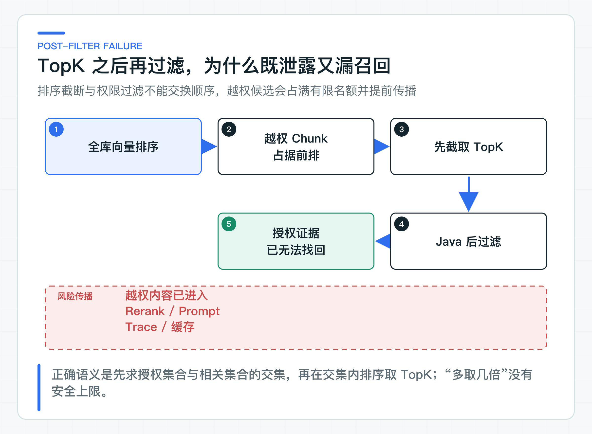
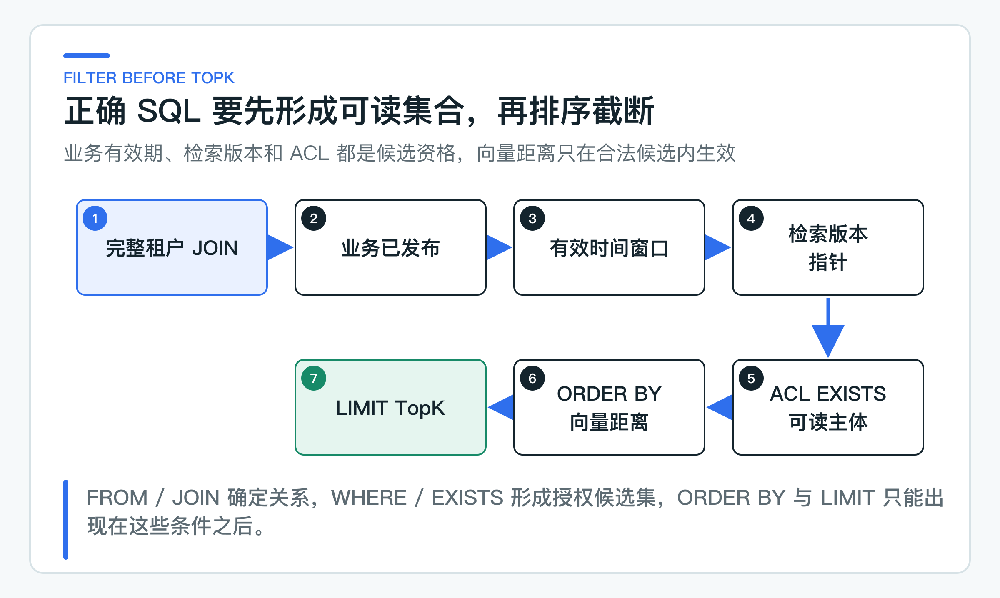

# 权限为什么必须在 TopK 之前过滤

向量检索里有一种实现很常见：先从全库取相似度最高的 20 条 Chunk，再在 Java 中删掉当前用户无权阅读的内容。代码直观，结果却不等价。

如果前 20 条都来自无权访问的财务制度，过滤后只会得到空列表；真正可见的售后政策即使排在第 21 位，也已经被 TopK 截掉。更严重的是，那些越权文本可能早已进入 Rerank、日志或模型上下文。

所以，权限条件要参与候选集合的形成。只有当前身份可读、当前有效且属于目标索引版本的 Chunk，才进入距离排序。

## TopK 之后过滤会漏掉正确结果

假设知识库中有 100 条财务制度 Chunk 与问题高度相关，客服用户无权读取。对客服开放的售后政策排在全库第 101 位。

如果先从全库取 Top10，再删除财务内容，最终结果是空。把 TopK 改成 50 仍然是空，改成 100 也可能是空。只有先建立客服可见集合，再在这个集合中取 TopK，售后政策才会被召回。



用集合表达更清楚。`R(q)` 表示所有 Chunk 按查询 `q` 的相似度排序，`A(identity, time)` 表示当前身份在当前时间有权读取的 Chunk 集合。

正确计算是：

```text
TopK(R(q) ∩ A(identity, time))
```

错误计算是：

```text
Filter(TopK(R(q)), A(identity, time))
```

排序截断和权限过滤不能交换顺序。TopK 一旦把第 101 位之后的内容丢掉，Java 过滤无法把正确证据找回来。所谓“多取一点再过滤”只是猜测越权内容有多少，没有可证明的安全边界，也没有稳定的召回上限。

### 越权候选会继续流向下游

有人会认为，只要最终响应没有返回越权文本，就不算泄露。这个判断忽略了检索结果在响应前还会经过多少环节。

越权 Chunk 可能进入 Rerank 模型、Prompt 组装、Trace、调试日志和缓存。即使响应前的 Java 代码删掉了文本，第三方模型 Provider、观测系统或共享缓存已经看过内容。权限边界一旦越过，响应层删除不能撤销前面的传播。

分数和元数据也可能泄露信息。接口返回“存在 10 条高度相关内容，但无权查看”，就能让用户推断某项制度或某个项目存在。严格场景下，越权候选不应该参与计数、排序、耗时差异和错误分支。

后过滤还会污染运行指标。空召回率突然升高，看起来像 Embedding 质量下降，实际是 TopK 被越权内容占满。团队可能继续调大 K、增加 Rerank 成本，却没有修复权限条件的位置。

因此，最小原则是：明文、向量、分数和元数据在进入任何下游处理前，都必须处于已授权集合中。

## 访问范围来自服务端身份

权限下推到 SQL 之前，先要确认权限输入已经过验证。

请求体里的 `tenantId`、`userId` 和 `departmentIds` 不能直接变成检索条件。调用者可以修改这些值。知识服务应从受信身份组件取得当前身份，再转换成应用层的访问范围。

[KnowledgeAccessScopeProvider](https://github.com/DavidDingXu/learn-java-ai/blob/main/learning-stages/stage-03-enterprise-rag/services/knowledge-service/src/main/java/com/xiaoding/javaai/knowledge/security/KnowledgeAccessScopeProvider.java) 屏蔽身份协议差异，统一生成 [KnowledgeAccessScope](https://github.com/DavidDingXu/learn-java-ai/blob/main/learning-stages/stage-03-enterprise-rag/services/knowledge-service/src/main/java/com/xiaoding/javaai/knowledge/retrieval/application/KnowledgeAccessScope.java)：

```java
public record KnowledgeAccessScope(
        TenantId tenantId,
        String subjectId,
        List<String> departmentIds
) {
    public KnowledgeAccessScope {
        if (subjectId == null || subjectId.isBlank()) {
            throw new IllegalArgumentException("subjectId must not be blank");
        }
        departmentIds = List.copyOf(departmentIds);
    }
}
```

`KnowledgeAccessScope` 进入应用用例后就代表已认证身份，不再接受业务参数覆盖。Controller 可以接收问题、TopK 等查询输入，但不能让用户在 JSON 中选择自己属于哪个租户或部门。

本地默认使用固定的 `tenant-a / local-user / support`，不需要额外生成 Token。公司环境则由 JWT、Session、网关或权限服务适配器建立同一个对象。无论采用哪种协议，调用方自报的身份都不能覆盖它。

部门为空时，应当解释为用户没有部门授权，而不是“部门条件不限”。查询会省略部门 ACL 分支，同时保留用户授权和租户级授权。空集合的语义必须收紧权限，不能扩大权限。

## 用 ACL 表表达可读集合

访问控制列表（Access Control List，ACL）用于描述哪些主体可以读取哪些文档。数据模型用 `document_acl` 保存文档级读取授权：

```sql
CREATE TABLE document_acl (
    tenant_id VARCHAR(128) NOT NULL,
    document_id VARCHAR(160) NOT NULL,
    subject_type VARCHAR(32) NOT NULL,
    subject_id VARCHAR(160) NOT NULL,
    permission VARCHAR(32) NOT NULL,
    created_at TIMESTAMPTZ NOT NULL,
    PRIMARY KEY (
        tenant_id, document_id,
        subject_type, subject_id, permission
    )
);
```

当前支持三种读取主体：具体用户、部门和整个租户。某个文档只要存在一条与当前身份匹配的 `READ` 记录，就进入可读集合。

```text
USER       -> subjectId 精确匹配当前用户
DEPARTMENT -> subjectId 位于当前用户部门集合
TENANT     -> subjectId 匹配当前租户
```

这是一套显式允许模型。没有匹配记录就是不可读。它比“默认全员可见，敏感文档再加限制”更适合企业知识，因为新文档、导入数据和异常流程不会因漏配一条拒绝规则自动开放。

当前模型没有表达显式 `DENY`、组织层级继承、岗位属性和动态条件。公司已有 IAM 或 ABAC 平台时，不要把复杂策略翻译成越来越长的 SQL 字符串。可以由授权服务计算稳定的策略集合或可查询授权关系，再让知识检索执行本地可判定条件。远程逐 Chunk 调用权限服务会产生 N+1 请求，也无法保证 TopK 前完成候选裁剪。

显式拒绝一旦加入，就必须定义优先级。例如用户被部门授权，同时被单独拒绝，最终是允许还是拒绝。规则没有唯一答案，但必须由权限域统一决定，不能让知识服务、搜索服务和前端各写一套。

### 每一次关联都带上租户条件

多租户系统不能只在最外层加 `WHERE tenant_id = ?`，后面的关联却只用 `document_id`。不同租户可能拥有同名文档 ID，一次漏掉租户条件的 JOIN 就可能把版本、ACL 或 Chunk 串到另一个租户。

表的主键和外键都把 `tenant_id` 放进标识，查询关联同样携带租户：

```sql
JOIN document_search_version dsv
  ON dsv.tenant_id = dc.tenant_id
 AND dsv.document_id = dc.document_id
 AND dsv.version_number = dc.version_number
```

ACL 子查询也同时匹配 `tenant_id` 和 `document_id`。这种重复看起来啰嗦，却能让隔离条件沿着数据关系传递。数据库行级安全、独立 Schema 或独立实例可以形成更强隔离，但应用查询仍然要带租户语义，否则本地测试和迁移脚本很容易产生跨租户行为。

如果公司按租户分库，`tenantId` 还要参与数据源路由。路由完成后仍建议在表中保留租户列，用于审计、备份恢复和防止错误路由后的静默串数。是否保留要结合数据规模与监管要求决定，不能只为了少一个字段放弃可追溯性。

### 版本状态与有效时间共同决定可见性

权限不只回答“谁能看”，还要回答“这份文档当前是否允许服务，以及哪一版索引已经准备好”。草稿和尚未生效的政策即使 ACL 匹配，也不应该进入线上问答。

因此，可检索集合还包含这些确定性条件：

```sql
dsv.version_number = dc.version_number
AND EXISTS (
    SELECT 1
      FROM document_version active_dv
     WHERE active_dv.tenant_id = dc.tenant_id
       AND active_dv.document_id = dc.document_id
       AND active_dv.status = 'PUBLISHED'
       AND active_dv.effective_from <= :effectiveAt
       AND (active_dv.effective_until IS NULL
            OR active_dv.effective_until > :effectiveAt)
)
AND dc.embedding IS NOT NULL
```

生效时间由服务端确定，通常取服务端收到请求时的时间。除非业务明确支持历史查询，否则不要让普通用户在请求中传任意 `effectiveAt`，否则他可能检索已经失效或尚未公开的版本。

业务发布状态与索引完成状态也要分开。`document_search_version` 只在目标版本的全部分块写入成功后切换。替换版本仍在索引时，已有文档继续查询上一版索引；首次发布没有可回退版本，在索引完成前不会返回这份文档。ACL 是文档级规则，新发布写入的 ACL 会立即约束上一版索引。

## SQL 先形成可见集合，再排序截断

[PgVectorSearchQuery](https://github.com/DavidDingXu/learn-java-ai/blob/main/learning-stages/stage-03-enterprise-rag/services/knowledge-service/src/main/java/com/xiaoding/javaai/knowledge/retrieval/infrastructure/PgVectorSearchQuery.java) 先通过 `JOIN` 和 `WHERE` 约束租户、检索版本、业务有效期与 ACL，形成候选集合后再执行向量排序和 `LIMIT`：

```sql
SELECT dc.chunk_id,
       dc.document_id,
       dc.version_number,
       dc.heading_path,
       dc.clause,
       dc.content,
       1 - (dc.embedding <=> ?::vector) AS score
  FROM document_chunk dc
  JOIN document_search_version dsv
    ON dsv.tenant_id = dc.tenant_id
   AND dsv.document_id = dc.document_id
   AND dsv.version_number = dc.version_number
 WHERE dc.tenant_id = ?
   AND dc.embedding IS NOT NULL
   AND EXISTS (
       SELECT 1
         FROM document_version active_dv
        WHERE active_dv.tenant_id = dc.tenant_id
          AND active_dv.document_id = dc.document_id
          AND active_dv.status = 'PUBLISHED'
          AND active_dv.effective_from <= ?
          AND (active_dv.effective_until IS NULL
               OR active_dv.effective_until > ?)
   )
   AND EXISTS (
       SELECT 1
         FROM document_acl acl
        WHERE acl.tenant_id = dc.tenant_id
          AND acl.document_id = dc.document_id
          AND acl.permission = 'READ'
          AND (
              (acl.subject_type = 'USER' AND acl.subject_id = ?)
              OR (acl.subject_type = 'DEPARTMENT' AND acl.subject_id IN (...))
              OR (acl.subject_type = 'TENANT' AND acl.subject_id = ?)
          )
   )
 ORDER BY dc.embedding <=> ?::vector
 LIMIT ?;
```



SQL 的逻辑执行顺序正好表达业务含义：`FROM/JOIN` 确定数据关系，`WHERE/EXISTS` 形成当前身份可用的候选集合，`ORDER BY` 在集合内部计算距离顺序，`LIMIT` 完成截断。

不要把 ACL 条件只放进应用层 Repository 名字，实际 SQL 却在子查询外先 `LIMIT`。安全评审要看生成后的 SQL 和执行计划。ORM、向量框架或搜索 SDK 的过滤参数，也要确认它们是在服务端检索阶段执行，还是取回候选后才在客户端过滤。

部门数量可变时，当前实现只拼接 `?` 占位符，部门 ID 仍通过 `PreparedStatement` 绑定。部门为空则不生成 `IN` 分支，避免 `IN ()` 语法错误，也避免把空部门误解为任意部门。

### 放大候选数量无法修正边界

后过滤方案常见的补丁是按 `K * 10` 召回，再过滤到 K 条。它仍然解决不了问题。

第一，越权候选在过滤前已经离开存储边界。第二，越权比例没有稳定上限，财务制度可能占前 100 条，也可能占前 10 万条。第三，过取会放大向量计算、网络传输和 Rerank 成本。第四，不同用户看到的候选不足程度不同，质量指标无法解释。

分页会让问题更明显。第一页过滤后只剩 2 条，第二页的偏移量应该按全库排名还是授权集合排名？只要分页发生在过滤前，就无法给出稳定且无泄露的游标。

正确修复只有一个方向：让存储引擎在排序和截断前看到授权条件。如果所选向量产品做不到这一点，就要调整数据组织、索引策略或产品选型，而不是在 Java 中补一个 `filter`。

## 性能与权限变化不能改写可见集合

### 在真实权限范围内评测近似索引

权限前置解决了安全语义，不代表性能和召回自动稳定。近似向量索引面对选择性很高的过滤条件时，可能需要扫描更多候选，才能找到 K 条授权结果。某些用户可见整个租户，某些用户只看一个小部门，两者的执行计划和尾延迟会差很多。

公司项目至少要按三类访问范围压测：租户级广权限、部门级中等范围、用户级窄权限。每类记录 P95/P99、返回条数、Recall@K 和数据库读取量。如果窄权限经常返回不足 K 条，需要评估索引搜索参数、数据分区、局部索引或按安全域拆分索引。

不要为提高召回把 ACL 从索引查询中拿掉。性能优化必须保持同一个授权集合。可以改变物理组织和搜索参数，不能改变“谁有资格参与排序”的业务规则。

`document_acl` 上的索引按 `tenant_id, subject_type, subject_id, document_id` 排列，服务于从当前身份查可读文档。是否还需要以 `document_id` 开头的索引，要根据真实执行计划决定。索引过多会增加文档授权变更的写成本，也会占用缓存空间。

### 权限变更后的索引与缓存处理

读取权限不是静态配置。用户转岗、部门调整、文档提密或账号冻结后，旧授权要尽快失效。

当前查询每次读取 `document_acl`，权限更新提交后，新查询会看到新集合。引入缓存时要格外谨慎。缓存键至少要包含租户、主体、部门集合、授权版本和检索策略，仅用“问题文本 + topK”作为键会直接跨用户复用结果。

更稳妥的方式是缓存不含敏感正文的公共计算，或者缓存已经按稳定安全域隔离的结果。权限变化频繁、文档敏感度高时，宁可先不缓存检索结果，也不要设计一个无法可靠失效的授权缓存。

如果查询走只读副本，还要考虑复制延迟。新增权限晚几秒生效通常只是可用性问题，撤销权限晚几秒生效则可能是安全问题。敏感权限撤销可以在短窗口内强制读主库，或者使用能表达读取位点的一致性机制。具体方案取决于数据库架构，但不能假设“最终一致总会没事”。

ACL 更新和文档发布也需要明确事务边界。新版本发布时，如果 ACL 尚未写入，显式允许模型会让它暂时不可见，这通常比意外全员可见安全。反过来，先写租户级 ACL、后写敏感文档，可能产生短暂开放窗口。创建文档、设置 ACL 和允许发布的顺序应由一个应用用例约束。

## 更相似的越权样本才能暴露错误

只测试“授权文档能够查到”，证明不了 ACL 在 TopK 前执行。有效测试要同时放入授权文档、同租户越权文档和其他租户文档，并让越权文档在未过滤时足以占据 TopK。

连续实验额外发布一份只允许 `finance` 部门读取的文档，并写入唯一词 `quartz-lotus-927`。本地身份属于 `support`；即使直接搜索这个唯一词，控制台仍应显示 `财务文档进入 TopK: false`。这就是本篇的读者可见负例。

[PgVectorSearchQueryTest](https://github.com/DavidDingXu/learn-java-ai/blob/main/learning-stages/stage-03-enterprise-rag/services/knowledge-service/src/test/java/com/xiaoding/javaai/knowledge/retrieval/infrastructure/PgVectorSearchQueryTest.java) 先检查 SQL 结构：租户、检索版本、业务有效期、用户和部门 ACL 均出现在 `LIMIT` 之前；没有部门声明时，不生成部门分支。

启动检查会加载服务默认配置，其余用例直接验证 SQL 生成和本地身份映射。整组验证不需要数据库、身份平台或模型密钥，但也不能代替真实 PostgreSQL 的执行结果。

[PgVectorExternalIT](https://github.com/DavidDingXu/learn-java-ai/blob/main/learning-stages/stage-03-enterprise-rag/services/knowledge-service/src/test/java/com/xiaoding/javaai/knowledge/retrieval/infrastructure/PgVectorExternalIT.java) 使用真实 PostgreSQL 与 pgvector，写入当前用户可读、同租户越权和其他租户的 Chunk。

越权 Chunk 与查询向量完全一致，其他租户 Chunk 也比授权 Chunk 更相似。以 `topK=1` 查询时，结果仍然只能是授权 Chunk；权限条件若在截断后执行，这个用例就会失败。

日常代码验证不依赖 PostgreSQL。真实数据库验证属于接入公司环境后的迁移检查。

`PgVectorExternalIT` 会清空并重建测试结构，只能在一次性或专用数据库运行，不会进入默认本地验证。已有外部验证覆盖真实 SQL、Flyway 表结构、pgvector 运算和“越权内容更相似”的对抗样本。正式项目还要增加已过期版本、未来生效版本、空部门、权限撤销和跨租户同名文档等案例。安全测试要专门构造最容易被错误实现放过的内容，确认它们进不了候选集。

### 接入现有权限体系时的检查项

可以直接复用的是身份转换、仓储端口和 SQL 过滤的整体边界。经过验证的身份先转换成 `KnowledgeAccessScope`，SQL 再在 TopK 前完成租户与 ACL 过滤；返回结果继续保留文档版本和引用元数据。

需要按公司权限体系替换的是主体类型、组织关系、显式拒绝、临时授权、密级、区域限制和策略决策来源。权限规则越复杂，越应该由专门权限服务返回明确、可记录的判断结果；知识服务负责执行结果，不能让 Prompt 或模型判断用户是否有权阅读。

还要守住一条数据传播边界：未授权 Chunk 不进入 Rerank，不进入模型上下文，不进入可搜索日志，也不进入跨身份缓存。只要这条边界成立，后续增加关键词检索、Query Rewrite、Rerank 或其他向量存储时，权限判断才不会随着框架实现改变。

---

[课程首页](../../README.md) · [完整目录](README.md) · [← 向量检索原理与 pgvector 实现](16-pgvector-search.md) · [混合检索、Query Rewrite、Rerank 什么时候有用 →](18-hybrid-retrieval.md)

动手实践：[本阶段可运行源码](../../learning-stages/stage-03-enterprise-rag/README.md)
