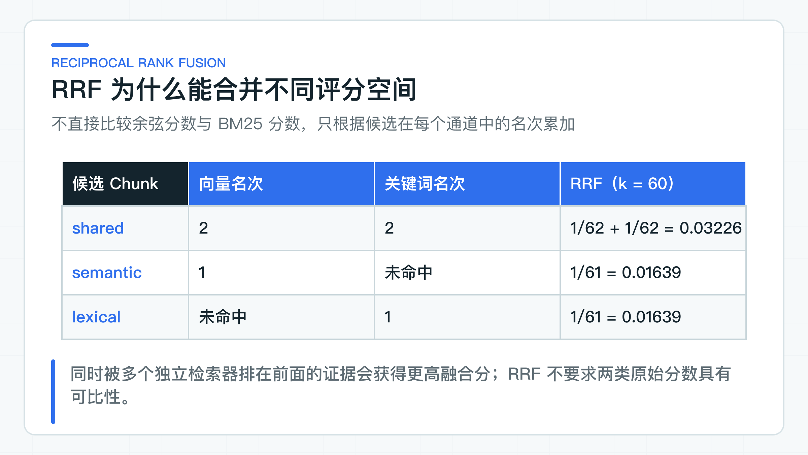

# 混合检索、Query Rewrite、Rerank 什么时候有用

“退款多久到账”和“PAY-REFUND-042 怎么处理”都在查售后知识，却适合不同的检索方式。前者依赖语义相近，向量检索更占优势；后者包含精确错误码，关键词检索通常更稳。

项目做到这里，很容易顺手把向量、关键词、查询改写（Query Rewrite）和重排（Rerank）全部串上。链路确实更完整了，候选分数却无法直接比较，改写可能偏离原问题，重排也会增加延迟和外部调用。一项能力是否值得加入，要看它解决了哪类真实召回问题。

下面继续使用退款政策，先实现 pgvector、用于模糊关键词匹配的 `pg_trgm`，以及按名次合并结果的 RRF，再说明 Query Rewrite 与 Rerank 适合放在哪里。重点是检索计划、候选预算和失败后的处理方式，而不是把链路堆得更长。

## 语义查询和精确词各有所长

假设知识库里有以下三段内容：

```text
A. 退款审核通过后，款项将在一到五个工作日内原路退回。
B. 支付平台返回错误码 PAY-REFUND-042 时，转人工核对退款单。
C. 售后政策第十条适用于银行卡及第三方支付退款。
```

用户问“退款多久到账”，向量检索容易命中 A，因为“多久到账”和“一到五个工作日”在语义上接近。用户改问“PAY-REFUND-042 怎么处理”，关键词检索通常更可靠：错误码几乎没有同义表达，任何模糊匹配都可能把它带到别的支付故障。用户问“第十条支持哪些支付方式”，条款编号与“银行卡”同时出现，关键词信号也很有价值。

向量检索把查询和 chunk 映射到同一个向量空间，再按距离或相似度取近邻。它对同义表达、口语、省略主语比较友好，但有几个天然弱点：

- 型号、工单号、政策编号等低频词可能没有可靠语义表示；
- 两段话主题相近，不代表其中包含回答问题所需的具体条件；
- Embedding 模型更换后，距离分布和召回顺序可能变化；
- 长 chunk 中的次要事实容易被整体语义稀释。

关键词检索根据词项、词频、字段权重等信号排序。BM25 一类算法会考虑词在当前文档中的出现次数，也会降低全库高频词的区分度。它适合精确术语、名称、编号和原文措辞，却很难仅凭字面匹配理解“多久到账”与“到账时限”说的是同一件事。中文还涉及分词词典、同义词表和领域词维护，不能把英文默认分词配置原样搬进生产环境。

两种通道互补的前提，是它们独立执行相同的业务过滤。租户、部门、文档发布状态和生效时间必须在各自检索语句中生效，而不是两边召回完成后再统一删除越权结果。否则无权限内容会占掉候选名额，RRF 和 Rerank 都无法把已经丢失的合规候选补回来。

图里的 `candidateK` 是每个召回通道的候选上限，`topK` 是最终交给回答链路的证据上限。两者必须分开。直接让向量和关键词各返回 `topK`，融合后再做重排，候选面往往太窄；无限放大 `candidateK` 又会增加搜索、网络传输和重排成本。

## 三个增强步骤各自解决一个问题

### Query Rewrite 只生成检索表达

真实咨询经常包含代词、省略和聊天语气：

```text
用户上一轮：我的退款已经审核通过了。
用户这一轮：那一般还要等多久？
```

只检索“那一般还要等多久”几乎没有业务信息。Query Rewrite 可以结合受控的会话上下文，把它改写成“退款审核通过后的到账时限”。检索表达更完整后，向量和关键词通道都有机会命中正确条款。

改写会改变原始表达，存在明确风险。模型可能把“银行卡退款”改成“第三方支付退款”，把“试用期员工”改成“正式员工”，或者补进原问题从未出现的产品名称。查询看起来更顺，检索意图已经漂了。知识库更难发现的坏案例，是系统带着错误限定条件命中一条措辞很像的制度，而非简单返回空结果。

工程上应把原问题和检索表达保留成两个字段，并让它们承担不同职责：

| 信息 | 用途 |
|---|---|
| 原问题 | 展示、受控审计、Rerank、回答生成和最终评测 |
| 改写查询 | 向量化、关键词召回和检索日志 |
| 改写使用的上下文 | 解释代词和省略，必须经过长度与权限控制 |
| 改写版本 | 定位 Prompt 或模型变化引起的召回结果变化 |

当前 [HybridKnowledgeRetrievalService](https://github.com/DavidDingXu/learn-java-ai/blob/main/learning-stages/stage-03-enterprise-rag/services/knowledge-service/src/main/java/com/xiaoding/javaai/knowledge/retrieval/application/HybridKnowledgeRetrievalService.java) 正是这样处理的。改写结果进入 Embedding 与关键词通道，Rerank 收到的仍是原始问题 `query.question()`。即使改写补充了检索术语，最终相关性判断也要回到用户真正问的内容。

改写适合以下场景：多轮对话存在明确指代，用户表达非常口语化，或者企业内部术语与用户语言差异很大。短而精确的查询未必需要改写，例如错误码、订单号、产品型号和条款编号。对这些内容，模型“润色”反而容易破坏精确词。

Query Rewrite 还应遵守两条硬边界。第一，它不能扩大访问范围。租户和权限来自经过校验的身份，不允许模型通过改写查询决定访问哪些部门。第二，它不能把改写文本当成事实。改写只帮助召回，回答仍然要以检索到的已发布证据为准。

当前最小实现要求改写结果非空，空白结果会抛出参数异常，模型或网络异常则继续向上返回。生产适配器可以选择“改写失败时使用原问题”这一降级语义，但要记录 `rewrite_fallback=true`、失败类型和耗时。悄悄回退而不留痕，会让离线评测与线上表现对不上。

### 用排名融合代替直接比较分数

向量通道可能返回余弦相似度 `0.86`，关键词通道可能返回 BM25 分数 `21.4`。如果把结果放进一个列表按原始 `score` 排序，关键词结果几乎总在前面；换一种搜索引擎或相似度函数，结论又可能反过来。分数的数值范围、分布和方向都由算法实现决定，不是跨通道通用的相关性单位。

可以先对两边分数做归一化，再加权求和，但这要求分数分布相对稳定。数据量、查询类型、索引版本或模型变化都会影响归一化参数。线上查询只有少量候选时，用当前结果的最大最小值归一化也很脆弱：第一名和第二名的真实差距可能很小，归一化后却被放大成 1 与 0。

RRF（Reciprocal Rank Fusion）绕开了这个问题。它不比较原始分数，只使用候选在每个通道中的名次。对文档 `d`，融合分数可以写成：

```text
RRF(d) = Σ 1 / (k + rank_i(d))
```

`rank_i(d)` 是 `d` 在第 `i` 个排名中的位置，从 1 开始；没有进入某个排名，就不贡献该通道分数。`k` 是平滑常数，用来控制前几名与后续名次的差距。当前实现使用 `k = 60`。

假设向量通道排序为 `[semantic, shared]`，关键词通道排序为 `[lexical, shared]`：

| chunk | 向量名次 | 关键词名次 | RRF 分数 |
|---|---:|---:|---:|
| `shared` | 2 | 2 | `1/62 + 1/62` |
| `semantic` | 1 | - | `1/61` |
| `lexical` | - | 1 | `1/61` |

`shared` 同时被两个通道认可，所以排在只被单个通道命中的候选之前。RRF 不知道哪个通道的原始分数更大，也不需要知道。它表达的是一种相当实用的判断：多个独立检索器都把某段证据排在前面时，这段证据更值得进入下一步。



[ReciprocalRankFusion](https://github.com/DavidDingXu/learn-java-ai/blob/main/learning-stages/stage-03-enterprise-rag/services/knowledge-service/src/main/java/com/xiaoding/javaai/knowledge/retrieval/application/ReciprocalRankFusion.java) 以 `chunkId` 去重并累加排名贡献。融合分数相同时，再按 `chunkId` 升序排列：

```java
return scoresById.entrySet().stream()
        .sorted(Map.Entry.<String, Double>comparingByValue(Comparator.reverseOrder())
                .thenComparing(Map.Entry::getKey))
        .limit(topK)
        .map(entry -> withScore(chunksById.get(entry.getKey()), entry.getValue()))
        .toList();
```

第二排序条件用于保证确定性，与相关性无关。同一批输入不能因为 `HashMap` 遍历顺序或运行环境差异而随机交换位置。稳定排序会直接影响缓存、评测复现和分页结果，也是线上排查“同样问题为什么偶尔引用不同条款”的基础。

RRF 的局限也很明确。它只看名次，会丢掉通道内部的置信差异。向量第一名远高于第二名，与两者几乎并列，在 RRF 中都会被视为名次 1 和 2。它也不会理解用户问题和证据之间的细粒度关系。RRF 适合做异构召回的稳健融合，不是最终相关性模型。

### 把 Rerank 留给少量高价值候选

Embedding 检索通常采用双塔思路：查询和 chunk 分别编码，索引中的 chunk 向量可以预先计算，因此召回速度快。Rerank 常用交叉编码或大模型判断，让查询与每个候选一起参与计算，能够看到更细的词序、条件和否定关系，但无法像向量检索那样对全库预计算。

这决定了合理顺序只能是“先召回，再重排”。如果全库有一百万个 chunk，不可能让重排模型逐个判断；先用向量与关键词缩小到几十条，再选出最终几条，成本才可控。

候选预算至少要同时看四个量：

- 最终 `topK`：回答链路真正需要几段证据；
- 每通道 `candidateK`：为了不漏掉正确证据，召回面要放大多少；
- 候选去重率：两个通道重叠越高，融合后的实际数量越少；
- Rerank 单候选成本：模型输入长度、批处理能力、并发和计费方式。

当前 [RetrievalPlan](https://github.com/DavidDingXu/learn-java-ai/blob/main/learning-stages/stage-03-enterprise-rag/services/knowledge-service/src/main/java/com/xiaoding/javaai/knowledge/retrieval/application/RetrievalPlan.java) 把 `rewriteQuery`、`lexicalSearch`、`rerank` 和 `candidateK` 显式放在计划中。`candidateK` 被限制在 1 到 100，应用服务还会检查它不能小于查询的 `topK`。这个限制挡住了一个很常见的配置错误：想返回 8 条最终证据，却只让召回通道各找 5 条。

```java
if (plan.candidateK() < query.topK()) {
    throw new IllegalArgumentException(
            "candidateK must be greater than or equal to topK"
    );
}
```

链路延迟不能只看 Rerank 接口的平均耗时。按当前顺序执行的实现，粗略总延迟是：

```text
T ≈ T_rewrite + T_embedding + T_vector + T_lexical + T_fusion + T_rerank
```

如果向量与关键词查询在生产适配层并行执行，检索耗时可以接近两者中的较慢值，但前提是两边使用同一个改写查询、权限范围和生效时间，取消和超时也能同时结束两个请求，并保留在同一 Trace 中。当前应用服务是顺序调用，不能按并行链路估算延迟。

Rerank 的超时应该明显小于整个问答请求剩余预算。举例来说，接口总预算只有 2 秒，前面改写和两路检索已经消耗 1.4 秒，再给重排单独设置 2 秒超时没有意义。超时预算应由入口向下传递，而不是每层各配一个看起来合理的固定值。

降级也要按步骤定义，不能笼统写成“检索失败就返回默认结果”：

| 失败位置 | 可接受的读路径 | 必须保留的观测信息 |
|---|---|---|
| Query Rewrite | 使用原问题继续检索 | 异常类型、是否回退；脱敏原问题只进入受控明细 |
| 关键词检索 | 使用向量候选 | 失败通道、剩余候选数量 |
| 向量检索 | 仅在关键词足以支撑业务时继续 | Embedding/向量库错误、策略名 |
| Rerank | 使用 RRF 排名截取 `topK` | 重排超时或错误、融合版本 |
| 两个召回通道都失败 | 返回明确的检索不可用 | Trace、错误码、重试建议 |

这张表给出生产决策规则，当前代码不会自动执行这些回退。`HybridKnowledgeRetrievalService` 让端口异常向上抛出，避免在应用层无声吞错。公司项目若允许读请求降级，应把规则放进可测试的适配器或编排策略，同时把降级状态传到 Trace 和回答元数据。证据不足时若让大模型凭自身知识继续回答，产品的事实边界已经发生改变，不能按普通降级处理。

## 按查询类型选择三档策略

向量、关键词和重排不是固定套餐。先按查询分布和坏案例选最短链路，再用同一套 Golden Set 比较增量收益。

### 只用向量检索

适合自然语言问题为主、文档措辞差异大、专有编号较少的知识库。链路短，维护成本最低。第一个版本没有关键词索引与重排模型时，向量检索也更容易把权限过滤、版本过滤、引用和评测先做正确。

不要因为“混合检索更高级”就立刻加组件。如果向量 Recall@K 已经覆盖主要问题，线上坏案例集中在文档切分或权限，增加 Rerank 不会修复根因。

### 向量加关键词，再做 RRF

适合知识库同时包含自然语言规则和大量精确术语，例如错误码、产品型号、条款号、接口名。RRF 不要求校准两种分数，实现和解释成本都比学习排序低。

这档方案首先改善召回。它能把不同通道发现的候选放进同一列表，但不会理解复杂条件之间的关系。若正确证据已经进入候选集却总排不到前面，再考虑重排。

### 混合检索加 Rerank

适合候选内容高度相似、需要区分适用条件、否定条款和版本差异的场景。例如多份退款政策都写着“一到五个工作日”，只有渠道、地区或生效日期不同。重排模型可以结合原问题比较候选，但要承担模型质量、延迟、配额和降级成本。

Rerank 的价值应该体现在指标上。固定 `candidateK` 后，要比较首个正确证据排名的倒数均值（MRR）、整段排序质量（nDCG）和 TopK 证据准确率，还要记录坏案例、P95 延迟与单次成本。只展示一个“重排后看起来更准”的例子，不能支持默认开启。

## 从轻量关键词通道到 Java 编排

### pg_trgm 适合作为轻量起点

[PostgresTrigramKnowledgeChunkSearchRepository](https://github.com/DavidDingXu/learn-java-ai/blob/main/learning-stages/stage-03-enterprise-rag/services/knowledge-service/src/main/java/com/xiaoding/javaai/knowledge/retrieval/infrastructure/PostgresTrigramKnowledgeChunkSearchRepository.java) 作为关键词通道，通过 `pg_trgm` 的相似度和 `ILIKE` 补充字面召回。Flyway 的 [V2__knowledge_hybrid_search.sql](https://github.com/DavidDingXu/learn-java-ai/blob/main/learning-stages/stage-03-enterprise-rag/services/knowledge-service/src/main/resources/db/migration/V2__knowledge_hybrid_search.sql) 创建扩展与 GIN 索引。数据库账号没有 `CREATE EXTENSION` 权限时，应由 DBA 预装扩展，再让应用账号只负责业务表迁移。

这套方案适合数据量有限、团队已经使用 PostgreSQL、希望先验证混合检索增量收益的场景。它按字符片段工作，不理解中文词边界、字段权重、同义词和领域词典；大规模知识库、复杂字段检索或专有词维护通常更适合公司已有的 Elasticsearch、OpenSearch 或搜索中台。

无论关键词通道落在哪个组件，租户、当前有效的业务版本、当前检索版本和 ACL 都必须在 TopK 之前过滤。不能先让搜索引擎返回全局候选，再由 Java 删除越权结果。更换关键词基础设施时，应替换 `KnowledgeLexicalSearchRepository` 适配器，而不是改写混合检索用例。

### Java 应用层的检索编排

混合检索最容易写成一个依赖搜索引擎 SDK、Embedding SDK 和重排 SDK 的大 Service。这样短期代码少，后面切模型、做本地测试或增加降级时，每个分支都会碰到基础设施细节。

应用层用六个端口隔开变化来源：

| 端口 | 责任 |
|---|---|
| `KnowledgeQueryRewriter` | 把原问题改成检索表达 |
| `KnowledgeEmbeddingModel` | 生成查询向量并返回模型标识 |
| `KnowledgeChunkSearchRepository` | 在权限与时间范围内做向量召回 |
| `KnowledgeLexicalSearchRepository` | 使用同一范围做关键词召回 |
| `KnowledgeReranker` | 根据原问题重排候选 |
| `RetrievalPlanProvider` | 根据服务端策略选择候选预算与可选步骤 |

应用服务只编排顺序和预算：

```java
String retrievalQuery = plan.rewriteQuery()
        ? requireText(queryRewriter.rewrite(query.question()), "rewritten query")
        : query.question();

KnowledgeEmbedding embedding = embeddingModel.embed(retrievalQuery);
List<RetrievedKnowledgeChunk> vectorCandidates = vectorSearch.search(
        embedding.vector(), embedding.model(),
        query.accessScope(), query.effectiveAt(), plan.candidateK()
);

List<RetrievedKnowledgeChunk> candidates = vectorCandidates;
if (plan.lexicalSearch()) {
    List<RetrievedKnowledgeChunk> lexicalCandidates = lexicalSearch.search(
            retrievalQuery, query.accessScope(), query.effectiveAt(), plan.candidateK()
    );
    candidates = rankFusion.fuse(
            vectorCandidates, lexicalCandidates, plan.candidateK()
    );
}

List<RetrievedKnowledgeChunk> result = plan.rerank()
        ? restoreRerankedCandidates(
                candidates,
                reranker.rerank(query.question(), candidates, query.topK()),
                query.topK()
        )
        : candidates.stream().limit(query.topK()).toList();
```

这里有几个值得保留的细节。

第一，向量查询携带 Embedding 模型标识，避免升级期间混排不兼容向量。第二，两个召回通道收到相同的 `KnowledgeAccessScope` 和 `effectiveAt`。检索策略可以变化，身份与时效边界不能变化。

第三，RRF 输出受 `candidateK` 限制，不会无限放大候选集。第四，Rerank 只返回 Chunk ID。应用层拒绝空 ID、重复 ID、未知 ID 和数量异常，再从原始授权候选恢复对象。重排适配器只能改变顺序，不能丢候选或注入未经过 ACL 的内容。

`RetrievalPlan` 让同一个用例可以按场景选择链路，但它不应该直接暴露给前端，让用户随意打开昂贵能力。计划应由服务端根据业务入口、租户配置、实验分组和容量策略决定。外部请求只表达业务问题、身份与期望证据数量。

项目默认使用单路向量检索。把 `java-ai.knowledge.retrieval.mode` 设为 `hybrid` 后，应用才会组装 `pg_trgm` 关键词通道和 RRF。该模式下 `rewrite-query` 与 `rerank` 仍默认关闭。

当前仓库没有真实的 Rewrite 和 Rerank 适配器，误开开关会直接报错，不会返回固定结果或静默降级。接入公司的改写或重排服务后，再打开对应开关，并用固定数据集验证收益、超时和回退策略。

## 固定融合顺序、预算和稳定性

连续实验会在同一次启动中分别请求 `VECTOR` 与 `HYBRID`，控制台并列打印两组 TopK，最终报告也分别计算 Recall、HitRate 和 MRR。普通问答仍按 `application.yml` 中的检索计划运行；这个模式参数只属于受保护的内部评测接口，避免终端用户随意打开昂贵链路。

确定性代码继续锁住什么文本进入哪个端口、权限范围是否原样传递、候选预算是否一致，以及最终顺序是否可重复。

[HybridKnowledgeRetrievalServiceTest](https://github.com/DavidDingXu/learn-java-ai/blob/main/learning-stages/stage-03-enterprise-rag/services/knowledge-service/src/test/java/com/xiaoding/javaai/knowledge/retrieval/application/HybridKnowledgeRetrievalServiceTest.java) 固化了两条路径。完整路径把“退款多久到账？”改写为“退款到账时效”，向量和关键词通道都拿到 8 条候选预算，Rerank 收到原问题与融合后的候选；纯向量路径则确认 Rewrite、关键词和 Rerank 端口都不会被调用。

[ReciprocalRankFusionTest](https://github.com/DavidDingXu/learn-java-ai/blob/main/learning-stages/stage-03-enterprise-rag/services/knowledge-service/src/test/java/com/xiaoding/javaai/knowledge/retrieval/application/ReciprocalRankFusionTest.java) 验证同一 chunk 被两个通道命中时排在单通道候选之前，还验证融合分数相同后按 `chunkId` 得到稳定顺序。

[PostgresLexicalSearchQueryTest](https://github.com/DavidDingXu/learn-java-ai/blob/main/learning-stages/stage-03-enterprise-rag/services/knowledge-service/src/test/java/com/xiaoding/javaai/knowledge/retrieval/infrastructure/PostgresLexicalSearchQueryTest.java) 锁住关键词 SQL 的租户、状态、版本、时效与 ACL 前置过滤。`KnowledgeRetrievalConfigurationTest` 则确认 `hybrid` 配置真正组装出混合检索器，避免运行时仍走旧实现。

这些测试检查编排与融合算法。接入公司环境时，还要用同一套业务问题分别运行三档策略，保存原问题、改写查询、各通道排名、融合排名、重排结果和耗时。指标发生变化时，才能据此判断是改写结果发生变化、某一路漏召回，还是重排压低了正确证据。

## 迁入既有检索系统时保留什么

可以直接复用的是应用层边界：原问题与检索查询分离、`candidateK` 与 `topK` 分离、两路召回使用相同权限和时效条件、异构分数通过排名融合、同分排序保持稳定、重排只处理有限候选。

关键词检索、Query Rewrite 和 Rerank 这三个适配点要按公司基础设施接入。关键词检索可以落在已有搜索引擎或数据库全文检索能力上，但中文分词、字段权重和同义词必须使用业务数据验证；Query Rewrite 与 Rerank 可以调用独立模型服务，也可以在效果收益不足时关闭。代码中有端口，不代表每个环境都必须部署对应组件。

生产观测至少应回答这些问题：

- 当前使用哪种 `RetrievalPlan`，`candidateK` 与 `topK` 分别是多少；
- 原问题是否改写，改写失败是否回退；
- 两个通道分别返回多少候选，重合率是多少；
- RRF 和 Rerank 前后的正确证据名次怎样变化；
- 每一步耗时、超时、错误和降级原因是什么；
- 最终证据属于哪个租户、文档版本、标题和条款。

混合检索值得引入的判断标准很朴素：它能否在固定权限、固定候选预算和可接受延迟下，稳定找回单通道遗漏的证据。Query Rewrite 只负责补全检索表达，RRF 负责合并不同评分空间，Rerank 负责在小候选集里判断细粒度相关性。三者各自解决一个问题，任何一步没有独立收益，都可以从计划中关掉。

---

[课程首页](../../README.md) · [完整目录](README.md) · [← 权限为什么必须在 TopK 之前过滤](17-acl-before-topk.md) · [RAG 回答为什么必须带证据：拒答、冲突、时效与知识注入 →](19-grounded-rag-answer.md)

动手实践：[本阶段可运行源码](../../learning-stages/stage-03-enterprise-rag/README.md)
