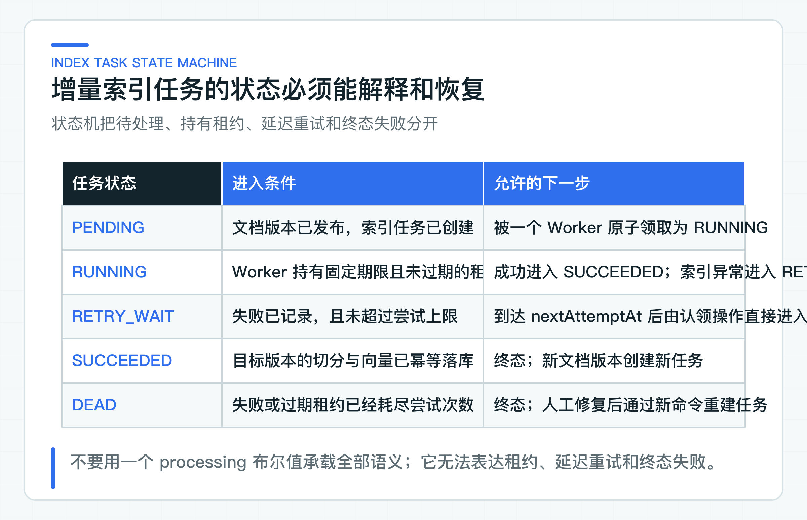
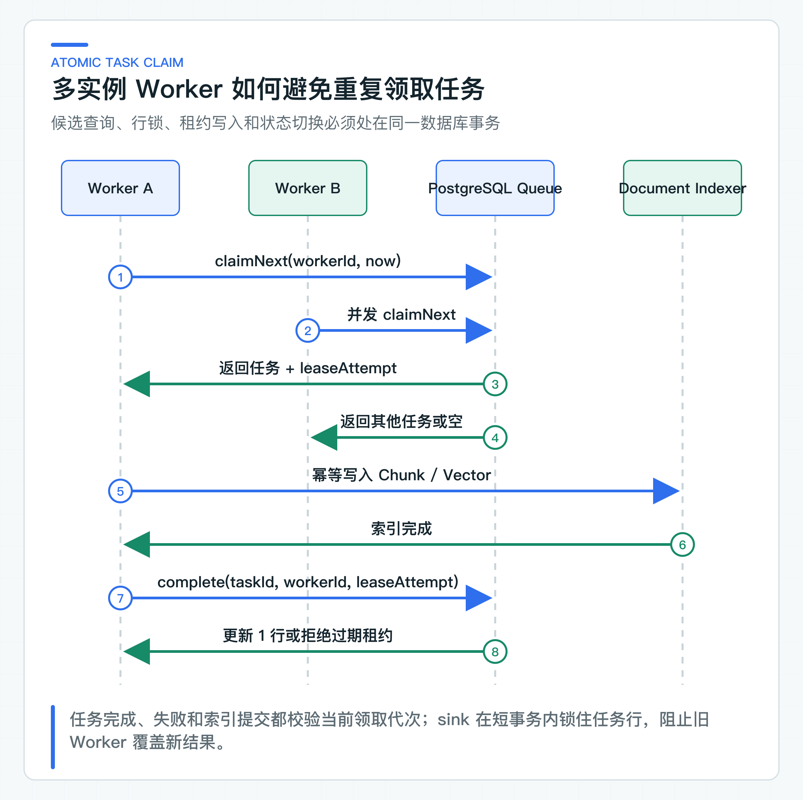

# 增量索引为什么需要任务、租约和失败恢复

运营同学刚发布一版退款政策，后台显示成功，用户却仍然搜不到。排查后可能发现，原文件已经保存，切分完成了一半，Embedding 调用遇到限流，应用恰好又重启了。

从上传到可检索，中间还有解析、切分、Embedding、Chunk 与向量写入，以及旧索引切换。把它们都塞进 HTTP 请求，接口延迟会被最慢的外部依赖拖住；只扔进线程池，进程消失后又没有恢复依据。

因此，增量索引需要一条可以查询和重试的任务记录。任务绑定确定的文档版本，租约标识当前后台执行进程（Worker），幂等写入保证重复执行不会产生重复 Chunk。这样才能解释“处理到哪一步了”，也能在失败后继续完成。

任务处理由 `IndexTask` 状态机、`IndexTaskWorker`、JDBC 队列，以及原子认领与租约代次校验 SQL 组成。`DocumentVersionIndexingService` 负责确定性切分和批量 Embedding，`PgVectorKnowledgeChunkIndexSink` 负责事务写入与检索版本切换。

## 先把索引建模成可恢复任务

同步方案最直观：上传文档后立即解析、切分、调用 Embedding，再把向量写进数据库，全部成功才向调用方返回。它在本地样例里很好理解，放进公司业务系统后会产生几个难以接受的耦合。

首先，上传接口继承了模型服务的延迟与可用性。一个几十页的文档可能产生数百个 Chunk，需要多批 Embedding 请求。Provider 出现限流时，用户看到的是上传超时；实际上原文件可能已经保存，文档版本也已经创建，只有索引没有完成。调用方重试上传，又可能创建重复对象或重复版本。

其次，HTTP 请求不是可靠的任务容器。网关超时、客户端断开、Pod 重启都可能发生在索引中间。进程内 `CompletableFuture` 或线程池只能把工作移出请求线程，不能在进程消失后保存进度。没有持久化任务记录，运维只能从日志猜测哪些版本需要补偿。

第三个问题是发布与可检索并非同一个状态。文档领域关心内容版本、审批和生效时间，索引领域关心某个版本是否已经按指定切分策略与 Embedding 模型生成检索数据。把两者压成一个 `published=true`，会让业务页面无法解释“文档已发布但索引仍在处理”以及“新索引失败时是否继续使用旧版本”。

更稳妥的边界是：文档发布事务只负责确认不可变版本，并创建一条持久化索引任务；Worker 在事务外调用解析器和模型，完成后再提交任务结果。文档与任务位于同一个数据库时，版本发布与任务创建可以放在一个本地事务中，不必为了异步而先引入消息中间件。若任务要通过消息总线分发，再使用事务发件箱（Outbox）保证数据库事实和事件一致。

项目把业务发布版本和检索版本分开保存。`PUBLISHED` 表示内容已经完成业务发布，`document_search_version` 表示查询当前读取哪一版完整索引。替换版本仍在处理时，读取继续使用上一版索引；首次发布没有旧版可回退，要等第一条索引任务成功。

### 任务绑定不可变文档版本

索引任务不能只记录一个文件地址。文件可能被覆盖，文档可能发布新版本，Embedding 模型也可能升级。Worker 如果每次都“读取最新内容”，同一任务重试两次就可能处理两份不同文本，结果无法复现。

`index_task` 表使用下面的业务唯一约束：

```sql
UNIQUE (tenant_id, document_id, version_number, task_type)
```

完整表结构见 [V1__knowledge_platform.sql](https://github.com/DavidDingXu/learn-java-ai/blob/main/learning-stages/stage-03-enterprise-rag/services/knowledge-service/src/main/resources/db/migration/V1__knowledge_platform.sql)。`tenant_id` 保证多租户隔离，`document_id + version_number` 指向不可变版本，`task_type` 允许同一版本分别执行建索引、重建索引或其他受控任务。重复收到“为退款政策第 2 版建索引”的命令时，数据库唯一键只保留同一个业务任务，不会生成两批相同向量。

任务 ID 与业务幂等键承担不同职责。`task_id` 用于定位一次任务记录；业务唯一键用于判断两个请求是否在表达同一项工作。只拿随机 UUID 做去重没有意义，因为每次重试都会得到一个新 UUID。

任务还要保留 `attempts`、`lease_owner`、`lease_until`、`next_attempt_at`、`error_code`、`created_at` 和 `updated_at`。每个字段都对应一个运行问题：任务尝试过几次，是否有人正在处理，租约是否已经失效，下次何时允许领取，以及最近一次失败发生在解析、Embedding 还是向量写入。

### 状态机记录完整处理结果

一个 `processing` 布尔值只能区分“正在处理”和“没有处理”。Worker 崩溃后，它会永远停在 `true`；任务等待限流退避时，它又只能写回 `false`，与从未开始的任务无法区分。任务队列需要显式状态机。



任务状态机使用五个状态：

| 代码状态 | 语义 | 可以发生的转换 |
|---|---|---|
| `PENDING` | 新任务已经创建，达到执行时间后可以领取 | `RUNNING` |
| `RUNNING` | 某个 Worker 持有未过期租约 | `SUCCEEDED`、`RETRY_WAIT`、`DEAD` |
| `RETRY_WAIT` | 可恢复失败已经记录，等待退避时间 | 到期后由认领操作直接进入 `RUNNING` |
| `SUCCEEDED` | 目标版本已经完成索引 | 终态 |
| `DEAD` | 失败或过期租约已经耗尽尝试次数 | 终态，人工处理后创建新的受控任务 |

[IndexTask](https://github.com/DavidDingXu/learn-java-ai/blob/main/learning-stages/stage-03-enterprise-rag/services/knowledge-service/src/main/java/com/xiaoding/javaai/knowledge/indexing/domain/IndexTask.java) 在 `RETRY_WAIT` 到期后不会先改回 `PENDING`，下一次认领会直接把它切换为 `RUNNING`。数据库队列使用相同语义，不存在图外的中间状态。

`claim` 每成功一次就增加 `attempts`，并写入租约所有者和截止时间：

```java
status = IndexTaskStatus.RUNNING;
attempts += 1;
leaseOwner = workerId;
leaseUntil = now.plus(leaseDuration);
updatedAt = now;
```

失败时不能只保存异常消息。异常文本会随 SDK、语言与实现变化，不适合统计和自动决策。`IndexingException` 提供稳定 `errorCode`，例如 `EMBEDDING_TIMEOUT`、`UNSUPPORTED_DOCUMENT`。任务表可以另外保存脱敏后的 `error_message` 供排查，但重试策略应依赖稳定错误分类，而不是对异常字符串做包含判断。

## 用租约协调多实例 Worker

多实例部署下，两个 Worker 可能同时看到同一条到期任务。简单执行“先查一条 PENDING，再 UPDATE”为 RUNNING，会留下竞态窗口：两边都查到同一条记录，然后都开始调用 Embedding。用 JVM 锁没有用，因为两个 Worker 不在同一进程。

租约的含义是：Worker 在一段有限时间内拥有完成或报告失败的权利。它不是永久锁。租约到期后，系统推断原 Worker 已失联，允许另一个实例接管任务。这样即使进程被杀、机器断电或网络分区，任务也不会永远卡住。



领取必须在数据库里原子完成。[PostgresIndexTaskClaimQuery](https://github.com/DavidDingXu/learn-java-ai/blob/main/learning-stages/stage-03-enterprise-rag/services/knowledge-service/src/main/java/com/xiaoding/javaai/knowledge/indexing/infrastructure/PostgresIndexTaskClaimQuery.java) 使用一个 CTE 完成候选选择和状态更新：

```sql
WITH exhausted AS (
    UPDATE index_task
       SET status = 'DEAD',
           lease_owner = NULL,
           lease_until = NULL,
           error_code = COALESCE(error_code, 'LEASE_ATTEMPTS_EXHAUSTED'),
           updated_at = ?
     WHERE status = 'RUNNING'
       AND attempts >= ?
       AND lease_until <= ?
    RETURNING task_id
),
candidate AS (
    SELECT task_id
      FROM index_task
     WHERE status IN ('PENDING', 'RETRY_WAIT', 'RUNNING')
       AND attempts < ?
       AND (
            (status IN ('PENDING', 'RETRY_WAIT') AND next_attempt_at <= ?)
            OR (status = 'RUNNING' AND lease_until <= ?)
       )
     ORDER BY next_attempt_at, created_at, task_id
     FOR UPDATE SKIP LOCKED
     LIMIT 1
)
UPDATE index_task task
   SET status = 'RUNNING',
       attempts = task.attempts + 1,
       lease_owner = ?,
       lease_until = ?,
       updated_at = ?
  FROM candidate
 WHERE task.task_id = candidate.task_id
RETURNING task.*
```

`exhausted` 先把租约已经过期且尝试预算耗尽的任务置为 `DEAD`，避免它被无限接管。`FOR UPDATE` 锁住候选行，`SKIP LOCKED` 让其他 Worker 跳过已经被领取的任务，继续寻找下一条，而不是排队等待同一行。`UPDATE ... RETURNING` 把状态切换和任务返回放在同一个事务里。只有拿到返回记录的 Worker 才能执行索引。

`SKIP LOCKED` 解决并发吞吐，不自动解决公平性。排序字段决定任务优先级；长时间失败、不断到期的旧任务可能挤占新任务，某些高优先级租户又可能需要独立队列。公司项目应根据业务设置优先级、分片或配额，并观察最老待处理任务的年龄，而不是只看队列总数。

还有一条容易写错：数据库行锁不能覆盖整个 Embedding 调用。若 Worker 在持有事务和行锁时请求外部模型，几十秒的网络等待会占用连接与锁，吞吐很快崩掉。正确做法是短事务领取并提交，随后在事务外执行索引，再用另一个短事务完成或失败任务。租约负责跨越这段无数据库锁的执行时间。

### 提交结果前再次校验租约所有权

设想 Worker A 获得 45 秒租约，处理时发生长时间暂停；45 秒后 Worker B 接管并完成任务。A 随后恢复，如果它仍能无条件写 `SUCCEEDED`，就会覆盖 B 的结果，甚至在 B 已经依据新配置重建向量后写回旧数据。

因此 `complete` 与 `fail` 都必须证明调用者仍拥有有效租约。[IndexTask](https://github.com/DavidDingXu/learn-java-ai/blob/main/learning-stages/stage-03-enterprise-rag/services/knowledge-service/src/main/java/com/xiaoding/javaai/knowledge/indexing/domain/IndexTask.java) 会检查状态、`workerId` 和 `leaseUntil`：

```java
if (status != IndexTaskStatus.RUNNING || !workerId.equals(leaseOwner)) {
    throw new IndexTaskLeaseOwnershipException(workerId, leaseOwner);
}
if (leaseUntil == null || !leaseUntil.isAfter(now)) {
    throw new IndexTaskLeaseOwnershipException(workerId, leaseOwner);
}
```

JDBC 队列还把本次领取后的 `attempts` 返回为 `leaseAttempt`，作为这次租约的代次。完成和失败 SQL 同时校验 `workerId`、`leaseAttempt` 与 `leaseUntil`，更新行数不是 1 就抛出 `IndexTaskLeaseLostException`。

即使同一个 `workerId` 被重启后的进程复用，旧代次也不能覆盖新代次写入的任务状态。这种防止旧执行者覆盖新结果的做法，通常称为租约代次校验（fencing）。

任务状态受保护，不等于索引数据自动受保护。`ClaimedIndexTask` 会把 `leaseAttempt` 传给 `KnowledgeChunkIndexSink`。pgvector 适配器在短事务开始时按 `taskId + leaseAttempt` 锁住当前任务行，并再次检查状态与租约。校验通过后才写分块和切换检索版本；失去租约的旧 Worker 在写入前就会失败。

当前 Worker 会在一个租期的三分之一处开始周期续租。续租 SQL 与完成、失败 SQL 使用同一组 fencing 条件：任务仍为 `RUNNING`、Worker 匹配、`leaseAttempt` 匹配、旧租约尚未过期。任一条件失效，续租就不能修改当前任务。

心跳解决的是正常长任务续租，不是让已失联的 Worker 无限占有任务。如果数据库异常导致续租不确定，最终的完成或失败 SQL 仍会重新校验所有权。返回 `LOST_LEASE` 时，旧 Worker 停止终态写入，任务由当前持有者继续处理或在租期后被接管。

### Worker 只编排任务步骤

[IndexTaskWorker](https://github.com/DavidDingXu/learn-java-ai/blob/main/learning-stages/stage-03-enterprise-rag/services/knowledge-service/src/main/java/com/xiaoding/javaai/knowledge/indexing/application/IndexTaskWorker.java) 的 `runOnce` 保持了很窄的职责：领取一条任务，调用 `DocumentVersionIndexer`，成功后完成任务，可分类的索引异常则记录失败策略。

```java
private IndexTaskRunResult runClaimed(Optional<ClaimedIndexTask> claimed) {
    if (claimed.isEmpty()) return IndexTaskRunResult.IDLE;

    ClaimedIndexTask task = claimed.orElseThrow();
    LeaseHeartbeat heartbeat = new LeaseHeartbeat(task);
    heartbeat.start();
    try {
        indexer.index(task);
        heartbeat.close();
        if (heartbeat.leaseLost()) return IndexTaskRunResult.LOST_LEASE;
        taskQueue.complete(
                task.taskId(), workerId, task.leaseAttempt(), clock.get());
        return IndexTaskRunResult.SUCCEEDED;
    } catch (IndexingException error) {
        heartbeat.close();
        if (heartbeat.leaseLost()) return IndexTaskRunResult.LOST_LEASE;
        try {
            taskQueue.fail(task.taskId(), workerId, task.leaseAttempt(),
                    clock.get(), error.errorCode(), retryDelay, maximumAttempts);
            return IndexTaskRunResult.FAILED;
        } catch (IndexTaskLeaseLostException leaseLost) {
            return IndexTaskRunResult.LOST_LEASE;
        }
    } finally {
        heartbeat.close();
    }
}
```

上面的片段省略了失败写入细节。可预期的解析失败、Provider 限流和外部超时，需要在 `DocumentVersionIndexer` 边界转换成稳定错误码。失败写入如果被 fencing 拒绝，返回 `LOST_LEASE`；`NullPointerException`、数据库映射错误等编程缺陷不会被统一包装成“稍后重试”，避免任务反复消耗资源却隐藏真正缺陷。

实际 Worker 进程仍需要最外层的运行保护：记录未处理异常、让租约自然过期、触发告警，并保证调度线程不会永久死亡。这个保护属于运行容器，不应改变领域错误分类。当前最小实现对 `IndexingException` 使用统一的固定退避和最大尝试次数；公司项目若要让不可恢复错误直接进入终态，应显式扩展错误策略，不能只靠错误消息猜测。

`runOnce` 返回 `IDLE`、`SUCCEEDED`、`FAILED` 或 `LOST_LEASE`。空队列时可以退避，连续成功时可以立即领取下一条，失败时由任务的 `nextAttemptAt` 控制重试。`LOST_LEASE` 不能再用旧租约记录一次 `FAILED`，否则会让丢失所有权的 Worker 再次修改任务。

## 让重复执行得到同一索引结果

租约意味着系统采用至少一次执行语义。Worker A 可能已经把全部向量写入数据库，但在提交 `SUCCEEDED` 前宕机；租约到期后 Worker B 会再次执行同一任务。任何声称分布式索引“恰好一次”的设计，最终都要面对这个窗口。

工程目标应当是让重复执行得到同一业务结果，因为分布式链路无法消除所有重复窗口。向量写入的幂等键至少应包含：

```text
tenantId + documentId + documentVersion + chunkId
```

如果同一个文档版本允许使用不同 Embedding 模型并行迁移，还要加入 `embeddingModel` 或 `indexVersion`。切分阶段已经让 `chunkId` 由版本、切分策略、顺序、标题路径和内容摘要稳定生成。同一版本按同一策略重跑时，可以执行 UPSERT，也可以先写新索引版本再原子切换。不要每次重跑都追加一行。

删除旧数据也要有版本边界。不要在新版本第一批向量写入前就删除旧版本，否则中途失败会让线上没有可用索引。项目让不同文档版本使用不同的 Chunk 行，全部 Embedding 完成后，sink 在一个短事务中写入目标版本并更新 `document_search_version`。中途失败时事务回滚，查询指针仍指向上一版。当前代码没有实现旧版本清理任务；公司接入时应在回退窗口结束后再清理旧分块，并保留正在被引用或审计的版本。

这套实现优先保证已有知识可用，因此新索引长期失败时会继续返回旧版。公司必须给“业务版本与检索版本不一致”设置最长允许时间和告警。法规、价格或权限敏感内容不能接受继续返回旧版时，应改成先构建索引、再原子发布；或者在新版本就绪前明确拒答。

恢复策略应先分类失败：

| 失败类型 | 示例 | 处理方式 |
|---|---|---|
| 瞬时依赖失败 | Provider 超时、限流、短暂网络错误 | 指数退避并增加随机抖动，有限重试 |
| 输入不可处理 | 不支持的格式、解码失败、文档损坏 | 直接终态，提示内容维护人员修复源文件 |
| 配置或兼容错误 | 向量维度不匹配、模型名无效、数据库迁移缺失 | 阻断同类任务并告警，不让每条任务重复撞错 |
| Worker 失联 | 进程退出、节点故障、长时间停顿 | 租约到期后由其他 Worker 接管 |

当前领域模型使用固定 `retryDelay` 和最大尝试次数，便于把状态转换写清楚。公司项目可以把退避计算放入策略对象，例如 `baseDelay * 2^(attempts-1)`，再增加上限与随机抖动，避免大量任务同时恢复造成惊群。重试参数应按错误类型区分；损坏文件重试十次不会变好，限流错误立即重试又会进一步放大流量。

### Embedding 批次兼顾吞吐与一致性

逐 Chunk 调用 Embedding Provider 会把一次文档索引放大成大量网络往返；把几百个 Chunk 一次性提交，又可能超过 Provider 的批量上限、请求体限制或单次超时预算。批次大小应作为 Worker 配置，而不是写死在循环里，并结合文档规模、向量维度、Provider 限流和连接池容量压测。

[DocumentVersionIndexingService](https://github.com/DavidDingXu/learn-java-ai/blob/main/learning-stages/stage-03-enterprise-rag/services/knowledge-service/src/main/java/com/xiaoding/javaai/knowledge/indexing/application/DocumentVersionIndexingService.java) 按 `embeddingBatchSize` 切分请求。每批文本通过 `KnowledgeEmbeddingModel.embedAll` 一次提交。

[SpringAiKnowledgeEmbeddingModel](https://github.com/DavidDingXu/learn-java-ai/blob/main/learning-stages/stage-03-enterprise-rag/services/knowledge-service/src/main/java/com/xiaoding/javaai/knowledge/retrieval/infrastructure/SpringAiKnowledgeEmbeddingModel.java) 还会校验返回数量、结果索引、模型元数据和向量维度。批次少一个向量、索引重复或中途换模型，都不能继续写库。

同一任务的所有批次必须使用同一个 Embedding 模型和维度。同一文档版本若前半批使用 `embedding-v1`、后半批使用 `embedding-v2`，即使维度相同，距离空间也可能不兼容。当前实现发现模型名变化会终止任务，由失败恢复流程处理；模型迁移应建立独立索引版本，完成整批验证后再切换可见版本。

批量 Embedding 完成前不持有数据库行锁，所有批次完成后才调用 `replaceVersion`。当前 pgvector 适配器把任务租约校验、目标版本分块写入和检索指针切换放在同一个短事务里，不能让前两个批次成功、第三个批次失败后留下半份可见索引。

## 通过发布接口走一遍索引任务

第 14 篇上传接口返回 `documentId`、`versionNumber` 和最新 `revision`。发布时使用这个 revision，并同时提交文档级 READ ACL：

`rag-learning-journey.http` 会发布两份文档，并调用 Worker 两次。`06-index-first-document` 与 `07-index-second-document` 都应返回 `SUCCEEDED`。随后执行 `11-idempotent-worker-observation`，结果应为 `IDLE`。

若出现 `FAILED` 或 `LOST_LEASE`，就根据响应中的任务结果回到上面的状态机定位：是 Provider 失败、租约已经丢失，还是任务进入了下一次退避。发布接口返回 `202 Accepted`、新的 revision 和 `indexTaskId`；在 JDBC 实现中，业务版本、ACL 和 `PENDING` 任务在同一个数据库事务中提交。

阶段 03 已把发布、手动触发 Worker 和重复触发写进同一个 `.http` 文件，macOS 与 Windows 都可以直接在 IDEA 中运行，不需要在三套命令之间切换。完整配置和结果核对 SQL 见 [知识写入运行手册](https://github.com/DavidDingXu/learn-java-ai/blob/main/docs/runbooks/knowledge-ingestion.md)。

## 从任务年龄和结果观察积压

队列长度不是唯一指标。100 条刚创建的任务可能完全正常，1 条等待两小时的高优先级政策任务却可能已经影响用户。任务观测至少需要以下维度：

- 到期可领取任务数，以及最老任务等待时间；
- `RUNNING` 数量、租约即将到期和已经过期的数量；
- 各低基数 `errorCode` 的失败次数、重试次数和终态数量；
- 从文档发布到索引成功的端到端延迟分位数；
- 每个任务的 Chunk 数、Embedding 批次数和向量写入耗时；
- 当前检索版本与当前有效业务版本是否一致。

`taskId`、`documentId` 和租户不适合放进指标标签，它们会制造高基数。单任务排查通过调用链、结构化日志或受控查询完成，聚合指标只保留任务类型、结果、错误类别和 Worker 池等稳定维度。

告警也要与业务影响绑定。短暂积压可以观察；最老任务超过服务目标、终态失败持续增加、过期租约异常增多，才需要通知。文档发布页面最好直接展示 `INDEXING`、`SEARCHABLE` 和失败原因摘要，让内容维护人员不用翻运维日志判断政策是否已经对用户生效。

## 从故障现象判断恢复边界

读代码时抓住三条规则即可。`IndexTask` 决定合法状态转换。[IndexTaskWorker](https://github.com/DavidDingXu/learn-java-ai/blob/main/learning-stages/stage-03-enterprise-rag/services/knowledge-service/src/main/java/com/xiaoding/javaai/knowledge/indexing/application/IndexTaskWorker.java) 只编排领取、续租、索引与终态。[PgVectorKnowledgeChunkIndexSink](https://github.com/DavidDingXu/learn-java-ai/blob/main/learning-stages/stage-03-enterprise-rag/services/knowledge-service/src/main/java/com/xiaoding/javaai/knowledge/indexing/infrastructure/PgVectorKnowledgeChunkIndexSink.java) 在短事务里校验租约代次、写入完整目标版本并切换检索指针。

重复触发后返回 `IDLE`，说明同一业务任务没有被再次创建；旧 Worker 返回 `LOST_LEASE`，说明它不能覆盖新持有者；索引批次失败后旧检索版本仍可用，说明半份新索引没有暴露给查询。进入目标 PostgreSQL 环境后，再用两个 Worker 同时领取到期任务，观察同一任务是否只被一个连接拿到，以及过期租约能否由另一个连接接管。

### 接入现有任务系统时保留的规则

可以复用的规则很具体：任务绑定不可变文档版本，发布与任务创建保持一致，领取通过数据库原子更新完成。执行期间只持有有限租约，完成与失败必须校验所有权。重试建立在幂等索引写入上，终态失败可以查询并转人工处理。调度框架只负责触发执行。

需要按公司环境替换的部分包括调度入口、Embedding 批大小与限流策略、向量库写入、心跳策略和告警平台。已有 XXL-JOB、Kubernetes CronJob 或内部任务平台时，可以让它们周期性调用 `runOnce`，但不要把任务状态只存在调度平台里。索引任务状态仍应由知识服务自己的数据库保存，避免换调度器时丢失恢复语义。

迁移时可以复用 JDBC Queue 的原子领取、续租与租约代次校验，sink 的事务切换，以及 `DocumentVersionIndexer` 对相同输入生成相同索引结果的要求。调度周期、租期、续租频率、公司对象存储和长文档检查点，则要根据目标调度平台、Provider 超时、向量策略和文档规模调整。

增量索引稳定后，几次成功查询仍然不能代表 RAG 质量。切分策略、Embedding、TopK、混合检索和重排（Rerank）每改一项，都可能让一部分问题变好、另一部分问题变差。下一步需要把“搜得准”变成可重复计算的指标，并把每个失败样例定位到具体链路。

---

[课程首页](../../README.md) · [完整目录](README.md) · [← RAG 回答为什么必须带证据：拒答、冲突、时效与知识注入](19-grounded-rag-answer.md) · [RAG 质量怎样量化：Golden Set、Recall@K 和坏案例 →](21-rag-evaluation.md)

动手实践：[本阶段可运行源码](../../learning-stages/stage-03-enterprise-rag/README.md)
