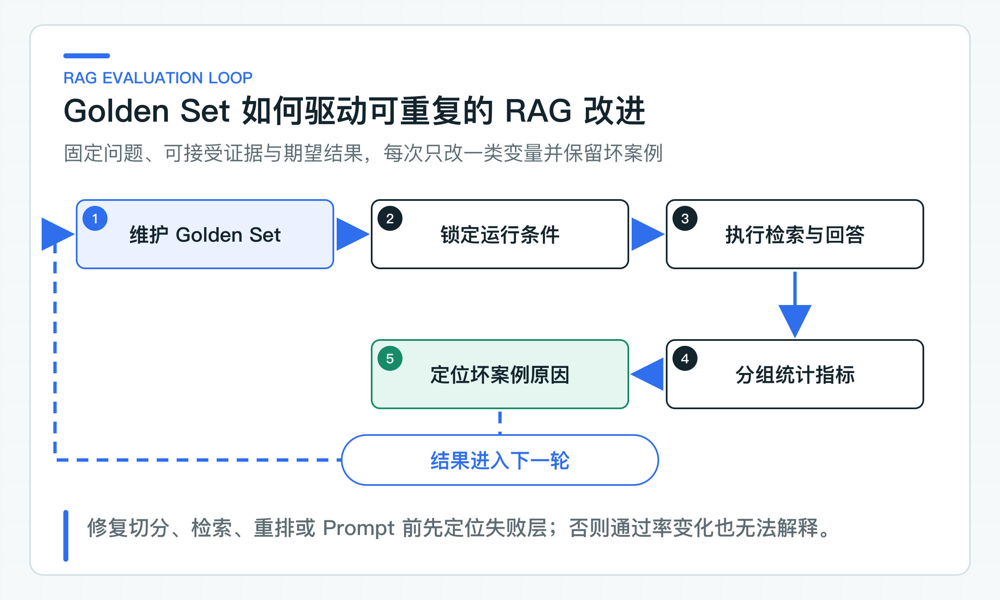

# RAG 质量怎样量化：Golden Set、Recall@K 和坏案例

检索增强生成（RAG）准备上线时，评审会上常听到一句话：“大家试了十几个问题，回答看起来还不错。”可一旦有人把 Chunk 长度从 500 调到 800，或者替换了 Embedding 模型，团队很难说清效果到底变好还是变坏。

只看最终文字也定位不了问题。答案错误，可能是知识缺失、切分破坏语义、检索漏召回、重排阶段排错位置，也可能是模型没有使用已经找到的证据；答案正确，也可能只是模型碰巧知道。

这就需要分层评测：先看正确证据有没有进入 TopK、排在什么位置，再检查引用与结论、拒答行为以及延迟和 Token。把这些样例整理成固定评测集（Golden Set）后，模型、Prompt 或检索策略的每次变化才有可比较的基线。

配套代码实现了这套评测流程。版本化 Golden Set 保存问题与期望 Chunk。独立评测程序 Eval Runner 使用带 `knowledge:eval` 权限的短期 Token 调用内部评测接口。它根据实际召回顺序计算 Recall@K、HitRate@K、平均倒数排名（Mean Reciprocal Rank，MRR）、重复率和 p95 延迟。回答忠实度、拒答和线上反馈仍要单独评估，不能用检索分数代替。

## 先把质量问题拆到每一层

一个 RAG 请求至少经过知识准备、检索、上下文组装、模型生成和业务校验。最终答案错误，只说明链路某处出了问题；最终答案正确，也不代表链路可靠。模型可能没有使用检索证据，只是凭参数记忆碰巧答对；也可能引用了错误文档，却写出了符合常识的结果。

质量指标要与系统边界一一对应：

| 质量层 | 需要回答的问题 | 常用指标 |
|---|---|---|
| 检索覆盖 | 正确证据是否进入候选集 | Recall@K、HitRate@K |
| 检索排序 | 正确证据是否足够靠前 | MRR、nDCG@K（同时考虑多条证据相关度和位置） |
| 引用与忠实度 | 回答里的结论是否由引用支持 | 引用命中率、声明支持率 |
| 拒答边界 | 证据不足时是否拒答，可回答时是否过度拒答 | 拒答精准率、拒答召回率 |
| 系统效率 | 质量收益是否值得链路成本 | p50/p95 延迟、Token、调用成本 |

这些指标不能简单加权成一个“RAG 总分”。跨租户泄露一次，不应该被十条措辞良好的回答抵消；Recall@5 从 0.82 提高到 0.85，如果 p95 延迟翻倍，也未必值得上线。发布判断需要硬性安全条件、分层质量阈值与运行预算，而不是一个看起来完整的百分比。

检索评测应先于生成评测。若正确证据根本没有进入 TopK，继续调 Prompt 或更换聊天模型通常没有意义。反过来，正确证据稳定出现在前两名，答案仍然编造条件，问题才更可能位于上下文组装、生成或业务校验。

### Golden Set 保存可重复的业务样例

Golden Set 是一组可以重复执行、有人负责维护的业务样例。它至少要固定问题、访问范围、评测时刻、可接受证据和期望行为，而不是只存一问一答。Runner 的数据集不接收 `tenantId`、`subjectId` 和部门列表，这些可信身份来自评测 Token，防止数据文件越过服务端权限边界。

当前检索集包含 50 条回归案例，围绕三段政策知识构造口语、省略、同义改写和越界问题。它们用于检查数据加载、身份、Chunk ID、指标和阈值逻辑。公司项目要从搜索日志、客服工单、无结果查询、权限边界和政策变更中重新抽样，并保留数据来源与标注责任人。

一条面向检索的样例可以包含：

```json
{
  "datasetVersion": "retrieval-golden-v1",
  "id": "refund-arrival-time",
  "question": "退款审核通过后多久到账？",
  "expectedChunkIds": ["chunk-7f926e84da079f9d29d2dfb6"]
}
```

这个 Chunk ID 不是手写别名，而是由租户、文档、版本、切分策略、顺序、标题路径和规范化正文共同生成。测试会重新切分源文档，及时发现固定评测集（Golden Set）引用的 Chunk 是否已经发生变化。

当前项目面向实时咨询，`effectiveAt` 由知识服务可信时钟生成，身份范围由 Token 提供。公司若要评测历史工单，应新增受权限保护的历史评测接口，由服务端校验调用方身份和允许回看的时间范围，不能让普通问答接口接受任意时间和租户字段。`forbiddenChunkIds`、业务标签与可接受证据组适合在数据集规模扩大后加入，但仍不能替代服务端 ACL 与版本过滤。

`expectedChunkIds` 的语义必须写清。指标计算器把集合中的每个 Chunk 都视为回答该案例所需的证据，因此只召回其中一部分会降低 Recall。

若两段内容可以互相替代，例如总部 FAQ 和正式政策都能独立支持同一结论，就不应简单把两者同时放进必需集合。更合适的数据结构是“可接受证据组”，规定每组命中一个即可。若问题需要同时命中退款时限与渠道限制两条规则，则两条都应该是必需证据。

Golden Set 的来源比数量更重要。初始样例可以从客服高频问题、搜索无结果词、历史工单、政策变更和安全边界中抽取。数据集不能只收录“退款多久到账”这类简单问题，还应包含：

- 正确条款使用同义表达、不包含问题原词的语义召回；
- 错误码、制度编号和产品型号等精确词查询；
- 旧版本比新版本措辞更相似，但已经失效；
- 同租户越权文档和其他租户文档与问题高度相关；
- 两段证据共同构成答案，漏掉任一段都会改变结论；
- 知识不足、条件缺失、证据冲突和知识内 Prompt Injection；
- 同一内容重复入库，候选列表出现重复 Chunk。

每个坏案例都要有业务来源、风险标签和标注说明。标注人需要说明为什么这些 Chunk 是必需证据，哪些内容绝不能召回。没有说明的 ID 列表很快会失去可维护性：文档重新切分后，团队只看到一批过期标识，不知道该映射到哪个业务规则。

## 用三个指标观察覆盖与排序

对单个案例，Recall@K 的定义是：原始前 K 个位置中，去重后命中的必需证据数量，占全部必需证据数量的比例。

```text
Recall@K(q) = |TopK(q) ∩ Relevant(q)| / |Relevant(q)|
```

假设某问题需要两个 Chunk：`chunk-10` 和 `chunk-11`。检索前 3 名为 `[chunk-10, chunk-99, chunk-11]`，则 Recall@3 为 `2/2 = 1`。若只召回 `chunk-10`，Recall@3 为 `1/2 = 0.5`。这比“是否至少命中一个”更严格，适合答案需要组合多个条件的业务问题。

整套数据集采用宏平均：先计算每条案例的 Recall，再对案例平均。

```text
Macro Recall@K = Σ Recall@K(q) / N
```

宏平均让每个问题拥有相同权重，避免某个包含大量证据的案例支配结果。若线上问题分布差异很大，还可以按业务流量计算加权指标，但发布报告仍应保留宏平均与分组结果。否则高频低风险问题会掩盖低频高风险问题的质量下降。

Recall@K 也有代价。把 K 从 3 提高到 50，Recall 往往会上升，却会把更多噪声送进 Rerank 与模型上下文，增加延迟、Token 和错误引用机会。评测应同时比较多个有限 K 值，并把最终上下文预算作为约束。数字升高只有在成本可接受、证据仍然可用时才有价值。

### HitRate@K 与 Recall@K 回答不同问题

HitRate@K 只判断前 K 名是否至少出现一个正确证据：

```text
Hit@K(q) = 1, TopK(q) 中至少有一个相关 Chunk
          0, 否则
HitRate@K = Σ Hit@K(q) / N
```

对于每个问题只需要一条证据的 FAQ，HitRate 很直观。对于需要多条规则共同回答的问题，它会显得过于乐观：期望两条证据，只命中一条时，HitRate 仍为 1，Recall 只有 0.5。

两者一起看更有判断力。HitRate 很高而 Recall 偏低，常见原因是系统能找到主题相关内容，却经常漏掉补充条件、例外条款或跨文档证据。HitRate 和 Recall 同时偏低，则应先检查知识覆盖、切分、Embedding、查询改写或权限过滤。

`RetrievalMetricsCalculator` 将 Recall 小于 1 的案例加入 `failedCaseIds`。只要必需证据没有完整进入 TopK，就保留案例供人工定位原因。聚合平均数可以告诉团队整体趋势，失败 ID 才能告诉团队下一步该修哪条链路。

### 用 MRR 观察第一条正确证据的位置

Recall 与 HitRate 不关心正确证据位于第一名还是第十名。实际 RAG 链路往往只给模型有限候选，排名越靠前越不容易被截断，也更容易在 Rerank 或上下文裁剪中保留。

MRR（Mean Reciprocal Rank）先找到每个案例第一条相关结果的位置，再取倒数并求平均：

```text
RR(q) = 1 / rank(first relevant chunk)
MRR   = Σ RR(q) / N
```

第一名命中得 1，第二名得 0.5，第三名约为 0.333，没有命中得 0。MRR 对第一条正确证据非常敏感，适合问答入口通常只需要一条主证据的场景。它不关心第二条、第三条相关证据的排序；多证据问题还要结合 Recall@K，或使用归一化折损累积增益（nDCG@K）观察多条相关证据的整体排序质量。

指标测试使用三个案例：

| 案例 | 期望证据 | 前 3 名结果 | Recall@3 | Hit@3 | RR |
|---|---|---|---:|---:|---:|
| `refund-arrival` | `chunk-10`、`chunk-11` | `10, 99, 11` | 1 | 1 | 1 |
| `refund-rejected` | `chunk-20` | `99, 20, 21` | 1 | 1 | 0.5 |
| `invoice-change` | `chunk-30` | `40, 41, 42` | 0 | 0 | 0 |

三条案例的宏平均 Recall@3 与 HitRate@3 都是 `2/3`，MRR 是 `(1 + 0.5 + 0) / 3 = 0.5`。只看 Recall 会认为前两条同样成功；MRR 进一步指出第二条的正确证据排在第二名，排序仍有改进空间。

### 用代码固定指标计算口径

[RetrievalEvalResult](https://github.com/DavidDingXu/learn-java-ai/blob/main/learning-stages/stage-03-enterprise-rag/quality/eval-runner/src/main/java/com/xiaoding/javaai/eval/retrieval/RetrievalEvalResult.java) 只保留计算检索指标需要的三个字段：`caseId`、`expectedChunkIds` 和按顺序排列的 `retrievedChunkIds`。构造时拒绝空案例 ID、空期望集合和 `null` 结果列表，避免分母为零或把未执行误当成空召回。

[RetrievalMetricsCalculator](https://github.com/DavidDingXu/learn-java-ai/blob/main/learning-stages/stage-03-enterprise-rag/quality/eval-runner/src/main/java/com/xiaoding/javaai/eval/retrieval/RetrievalMetricsCalculator.java) 的主循环直接对应公式：

```java
for (RetrievalEvalResult evalCase : cases) {
    List<String> topK = rawTopK(evalCase.retrievedChunkIds(), k);
    Set<String> uniqueTopK = new LinkedHashSet<>(topK);
    long relevantCount = uniqueTopK.stream()
            .filter(evalCase.expectedChunkIds()::contains)
            .count();
    double recall = (double) relevantCount
            / evalCase.expectedChunkIds().size();

    int firstRelevantRank = firstRelevantRank(
            topK, evalCase.expectedChunkIds());
    if (firstRelevantRank > 0) {
        hitTotal += 1;
        reciprocalRankTotal += 1.0d / firstRelevantRank;
    }
    if (!topK.isEmpty()) {
        duplicateRateTotal += (double) (topK.size() - uniqueTopK.size())
                / topK.size();
    }
    if (recall < 1.0d) failedCaseIds.add(evalCase.caseId());
}
```

TopK 必须先按服务实际返回的位置截取，重复结果不能在计算前被直接删除。假设结果是 `[chunk-1, chunk-1, chunk-2]`，K 为 2，真实送到下游的两个位置都被 `chunk-1` 占据，`chunk-2` 就没有进入 Top2。若先全局去重再取 K，会把指标美化成 `[chunk-1, chunk-2]`，掩盖重复候选正在浪费上下文预算。

命中数量使用集合去重，避免同一正确 Chunk 被重复计数；排名和 K 的位置仍使用原始列表，MRR 因而能够反映重复项造成的真实挤占。`duplicateRateAtK` 单独统计重复位置占比，它常指向重复入库、融合未按稳定 ID 去重，或高度重叠切分。

K 被限制在 1 到 100，避免无效参数和不受控候选规模。指标结果由 [RetrievalMetrics](https://github.com/DavidDingXu/learn-java-ai/blob/main/learning-stages/stage-03-enterprise-rag/quality/eval-runner/src/main/java/com/xiaoding/javaai/eval/retrieval/RetrievalMetrics.java) 返回，包含 K、三个聚合指标、重复率和失败案例列表。纯 Java 计算器不依赖 Spring、数据库或模型，适合在单元测试中锁定公式；真实质量结论还要连接实际检索服务运行 HTTP 评测。

## 让每次实验能够解释结果变化

固定 Golden Set 仍然不够。Embedding 模型、索引内容、切分策略、TopK、混合检索、Query Rewrite、Rerank 和权限范围任一变化，指标都可能不同。若一次同时升级模型、调整 Chunk 大小和修改 Prompt，即使 Recall 提高，也无法知道是哪项变化造成的。



一轮可解释的离线评测应锁定这些条件：

- 数据集版本、知识文档版本与索引版本；
- Embedding 模型、向量维度和距离函数；
- Chunk 策略版本、`candidateK`、`topK` 与相似度阈值；
- 是否开启关键词检索、查询改写（Query Rewrite）、倒数排名融合（RRF）与重排（Rerank）；
- 测试身份、部门范围、租户和 `effectiveAt`；
- 回答模型、Prompt 版本、温度与上下文预算；
- 代码版本和外部服务配置。

检索实验与回答实验最好分开。先对同一批问题保存检索结果，比较 Recall、HitRate 和 MRR；确定候选质量后，再评测引用、拒答和回答支持率。这样聊天模型的随机性不会掩盖检索变化，检索结果也可以重复用于多个回答模型。

对概率模型不要通过“失败就重跑，直到通过”清洗结果。需要多次运行时，应预先规定次数，报告均值、离散程度和单次失败。某条高风险案例十次中出现一次越权或虚构动作，也必须按发布风险处理，不能归入普通随机波动。

### 从坏案例定位失败层

一个案例 Recall@5 为 0，不能直接得出“向量模型不行”。正确条款可能根本没有入库，也可能被错误权限过滤掉；还可能在向量通道召回后被 RRF 或 Rerank 挤出最终候选。修错层会让链路更复杂，却不解决原问题。

可以按下面的顺序追查：

1. **知识与切分**：正确文档版本是否存在、是否已发布、Chunk 是否保留完整条件、稳定 ID 是否符合标注。
2. **检索与过滤**：正确 Chunk 是否进入向量或关键词候选；租户、ACL、状态和时效条件是否把它错误排除。
3. **融合与重排**：正确 Chunk 在各通道分别排第几，RRF 后是否下降，Rerank 是否因改写查询或候选噪声做出错误排序。
4. **生成与校验**：正确证据已经进入最终上下文时，模型是否引用并正确使用；应用层是否拦住未知引用和无证据结论。

失败报告应保留每一层的稳定标识与排名，而不是只保存最终回答文本。对某条案例，至少能看到原问题、改写查询、各召回通道的候选 ID 与原始名次、融合名次、Rerank 名次、最终上下文、模型引用 ID、拒答原因和 Trace ID。内容可能含有敏感信息时，应做脱敏和访问控制，指标标签里只保存低基数失败类别。

失败原因分类本身也值得统计。多数失败来自 `KNOWLEDGE_MISSING` 时，继续调 TopK 没有意义。出现 `ACL_FILTERED_EXPECTED_CHUNK` 时，先核对 Golden Set 的身份与权限标注。正确证据已在候选中却被移除时，再评估 Rerank 模型、Prompt 或候选规模。

## 把检索指标补成完整质量门槛

Recall@K、HitRate@K 和 MRR 只评检索，不证明最终回答正确。完整 RAG 评测还要检查三组规则。

第一组是引用规则。返回的每个引用必须属于本次最终上下文，文档版本和 Chunk ID 必须存在，禁止出现跨租户、已退役或超出访问范围的引用。引用命中率可以自动计算，但“引用内容是否支持具体结论”需要把答案拆成业务声明再核对。

第二组是拒答规则。Golden Set 要标记哪些案例可回答、哪些必须拒答，以及拒答原因。可以计算拒答精准率和召回率：系统拒答的案例中有多少确实该拒答，该拒答的案例中有多少被正确拒绝。只追求拒答召回率会让系统对所有问题都说不知道；只追求回答率又会放大幻觉。

第三组是安全与业务规则。跨租户证据、旧版本证据、伪造业务动作、未知引用、缺少确认的写操作等必须使用确定性断言，容忍值为零。它们不应该交给另一个模型打分，也不能被平均指标稀释。

回答措辞是否直接、是否遗漏次要条件等语义维度，可以使用人工评分规则，或用大模型辅助评分（LLM-as-Judge）。评判模型必须先用人工标注集校准，记录模型和评分提示版本，并定期抽检偏差。它适合提供质量信号，不适合判断权限、金额、状态机和引用存在性等代码能够确定的事实。

### 按风险设置上线阈值

一套可用的上线门禁通常包含三层规则。

安全硬条件没有平均空间：跨租户召回、越权引用、失效版本泄露和无证据写操作必须为零。任何一条失败都应阻断。

核心业务指标要与已经认可的基线比较。例如退款、发票、会员权益分别统计 Recall@K 和拒答结果，防止整体平均数不变但某个业务域质量明显下降。阈值可以使用“不得低于绝对下限”加“相对基线下降不得超过允许值”，具体数字必须由公司数据和风险决定，不能从通用教程抄一个 90%。

效率指标承担预算约束。混合检索与 Rerank 可能提升 Recall，却增加 p95 延迟和调用成本。报告应同时显示质量增量、候选数量、模型调用数、Token 和延迟。若收益只出现在极少数低风险案例，关闭昂贵链路可能更合理。

小数据集要展示分子、分母和具体变化。10 条样例从 8 条通过变成 9 条，不能只写“提升 12.5%”；它实际只修复了一条案例。数据集扩大后，可以按业务标签统计置信区间和趋势，但坏案例列表仍然不能被隐藏。

### 离线评测与线上反馈互相补充

离线 Golden Set 可重复、可比较，适合发布前回归；它永远无法完整代表线上分布。线上反馈能暴露真实说法、新业务和长尾问题，却带有强烈噪声。用户点“有帮助”可能只是答案读起来顺，也可能因为问题本身不重要；没有点击不等于答案错误。

线上需要保留低风险可观测信号：无结果查询、拒答原因、引用打开率、转人工率、用户显式反馈、重复提问、检索候选数量、延迟和错误。抽样进入坏案例库时要脱敏，并由业务人员确认期望证据与风险标签。未经标注的线上日志不能直接当 Golden Set。

评测集还要防止“只为当前实现服务”。修复一个案例后可以新增回归样本，但不能为了让新模型通过而删除难题或放宽标准。长期核心集应保持稳定，新业务与事故样本可以放入增量集；报告分别展示核心回归、增量覆盖和线上抽样结果。

## 用连续实验的数据直接生成检索报告

[RetrievalMetricsCalculatorTest](https://github.com/DavidDingXu/learn-java-ai/blob/main/learning-stages/stage-03-enterprise-rag/quality/eval-runner/src/test/java/com/xiaoding/javaai/eval/retrieval/RetrievalMetricsCalculatorTest.java) 验证宏平均 Recall、HitRate、MRR、重复率、失败案例列表，以及“原始 TopK 占位、命中集合去重”的口径。

这组测试只检查指标计算。真实检索质量仍要连接知识服务、索引和 Embedding 模型运行。

真实检索评测调用 [KnowledgeRetrievalEvaluationController](https://github.com/DavidDingXu/learn-java-ai/blob/main/learning-stages/stage-03-enterprise-rag/services/knowledge-service/src/main/java/com/xiaoding/javaai/knowledge/retrieval/web/KnowledgeRetrievalEvaluationController.java) 提供的内部接口。接口只接收问题和 TopK，租户、用户和部门来自服务端身份组件。本地使用固定身份，不需要 Token；正式环境应给评测调用方独立权限，不能让普通问答身份访问检索调试信息。底层 JDBC 检索会切换到 Reactor 专门承接阻塞调用的 `boundedElastic` 调度器，不占用 WebFlux 事件循环。

第 13-20 篇已经通过 `.http` 文件准备好真实文档、ACL 和索引。现在在 IDEA 运行 `EvalRunner`，把下面一行填入 Program arguments；它会用同一份 [Golden Set](https://github.com/DavidDingXu/learn-java-ai/blob/main/learning-stages/stage-03-enterprise-rag/datasets/retrieval/golden-set-v1.jsonl) 调用正在运行的 Knowledge Service：

```text
retrieval-eval --dataset datasets/retrieval/golden-set-v1.jsonl --base-url http://localhost:8081 --top-k 5 --min-recall 0.80 --min-hit-rate 0.90 --min-mrr 0.60 --max-duplicate-rate 0.02 --max-p95-ms 1500 --report var/reports/retrieval-eval
```

运行结束后打开 `var/reports/retrieval-eval.md`，查看 Recall@5、HitRate@5、MRR、重复率、p95 和逐案例失败列表。再对照 `.http` 文件的 `VECTOR` 与 `HYBRID` 响应，判断策略变化具体影响了哪些文档排序。

若模型是 `qwen3-embedding:4b`，这些数字来自免费的本地语义模型，可以作为本机实验基线。切换到目标环境后，仍要用目标模型和业务数据重新评测。

若模型是 `deterministic-hash-v1-1536`，这些数字只说明 Golden Set、pgvector 查询、ACL 和指标计算已经连通，不能评价语义召回。

这个限制不能靠“本地跑出了 1.0”绕过去。候选数较少、TopK 较大时，本地哈希向量同样可能把所有允许访问的 Chunk 都带回来，Recall 自然是 1.0，却没有证明排序理解了问题。报告保留这组数，是为了让读者看清评测程序怎样工作，而不是制造一个漂亮基线。

同一个 `EvalRunner` 也可以指向共享环境，用于阈值门禁、逐案例错误和 p95 延迟等更严格的发布评测。学习阶段先在本机把“固定输入、真实召回、可比较报告”跑通，再替换目标地址和身份配置。

聊天模型参与回答评测时，再单独记录模型、Prompt、Token、延迟与 Trace。检索指标仍基于稳定 Chunk ID 和实际排序，不让评判模型猜“这段大概相关”。

## 建立第一版可信基线

第一版不需要上千条样例。先选择 30 到 100 条能代表核心业务与高风险边界的问题，确认每条问题的身份、时间、必需证据、禁止证据和拒答预期。数量较少时，人工复核标注质量比快速扩容更重要。

把评测放在独立模块，通过受保护的 HTTP 接口调用知识服务，不依赖服务内部类。这样同一套 Golden Set 可以跑共享测试环境和候选版本，也可以在框架迁移时保持评测口径不变。数据集、索引、模型、Prompt 和检索计划都要有可追踪版本，任何“效果更好”的结论都必须指向同一批样例与同一运行预算。

Eval Runner 可以直接接入测试环境发布流水线，但公司项目通常还要扩展可接受证据组、禁止召回、nDCG、分组统计、基线差异与失败原因。扩展时优先保留逐案例结果，聚合指标只是视图；一旦只保存平均数，最有价值的坏案例就丢了。

RAG 评测要让团队知道一次变更修复了哪些问题、又破坏了哪些问题，以及新增延迟和成本是否可接受。检索指标先算清正确证据是否进入候选，引用和拒答评测再检查模型怎样使用证据。完成这些检查后，知识问答才能进入 C 端入口；BFF 负责身份委托、限流、SSE 代理和终端 DTO，知识服务继续负责检索与回答规则。

---

[课程首页](../../README.md) · [完整目录](README.md) · [← 增量索引为什么需要任务、租约和失败恢复](20-incremental-indexing.md) · [C 端为什么需要薄 BFF：鉴权、限流、SSE 和 DTO 聚合 →](22-thin-bff.md)

动手实践：[本阶段可运行源码](../../learning-stages/stage-03-enterprise-rag/README.md)
