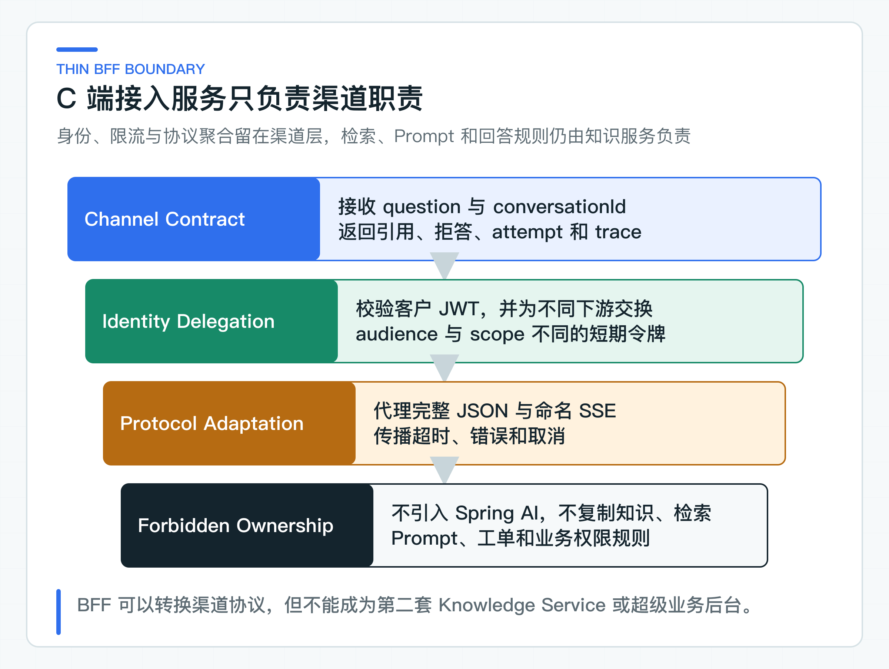
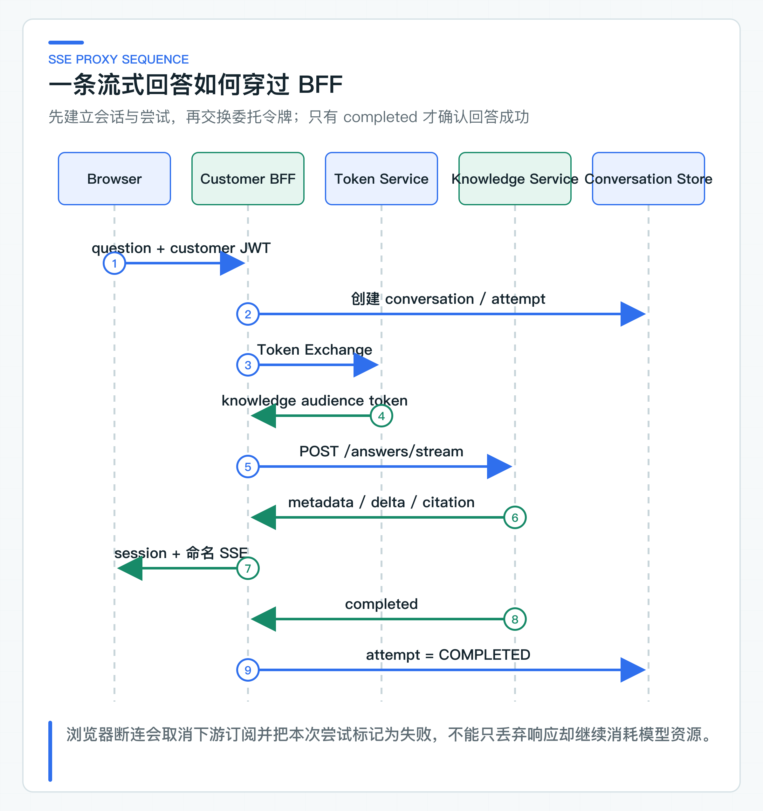

# C 端为什么需要薄 BFF：鉴权、限流、SSE 和 DTO 聚合

内部页面已经能调用 Knowledge Service，接入 C 端时却会立刻多出一组新问题。客户令牌能不能交给内部服务？浏览器断连后怎样取消模型请求？重复点击如何限流？不同渠道的 DTO 又由谁兼容？

这些问题属于终端入口；知识权限、检索、Prompt、模型调用、引用和拒答则属于 Knowledge Service。把两类职责都塞进一个 Controller，代码很快会同时受渠道发布和 AI 链路变化牵制。

项目在 Customer Web 与 Knowledge Service 之间加入面向前端的后端（Backend for Frontend，BFF）。它负责客户身份、委托令牌、渠道限流、回答与 SSE 转发、终端 DTO，以及反馈和转人工入口；不引入 Spring AI，也不读取知识数据库。

这里的“薄”指业务所有权窄，不是类的数量少。只要 BFF 始终围绕渠道身份、协议和会话工作，即使代码不少，边界仍然清楚。

配套的 [Customer Web](https://github.com/DavidDingXu/learn-java-ai/tree/main/apps/customer-web) 是独立 React 应用。它只调用 Customer BFF，负责流式渲染、引用展示、反馈、重新生成和转人工。它不进入 Maven reactor，前端构建失败仍会让仓库总验证失败。

## 先划清渠道与知识服务的边界

### 浏览器直连会混合两类职责

浏览器直连知识服务看起来最省事：前端携带 Token，请求 `/answers` 或 `/answers/stream`，知识服务返回结果。这个方案很快会遇到四类问题。

第一类是身份受众。客户登录令牌通常签发给 Customer BFF 或统一 API 网关，不应该直接成为 Knowledge Service 的访问凭证。如果同一个高权限 Token 可以穿过所有服务，任何一个终端泄漏都会扩大影响范围，下游也无法判断请求究竟由哪个渠道代理。

第二类是渠道协议。Web、App、小程序和第三方渠道对错误码、分页、SSE 事件、字段兼容和发布节奏的要求不同。让 Knowledge Service 同时兼容所有终端，会把渠道演进压力带进知识核心。

第三类是渠道限流。客户连续点击重试、浏览器刷新、移动网络重连和机器人扫描都发生在渠道边界。知识服务可以保护模型并发，但它不适合承担“每个客户一分钟允许多少次咨询”这类终端策略。

第四类是攻击面。浏览器不应知道内部服务地址、内部 scope、模型错误细节和服务拓扑。BFF 对外返回稳定状态码和错误码，下游实现细节留在受控网络中。

这四类问题足以说明 BFF 的价值，但也容易把它推向另一个极端：所有逻辑都塞进 BFF。下面先划清 BFF 与 Knowledge Service 的职责。



| 能力 | Customer BFF 负责 | Knowledge Service 负责 |
|---|---|---|
| 身份 | 验证客户 JWT，交换下游委托令牌 | 再次验证委托令牌与知识 scope |
| 限流 | 按客户和渠道做入口限流 | 按模型、检索资源和实例容量做服务保护 |
| SSE | 转发命名事件、传播取消和空闲超时 | 产生模型事件、引用和完成信号 |
| DTO | 面向渠道隐藏 Provider 细节 | 定义知识回答字段与校验规则 |
| 会话 | 保存短时交互状态和回答尝试 | 重新检索当前授权知识，不信任历史答案 |
| 知识规则 | 不拥有 | 文档、ACL、检索、Prompt、引用与拒答 |

判断一段逻辑应放在哪里，可以问两个问题：它是在适配终端，还是在解释知识业务；换一个渠道后它是否仍然成立。若规则在 Web、App 和客服终端中都相同，例如 ACL 必须在 TopK 前过滤，它属于 Knowledge Service。若规则只决定 C 端返回哪些字段、怎样限流和怎样组织 SSE，它更适合 BFF。

### 请求体只表达业务意图

Customer BFF 的回答请求只有两个字段：

```json
{
  "conversationId": "可选的会话标识",
  "question": "退款多久到账？"
}
```

请求体没有 `tenantId`、`customerId`、角色和部门。身份只来自资源服务器已经验证的 JWT。[CustomerJwtIdentityFactory](https://github.com/DavidDingXu/learn-java-ai/blob/main/learning-stages/stage-04-customer-consultation/apps/customer-bff/src/main/java/com/xiaoding/javaai/customer/identity/CustomerJwtIdentityFactory.java) 从 Token 提取主体、租户、角色和部门，再形成项目自有的 `CustomerAccessToken`。

这样设计的重点不在于少几个字段，而在于消除冲突来源。假设请求体写 `tenantId=B`，Token 写 `tenantId=A`，服务若允许业务代码“选择一个”，越权漏洞就已经产生。身份事实只有一个来源后，Controller 不需要在每个接口重复比较 Header、JSON 和 SecurityContext。

[CustomerAnswerRequest](https://github.com/DavidDingXu/learn-java-ai/blob/main/learning-stages/stage-04-customer-consultation/apps/customer-bff/src/main/java/com/xiaoding/javaai/customer/consultation/web/CustomerAnswerRequest.java) 通过 Bean Validation 限制会话标识与问题长度。[CustomerConsultationController](https://github.com/DavidDingXu/learn-java-ai/blob/main/learning-stages/stage-04-customer-consultation/apps/customer-bff/src/main/java/com/xiaoding/javaai/customer/consultation/web/CustomerConsultationController.java) 把已验证 JWT 映射为客户身份，再调用应用服务。Controller 不读取知识库，也不构造 Prompt。

### 用委托 Token 收窄下游权限

客户 Token 的受众是 BFF，Knowledge Service 需要面向自己的短期令牌。这里使用 RFC 8693 Token Exchange 完成委托。BFF 把已验证的客户 Token 作为 `subject_token` 交给身份系统。身份系统再签发 audience 为 `knowledge-service`、scope 为 `knowledge:answer` 的令牌。

调用 Ticket Agent 时再申请另一枚令牌：audience 为 `ticket-agent-service`，scope 为 `ticket:task:create`。两枚令牌不能互换。知识问答权限不等于创建工单任务权限，受众不同也可以阻止令牌被错误服务接受。

[OAuth2TokenExchangeDelegatedTokenClient](https://github.com/DavidDingXu/learn-java-ai/blob/main/learning-stages/stage-04-customer-consultation/apps/customer-bff/src/main/java/com/xiaoding/javaai/customer/identity/OAuth2TokenExchangeDelegatedTokenClient.java) 发出的表单包含：

```text
grant_type=urn:ietf:params:oauth:grant-type:token-exchange
subject_token=<customer access token>
subject_token_type=urn:ietf:params:oauth:token-type:access_token
requested_token_type=urn:ietf:params:oauth:token-type:access_token
audience=knowledge-service
scope=knowledge:answer
```

真实企业 IdP 通常还会验证调用 Token Exchange 的客户端身份。`OAuth2TokenExchangeDelegatedTokenClient` 支持 Basic 客户端认证和独立超时。它只接受访问令牌类型的 Bearer 响应，并检查令牌非空、有效期为正数。`client_id`、`client_secret` 等配置位于 `application.yml` 的 `java-ai.identity`，两项必须同时提供。

仓库中的值只用于说明配置结构，生产凭据应由部署平台的密钥系统覆盖。身份系统签发的新令牌应保留客户主体与租户，并增加 `act.sub=customer-bff`。下游由此能同时知道“代表谁”和“由谁代理”。

Knowledge Service 与 Ticket Agent Service 不能因为请求来自内网就直接信任 BFF。它们仍要验证签名、issuer、audience、有效期、主体、租户、actor 和 scope。BFF 是受控调用方，不是可以替下游做最终授权的超级网关。

## BFF 同时管理回答协议与生命周期

### 完整回答经过 BFF 的过程

非流式链路适合需要一次性拿到完整结构化结果的渠道，也适合反馈、重试和工单升级前保存确定结果。

[WebClientKnowledgeAnswerClient](https://github.com/DavidDingXu/learn-java-ai/blob/main/learning-stages/stage-04-customer-consultation/apps/customer-bff/src/main/java/com/xiaoding/javaai/customer/consultation/infrastructure/WebClientKnowledgeAnswerClient.java) 使用委托令牌调用 Knowledge Service。发送给下游的仍然只有当前问题和经过裁剪的会话上下文，不包含授权字段。下游返回的模型名、Token 使用量和 finish reason 不会原样暴露给 C 端，BFF 只保留终端真正需要的内容：

```json
{
  "conversationId": "9b7f...",
  "attemptId": "753a...",
  "retryOfAttemptId": null,
  "answer": "退款审核通过后通常在 1 到 5 个工作日到账。",
  "citations": [
    {
      "documentId": "refund-policy",
      "version": "v1",
      "sectionId": "arrival-time",
      "title": "退款到账时间"
    }
  ],
  "refused": false,
  "refusalReason": null,
  "traceId": "trace-123"
}
```

Provider 模型名、finish reason 和 Token 适合进入 Trace、Metric 和成本报表，不适合直接堆到客户页面。渠道 DTO 的目标是稳定表达业务结果，而不是展示系统内部用了多少组件。

### SSE 转发同时管理生命周期

流式接口最容易在演示中显得简单。BFF 从下游订阅 `text/event-stream`，再把数据写给浏览器，看起来几十行代码就能完成。真实项目还要处理会话标识、事件名称、空闲超时、下游错误、浏览器取消，并在流结束时把 AnswerAttempt 更新为完成或失败。

流式请求先创建 conversation 和 answer attempt，再交换 Knowledge Token 并订阅下游。BFF 先发送 `session` 事件，让浏览器拿到 `conversationId` 和 `attemptId`。后续再转发 Knowledge Service 的 `metadata`、`delta`、`heartbeat`、`citation`、`completed` 和 `error`。



事件顺序具备业务含义。`session` 和 `metadata` 固定在最前面，`completed` 或 `error` 负责收尾。正文输出期间，`delta` 与 `heartbeat` 可以按实际耗时交错出现，不能假设所有心跳都在文本之后。

1. `session` 建立终端后续反馈、重试和升级的定位键。
2. `metadata` 提供 Trace，便于跨服务排查。
3. `delta` 只承载增量文本，可能出现零次或多次。
4. `heartbeat` 可以穿插在多次 `delta` 之间，防止空闲链路被代理误判为失活。
5. `citation` 提供模型声明、且已通过本次上下文校验的引用；它不等于应用已经证明每句话都被引用内容支持。
6. `completed` 携带 `refused` 和 `refusalReason`。BFF 保存回答、引用和拒答状态后，才把 attempt 标记为完成。
7. `error` 是流内稳定错误，不应伪装成一段普通文本。

浏览器端不能直接用 `EventSource`，因为这里是带 JSON 请求体和 Bearer Token 的 POST 请求。[HttpCustomerBffClient](https://github.com/DavidDingXu/learn-java-ai/blob/main/learning-stages/stage-04-customer-consultation/apps/customer-web/src/api/customer-bff-client.ts) 使用 `fetch` 发起请求，通过 `ReadableStream` 解析命名事件，并用 `AbortController` 处理“停止生成”和页面离开。连接关闭但没有收到 `completed` 或 `error` 时，前端按中断处理，不能把已收到的半段文本当成完成回答。

[WebClientKnowledgeAnswerStreamClient](https://github.com/DavidDingXu/learn-java-ai/blob/main/learning-stages/stage-04-customer-consultation/apps/customer-bff/src/main/java/com/xiaoding/javaai/customer/consultation/infrastructure/WebClientKnowledgeAnswerStreamClient.java) 按事件名解析 JSON，而不是把下游字节原样暴露给终端。未知事件、缺少字段或错误 HTTP 状态会被当成协议异常；拒答完成事件缺少 `refusalReason` 也会被拒绝。这样下游升级协议时，BFF 可以在测试中及时发现不兼容，而不是让浏览器随机报错。

[CustomerConsultationService](https://github.com/DavidDingXu/learn-java-ai/blob/main/learning-stages/stage-04-customer-consultation/apps/customer-bff/src/main/java/com/xiaoding/javaai/customer/consultation/application/CustomerConsultationService.java) 使用 `Flux.usingWhen` 管理流式尝试的生命周期。收到 `completed` 后，它把累积文本、引用、拒答状态和 Trace 保存为同一个 `KnowledgeAnswerView`，保存成功后才向浏览器发送 BFF 的 `completed`。下游异常、流提前结束或客户端取消时，attempt 会被标记为失败。

如果响应已经开始，BFF 不能再改 HTTP 状态码。普通下游异常会转换为 `KNOWLEDGE_STREAM_FAILED`，空闲或总时长超限则转换为 `KNOWLEDGE_STREAM_TIMEOUT`。页面关闭后，取消信号会继续传给 WebClient 和 Knowledge Service；这能及时释放应用侧连接，Provider 是否同时停止生成与计费，还要用所接模型的真实链路验证。

### 同时限制空闲时间和总时长

当前完整 JSON 的 Knowledge HTTP 调用最多等待 35 秒，Knowledge Service 把首次模型调用、重试间隔和可能的第二次调用一起限制在 30 秒内。只有 Provider 5xx 或网络 I/O 异常会重试一次；429 和整轮超时都不重试。SSE 的语义不同：正常回答可能持续输出较长时间，不能直接复用同步接口的 35 秒预算。

流式客户端同时设置两道边界。连续 30 秒没有收到 metadata、delta、heartbeat、citation 或 completed，判定连接失活。即使一直有 heartbeat，整条下游流超过 2 分钟也会结束。前者容忍模型短暂静默，后者避免只有心跳、始终没有业务结果的连接永久占用资源。

超时预算还要从端到端考虑，而不是每层都拿一份完整等待时间。

以当前配置为例，Knowledge Service 的整轮模型预算是 30 秒，BFF 的 Knowledge HTTP 等待上限是 35 秒。终端整体超时还要继续给 BFF 鉴权、Token Exchange 和网络传输留出时间。具体数字需要结合压测结果设定，但每一层都要给下游完成与映射结果留出空间。否则下游的重试还没结束，上游就已经宣布失败。

Token Exchange、Knowledge 和 Ticket 使用不同超时。Token Exchange 超时会映射为稳定的 504 `DOWNSTREAM_TIMEOUT`。尚未开始 SSE 时，Knowledge 或 Ticket 超时也使用同一错误。身份令牌没有拿到时，不会继续调用业务下游。

SSE 一旦开始，HTTP 状态已经不能修改，超时会通过 `KNOWLEDGE_STREAM_TIMEOUT` 事件告诉前端。创建 Ticket 发生超时后不能换一个幂等键再次创建。工单升级链路必须复用原幂等键，并查询原任务结果。

## 入口保护要区分限流和错误语义

### 按保护对象设计两层限流

“加一个限流器”不是完整设计。需要先回答限流维度、窗口、拒绝语义和多实例一致性。

Customer BFF 的入口限流保护客户渠道和后端成本，限流 Key 使用 `tenantId + subject`。同一客户在一分钟内超过请求上限时返回 429，另一个客户不会被共同计数。Key 来自 JWT，不能由请求体伪造。

[InMemoryFixedWindowConsultationRateLimiter](https://github.com/DavidDingXu/learn-java-ai/blob/main/learning-stages/stage-04-customer-consultation/apps/customer-bff/src/main/java/com/xiaoding/javaai/customer/consultation/infrastructure/InMemoryFixedWindowConsultationRateLimiter.java) 是单进程适配器，通过 `ConcurrentHashMap.compute` 原子更新计数。它用于检查限流 Key 和 429 响应，不适合多实例生产：三台 BFF 各允许 20 次，客户实际可能发起 60 次。

生产环境可以把 `ConsultationRateLimiter` 端口替换为 Redis、API 网关或公司统一限流平台。无论使用哪种组件，都应保留业务 Key 与错误语义。只按 IP 限流会误伤 NAT 后的正常客户，也容易被移动网络变化绕过；只按租户限流又可能让一个异常客户占满整个租户配额。常见做法是组合客户级、租户级和全局模型容量保护。

Knowledge Service 仍需要自己的并发上限和 Provider 限流。入口限流回答“某个客户能多快请求”，模型并发上限回答“单实例能承受多少并发”，两者保护对象不同，不能互相替代。

### 错误码告诉终端下一步动作

如果 BFF 把所有异常都包装为 `500 AI_ERROR`，前端只能统一展示“系统繁忙”。真实业务至少要区分：

| HTTP | 稳定语义 | 渠道处理 |
|---:|---|---|
| 400 | 问题、会话或反馈参数无效 | 提示用户修正输入 |
| 401 | 客户 Token 缺失或无效 | 重新登录或刷新令牌 |
| 403 | 会话不属于当前客户，或缺少 scope | 终止请求，不自动重试 |
| 409 | 会话版本、尝试状态或幂等内容冲突 | 刷新状态后决定下一步 |
| 429 | 客户入口限流 | 根据 Retry-After 或产品策略稍后再试 |
| 502 | Knowledge、Ticket 或身份服务异常 | 展示暂时不可用，可保留 Trace |
| 504 | 身份、Knowledge 或 Ticket 在预算内未返回 | 提示超时，写操作先查询原任务 |

[CustomerConsultationExceptionHandler](https://github.com/DavidDingXu/learn-java-ai/blob/main/learning-stages/stage-04-customer-consultation/apps/customer-bff/src/main/java/com/xiaoding/javaai/customer/consultation/web/CustomerConsultationExceptionHandler.java) 把权限、限流、下游异常、下游超时、参数错误和状态冲突映射为不同状态。模型证据不足不属于技术故障：无论完整响应还是 SSE `completed`，Knowledge Service 都会返回 `refused=true` 和拒答原因，BFF 按正常业务结果保存并交给终端。

区分拒答与故障很重要。拒答意味着服务正常工作，但当前证据不足；502 意味着依赖系统没有完成请求。把两者混在一起会让用户不停重试证据不足的问题，也会让监控把正常拒答误算成可用性事故。

## 从 main 方法启动渠道链路

本地先运行 [KnowledgeServiceApplication](https://github.com/DavidDingXu/learn-java-ai/blob/main/learning-stages/stage-03-enterprise-rag/services/knowledge-service/src/main/java/com/xiaoding/javaai/knowledge/KnowledgeServiceApplication.java) 的 `main` 方法，再运行 [CustomerBffApplication](https://github.com/DavidDingXu/learn-java-ai/blob/main/learning-stages/stage-04-customer-consultation/apps/customer-bff/src/main/java/com/xiaoding/javaai/customer/CustomerBffApplication.java) 的 `main` 方法。两个应用默认监听 8081 和 8080，使用固定客户身份与本地委托令牌，不要求先部署身份平台。

想直接体验页面，可以打开阶段 04 的 `apps/customer-web/package.json`，在 IDEA 的 npm 面板运行 `dev`，再访问 `http://127.0.0.1:5173`。页面会展示流式回答、引用、停止生成、反馈和转人工入口；本地固定身份下不需要填写 Token。

在 IDE HTTP Client 中请求 `POST http://localhost:8080/api/v1/customer/consultations/answers`，请求体只需当前问题。响应应返回 `conversationId`、`attemptId`、回答、引用、拒答状态和 `traceId`。Provider 模型名、Token 用量和 finish reason 不应直接暴露给渠道。

将路径切换为 `/answers/stream` 后，还应观察命名 SSE 事件的顺序。客户端取消时，下游连接也应同步结束。

后端测试覆盖客户 JWT 映射、Token Exchange 表单与客户端认证、完整回答、SSE 事件、渠道 DTO、限流、会话归属和应用启动。Customer Web 另有针对 SSE 分块解析、协议映射、反馈、重试、转人工和生产构建的前端测试。Java 主线的定向验证不依赖前端工具链。

本地 HTTP 组件测试只能说明双方按相同接口约定解析请求和响应。目标 IdP、网关和已部署服务仍要单独联调。

公开接口定义位于 [customer-bff-v1.yaml](https://github.com/DavidDingXu/learn-java-ai/blob/main/learning-stages/stage-04-customer-consultation/contracts/openapi/customer-bff-v1.yaml)。阶段 04 只保留本阶段新增或改变的 Customer BFF 与任务接收契约；发布阶段再汇总全部 OpenAPI 做统一解析，避免复制文件让读者误判本篇改动范围。

## 接入现有渠道时保留的边界

公司项目可以替换 IdP、限流组件、HTTP 客户端配置和错误码格式，但建议保留以下原则：

1. 客户身份只来自受信 Token，不从 JSON 或自定义身份 Header 获取。
2. BFF 为每个下游申请受众和 scope 最小化的短期令牌。
3. Knowledge Service 再次验证令牌，不把“来自 BFF”当成授权结论。
4. BFF 不依赖 Spring AI，不访问知识库，不复制 Prompt 与检索规则。
5. SSE 使用稳定事件名，取消继续传播到下游，只有 completed 才确认成功。
6. 客户入口限流、服务并发保护和 Provider 限流分层配置。
7. 公开 DTO 保留引用、拒答、attempt 和 trace，隐藏 Provider 内部对象。
8. 测试用的假实现和正式运行适配器实现同一业务端口，并明确各自的验证范围。

薄 BFF 把渠道令牌、限流、SSE 和 DTO 变化留在渠道层，Knowledge Service 因此可以专注检索与回答。BFF 拥有的多轮会话只保存短时交互上下文，不能把旧回答、订单状态和政策结论混成所谓“长期记忆”。

---

[课程首页](../../README.md) · [完整目录](README.md) · [← RAG 质量怎样量化：Golden Set、Recall@K 和坏案例](21-rag-evaluation.md) · [多轮会话原理：短期状态、裁剪、总结和过期 →](23-conversation-state.md)

动手实践：[本阶段可运行源码](../../learning-stages/stage-04-customer-consultation/README.md)
