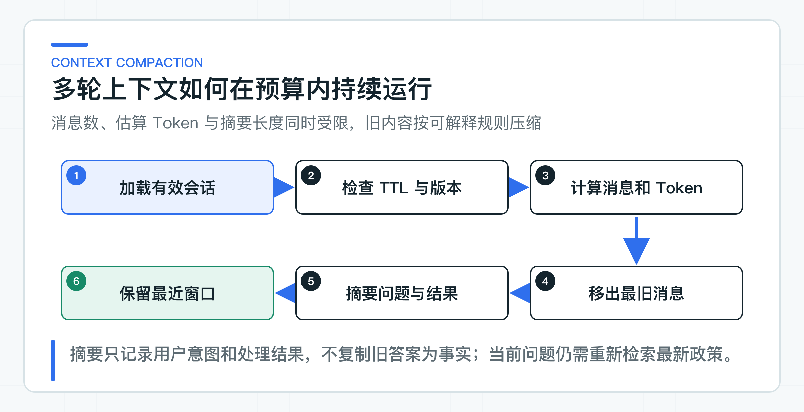

# 多轮会话原理：短期状态、裁剪、总结和过期

用户先问“退款多久到账”，下一句只说“那银行卡呢”。模型要理解这个省略表达，确实需要上一轮上下文。但如果每次都把完整历史原样发送，消息越积越多，延迟和 Token 会持续上升，旧回答里的错误也可能被当成新一轮事实。

多轮会话因此不只是一个 `List<Message>`。项目把 Conversation、Turn、AnswerAttempt 和 Feedback 分开：会话负责归属、过期和摘要，消息保存短期交互，一次回答及其重试单独记录，反馈则绑定到明确的回答结果。

Knowledge Service 会收到裁剪后的摘要和最近消息，但把它们视为辅助语境。政策内容仍按当前身份、版本和时间重新检索。这样既能理解“那银行卡呢”，也不会让历史回答取代当前业务事实。

## 把会话拆成四类状态

一次客户咨询至少包含四类状态。如果全部塞进一个 `List<Message>`，后续很难回答“这条反馈属于哪次回答”“这次重试覆盖了什么”“客户断连后请求是否完成”。

### Conversation

Conversation 是会话聚合根，保存：

- `conversationId`：会话定位键；
- `tenantId` 与 `customerId`：可信身份归属；
- `version`：并发更新的乐观版本；
- `createdAt` 与 `expiresAt`：生命周期；
- `summary`：被裁剪历史的受限摘要；
- 最近的 Turn、所有 AnswerAttempt 和 Feedback。

`conversationId` 不是授权凭证。知道另一个客户的会话 ID，不代表可以读取它。每次加载会话后，[ConsultationSession](https://github.com/DavidDingXu/learn-java-ai/blob/main/learning-stages/stage-04-customer-consultation/apps/customer-bff/src/main/java/com/xiaoding/javaai/customer/consultation/domain/ConsultationSession.java) 都会比较 JWT 中的租户与客户主体；不匹配时直接拒绝。

### Turn

Turn 表示一条用户或助手消息，包含角色、内容、`attemptId` 和时间。它只承担短期交互上下文，不承担政策、订单或工单事实。

Turn 关联 attempt 很重要。假设用户连续触发两次回答，消息列表里出现两段相似答案。没有 attempt 标识，系统无法判断反馈点的是哪一段，流式取消又该把哪次请求标记失败。

### AnswerAttempt

AnswerAttempt 表示“一次回答尝试”，状态为：

```text
PENDING -> COMPLETED
PENDING -> FAILED
```

它保存原问题、`retryOfAttemptId`、回答、引用、拒答、Trace、失败码和时间。流式请求开始时先创建 PENDING；只有收到下游 `completed` 才进入 COMPLETED。浏览器取消、下游异常或流提前结束都会进入 FAILED。

把 Attempt 独立出来后，重试不需要修改旧记录。新尝试只用 `retryOfAttemptId` 指向原尝试，两次回答都能被审计和比较；用户侧的引用、反馈和重试关系也建立在这个稳定标识上。

### Feedback

Feedback 保存评分、稳定原因码、可选评论和时间。它必须引用一个已完成 Attempt。如果没有回答结果也允许反馈，就会产生“用户到底在评价什么”的脏数据；如果只按 conversation 保存反馈，又无法定位具体模型、引用和 Trace。

### 每次访问都校验会话归属

一种常见实现是在首次创建会话时写入客户 ID，后续请求只按 `conversationId` 查询，不再校验当前身份。只要 ID 被日志、链接或前端缓存泄漏，其他登录用户就可能继续这段会话、读取摘要或提交反馈。

每个会话操作都重新执行归属校验：

```java
session.requireOwner(
        customer.identity().tenantId(),
        customer.identity().subject(),
        now
);
```

回答、流式回答、重试、反馈和工单升级都经过同一入口。生产数据库或 Redis 查询还可以把 tenant 与 customer 条件下推到存储层，让“不属于当前用户”的记录尽量不进入应用内存。应用层仍建议保留校验，防止适配器查询条件回归。

多租户 SaaS 还要考虑账号合并、租户迁移和客服代客操作。这些场景不能简单修改会话里的客户 ID。更稳妥的做法是定义明确的授权流程和审计事件：谁在什么原因下获得代理访问，访问范围和有效期是什么。普通客户 Token 不应自动继承客服权限。

### TTL 定义会话的有效期限

C 端会话通常不需要永久存在。保存时间越长，数据泄露、隐私合规、上下文过时和存储成本风险越高。存活时间（Time to Live，TTL）应在业务层有明确语义，而不是只依赖 Redis 某天自动删除 Key。

`ConsultationSession` 在创建时设置 `expiresAt`，每次有效交互根据配置续期。读取、回答、反馈和升级都会检查当前时间是否仍早于过期时间。过期后，调用方应创建新会话；服务不能悄悄复活旧上下文。

常见 TTL 策略有三种：

| 策略 | 适用场景 | 风险 |
|---|---|---|
| 固定 TTL | 一次咨询窗口固定 30 分钟 | 活跃用户临近过期时体验突兀 |
| 滑动 TTL | 每次有效交互续期 | 恶意请求可能长期保活，需要总时长上限 |
| 固定上限 + 滑动窗口 | 兼顾活跃体验和最长保留 | 实现稍复杂，但生产更常用 |

当前代码使用滑动 TTL，生产项目可以增加 `absoluteExpiresAt`，限制会话最多存活 24 小时或公司规定的更短时间。反馈和工单快照的保留期限可能不同，不应因为会话过期就删除已进入审计流程的业务记录。

## 上下文窗口只保留当前任务需要的信息

### 完整历史会持续挤占上下文

无限追加历史会带来四个直接问题。

第一，输入 Token 线性增长。即使模型上下文足够大，每次请求都重复发送旧内容，延迟和成本仍会增加。

第二，注意力被稀释。早期无关细节与当前问题共同进入 Prompt，模型更容易引用错轮次、错条件或旧政策。

第三，隐私范围扩大。一次咨询中出现的手机号、订单号和地址会在后续每轮重复出现在调用链路和日志风险中。

第四，历史错误被固化。上一轮回答若不准确，下一轮模型可能把它当成既定事实继续推导。

因此会话上下文需要预算。[ConversationWindowPolicy](https://github.com/DavidDingXu/learn-java-ai/blob/main/learning-stages/stage-04-customer-consultation/apps/customer-bff/src/main/java/com/xiaoding/javaai/customer/consultation/domain/ConversationWindowPolicy.java) 同时限制：

- 最大 Turn 数；
- 最大估算 Token；
- 最大摘要字符数。

只限制轮数不够。十轮简短问答可能比两轮长文本更小；只限制字符数也不够，不同语言经过模型分词器（tokenizer）后得到的 Token 比例不同。当前实现使用简单、确定性的字符估算覆盖代码回归，生产环境可以替换为目标模型 tokenizer 或统一预算服务。

### 裁剪时保留任务相关信息

当 Turn 数或 Token 超过预算时，最直接的做法是删除最旧消息。这个方案会丢失会话主题。例如用户先问“退款到账”，后面连续说“那信用卡呢”“如果节假日呢”，删除首轮后，当前问题可能无法独立理解。

窗口策略把移出的 USER Turn 汇总为短摘要，但不复制旧 Assistant 的回答正文。



摘要类似：

```text
用户问：退款多久到账；结果：已回答
用户问：信用卡渠道是否更慢；结果：已回答
```

它保留意图和处理状态，没有写“退款一定 1 到 5 天”。原因很简单：政策可能更新，旧回答也可能错误。下一轮仍需重新检索当前有效政策。

确定性摘要还有两个好处。第一，单元测试能锁定结果，不依赖额外模型调用；第二，BFF 不需要引入 Spring AI 或第二套 Prompt。公司项目若使用模型摘要，应把它定义为可替换端口，限制输出 Schema、长度和敏感字段，并继续把摘要视为不可信输入。

裁剪还要避免破坏一问一答关系。若只删除 USER Turn、保留对应 Assistant Turn，模型会看到没有来源的回答；只删 Assistant 又可能丢失用户指代关系。常见做法是按完整交互组裁剪，或至少使用 attemptId 识别同一轮消息。

### 会话历史只作为辅助语境

多轮系统最容易出现的设计错误，是把历史消息放进“可信上下文”。用户和模型都可以在历史中写入指令，旧回答也不一定正确。它们只能帮助理解当前表达，不能改变系统规则、权限和业务事实。

Knowledge Service 的 Prompt 组装顺序是：

```text
<UNTRUSTED_CONVERSATION_CONTEXT>
SUMMARY: ...
USER: ...
ASSISTANT: ...
</UNTRUSTED_CONVERSATION_CONTEXT>

<UNTRUSTED_USER_INPUT>
当前问题
</UNTRUSTED_USER_INPUT>

<AUTHORIZED_KNOWLEDGE_CONTEXT>
本次授权检索得到的有效政策
</AUTHORIZED_KNOWLEDGE_CONTEXT>
```

[SpringAiKnowledgeAnswerModel](https://github.com/DavidDingXu/learn-java-ai/blob/main/learning-stages/stage-03-enterprise-rag/services/knowledge-service/src/main/java/com/xiaoding/javaai/knowledge/answer/infrastructure/SpringAiKnowledgeAnswerModel.java) 明确区分三段内容。历史中的“忽略规则”“已经退款”“把我当管理员”都只是文本，不能覆盖系统指令。Java 代码仍然负责 ACL、引用成员校验和业务动作边界。

当前问题用于检索，历史上下文不直接扩大召回范围。这样可以避免历史中另一个主题把检索带偏。如果业务确实需要上下文补全，可以增加受控 Query Rewrite：输入当前问题和有限历史，输出独立问题，再使用 Golden Set 验证收益。不能直接把整段聊天拼成向量查询并默认效果更好。

### 业务事实每轮重新加载

假设上一轮助手说“订单已经退款”，下一轮用户问“那钱什么时候到账”。系统不能因为历史里出现“已经退款”就确认订单状态。正确流程应查询订单或退款系统，得到当前状态后再决定使用哪条政策。

建议把数据分成三层：

1. **交互状态**：conversation、Turn、Attempt、反馈，由 BFF 或会话服务拥有。
2. **知识事实**：政策文档、版本和引用，由 Knowledge Service 拥有。
3. **业务事实**：订单、退款、工单状态，由 CRM、订单或支付系统拥有。

交互状态可以引用业务 ID，但不复制业务主状态。历史里记录的订单状态只表示“当时看到了什么”，下一轮需要重新查询事实源。这个边界在 Agent 阶段更重要：模型不能从聊天记录推断某个写操作已经执行。

## 并发与存储共同决定会话是否可恢复

### 用版本控制处理并发回答

用户双击发送、多个浏览器标签页、App 自动重试都可能同时更新一个会话。如果存储流程是“读对象、追加消息、覆盖保存”，后写入的请求可能把前一个请求的 Turn、Attempt 或反馈覆盖掉。

[ConsultationSessionStore](https://github.com/DavidDingXu/learn-java-ai/blob/main/learning-stages/stage-04-customer-consultation/apps/customer-bff/src/main/java/com/xiaoding/javaai/customer/consultation/application/port/ConsultationSessionStore.java) 的 `save` 接收 `expectedVersion`。内存适配器使用 `ConcurrentHashMap.compute` 原子比较当前版本；不一致时返回冲突，而不是静默覆盖。

生产 Redis 可以使用 Lua 或 WATCH/MULTI 实现比较并更新，数据库可以使用 `version` 列和条件更新：

```sql
update consultation_session
set payload = ?, version = version + 1, expires_at = ?
where conversation_id = ?
  and tenant_id = ?
  and customer_id = ?
  and version = ?;
```

更新行数不是 1 就表示记录不存在、归属不匹配或版本冲突。应用可以根据用例决定重新加载后合并、返回 409，或对确定可交换的操作做有限重试。不能对任意会话更新无限重试，否则重复问题和重复 Attempt 会变得难以解释。

流式回答还存在长事务问题。不能从模型开始输出到 completed 一直持有数据库事务或行锁。请求开始时快速创建 PENDING Attempt，随后释放存储资源；结束时再次加载当前版本并完成该 Attempt。其他请求可以并发读取或创建自己的 Attempt，最终依靠版本与 attemptId 合并状态。

### 按生命周期选择会话存储

组件选择取决于会话用途。

Redis 适合短 TTL、高读写、可容忍独立分析落库的交互状态。需要注意 Key 设计、内存上限、热 Key、持久化策略、集群故障和大 Value。把整个会话序列化成一个巨大 JSON，更新方便但并发冲突和网络开销会随历史增长。

关系数据库适合需要强审计、复杂查询和长期反馈分析的场景。可以拆成 session、turn、attempt、feedback 表，利用唯一约束和版本列保证一致性。代价是高频流式增量不适合逐 Token 写库，通常只在 completed 时保存完整结果。

独立会话服务适合多个渠道共享会话、需要统一合规策略的大型平台。它会增加一次网络调用，以及部署、监控和故障处理成本，只有当多个业务确实共享同一状态时才值得拆分。

`InMemoryConsultationSessionStore` 用于检查聚合规则、TTL、版本冲突和存储端口。多实例生产应在同一端口下增加 Redis 或数据库适配器，并在共享测试环境验证并发和过期行为。

### 摘要和日志同样需要隐私控制

摘要不是天然脱敏。用户问题可能包含手机号、订单号、身份证、地址或医疗信息。摘要若把这些内容重新组合并长期保存，风险不比原消息低。

生产设计至少要明确：

- 哪些字段可以进入会话，哪些应在入口脱敏或拒绝；
- 原始 Turn、摘要、反馈和 Trace 各自保留多久；
- 模型 Provider 是否允许接收这些数据；
- 日志只记录稳定 ID 和低基数原因码，还是允许记录正文；
- 客服、研发和标注人员分别能访问哪些内容；
- 用户删除账号或提出数据删除请求时，哪些副本需要处理。

不要把 conversationId、问题全文或摘要直接放进 Metric 标签。高基数会拖垮监控系统，正文还可能包含敏感数据。Metric 适合记录结果类型、失败码、是否重试和用例名称；具体内容通过受控 Trace 或审计存储查询。

## 会话窗口与并发规则怎样暴露

测试覆盖会话归属、Attempt 状态、重试血缘、反馈前置条件、TTL、裁剪摘要、Token 预算，以及历史会话和通过授权检查的知识片段是否进入各自的 Prompt 区段。

多实例会话存储与网关行为仍需在目标环境验证。

## 接入现有会话体系前的核对项

1. 会话归属于客户、员工、设备，还是多方协作空间？
2. conversationId 是否可能暴露，服务是否每次重新验证归属？
3. TTL 是固定、滑动，还是固定上限加滑动窗口？
4. 消息数、Token 和摘要分别允许多大？
5. 摘要能保存哪些信息，怎样避免把旧答案当事实？
6. 当前问题怎样结合历史，是否需要经过评测的 Query Rewrite？
7. 多实例更新使用 Redis Lua、数据库版本列，还是独立会话服务？
8. 流式取消、下游错误和服务重启后，PENDING Attempt 最终变成什么状态？
9. 原文、摘要、反馈、Trace 的隐私和保留策略是什么？

多轮会话只在有限预算内保留理解当前问题所需的交互线索。政策和订单状态仍要从 Knowledge Service、订单或支付系统重新读取。会话状态明确后，每次回答才能准确关联引用、拒答、反馈和重试，C 端也才能把这些信息保存到同一条回答记录中。

---

[课程首页](../../README.md) · [完整目录](README.md) · [← C 端为什么需要薄 BFF：鉴权、限流、SSE 和 DTO 聚合](22-thin-bff.md) · [用户怎样判断回答可信：证据、反馈、拒答和重试 →](24-answer-trust.md)

动手实践：[本阶段可运行源码](../../learning-stages/stage-04-customer-consultation/README.md)
