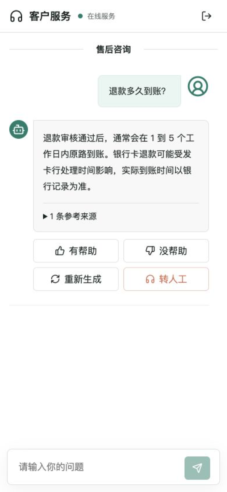
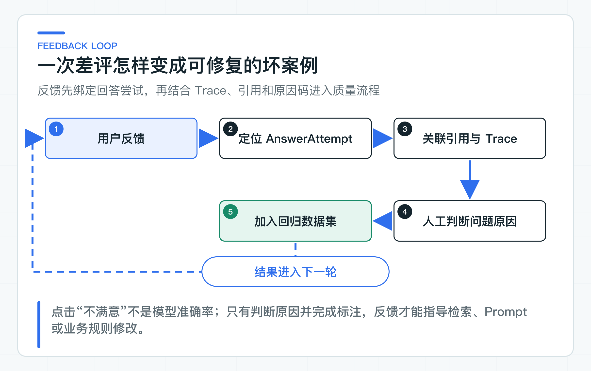

# 用户怎样判断回答可信：证据、反馈、拒答和重试

用户看到“退款将在五个工作日内到账”，最需要的不是旁边再放一个“置信度 92%”，而是能打开对应政策，确认这句话适用于自己的情况。系统答不了时，也应该说明缺少什么，而不是返回一个模糊错误。

项目把这些信号拆开：Citation 指向模型声明、且属于本次授权上下文的依据，Refusal 说明拒答原因，AnswerAttempt 标识一次具体结果，Trace 供客服和研发定位服务记录。每个信号都有明确的使用者和校验边界。

反馈、重试和工单升级都绑定 `attemptId`。这样“不满意”不会漂浮在整个会话上，重试也不会覆盖原答案；质量团队可以回到当时的引用、拒答和 Trace，判断该修知识、检索、Prompt、模型还是渠道表达。

## 用可核对信号代替置信度数字

很多产品会在模型结果旁展示“置信度”。如果这个分数只是模型自评，模型可能对错误答案同样自信；如果来自向量相似度，它只能表示问题和片段接近，不能证明片段足以支持结论；如果来自 Rerank 分数，不同模型和查询之间也未必可直接比较。

可信度需要拆成用户能理解、系统能验证的信号。

这些信号最终要落到页面上。移动端把引用折叠在当前回答内，用户可以继续反馈、重新生成或转人工；`attemptId` 和 `traceId` 留给服务端关联，不直接展示给客户。

<!-- visual-origin: screenshot: column/assets/reports/customer-web-browser-qa.md -->


| 信号 | 自动验证方式 | 用户价值 |
|---|---|---|
| Citation | 引用 ID 必须属于本次最终授权上下文 | 可以查看政策标题和来源 |
| Refusal | 证据不足、冲突或条件缺失使用稳定原因 | 知道系统为什么不回答 |
| Attempt | 每次回答和重试都有独立 ID | 反馈和升级不会指错对象 |
| Trace | 当前回答保留 Knowledge 返回的 `traceId`；跨服务传播仍需联调 | 客服能定位本次知识调用记录 |

这些信息不能保证答案永远正确，但能让用户核对来源，也能让团队定位并修复错误。相比一个无法解释的百分比，它们更适合企业项目。

### Citation 只从本次上下文产生

引用不能由模型自由生成。模型可能写出一个看似合理但不存在的文档编号，也可能引用检索候选中已经被 ACL、时效或 Rerank 排除的片段。

Knowledge Service 在生成前已经得到本次可信 `PolicyContext` 列表。模型只声明用于支撑回答的 `sectionId`。应用层 [KnowledgeAnswerValidator](https://github.com/DavidDingXu/learn-java-ai/blob/main/learning-stages/stage-03-enterprise-rag/services/knowledge-service/src/main/java/com/xiaoding/javaai/knowledge/answer/application/KnowledgeAnswerValidator.java) 检查这些 ID 是否属于本次上下文，再由服务端映射文档、版本、片段和标题。未知引用无法进入成功响应。

这项检查解决的是“引用是否存在、是否越出本次授权上下文”，不是“答案中的每句话是否被引用内容证明”。例如引用确实写着“1 到 5 个工作日”，模型却回答“当天到账”，仅检查 `sectionId` 仍然发现不了。数字、金额、状态等高风险结论还需要确定性字段校验或声明级评测。

BFF 不重新判断引用是否正确。它把已经校验的 [CitationView](https://github.com/DavidDingXu/learn-java-ai/blob/main/learning-stages/stage-04-customer-consultation/apps/customer-bff/src/main/java/com/xiaoding/javaai/customer/consultation/domain/CitationView.java) 转成渠道 DTO。这样引用规则只有一个所有者，Web、App 和客服终端不会各写一套“引用存在性”校验。

C 端展示可以提供政策标题、更新时间和受控详情入口，但不要直接暴露对象存储路径、内部 Chunk 内容或可猜测的跨租户 URL。详情接口仍需验证当前客户是否有权查看该文档版本。回答时有权看到一段知识，不代表可以下载整份内部制度。

引用点击率可以作为产品信号，却不能当成答案正确率。用户不点击可能因为答案已经足够清楚；频繁点击也可能说明回答令人怀疑。质量判断仍要结合 Golden Set、人工标注和坏案例原因分析。

### 把拒答作为正常业务结果

当有效证据为空、决定条件缺失或政策冲突无法裁决时，系统应该拒答。拒答表示链路正常执行，并且遵守了业务边界。数据库连接失败、模型超时和身份系统异常才是技术故障。

两者在 C 端响应中必须分开：

```json
{
  "answer": "当前资料只能说明退款审核通过后的通常到账时间，无法确认这笔退款是否已经通过审核。",
  "citations": [],
  "refused": true,
  "refusalReason": "缺少这笔退款的审核状态",
  "traceId": "trace-456"
}
```

拒答仍然需要一段可直接展示给用户的 `answer`。`refusalReason` 用来稳定表达缺少的条件，不能让前端把内部原因码拼成一句生硬提示。

拒答原因应面向用户说明还缺什么或下一步是什么，内部观测则使用稳定原因码，例如：

- `NO_AUTHORIZED_EVIDENCE`：权限和时效过滤后没有证据；
- `MISSING_BUSINESS_FACT`：需要订单状态、支付渠道等事实；
- `CONFLICTING_POLICY`：有效政策存在无法自动裁决的冲突；
- `HUMAN_DECISION_REQUIRED`：规则要求人工判断。

不要把底层异常文本直接当拒答原因。`Connection refused`、Provider 请求 ID 和 SQL 信息既不帮助客户，也可能泄露内部结构。技术错误使用稳定的 HTTP 状态或 SSE `error` 事件，详细原因通过 Trace 查询日志。

拒答后是否自动创建工单，要由业务规则决定。用户只是问了一个知识库没有覆盖的低风险问题，自动建单可能制造大量噪声；涉及订单状态、投诉或用户明确要求人工时，提供升级入口更合理。BFF 不应仅凭回答文本包含“抱歉”就判断是否升级，应使用结构化拒答和显式原因码。

## AnswerAttempt 关联后续交互

conversationId 代表一段会话，无法唯一指向某次回答。一个会话中可能有首次回答、两次重试、一次流式取消和一次拒答。反馈如果只绑定 conversation，质量团队不知道用户评价的是哪条结果。

[AnswerAttempt](https://github.com/DavidDingXu/learn-java-ai/blob/main/learning-stages/stage-04-customer-consultation/apps/customer-bff/src/main/java/com/xiaoding/javaai/customer/consultation/domain/AnswerAttempt.java) 保存：

```text
attemptId
question
retryOfAttemptId
status
answer / citations / refusal / trace
failureCode
createdAt / completedAt
```

它的状态变化由应用服务控制。开始请求时创建 PENDING；完整回答返回或 SSE 收到 completed 后进入 COMPLETED；下游异常、空流或取消进入 FAILED。反馈和工单升级只接受 COMPLETED，避免对不存在的结果操作。

attemptId 还可以成为观测关联键。Trace 负责一次分布式调用，attempt 负责业务上的一次回答。一次 attempt 可能跨 Token Exchange、Knowledge、Provider 和存储多个 Span。重试会生成新的 Trace 和 attempt，但通过 retryOf 保留业务血缘。

### 原因码让反馈可以分类处理

单纯的赞和踩信息量很低。用户点“不满意”可能有多种原因：答案错误、信息不完整、引用无关、表达难懂、没有解决问题，或其实需要人工处理。不同原因对应不同修复层。

反馈请求包含：

```json
{
  "rating": "NOT_HELPFUL",
  "reasonCode": "ANSWER_INCOMPLETE",
  "comment": "没有说明信用卡退款是否更慢"
}
```

`NOT_HELPFUL` 必须携带原因码，评论最多 500 字。推荐从有限枚举开始，例如：

这个条件同时写进 Bean Validation 和 OpenAPI 3.1：`HELPFUL` 可以不传原因，`NOT_HELPFUL` 的 `reasonCode` 必须是非空字符串。只在领域对象里抛异常会让接口文档允许一种运行时必然失败的请求，前端生成代码也无法提前发现。

| 原因码 | 可能原因 |
|---|---|
| `ANSWER_INCORRECT` | 知识、检索、生成或业务校验 |
| `ANSWER_INCOMPLETE` | 漏召回条件、上下文裁剪或生成遗漏 |
| `CITATION_IRRELEVANT` | 排序、引用映射或知识版本 |
| `HARD_TO_UNDERSTAND` | 渠道表达和答案模板 |
| `NEEDS_HUMAN` | 业务流程本应升级 |

原因码要稳定，展示文案可以国际化和迭代。不要把自由文本评论直接作为 Metric 标签，也不要在没有脱敏与权限控制的情况下送给另一个模型自动分析。

[ConsultationSession.recordFeedback](https://github.com/DavidDingXu/learn-java-ai/blob/main/learning-stages/stage-04-customer-consultation/apps/customer-bff/src/main/java/com/xiaoding/javaai/customer/consultation/domain/ConsultationSession.java) 验证 attempt 已完成。反馈按 attempt 保存，PUT 接口允许同一用户修正选择，不会每点击一次就新增一条无法去重的记录。

## 从用户反馈生成回归案例

线上反馈本身带有噪声。有人会因为政策结果不符合预期而给正确答案差评，也有人看到流畅文本就点赞。分析反馈时要同时查看当次引用、检索排名、Prompt 版本、模型和 Trace，再由业务或标注人员判断问题出在哪一层。



建议流程是：

1. 通过 attemptId 找到当时的问题、回答、引用、拒答和 Trace。
2. 读取同一 Trace 下的检索候选、Prompt 版本、模型、延迟和错误信息。
3. 由业务或标注人员判断期望证据与期望行为。
4. 给失败层打标签，例如 `KNOWLEDGE_MISSING`、`RETRIEVAL_MISS`、`RERANK_DROP`、`UNSUPPORTED_CLAIM` 或 `CHANNEL_COPY`。
5. 将有代表性的案例脱敏后加入 Golden Set 或安全回归集。
6. 修复后保留原案例，验证后续变化没有再次破坏它。

不要让系统根据一条差评立即在线修改 Prompt 或知识。恶意用户可以利用反馈污染行为，普通用户的偏好也不等于业务事实。反馈适合进入受控迭代流程，不适合直接成为自动训练指令。

当数据量扩大后，可以统计分业务域的差评率、拒答转人工率和引用打开率，但分母必须清楚。只看“本周差评下降”可能是因为反馈入口变难找，也可能是大量请求直接失败没有产生反馈资格。

## 重试保留原回答和因果关系

用户点“重新回答”时，最省事的实现是再次调用模型，然后用新文本覆盖页面和数据库里的旧文本。这样会丢失原引用、原 Trace、原反馈和问题发生时的证据，质量团队也看不到重试是否真的改善。

重试会创建新 attempt，并设置：

```text
attempt-2.retryOfAttemptId = attempt-1
```

[CustomerConsultationService.retry](https://github.com/DavidDingXu/learn-java-ai/blob/main/learning-stages/stage-04-customer-consultation/apps/customer-bff/src/main/java/com/xiaoding/javaai/customer/consultation/application/CustomerConsultationService.java) 先加载原会话并验证归属，再读取原 attempt 的问题，走一次新的知识调用。新回答拥有新的引用和 Trace；原回答与反馈保持不变。

这种设计可以回答几个关键问题：

- 重试后引用是否变化；
- 同一问题是否因为模型随机性得到不同结论；
- 用户是在拒答后重试，还是对完整回答不满意；
- 某个模型或 Prompt 版本是否更容易触发多次重试；
- 重试最终是否转人工。

重试不能变成“刷答案”。证据不足时，多调用几次模型不会产生新事实，只会增加成本和偶然幻觉。可以设置每个 conversation 或原 attempt 的最大重试次数；连续拒答或相同失败码出现后，优先提供人工升级或补充业务信息入口。

如果重试目标是修复临时技术错误，策略又不同。下游超时且服务端可能已经完成请求时，应先根据 attempt 状态查询，不能直接创建新 attempt；否则客户端没收到响应会被误判为业务需要重新回答。技术重试与用户主动重新回答应使用不同接口和观测标签。

## 在 SSE 中区分引用、拒答和错误

流式接口不能只发送 delta。客户端在首个 Token 到达前需要 session 和 metadata，回答过程中需要 heartbeat，结束后需要 citation 与 completed，异常时需要 error。

BFF 对终端输出以下事件序列：

```text
session -> metadata -> (delta | heartbeat)* -> citation* -> completed
session -> metadata -> (delta | heartbeat)* -> error
```

`session` 提供 `attemptId`，前端可以在流结束后提交反馈。`citation` 与普通回答使用同一 `CitationView`。`completed` 携带 `refused` 和 `refusalReason`，也是保存完成状态的唯一信号。浏览器看到连接关闭不等于成功，网络中断也会关闭连接。

模型流先给出一段不会透传给浏览器的决策头，其中包含引用 ID、`refused` 和 `refusalReason`。Knowledge Service 先校验决策，再输出正文；流结束时还会把完整回答交给与非流式链路相同的 `KnowledgeAnswerValidator`。未知引用、缺少决策或最终校验失败都会得到 `error`，不会发送 `completed`。

BFF 解析 Knowledge 的 `completed`，把拒答状态与累积文本、引用和 Trace 一起保存到 AnswerAttempt，再发送自己的 `completed`。Customer Web 最终从结构化字段更新页面状态，不根据答案里是否出现“无法回答”来猜测。Knowledge OpenAPI、Customer OpenAPI 和两端协议测试共同固定这组字段。

### 渠道 DTO 隔离模型元数据

Knowledge Service 的内部响应包含模型名、Token 和 finish reason，它们对测试、观测和成本统计有价值。C 端 BFF 只返回 answer、citations、refused、attempt 和 trace。Customer Web 展示答案、引用和下一步操作，不把内部 ID 做成客户页面上的“技术详情”。

隐藏这些字段不是为了掩盖系统，而是减少渠道耦合。更换 Provider、切换模型路由或增加缓存，不应迫使 App 升级。用户真正需要的是依据和下一步，模型 ID 通常无法帮助判断答案是否正确。

运维终端或内部调试页面可以在权限控制下展示模型、Prompt、检索计划和 Token。公共 API 与内部诊断 API 应分开，避免为了排查方便长期暴露实现细节。

### 同时设计 HTTP 状态和业务结果

回答可信还依赖稳定错误语义：

- `200 + refused=true`：系统正常，当前证据不足或需要人工；
- `400`：请求字段、反馈原因或会话参数无效；
- `401/403`：身份或会话归属不成立；
- `409`：Attempt 状态、会话版本或幂等内容冲突；
- `429`：渠道限流；
- `502/503/504`：下游异常、不可用或超时。

不要用 `200 + answer="系统繁忙"` 表示故障。它会被保存成正常回答，用户可以给它反馈，工单快照也会误认为 Knowledge 成功执行。技术异常必须保持异常身份。

同样，不要把拒答返回 500。拒答是质量和业务边界的一部分，需要进入拒答率、转人工率和 Golden Set，而不是可用性告警。

## 可信交互必须绑定会话与回答

测试覆盖未完成 attempt 禁止反馈或升级、重试血缘、会话归属和渠道 DTO。反馈、重试和升级命令都必须绑定 conversation 与 attempt。

接口定义位于 [customer-bff-v1.yaml](https://github.com/DavidDingXu/learn-java-ai/blob/main/learning-stages/stage-04-customer-consultation/contracts/openapi/customer-bff-v1.yaml)，包括完整回答、SSE、反馈、重试和工单升级。发布客户端前应使用 OpenAPI diff 和客户端兼容测试检查破坏性变化，不能只依赖 Java 编译。

## 建立可信信号表

建议在开发前明确：

| 信号 | 来源 | 是否给用户看 | 是否进入评测 | 保留期限 |
|---|---|---|---|---|
| Citation | Knowledge 校验结果 | 是 | 是 | 随 Attempt |
| Refusal | Knowledge 业务结果 | 是 | 是 | 随 Attempt |
| Attempt | BFF 会话聚合 | 可隐藏 ID，必须保留关联 | 是 | 按会话与审计要求 |
| Trace | 可观测链路 | 必要时展示服务编号 | 排障使用 | 按日志策略 |
| Feedback | 用户输入 | 展示已提交状态 | 人工分析后进入 | 按隐私策略 |
| Provider metadata | Knowledge/Provider | 通常否 | 是 | 按观测与成本策略 |

同时回答以下问题：反馈是否允许修改，差评原因码有哪些，连续重试多少次后升级，拒答和系统错误怎样展示，引用详情如何继续做权限校验，哪些反馈可以进入标注集。

引用告诉用户答案来自哪里，拒答说明当前缺少什么，Attempt 把反馈和重试指向具体一次回答。机器人仍然解决不了时，再把这次 Attempt 连同引用、拒答原因和 Trace 升级为工单，并用幂等键避免网络重试创建重复任务。

---

[课程首页](../../README.md) · [完整目录](README.md) · [← 多轮会话原理：短期状态、裁剪、总结和过期](23-conversation-state.md) · [机器人解决不了时怎样平滑升级工单 →](25-ticket-handoff.md)

动手实践：[本阶段可运行源码](../../learning-stages/stage-04-customer-consultation/README.md)
