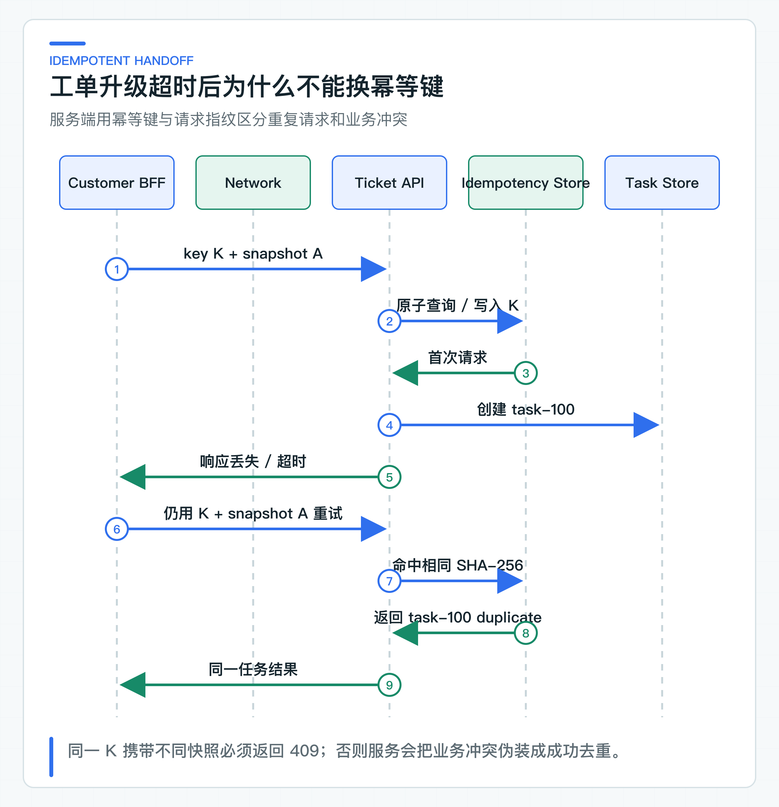

# 机器人解决不了时怎样平滑升级工单

用户已经和机器人聊了五轮，点击“转人工”后，客服却只收到一句“退款未到账”。原问题、模型引用过的政策、拒答原因和用户反馈都丢了；创建工单的请求再超时重试，还可能多出一张重复工单。

这一步真正要做的是把未解决咨询转换为可追踪、可去重的业务任务。项目让升级请求绑定已完成的 AnswerAttempt，并生成不可变的 Handoff Snapshot；Ticket Agent 再用幂等键和内容指纹识别重复请求。

这里先建立可靠的工单入口，不让模型自动修改订单，也暂不处理 JDK8 人工确认。等任务有了身份、来源和状态，后续 Agent 才有稳定的起点。

Customer Web 发起工单升级请求时只提交升级原因，接口路径如下：

```http
POST /api/v1/customer/consultations/{conversationId}/attempts/{attemptId}/handoffs
```

浏览器不生成幂等键，也不拼接工单上下文。BFF 根据已经保存的 AnswerAttempt 生成快照和稳定幂等键，避免前端刷新或重试改变业务含义。

## 从升级条件到不可变的处理现场

### 用明确条件触发工单升级

转人工需要稳定触发条件，不能只依赖模型文本或相似度分数。常见来源包括：

- 用户明确要求人工处理；
- Knowledge 返回结构化拒答，原因是缺少业务事实或需要人工判断；
- 问题涉及投诉、资金、账户安全等必须人工介入的场景；
- 需要查询或修改订单、退款、发票等业务状态；
- 连续重试仍未解决；
- 用户对回答提交 `NEEDS_HUMAN` 反馈。

“向量相似度低于 0.7 自动建单”通常过于粗糙。低分可能是表达差异，也可能是知识缺失；高分也不证明答案足够。更稳妥的方式是由 Knowledge 提供结构化拒答，BFF 结合用户动作和确定性业务规则决定是否展示升级入口。

自动升级还要考虑噪声。所有拒答都建单会把知识缺失问题变成客服积压，攻击者也可以批量制造任务。入口限流、租户配额、风险分类和去重仍然需要保留。

### Handoff Snapshot 保留处理现场

聊天记录缺少稳定业务语义。客服看到“它说不行”时，不知道“它”是哪次回答；看到一段政策文本时，不知道是否来自当前有效版本；看到“用户不满意”时，也不知道具体原因。

Handoff Snapshot 至少应包含：

- conversationId 与 attemptId；
- 原问题；
- 本次回答或拒答原因；
- 本次引用的文档、版本和 section；
- 用户反馈与原因码；
- 受限会话摘要；
- 升级原因码；
- 源 Trace；
- 创建时间。

租户、客户、角色和部门不放进业务请求体，它们由 Ticket Agent 验证委托 JWT 后获得。

[TicketHandoffSnapshot](https://github.com/DavidDingXu/learn-java-ai/blob/main/learning-stages/stage-04-customer-consultation/apps/customer-bff/src/main/java/com/xiaoding/javaai/customer/consultation/domain/TicketHandoffSnapshot.java) 在 BFF 领域层创建。只有 COMPLETED Attempt 才能生成快照，避免把一个仍在输出或已经失败的请求当成有效回答交给客服。

快照应该在创建后保持不变。后续用户修改反馈、知识文档发布新版本或会话继续聊天，都不能改变已经提交任务的历史输入。若业务需要补充材料，应创建明确的补充事件或任务更新，而不是覆盖原快照。

## 委托身份限定任务创建权限

客户 Token 的受众是 Customer BFF，Knowledge Token 的 scope 是 `knowledge:answer`。它们都不应该直接调用 Ticket Agent。

BFF 通过 Token Exchange 请求：

```text
audience=ticket-agent-service
scope=ticket:task:create
```

新令牌保留客户 `sub` 和 `tenantId`，`act.sub` 标识 `customer-bff`。Ticket Agent 把校验分为三层：

1. [DelegatedJwtConfiguration](https://github.com/DavidDingXu/learn-java-ai/blob/main/learning-stages/stage-04-customer-consultation/services/ticket-agent-service/src/main/java/com/xiaoding/javaai/ticket/security/DelegatedJwtConfiguration.java) 校验签名、issuer、过期时间、audience，并要求 subject、tenant 和 `act.sub` 存在；
2. [SecurityConfiguration](https://github.com/DavidDingXu/learn-java-ai/blob/main/learning-stages/stage-04-customer-consultation/services/ticket-agent-service/src/main/java/com/xiaoding/javaai/ticket/SecurityConfiguration.java) 要求创建入口包含 `ticket:task:create` scope；
3. [DelegatedTicketIdentityFactory](https://github.com/DavidDingXu/learn-java-ai/blob/main/learning-stages/stage-04-customer-consultation/services/ticket-agent-service/src/main/java/com/xiaoding/javaai/ticket/security/DelegatedTicketIdentityFactory.java) 再确认 actor 必须是 `customer-bff`，错误 actor 返回 403。

为什么还要 actor？因为客户主体代表“为谁创建任务”，actor 代表“谁在代理这次操作”。后续审计可以区分 Customer BFF 自动升级、客服终端创建和内部批处理创建。只记录 customerId 会丢失调用来源。

Ticket Agent 不接受请求体里的 tenant 或 customer 身份。BFF 发送的 businessContext 只包含问题、回答、引用、反馈、原因码和 Trace。下游用 Token 身份写任务归属，避免调用方伪造其他租户。

## 幂等键识别同一次业务请求

HTTP 超时只说明调用方没有及时收到结果，不说明服务端没有执行。BFF 发送创建任务请求后，Ticket Agent 可能已经写入 task-100，但响应在网络中丢失。如果 BFF 生成新请求 ID 再试，服务端会合理地创建 task-101。

Idempotency-Key 表达“这些重试属于同一次业务意图”。工单升级使用的键为：

```text
handoff:v1:SHA-256(
  lengthPrefixed("tenantId") + lengthPrefixed(tenantId) +
  lengthPrefixed("conversationId") + lengthPrefixed(conversationId) +
  lengthPrefixed("attemptId") + lengthPrefixed(attemptId)
)
```

它绑定一次具体回答的升级。相同 Attempt 无论因为超时重试多少次，都使用同一个 Key。另一个重试 Attempt 需要独立升级时，会有不同 attemptId，因此生成不同 Key。字段名和字段值都使用长度前缀，避免标识中包含分隔符时产生相同字节序列；对整体取摘要后，网关和 HTTP 日志也不会直接记录租户、会话和 Attempt 标识。

不要使用随机 UUID 作为每次 HTTP 调用的幂等键。随机值只能标识请求，无法让重试落到同一个业务操作。也不要只用 conversationId，一个会话可能在不同阶段产生多个合理的人工任务。

### 请求指纹防止同 Key 换内容

服务端若只保存 `key -> taskId`，调用方错误地复用 Key 发送不同内容时，接口会返回原任务，看起来幂等成功，实际掩盖了业务冲突。

[AgentTaskIntakeService](https://github.com/DavidDingXu/learn-java-ai/blob/main/learning-stages/stage-04-customer-consultation/services/ticket-agent-service/src/main/java/com/xiaoding/javaai/ticket/task/AgentTaskIntakeService.java) 对规范化请求计算 SHA-256：

```text
fingerprint = SHA-256(
  lengthPrefixed("caseId") + lengthPrefixed(caseId) +
  lengthPrefixed("objective") + lengthPrefixed(objective) +
  lengthPrefixed("businessContext") + lengthPrefixed(contextSize) +
  sorted(lengthPrefixed(contextKey) + lengthPrefixed(contextValue))
)
```

固定字段名和值都先写入长度，再写入正文，避免换行符、等号或其他分隔符出现在业务文本中时形成相同字节序列。Map Key 排序则让语义相同但 JSON 字段顺序不同的请求得到相同指纹。测试同时覆盖字段顺序变化与分隔符碰撞。处理规则为：

| Key | 指纹 | 结果 |
|---|---|---|
| 首次出现 | A | 创建 task，返回 `duplicate=false` |
| 已存在 | A | 返回原 task，`duplicate=true` |
| 已存在 | B | 返回 409 `IDEMPOTENCY_CONFLICT` |



409 很重要。它告诉团队调用方或 Key 设计存在错误，需要人工检查，不能把不同业务输入静默合并。

### 在数据库唯一约束上建立原子性

生产实现需要在一个原子边界内完成：

1. 查询或写入 Idempotency-Key；
2. 保存请求指纹；
3. 创建或关联 taskId；
4. 记录接收状态。

关系数据库可以使用唯一约束：

```sql
create unique index uk_agent_task_idempotency
    on agent_task (tenant_id, idempotency_key);
```

事务中先尝试插入幂等记录和任务。发生唯一键冲突后读取原记录，比较指纹；相同则返回原 task，不同则返回 409。不能先查“有没有”，再在另一个事务创建，两个并发请求都可能在查询后同时认为不存在。

Redis 可以使用 Lua 原子判断 Key、指纹和 taskId，但任务本身通常仍要进入持久数据库。若 Redis 与数据库分开写，就会产生新的跨资源一致性问题。除非公司已有成熟方案，优先让幂等记录和业务任务落在同一数据库事务中。

内存仓储使用 `ConcurrentHashMap.compute` 原子检查这条规则，进程重启会丢失状态。它适合本地联调、领域规则和接口测试，不能替代生产持久化。

### HTTP 接口提供可重试语义

网络可能重复、超时和断开，调用方也可能崩溃。服务端很难保证“请求只到达一次”，更实际的目标是“同一业务意图重复到达时只产生一个可观察结果”。

这依赖三个条件：

- 调用方稳定复用业务幂等键；
- 服务端持久化 Key、指纹和结果；
- 后续副作用同样以 taskId 或动作幂等键约束。

Ticket Agent 接收任务幂等，不代表 Tool 自动幂等。假设 task-100 最终调用 CRM 退款，Tool 层还需要自己的业务键、状态机、确认单，以及跨本地与远程事务的审计。

不要在收到超时后立刻把本地状态标记“创建失败”。更准确的状态是 `UNKNOWN` 或 `SUBMISSION_PENDING`。当前 `WebClientTicketTaskClient` 不会自动重试，超时由 BFF 映射为 `DOWNSTREAM_TIMEOUT`。调用方若决定重新提交，只能复用原 Key；生产迁移时应补充按 Key 或 taskId 查询状态的接口。只有服务端明确返回 4xx 且表示未接受，才能判断当前提交没有成功。

## 三个系统通过明确接口交接任务

### 接收任务与执行任务分开

[AgentTaskController](https://github.com/DavidDingXu/learn-java-ai/blob/main/learning-stages/stage-04-customer-consultation/services/ticket-agent-service/src/main/java/com/xiaoding/javaai/ticket/task/AgentTaskController.java) 接收 `/api/v1/agent/tasks`，返回 202：

```json
{
  "taskId": "task-100",
  "status": "ACCEPTED",
  "duplicate": false
}
```

202 表示服务端已经接受任务创建请求，不表示问题已经解决，更不表示业务动作已经执行。这个“接受”能否在重启后恢复，取决于仓储实现：默认内存仓储只验证接口和领域规则；将 `java-ai.persistence.mode` 改为 `jdbc` 后才会持久化任务。公司环境还要验证事务、重启和并发重复请求，才能把 202 解释为可恢复的可靠接收。

如果接口直接返回 `status=COMPLETED`，调用方会误以为创建任务等同于完成业务。状态命名应与真实生命周期一致。后续可以扩展 `PENDING`、`RUNNING`、`WAITING_CONFIRMATION`、`SUCCEEDED`、`FAILED`，但当前入口只承诺 ACCEPTED。

### BFF 组装 Agent Task 请求

[WebClientTicketTaskClient](https://github.com/DavidDingXu/learn-java-ai/blob/main/learning-stages/stage-04-customer-consultation/apps/customer-bff/src/main/java/com/xiaoding/javaai/customer/consultation/infrastructure/WebClientTicketTaskClient.java) 把快照映射为 `AgentTaskRequest`：

```json
{
  "caseId": "conversation-1",
  "objective": "Resolve customer consultation: 退款多久到账？",
  "businessContext": {
    "source": "customer-consultation",
    "attemptId": "attempt-1",
    "question": "退款多久到账？",
    "previousAnswer": "退款通常在 1 到 5 个工作日到账。",
    "citations": "refund-policy/v1#arrival-time",
    "reasonCode": "CUSTOMER_REQUESTED_HUMAN",
    "sourceTraceId": "trace-123"
  }
}
```

字段有明确长度上限，引用压缩成稳定键；身份字段不在 body 中。公司项目可以为 Handoff 建立更专门的 Schema，避免 `Map<String,String>` 随意增长。当前实现先复用 Agent Task 的通用入口，并通过 JSON Schema 限制属性数量和长度。

敏感内容需要单独处理。问题、回答和反馈可能包含个人信息，BFF 在进入 Ticket 前可以按公司规则脱敏；Ticket 的访问权限通常高于普通知识问答，但仍不意味着所有员工都能看到完整客户数据。

### 三个系统各自拥有一段职责

工单升级建立了 BFF、Ticket Agent 和 JDK8 CRM 的连续链路，职责仍然分开。

Customer BFF 负责把当前客户咨询转换为任务输入，不能判断客服人员是否有退款权限，也不能直接修改订单。

Ticket Agent 负责任务状态、Agent 决策、Tool 编排、确认单和审计，不能绕过业务系统直接改数据库。

JDK8 CRM 或订单系统继续拥有最终业务状态。它验证员工身份、订单状态、金额、幂等键和业务规则，返回最终结果。

人工客服负责核对高风险动作。确认不能只是把模型建议复制到文本框点确定，后续需要结构化确认单，列出动作类型、目标对象、参数、风险等级、依据和过期时间。

当前链路止于“可靠地创建 Agent Task”。Tool 执行和 JDK8 人工确认仍由后续任务状态推进。先把升级入口、快照和幂等做好，后面的动作才不会建立在一段来源不明的聊天文本上。

### 写请求失败后先判断结果是否确定

创建任务的客户端策略可以按结果分类：

- **明确 2xx**：保存 taskId 和状态。`duplicate=true` 仍是成功，说明此前请求已经被接受。
- **明确 4xx**：400 表示请求无效，应修正输入；401/403 表示身份或权限问题，不能自动重试；409 表示同 Key 不同内容，需要排查调用方状态。
- **5xx 或网络超时**：结果未知。当前客户端不会自动重试；调用方若要重新提交，必须使用原 Key，不能生成新 Key。补充任务查询接口后，应优先查询已存在的结果。重新提交仍需要退避和总预算，避免下游恢复时被瞬时流量再次压垮。
- **客户端取消**：若请求已经发送，取消仍不能证明服务端未执行。BFF 可以停止等待，但后台状态应保持可查询。对工单创建这类写操作，不要简单沿用 SSE 的取消即终止语义。

这说明读请求和写请求的故障处理不同。Knowledge 回答在未输出前可以对特定瞬时错误做安全读重试；创建任务必须有幂等键和服务端去重记录，不能只配置通用 Retry 注解。

### 用 OpenAPI 固定三方协议

这条链路涉及三份公开 OpenAPI：

- [customer-bff-v1.yaml](https://github.com/DavidDingXu/learn-java-ai/blob/main/learning-stages/stage-04-customer-consultation/contracts/openapi/customer-bff-v1.yaml)：回答、SSE、反馈、重试和 Handoff；
- [knowledge-service-v1.yaml](https://github.com/DavidDingXu/learn-java-ai/blob/main/learning-stages/stage-03-enterprise-rag/contracts/openapi/knowledge-service-v1.yaml)：阶段 04 继续复用的知识回答接口；
- [agent-task-v1.yaml](https://github.com/DavidDingXu/learn-java-ai/blob/main/learning-stages/stage-04-customer-consultation/contracts/openapi/agent-task-v1.yaml)：Idempotency-Key、任务请求和回执。

Eval Runner 解析全部 OpenAPI 和 JSON Schema，检查外部引用、Schema 和文档格式；校验范围还包括 JDK8 Legacy Tool 接口。

接口测试不能证明真实网络和身份平台已经联调，但能提前发现字段改名、引用失效、返回结构缺失和身份字段误入 body。公司 CI 还可以增加 breaking-change 检查、生成客户端编译和消费者兼容测试。

## 从 main 方法启动工单升级链路

先在 IDE 中运行 `KnowledgeServiceApplication.main()`。再运行 `TicketAgentServiceApplication.main()` 和 `CustomerBffApplication.main()`。三个应用默认监听 8081、8082 和 8080。

Knowledge 与 Ticket 之间、BFF 与两个下游之间都是真实 HTTP 调用。本地固定身份、内存任务仓储和幂等写 Tool 只是减少外部依赖。

通过第 22 篇的回答接口先得到 `conversationId` 和 `attemptId`，再请求 BFF 的 Handoff 接口。正常结果是 BFF 返回 202 和 `taskId`，Ticket Agent 中的任务处于 `ACCEPTED`；它不应在接收请求时伪装成已完成业务动作。用同一个业务请求重试时，应返回原 task；复用同一个幂等键但修改内容时，应返回冲突。

定向自动化回归仍会检查快照映射、委托 Token、请求指纹和 OpenAPI/JSON Schema，但这些是仓库验收，不是读者启动主链路的前置作业。公司 IdP、持久化数据库和真实 Legacy Tool 仍需在目标环境验证。

## 进入生产前补齐的能力

迁移到公司项目时，至少补齐：

1. 将示例 `agent_task`、请求指纹和唯一约束映射到公司的数据库规范，并在目标 PostgreSQL 上验证迁移与并发。
2. IdP 中配置 Customer BFF 客户端认证、允许的 audience、scope 和 Token 生命周期。
3. Handoff 请求脱敏、字段加密、访问控制和保留期限。
4. 任务状态查询接口，让超时调用方用原 Key 或 taskId 获取结果。
5. 每租户、每客户和全局任务创建限流。
6. 任务队列、Worker 领取、租约和失败恢复策略。
7. Agent 决策、Tool 权限、人工确认和 JDK8 回调的后续状态机。
8. 任务接收率、重复率、409 冲突率、转人工率和处理时长指标。
9. 跨 BFF、Ticket、JDK8 的 Trace 与审计关联。

进入公司环境后，Ticket Agent 要使用持久化仓储，Customer BFF 要接入正式 IdP 与委托令牌。配置位置不会改变这里的请求指纹、幂等和任务状态规则。

[JdbcAgentTaskRepository](https://github.com/DavidDingXu/learn-java-ai/blob/main/learning-stages/stage-04-customer-consultation/services/ticket-agent-service/src/main/java/com/xiaoding/javaai/ticket/task/JdbcAgentTaskRepository.java) 使用作用域幂等与乐观锁。公司环境还要完成重启恢复、并发重复请求和网络超时演练，才能验收持久幂等链路。

平滑升级的目标是让用户不必从头解释，让客服知道系统做过什么，让研发能追到当时证据，并让网络重试不会制造重复工单。可靠入口建立后，Agent 不再从一段自由文本开始，而是从有身份、有快照、有幂等键、有任务状态的任务开始。

---

[课程首页](../../README.md) · [完整目录](README.md) · [← 用户怎样判断回答可信：证据、反馈、拒答和重试](24-answer-trust.md) · [Agent 与普通聊天有什么区别：目标、状态和受控执行 →](26-agent-boundary.md)

动手实践：[本阶段可运行源码](../../learning-stages/stage-04-customer-consultation/README.md)
