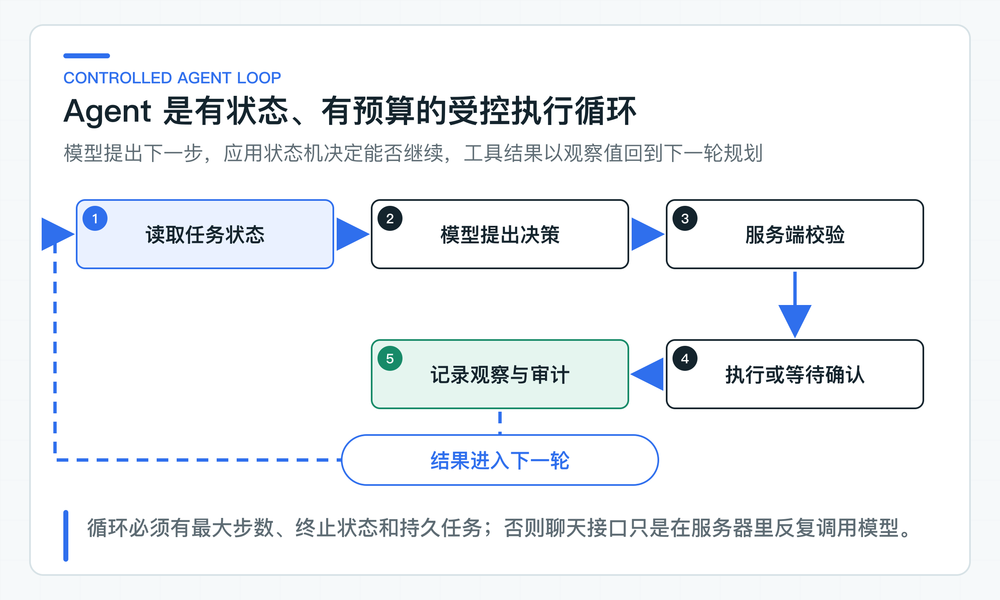
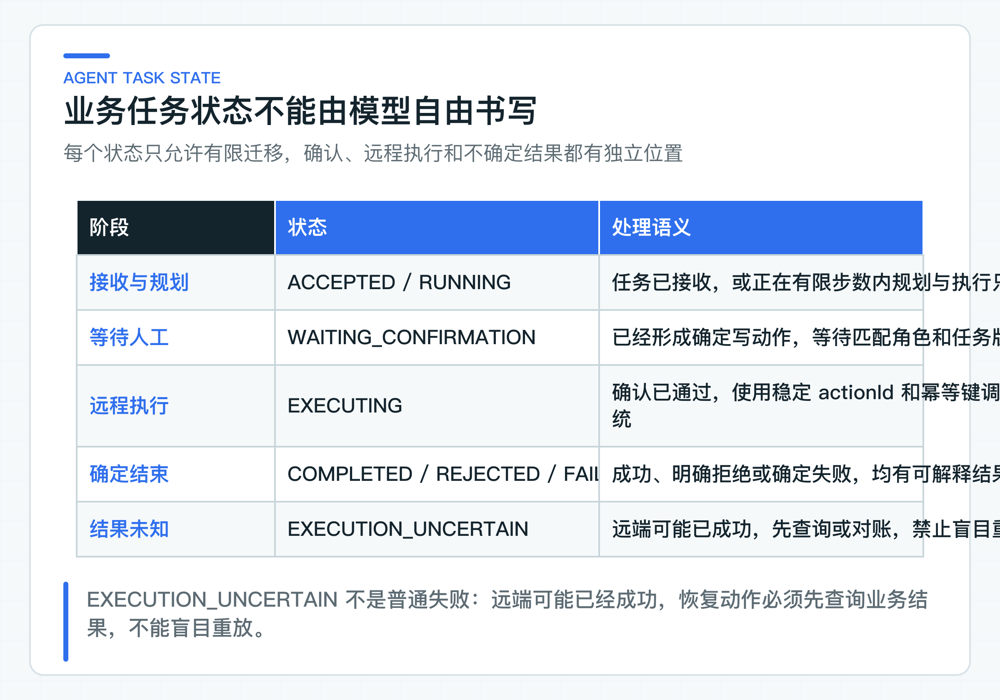

# Agent 与普通聊天有什么区别：目标、状态和受控执行

知识问答在一次请求内返回文本，工单处理却可能跨越多个小时：先查政策，再读取业务状态，准备修改队列时等待员工确认，第二天才继续执行。模型调用早已结束，任务本身还没有结束。

这正是普通聊天和 Agent 的工程分界。关键不在于有没有 Tool Calling，而在于是否需要保存跨步骤状态、处理外部副作用，并在超时或重启后继续恢复。把 `ChatClient` 放进循环，只解决了“多调用几次模型”，没有解决任务可靠性。

项目把工单 Agent 做成受控任务处理器。模型提出 `USE_TOOL`、`FINISH` 或 `REFUSE` 候选，Java 应用层负责状态迁移、工具白名单、权限、确认与幂等。当前代码已经覆盖同步运行、持久化状态和结果分类；后台领取、重启后自动续跑与未知结果对账仍是生产接入项，不能由一个状态枚举代替。

## Agent 与普通聊天的差别在于控制循环

### 普通聊天解决的是一次生成

普通聊天的输入通常是消息列表，输出是文本或结构化结果。它最重要的工程问题是 Prompt、上下文窗口、流式协议、超时、Token、引用和输出校验。前面的知识问答链路已经属于这一类：即使内部做了检索和模型生成，对外仍然是一次只读回答。

一次聊天失败，可以向用户返回错误或重新发起回答。它通常没有“已经修改了一半业务状态”的问题。只要没有副作用，重试的主要代价是延迟、Token 和可能不同的回答。

Agent 接收的则是任务目标。例如：

```text
根据当前政策和工单事实处理退款到账投诉；
如果需要改变处理队列或发起退款，交给有权限的员工确认。
```

这个目标会经历多个请求和参与者。Customer BFF 创建任务，Ticket Agent 运行，Knowledge Service 提供证据。JDK8 CRM 展示确认单，员工批准后再由老系统执行。各步可能发生在不同时间，因此任务不能只存在模型上下文里。

判断一个场景是否需要 Agent，可以问四个问题：

1. 是否要在多个步骤之间保存业务进度？
2. 是否要调用拥有不同权限和失败语义的外部系统？
3. 是否可能产生写操作或其他副作用？
4. 出错后是否需要人工或后台任务继续恢复？

四个问题都是否定时，优先使用普通应用服务加一次模型调用。引入 Agent 只会增加状态、评测和排障成本。只要出现跨请求状态或副作用，就应先设计任务边界，而不是先选 Agent 框架。

### Agent 通过控制循环推进任务

一个最小 Agent 循环可以表示为：

```text
读取任务 -> 生成下一步候选 -> 服务端校验 -> 执行或暂停
        -> 记录观察值与状态 -> 再次规划或终止
```



这里有两个不同的控制者。模型负责根据目标和已有观察值提出下一步，它适合处理语言理解、信息归纳和候选路径选择。Java 应用负责硬约束，包括任务状态、最大步数、工具白名单、参数校验、权限、风险和幂等。模型输出即使格式正确，也只是 proposal，不是命令。

[TicketAgentOrchestrator](https://github.com/DavidDingXu/learn-java-ai/blob/main/learning-stages/stage-05-controlled-agent/services/ticket-agent-service/src/main/java/com/xiaoding/javaai/ticket/agent/application/TicketAgentOrchestrator.java) 的主循环受 `maxSteps` 限制，配置范围为 1 到 16。每一步都调用 `TicketAgentPlanner`，获得项目自己的 `AgentPlanningResult`：

```java
public record AgentPlanningResult(
        AgentDecision decision,
        String model,
        AgentModelUsage usage,
        String finishReason
) {
}
```

项目类型没有暴露 Spring AI 的 `ChatResponse`。这样应用层可以保存模型名、Token 和结束原因，也可以在不改业务编排的情况下替换 Planner 实现。

三种决策分别有明确语义：

- `UseTool`：模型认为需要一个工具，应用层继续做目录和参数校验；
- `Finish`：当前目标已经完成，应用层写入完成摘要；
- `Refuse`：任务不应继续，记录稳定原因码和面向处理人的说明。

如果连续超过步数预算仍未终止，任务进入 `FAILED`，原因为 `STEP_BUDGET_EXCEEDED`。这项预算首先是一条安全边界，性能控制只是附带作用。没有它，错误 Prompt、循环工具结果或模型抖动可能导致无限调用和持续副作用尝试。

### 常见 Agent 编排模式怎样选择

前面的控制循环与 ReAct 思路相近：模型根据目标和已有 Observation 判断下一步，应用执行后再把结果交给模型。但项目没有让模型自行运行到结束，而是在每一步之后交回 Java 服务校验，并限制步数和写操作停止点。可以把它理解为一条受服务端约束的 ReAct 循环。

ReAct 只是编排方式之一。面对不同任务，常见选择如下：

| 编排方式 | 怎样推进任务 | 更适合的场景 | 主要代价 |
|---|---|---|---|
| 确定性工作流 | 服务端写死顺序、条件和分支 | 审批、开户、退款等规则明确的流程 | 灵活性较低，但最容易测试和审计 |
| ReAct | 决策、执行 Tool、读取 Observation 交替进行 | 步骤无法预先完全确定的查询与处理任务 | 容易循环或选错 Tool，必须限制步数和权限 |
| Plan-and-Execute | 先生成完整计划，再逐步执行 | 可以拆成多个相对稳定子任务的长任务 | 前提变化后原计划可能失效，需要重新规划 |
| Planner-Executor | 规划者只拆任务，执行者按受限能力完成步骤 | 规划和执行需要不同模型、权限或上下文的场景 | 组件和调用次数增加，出错时更难判断是哪一层的问题 |
| 反思检查（Reflection / Reviewer） | 初次结果完成后，再做一次检查或修订 | 文案、摘要、方案草稿等可反复改进的低风险输出 | 两次模型可能犯相同错误，不能代替业务校验 |
| 图工作流 | 用节点、边、条件和检查点显式描述路径 | 分支多、需要暂停恢复或并行处理的长流程 | 状态和版本管理成本更高 |

模式不是越复杂越好。步骤和规则已经明确时，普通工作流通常比 Agent 更可靠；只有下一步确实依赖模型对当前信息的判断时，才需要 ReAct 或规划器。图工作流解决复杂编排，Reviewer 改善候选结果，它们都不会自动补上权限、幂等和人工确认。

这条工单主线选择受控 ReAct 循环，是因为只读查询的顺序会随工单变化，而写操作必须在确认前停止。后面的图工作流实验会继续使用相同的状态和 Tool 边界，因此替换编排实现时，业务安全规则不需要跟着迁移。

## 状态与上下文决定任务能否继续

### 持久化状态支撑跨请求恢复

模型上下文无法承担业务状态。它既没有并发版本，也不能保证服务重启后恢复，更无法让 JDK8 终端查询“当前正在等待谁确认”。

[AgentTask](https://github.com/DavidDingXu/learn-java-ai/blob/main/learning-stages/stage-05-controlled-agent/services/ticket-agent-service/src/main/java/com/xiaoding/javaai/ticket/task/AgentTask.java) 保存任务身份、请求、状态、版本、观察值、待确认动作、结果和更新时间。状态由 [AgentTaskState](https://github.com/DavidDingXu/learn-java-ai/blob/main/learning-stages/stage-05-controlled-agent/services/ticket-agent-service/src/main/java/com/xiaoding/javaai/ticket/agent/domain/AgentTaskState.java) 定义：

```text
ACCEPTED
RUNNING
WAITING_CONFIRMATION
EXECUTING
EXECUTION_UNCERTAIN
COMPLETED
REJECTED
FAILED
```



状态名表达可操作事实，而不是界面文案：

- `ACCEPTED` 表示任务创建请求已被接受，尚未开始规划；是否可在重启后恢复取决于持久化配置；
- `RUNNING` 表示 Agent 可以继续规划或执行只读 Tool；
- `WAITING_CONFIRMATION` 表示已经形成确定写动作，必须等待指定角色；
- `EXECUTING` 表示确认已通过，远程业务动作正在执行；
- `EXECUTION_UNCERTAIN` 表示远程结果无法确定，禁止盲目重放；
- `COMPLETED` 表示任务或动作有确定成功结果；
- `REJECTED` 表示模型或员工明确拒绝继续；
- `FAILED` 表示确定失败或本地处理错误。

状态转换由领域对象的方法控制。确认接口不能把 `ACCEPTED` 直接改成 `COMPLETED`，过期确认不能从 `WAITING_CONFIRMATION` 进入 `EXECUTING`，远程超时也不能冒充 `FAILED`。这些约束要写在 Java 代码和测试里，不应交给 Prompt 描述。

[InMemoryAgentTaskRepository](https://github.com/DavidDingXu/learn-java-ai/blob/main/learning-stages/stage-05-controlled-agent/services/ticket-agent-service/src/main/java/com/xiaoding/javaai/ticket/task/InMemoryAgentTaskRepository.java) 是默认实现，通过任务版本做乐观并发校验，但进程重启会丢失任务。将 `java-ai.persistence.mode` 改为 `jdbc` 后，task、confirmation 和审计会写入 PostgreSQL。JDBC 实现用版本列或条件更新保持相同并发语义。目标数据库上的并发与重启恢复仍需单独验收。

### 控制模型可见的任务上下文

Planner 可以看到任务目标、受限业务上下文、已有 Tool Observation、当前步数，以及可用工具名与必填参数名。这里的 Observation 是 Tool 执行后经过应用裁剪、供下一轮规划使用的结构化结果。Planner 不应看到下游访问令牌、员工角色判断、风险配置、数据库实体或可直接执行的内部 URL。

[SpringAiTicketAgentPlanner](https://github.com/DavidDingXu/learn-java-ai/blob/main/learning-stages/stage-05-controlled-agent/services/ticket-agent-service/src/main/java/com/xiaoding/javaai/ticket/agent/infrastructure/SpringAiTicketAgentPlanner.java) 把 Prompt 分成三个区域：

```text
<SERVER_TOOL_POLICY>...</SERVER_TOOL_POLICY>
<UNTRUSTED_TASK_OBJECTIVE>...</UNTRUSTED_TASK_OBJECTIVE>
<UNTRUSTED_BUSINESS_CONTEXT>...</UNTRUSTED_BUSINESS_CONTEXT>
<UNTRUSTED_TOOL_OUTPUT>...</UNTRUSTED_TOOL_OUTPUT>
```

`SERVER_TOOL_POLICY` 告诉模型当前允许选择的工具名和每个工具的必填参数名。身份、授权、风险、确认和幂等仍然由服务端负责。

businessContext 已有同名参数时，模型必须原样复制，不能翻译、概括或润色执行值。Java Tool Catalog 还会拒绝缺失、多余、超长或不在业务白名单中的值。

用户目标、业务上下文和 Tool 输出都会标记为不可信内容。这些标签不能单独防住 Injection，还要配合后续的服务端校验。

每轮规划还要求模型把显式目标和已完成的 Tool Observation 对照：目标里仍有未完成动作且所需参数已经存在时，不能提前返回 `FINISH`。这条 Prompt 约束让多步目标更稳定，但最终状态仍由服务端记录；模型说“完成了”不能代替 Tool 回执。

模型返回结构化 `StructuredPlannerDecision`，再转换为项目 `AgentDecision`。如果 `decisionType` 缺失、工具名为空或必要字段不完整，适配器立即失败，不会猜测模型意图。结构化输出解决的是解析稳定性，不解决权限和业务真实性。

### 任务里的 Memory 到底指什么

Agent 文章经常把历史消息、任务进度、知识库和用户偏好统称为 Memory，落到代码里却由完全不同的系统负责。先分清数据的用途和可信度，才能决定放在哪里、保留多久以及谁可以修改。

| 数据 | 解决什么问题 | 在这条业务链中的位置 | 使用边界 |
|---|---|---|---|
| 会话上下文 | 理解“刚才那个订单”之类的指代 | Customer BFF 保存近期消息或摘要 | 有长度和过期时间，来自用户的内容仍不可信 |
| Agent 任务状态 | 记录当前走到哪一步、等待谁处理 | Ticket Agent 的任务与确认记录 | 属于业务流程事实，需要并发版本和持久化 |
| Tool Observation | 告诉 Planner 上一步查到了什么 | 当前任务的受限观察值 | 要裁剪敏感字段和长度，不能把其中的指令当规则 |
| RAG 知识 | 提供政策、手册和文档证据 | Knowledge Service 的授权文档版本 | 先做权限过滤，并保留引用和版本 |
| 业务事实 | 提供订单、退款和工单的当前状态 | 订单、CRM 等业务系统 | 以源系统为准，关键动作前重新读取，不能只信历史对话 |
| 长期用户偏好 | 跨会话保留语言或服务偏好 | 可选的独立用户资料 | 需要明确来源、授权、过期和删除规则，不能自动推断敏感属性 |
| 审计记录 | 还原谁在何时作出什么决策 | 追加写的低敏审计存储 | 用于追责和排障，不应重新塞给模型充当任务记忆 |

因此，本项目没有一个包办所有数据的“记忆库”。会话上下文帮助理解当前对话，任务状态支撑恢复，RAG 和业务系统提供事实，审计记录则保留证据。把它们拆开后，过期会话不会改写业务状态，旧 Observation 也不会盖过源系统的最新结果。

## Tool 与审计边界由应用掌握

### 只读 Tool 与写 Tool 采用不同停止点

查询知识属于只读 Tool。目录校验通过后，Orchestrator 调用 `AgentReadToolExecutor`，把受限结果记录为 `ToolObservation`，再进入下一轮规划。只读操作仍然需要最小权限、超时、下游身份和返回裁剪，只是不需要人工确认。

写 Tool 不在循环里直接执行。Orchestrator 只生成 `ConfirmationRequest`，任务进入 `WAITING_CONFIRMATION` 并立即返回。确认单包含工具、风险、所需角色、规范化参数、动作指纹、绑定任务版本和过期时间。确认单生成后，模型已经退出控制路径。

员工确认由另一个 HTTP 请求完成。服务端重新读取任务，验证确认身份、任务版本、过期时间和角色，批准后才进入 `EXECUTING`。这条边界使模型无法通过连续生成绕过人工环节。

### 审计记录每次决策与执行结果

Agent 发生问题时，最终回答远远不够。排障和审计必须还原当时的任务版本、模型决策、服务端工具、确认人以及下游确定性结果。

当前实现记录这些低敏事件：

```text
AGENT_RUN_STARTED
AGENT_PLAN_RECORDED
READ_TOOL_SUCCEEDED
CONFIRMATION_REQUESTED
CONFIRMATION_APPROVED / REJECTED
TOOL_EXECUTION_SUCCEEDED / REJECTED / UNCERTAIN
AGENT_TASK_COMPLETED / REJECTED / FAILED
```

`AGENT_PLAN_RECORDED` 保存 step、决策类型、模型名、总 Token 和 finish reason，不保存完整 Prompt、客户原问题或 Tool 参数。原始输入可能包含个人信息，审计系统也不应变成另一份无限保留的数据副本。

日志适合诊断运行异常，审计适合证明业务动作。两者可以用 taskId、actionId 和 trace 关联，但不能互相代替。生产审计还要有追加写保护、访问权限、保留期限和导出流程。

## 分层验证规划协议与控制循环

### 真实模型冒烟检查规划协议

规划器的真实模型冒烟检查应同时核对模型名、usage、finish reason 和 `USE_TOOL` 结构化决策。只看到一段规划文本，无法判断适配器是否完整保留了供应商元数据和工具决策。

一次真实调用无法覆盖所有工单，也不包含生产权限、数据库和老系统联调。真实 API 冒烟检查模型连接，Golden Set 检查指定案例的工具路径，共享环境再检查身份、网络和业务系统能否共同运行。

读者验证时继续使用第 25 篇已启动的 Knowledge Service 和 Ticket Agent Service。创建任务后请求 `/api/v1/agent/tasks/{taskId}/runs`，再查看任务状态和审计时间线。

真实模型返回 `USE_TOOL` 时，审计中应保留模型名、usage 和 finish reason。写 Tool 只能让任务停在 `WAITING_CONFIRMATION`，不能因为输出结构正确就直接执行。

### 控制循环必须覆盖失败路径

仓库回归覆盖合法状态迁移、版本冲突、只读 Tool 观察值、写 Tool 停在确认前、拒绝、完成和步数预算。真实模型链路通过主应用观察，不进入每次单元构建，避免外部网络和模型波动影响日常回归。

## 把受控 Agent 接入现有系统

第一步先把任务持久化映射到公司规范，暂缓扩充工具。[JdbcAgentTaskRepository](https://github.com/DavidDingXu/learn-java-ai/blob/main/learning-stages/stage-05-controlled-agent/services/ticket-agent-service/src/main/java/com/xiaoding/javaai/ticket/task/JdbcAgentTaskRepository.java) 已保存任务快照、版本、请求指纹和更新时间，并用数据库唯一约束与乐观锁保护并发。公司项目仍要决定 Worker 是同步触发、数据库队列还是消息队列，并在目标数据库上验证领取和恢复语义。

第二步把本地 HMAC 委托令牌替换为公司 IdP 或 Token Exchange。Agent 调 Knowledge 和 Legacy Tool 时应使用不同 audience 与 scope，不能复用一枚服务管理员 Token。

第三步按业务域重新设计工具目录和风险。退款、订单取消、账号冻结的审批角色和恢复策略不同，不能复制示例枚举后就视为安全。

第四步建设未知结果恢复。`EXECUTION_UNCERTAIN` 需要查询接口、后台对账或人工处理队列。没有恢复入口时，这个状态只是一条更准确但仍无法处理的记录。

Agent 把复杂任务拆成可以保存和恢复的步骤，模型只负责提出下一步候选。身份校验、任务状态、工具白名单和业务写权限仍由 Java 服务与原业务系统控制。查询 Tool 是验证这套边界的第一步；它没有写副作用，仍然需要限制权限、参数和返回字段。

---

[课程首页](../../README.md) · [完整目录](README.md) · [← 机器人解决不了时怎样平滑升级工单](25-ticket-handoff.md) · [Tool Calling 原理与查询 Tool：最小权限、最小参数和最小返回 →](27-query-tools.md)

动手实践：[本阶段可运行源码](../../learning-stages/stage-05-controlled-agent/README.md)
