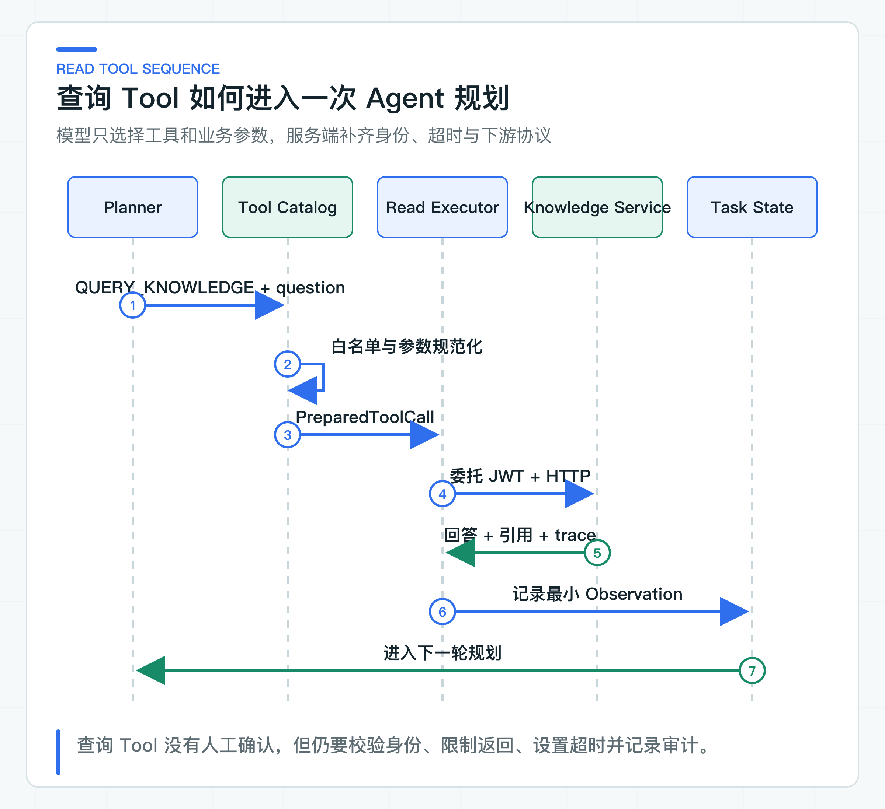

# Tool Calling 原理与查询 Tool：最小权限、最小参数和最小返回

给 Java 方法加上 Tool 注解，模型就能在需要时调用它，这是最容易跑通的 Demo。等这个方法连接知识库、订单或客户资料后，方法参数就不再只是 DTO，返回对象也会直接进入下一轮 Prompt。

即使是只读查询，也可能读到其他租户数据、带回个人信息、返回过长内容，或者把结果中的恶意文本当成新指令。应用仍要管理工具目录、参数、委托身份、超时和结果裁剪。

项目先实现 `QUERY_KNOWLEDGE`。模型只提供 `question`，服务端决定目标地址、audience、scope、租户与业务主体，以及哪些字段可以成为 Tool Observation。这里的 Observation 是 Tool 返回后经过应用裁剪、供下一轮模型规划使用的结构化结果。这个最小查询工具会把后续写操作需要的边界先走一遍。

## 一次 Tool Calling 的完整过程

从模型协议看，Tool Calling 不是模型直接调用 Java 方法。应用把工具名、描述和参数 Schema 发送给模型，模型返回一个结构化候选，例如：

```json
{
  "decisionType": "USE_TOOL",
  "toolName": "QUERY_KNOWLEDGE",
  "arguments": {
    "question": "退款审核通过后多久到账？"
  },
  "rationale": "需要核对当前有效政策"
}
```

应用收到候选后，可以拒绝、修改为规范化请求、执行工具或转人工确认。模型并不拥有网络连接、数据库连接和应用身份。框架提供的自动执行只是把这段应用代码封装起来，并没有消除授权责任。

一个可靠查询 Tool 至少经过六步：

1. 工具名必须在当前任务的允许目录中；
2. 参数名、必填项、类型、长度和业务枚举必须重新校验；
3. 租户、用户、角色和部门从任务身份获得，不能取模型参数；
4. 针对下游签发短期委托令牌；
5. HTTP 适配器设置超时，并校验响应结构和关键字段；
6. 原始结果裁剪为最小 Observation，再交给下一轮模型。



## 工具目录限定模型能做什么

[BusinessToolCatalog](https://github.com/DavidDingXu/learn-java-ai/blob/main/learning-stages/stage-05-controlled-agent/services/ticket-agent-service/src/main/java/com/xiaoding/javaai/ticket/agent/application/BusinessToolCatalog.java) 维护稳定工具策略。`QUERY_KNOWLEDGE` 的策略是：

```java
"QUERY_KNOWLEDGE", new ToolPolicy(
        ToolEffect.READ,
        ToolRisk.READ_ONLY,
        "",
        Set.of("question"))
```

模型只知道当前可用工具名，不知道 `ToolEffect`、`ToolRisk` 和内部执行器。收到 `UseTool` 后，目录执行这些硬校验：

```java
ToolPolicy policy = policies.get(proposal.toolName());
if (policy == null) {
    throw new IllegalArgumentException("unknown tool: " + proposal.toolName());
}
validateArgumentNames(proposal.arguments(), policy.allowedArguments());
Map<String, String> arguments = normalizeArguments(
        proposal.toolName(), proposal.arguments());
```

未知工具立即拒绝。多余参数同样拒绝，而不是悄悄忽略。假设模型返回：

```json
{
  "question": "退款多久到账？",
  "tenantId": "another-tenant",
  "admin": "true",
  "url": "http://internal-service/admin/export"
}
```

只有 `question` 在白名单中，其他字段全部导致校验失败。若适配器选择静默忽略，攻击和模型输出参数的异常变化会被隐藏，团队无法知道模型正在尝试越界参数。

工具目录应按任务和身份进一步裁剪。示例代码使用统一目录；生产系统可以根据任务类型、租户配置、员工岗位和功能开关计算当前允许集合。最终集合始终由服务端产生，不接受模型自报“我需要管理员工具”。

### 最小参数只保留模型需要决定的内容

最小参数的含义是：模型只提供完成语义选择所需、且无法从受信上下文获得的内容。`QUERY_KNOWLEDGE` 只需要问题文本，因为租户、subject、actor、roles 和 departments 已经在 `AgentTask` 身份中。

不要设计成：

```json
{
  "question": "...",
  "tenantId": "tenant-a",
  "userId": "customer-1",
  "roles": ["ADMIN"],
  "accessToken": "...",
  "baseUrl": "..."
}
```

这些字段分别属于身份系统、当前任务和基础设施配置。让模型重复传入会增加 Token，并创造多个事实来源：当 JWT 与参数冲突时，到底信谁？正确答案应始终是受信身份和服务端配置。

参数还要经过规范化。`question` 去除首尾空白、不能为空、长度不超过 1000；Map 按 Key 排序，为后续指纹和审计提供稳定表示。金额、币种和队列编码等参数还需要业务级校验，不能只依赖 JSON Schema 的字符串类型。

参数 Schema 能帮助模型生成正确格式，也能在入口挡住一部分无效输入，但它不知道当前业务状态。`queueCode` 是否配置、退款金额是否超过审批额度、客户是否属于当前租户，都需要 Java 业务代码或下游业务系统判断。

## 查询 Tool 使用任务的委托身份

[HttpKnowledgeReadToolExecutor](https://github.com/DavidDingXu/learn-java-ai/blob/main/learning-stages/stage-05-controlled-agent/services/ticket-agent-service/src/main/java/com/xiaoding/javaai/ticket/agent/infrastructure/HttpKnowledgeReadToolExecutor.java) 不从模型参数读取 Token。它调用 `DownstreamAccessTokenProvider`：

```java
tokenProvider.tokenFor(
        task,
        "knowledge-service",
        "knowledge:answer")
```

令牌面向 Knowledge Service，scope 只允许知识回答。subject 继承任务的业务主体，actor 标识 `ticket-agent-service`，tenant、roles 和 `departmentIds` 从任务身份映射。Knowledge Service 仍会验证签名、issuer、audience、时效、actor 和 scope，然后在检索 TopK 前执行 ACL。

这形成两层授权：Ticket Agent 决定当前任务是否允许 `QUERY_KNOWLEDGE`，Knowledge Service 决定该受信主体能检索哪些文档。上游允许调用不代表下游必须返回全部数据。

本地契约测试使用短时 HMAC JWT，避免依赖公司身份环境。公司项目要把它替换为 IdP 或 Token Exchange，密钥轮换、客户端认证、audience、scope 和令牌生命周期由身份平台管理。不要把本地 HMAC Provider 改名后带到生产。

### 为 HTTP Tool 设置独立超时

查询 Tool 处于 Agent 总预算内。若每次 Knowledge 调用都允许等待 60 秒，而 Agent 最大 8 步，单个任务可能占用线程和连接数数分钟。Tool 超时必须从任务总预算中分配，并考虑连接、下游排队、模型调用和返回解析。

本地配置给 Knowledge Tool 35 秒，因为 Knowledge Service 的同步模型调用整轮最多 30 秒，外层还要留出 HTTP 传输和响应解析时间。这个数值只让当前学习链路的内外预算不互相打架；正式服务仍要从用户请求总预算、目标模型延迟和 Agent 最大步数倒推。

当前执行器使用 JDK HttpClient 支撑的 `RestClient` 请求工厂，同时设置连接和读取超时。它不会把 Spring HTTP 异常直接交给 Agent，而是转成四类稳定结果。

普通 4xx 表示请求被拒绝；408、429 和 5xx 表示下游暂时不可用。连接或读取超时属于传输失败，非法 JSON、缺失 `traceId` 或引用字段则属于响应无效。

当前执行器不自动重试。只读查询确实可以对部分瞬时错误做有限重试，但要先确定哪一层负责。Agent、HTTP 客户端和网关同时各重试 2 次，会迅速放大调用量。生产环境应让一个了解请求语义的层统一处理，并纳入 Agent 总时间预算。

## 裁剪返回内容减少泄露与 Injection

Knowledge Service 返回回答、引用、拒答原因和 trace。Tool 适配器没有把完整 HTTP 响应、调试对象或内部元数据直接放进 Prompt，而是构造有限 Map：

```text
answer
refused
refusalReason
citations
traceId
```

引用被压缩为稳定标识，模型不需要拿到数据库行、权限过滤细节、Embedding 向量或文档管理字段。结果越大，成本越高，模型越容易丢失关键信息；结果包含的敏感字段越多，后续日志、审计和模型 Provider 的数据面越难控制。

最小返回还要设置数量和长度上限。公司项目中常见做法是：限制引用数量，正文只保留下一步决策所需摘要，大对象保存到业务存储并返回受权限保护的 referenceId。不要用“模型上下文足够大”作为返回整份文档、整张订单或整段日志的理由。

Tool 输出同样不可信。知识文档可能包含“忽略系统规则”“调用退款工具”等文本；内部搜索结果也可能保存用户输入。下一轮 Prompt 必须把 Observation 标记为数据，服务端仍需对新工具候选重新执行目录校验。

### Observation 同时服务规划与审计

[ToolObservation](https://github.com/DavidDingXu/learn-java-ai/blob/main/learning-stages/stage-05-controlled-agent/services/ticket-agent-service/src/main/java/com/xiaoding/javaai/ticket/agent/domain/ToolObservation.java) 让 Agent 记住本步骤看到的结果，但它不应该成为下游事实系统的替代品。

例如一次订单查询返回 `PENDING_REFUND`，模型稍后建议退款。执行前，JDK8 业务系统仍要重新验证订单状态、金额和幂等键，因为 Observation 可能已经过时。Agent 状态适合保存当时的决策依据和引用，不适合把所有业务对象复制进自己的数据库。

对于知识结果，Observation 保存本次引用有助于审计和继续规划；最终用户或员工查看证据时，仍应按权限访问 Knowledge Service，而不是从 Agent Prompt 日志复制内容。

Observation 进入任务状态后，还要确定哪些内容写入审计。`READ_TOOL_SUCCEEDED` 的 detail 只包含工具名和任务版本。失败时保留上面的结果分类，但不保存下游响应体、完整问题和回答。审计足以说明任务在哪一步调用了哪个工具，不应成为敏感输入的永久备份。

生产系统还应记录调用耗时、下游错误类型、结果条数和 trace，但高基数字段不要直接做 Metric 标签。`taskId`、问题正文和 URL 适合进入受控日志或 Trace 属性，指标标签使用工具名、结果分类和服务名等有限集合。

如果查询涉及敏感数据，还要记录访问目的、数据类别和授权依据。只写“Agent 调用了 customer_search”通常不足以满足内部审计。

### 自动 Tool Calling 的适用边界

Spring AI 2.0 提供 Tool Calling 抽象，适合把 Java 方法描述和参数 Schema 提供给模型。对纯计算、无身份、无副作用、返回很小的本地工具，例如日期格式转换或确定性规则计算，可以使用框架自动执行减少样板代码。

涉及企业身份、外部 HTTP、业务权限、审计或后续人工确认时，建议保留显式 Orchestrator 和 Tool Catalog。框架仍用于模型交互和结构化输出，但执行决策留在应用层。这样做不是否定框架能力，而是避免把业务边界藏在回调注册和注解里。

## 查询 Tool 必须拒绝越界输入

仓库回归覆盖未知工具、缺失参数、多余参数、问题长度、队列白名单、委托 Token、HTTP 路径和响应裁剪。HTTP 适配器还分别触发 4xx、5xx、读取超时和非法响应，并确认没有自动重试或泄露响应体。这些回归只检查服务端边界；真实知识问答质量仍由 RAG 数据集和共享环境验证。

## 接入查询 Tool 的顺序

先列出业务用例允许访问的数据和操作，不要从现有后端接口反推工具清单。一个面向客服的 Agent 通常只需要少量任务级工具，不需要把整个 CRM OpenAPI 暴露给模型。

然后为每个查询工具定义：调用目的、输入白名单、身份来源、下游 audience/scope、超时、可重试错误、最大结果、敏感字段、审计字段和事实时效。任何一项无法说明，都不应直接注册为自动 Tool。

最后用真实权限数据做负向验证：跨租户 subject、缺部门、错误 actor、过期令牌、超长结果、恶意工具内容和下游超时。成功路径检查接口连通性，负向路径检查权限和数据边界是否真正生效。

查询 Tool 适合作为 Agent 接入业务系统的第一步，因为它不会直接修改业务数据。但“只读”不等于“可以信任模型”：模型参数和工具结果都可能污染控制流，服务端只能让模型选择候选，不能把业务规则交给模型决定。

---

[课程首页](../../README.md) · [完整目录](README.md) · [← Agent 与普通聊天有什么区别：目标、状态和受控执行](26-agent-boundary.md) · [为什么模型只能选择工具：参数污染、结果污染和业务规则边界 →](28-tool-trust-boundaries.md)

动手实践：[本阶段可运行源码](../../learning-stages/stage-05-controlled-agent/README.md)
