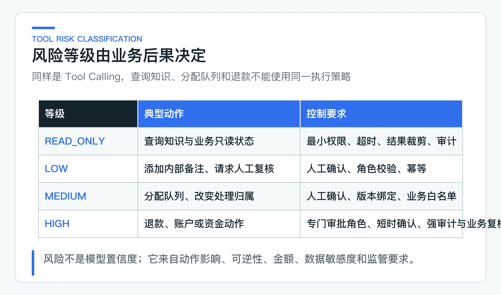
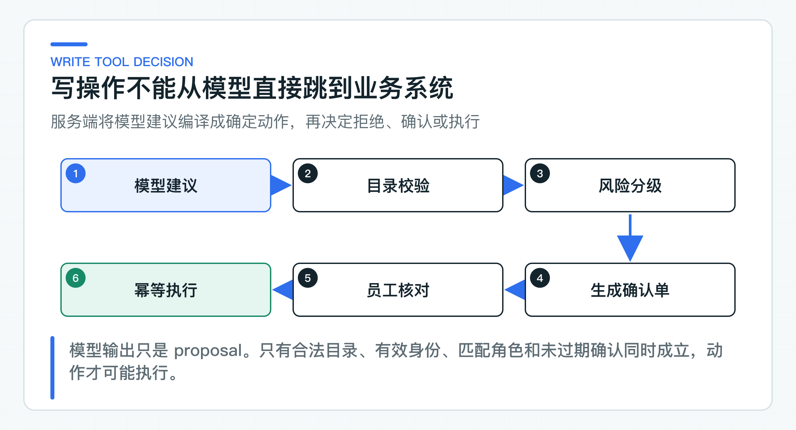

# 写操作为什么必须先做风险分级

添加内部备注、调整工单队列和发起退款都属于写操作。如果统一套一个 `requiresConfirmation=true`，页面不知道该展示哪些风险，服务端也无法判断由谁确认、确认多久有效，以及失败后能不能自动重试。

这三类动作的影响范围、可逆性和恢复方式并不相同。风险等级需要进一步驱动身份、展示字段、审批角色、有效期、幂等、审计和失败处置，而不是只作为一个标签写进 Prompt。

示例把工具分为 `READ_ONLY`、`LOW`、`MEDIUM` 和 `HIGH`：查询知识是只读，内部备注为 LOW，分配队列为 MEDIUM，退款为 HIGH。等级只是示范，接入公司项目时应按照真实业务后果重新评定。

## 风险来自动作后果

模型置信度回答“模型对自己判断有多确定”，即使这个分数可靠，也不能回答“判断错误会造成多大损失”。模型非常确定地选择退款工具，退款仍然是高风险动作；模型不太确定地建议查询政策，查询仍然是只读动作。

风险通常来自以下因素：

- 是否改变最终业务数据或状态；
- 是否涉及资金、账户、个人信息或监管数据；
- 动作是否可逆，以及撤销是否有额外代价；
- 错误影响单个工单还是一批用户；
- 执行后是否会触发通知、支付、合同或外部系统；
- 是否需要职责分离或双人审批；
- 远程超时后能否查询最终结果。

一个动作的模型置信度只能作为辅助信息，不能降低上述控制。也不建议把置信度直接显示成“93% 安全”，这会让确认人错误理解为风险概率。



## 四个等级对应不同控制

**READ_ONLY。** 只读动作不改变业务状态，可以在目录和身份校验后自动执行。它仍需要最小权限、超时、结果裁剪、访问审计和调用预算。查询客户资料可能包含高敏数据，虽然没有写副作用，也不意味着风险很低；数据敏感度可以在工具目录中形成另一维策略。

**LOW。** 低风险写操作通常影响局部工作流，容易撤销或由人工修正。例如添加普通内部备注、发起人工复核请求。它们仍会进入业务记录，因此要有员工确认、角色校验、稳定动作 ID 和审计。

**MEDIUM。** 中风险动作会改变处理归属、优先级或流程路径，例如把工单分配到退款审核队列。错误分配未必造成资金损失，但可能影响 SLA、数据可见范围和团队责任。除了人工确认，还应校验目标队列白名单、当前工单状态和操作人权限。

**HIGH。** 高风险动作涉及资金、账户、关键数据或不可逆外部影响。`ISSUE_REFUND` 需要 `REFUND_APPROVER`，最终业务系统还要重新验证订单、金额、币种和幂等键。Agent 侧确认通过不等于业务系统必须执行。

当前 `confirmationTtl` 对所有写工具使用同一配置，默认 15 分钟，只负责确认过期校验。生产系统应由服务端根据风险、金额和业务时效计算差异化 TTL，例如 HIGH 风险确认通常比普通队列调整更短；模型不能传入或延长这个时间。

公司项目可能还需要 `CRITICAL`，用于大额资金、批量动作、账号冻结或合规操作，要求双人审批或直接禁止 Agent 发起。不要为了保持枚举简洁，把所有高风险业务压成一种策略。

## 分开判断风险、权限与确认

风险描述错误后果，权限描述谁可以执行，确认描述当前人是否明确同意这一个动作。三者相关但不能合并。

一个员工拥有 `REFUND_APPROVER`，不代表系统可以替他自动批准所有退款；它只说明他具备确认资格。员工点击批准后，服务端仍需验证确认单未过期、任务版本未变化、参数指纹一致，最后由订单系统验证业务可执行性。

同理，LOW 风险动作也不能因为后果较小就跳过身份。添加内部备注会进入客户服务记录，必须能追到谁确认、写入了哪个 case、下游返回哪个 auditId。

[BusinessToolCatalog](https://github.com/DavidDingXu/learn-java-ai/blob/main/learning-stages/stage-05-controlled-agent/services/ticket-agent-service/src/main/java/com/xiaoding/javaai/ticket/agent/application/BusinessToolCatalog.java) 把 effect、risk 和 requiredRole 放在同一 ToolPolicy 中：

```java
"ASSIGN_QUEUE", new ToolPolicy(
        ToolEffect.WRITE,
        ToolRisk.MEDIUM,
        "TICKET_OPERATOR",
        Set.of("queueCode")),
"ISSUE_REFUND", new ToolPolicy(
        ToolEffect.WRITE,
        ToolRisk.HIGH,
        "REFUND_APPROVER",
        Set.of("amountMinor", "currency"))
```

这些字段不会出现在模型参数里。模型即使生成 `risk=LOW` 或 `requiredRole=NONE`，也会因为未知参数被拒绝。

## 写动作先编译成确定参数



模型返回 `UseTool` 后，服务端目录把它编译成 `PreparedToolCall`。只有经过参数白名单、业务枚举和长度校验，才会生成确定动作。随后 Orchestrator 根据 effect 分流：

```java
if (call.effect() == ToolEffect.READ) {
    // 执行只读 Tool，记录 Observation
}

// WRITE 不执行，只生成 ConfirmationRequest
```

写动作包含规范化参数和 SHA-256 指纹。任务进入 `WAITING_CONFIRMATION` 后，模型循环停止，不再有机会修改该动作。员工如果认为金额或队列不对，应拒绝当前确认并启动新的规划或人工处理，而不是在确认页面随手改参数后继续执行。

允许确认人在页面修改参数会让展示、审批和执行对不上：模型建议的是 A，员工看到后改成 B，审计却可能只记录“批准了模型建议”。若业务需要人工编辑，应把它建模为明确的人工命令，由业务系统重新校验并生成新 actionId。

### 服务端拥有动作策略字段

以下字段不应来自模型：

**Effect 与 Risk**

它们决定是否允许自动执行、是否生成确认单和后续监控等级。由代码或受控策略配置维护。

**Required Role**

它决定谁可以批准。角色来自公司身份系统，服务端把当前确认人 JWT 中的 roles 与策略比较。

**Allowed Arguments**

它决定模型能表达哪些业务参数。tenant、subject、actor、Token、URL、幂等键和审批角色都不属于模型参数。

**执行配置**

包括下游服务地址、HTTP 方法、audience、scope、超时、请求 DTO、结果分类和动作幂等键。它属于基础设施适配器。

这些策略可以配置化，但配置必须有 Schema、版本、审批和回归。把 YAML 放到配置中心不等于自动安全；错误配置同样可能让高风险工具使用低权限策略。

### 当前业务状态也会改变风险

静态工具等级只是起点。真实项目通常需要动态条件：

```text
risk = policy(
  toolName,
  amountMinor,
  paymentChannel,
  customerRiskLevel,
  caseType,
  currentBusinessState
)
```

例如 10 元优惠补偿和 10 万元退款不应走同一审批；普通队列调整和跨保密团队转派也不应相同。动态风险计算仍必须是确定性服务端规则，输入来自受信身份和当前业务数据。

动态规则不要依赖 Tool Observation 中的旧订单状态直接执行。确认或执行前，最终业务系统要重新读取事实，避免在 Agent 规划和员工确认之间发生状态变化。

## 让风险等级驱动执行策略

公司落地时，可以维护一张明确策略表：

| 控制项 | READ_ONLY | LOW | MEDIUM | HIGH |
|---|---|---|---|---|
| 自动执行 | 可按策略 | 否 | 否 | 否 |
| 人工确认 | 通常不需要 | 需要 | 需要 | 需要或双人审批 |
| 角色 | 数据访问 scope | 操作员 | 专门岗位 | 审批岗位 |
| 确认 TTL | 无 | 较长 | 较短 | 最短 |
| 业务复核 | 下游 ACL | 必需 | 必需 | 强制重新读取事实 |
| 未知结果 | 读取可重试 | 查询或人工 | 专门恢复 | 对账与升级告警 |
| 审计 | 访问记录 | 动作记录 | 完整时间线 | 强审计与合规保留 |

表格不能直接复制成所有系统的标准，但每一列都应有明确答案。若 HIGH 风险动作与 LOW 使用完全相同的角色、TTL、审计和恢复，说明风险分级还没有进入执行策略。

### 确认前后仍要校验业务状态

人工确认会受到疲劳、界面误导和信息不足影响。若页面连续弹出大量低价值确认，员工会形成机械点击；若页面只显示“Agent 建议退款”，确认人无法核对金额、订单、政策依据和影响。

降低确认风险需要：

- 只在服务端已经完成参数和业务前置校验后生成确认单；
- 展示结构化动作、目标、金额、风险和依据；
- 高风险动作突出不可逆影响和最终业务状态；
- 不把模型 rationale 当作唯一理由；
- 拒绝时允许填写稳定原因，进入后续改进；
- 控制确认数量，能用确定性规则自动处理的低价值步骤不要滥用模型。

确认人不是替系统做所有校验，而是在系统已经收紧边界后承担最终业务判断。

确认结束后，任务状态还要区分人工拒绝、业务失败和结果未知。员工拒绝动作时，任务进入 `REJECTED`，表示有人明确决定不执行。下游返回业务 4xx 时，任务进入 `FAILED`，表示业务系统已经拒绝动作。网络超时或 5xx 则进入 `EXECUTION_UNCERTAIN`，表示无法确定动作是否发生。

三种状态影响完全不同。把它们都显示成“执行失败”会让客服重复操作，甚至制造重复退款。风险越高，结果分类越需要严格。

## 风险分流必须覆盖状态变化

仓库回归覆盖 READ 与 WRITE 分流、退款金额和币种、队列白名单、风险与角色不可由模型覆盖，以及写 Tool 必须停在 `WAITING_CONFIRMATION`。它不会真的发起退款，副作用执行由隔离的 Legacy Tool 适配器检查。

## 建立可维护的风险目录

先从真实业务动作清单开始，而不是从模型可能做什么开始。对每个动作记录所有者、影响对象、可逆性、最大金额或批量范围、敏感数据、审批岗位、最终事实系统和未知结果恢复方法。

再把动作归并成少量业务 Tool。不要直接暴露 `updateOrderField(field,value)` 这类底层 CRUD 方法，它很难做风险判断。`REQUEST_REFUND(orderId, amount, reason)` 才有明确的业务语义。

最后由安全、业务和研发共同确认等级。风险目录属于业务控制资产，不应只由 Prompt 工程师或 Agent 开发者维护。每次新增工具、扩大参数范围或降低确认要求，都要运行安全与副作用回归。

风险分级完成后，还必须准确记录员工确认的是哪一个动作。一个可复用字符串 token 无法表达这层绑定，确认单还要记录任务版本、参数指纹、角色、过期时间和幂等决策。

---

[课程首页](../../README.md) · [完整目录](README.md) · [← 为什么模型只能选择工具：参数污染、结果污染和业务规则边界](28-tool-trust-boundaries.md) · [人工确认为什么不能只传一个字符串 token →](30-approval-receipt.md)

动手实践：[本阶段可运行源码](../../learning-stages/stage-05-controlled-agent/README.md)
