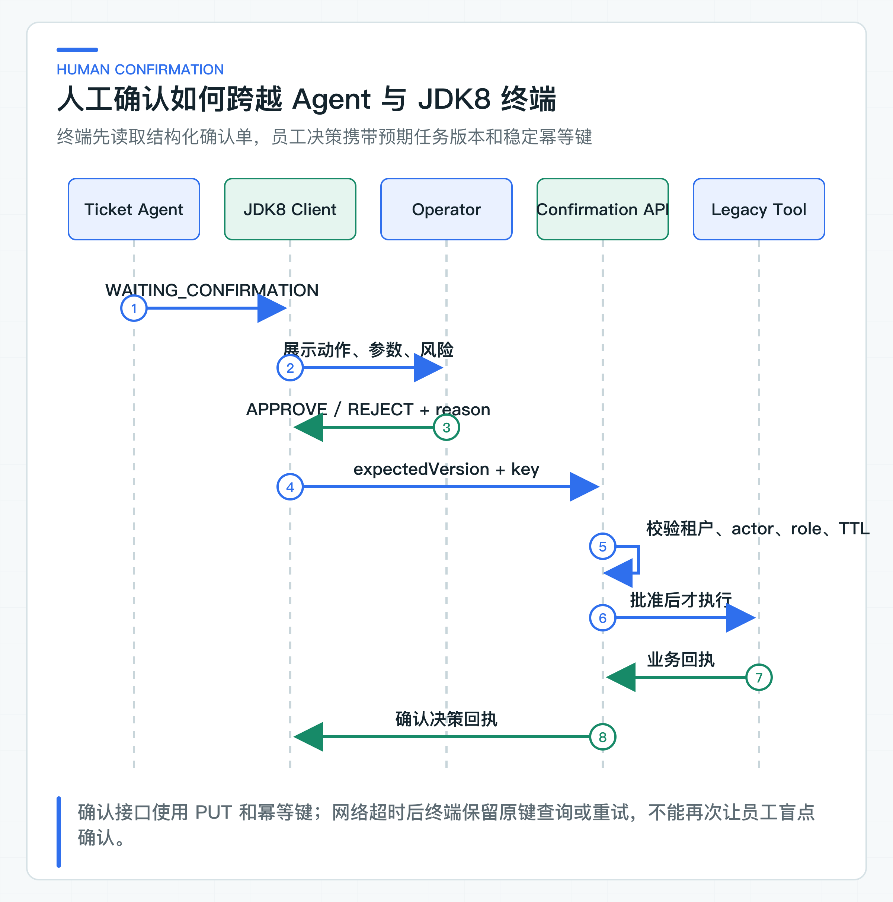
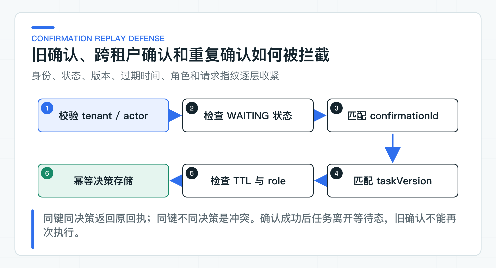

# 人工确认为什么不能只传一个字符串 token

很多 Agent Demo 会返回一个 `confirmationToken`。前端把它显示成确认按钮，员工点击后原样传回，后端随即执行工具。问题是，这个字符串没有告诉确认人当前金额、工单和风险，也无法证明执行参数和页面展示时保持一致。

项目把一次人工决定建模为结构化确认单，记录任务版本、工具、规范化参数、风险、所需角色、过期时间和确认人。重复提交同一决定时，服务端还要返回同一结果。

确认单由 Ticket Agent 生成，通过 OpenAPI 交给 JDK8 CRM 展示。配套项目提供 Java 8 客户端和协议测试，没有实现公司的 CRM 页面。接入后，员工提交 `confirmationId`、`expectedTaskVersion`、原因和稳定的 `Idempotency-Key`；服务端重新验证这些绑定，批准后才执行写 Tool。

## 一个字符串无法表达动作事实

假设接口只返回：

```json
{
  "confirmationToken": "abc123"
}
```

前端无法知道 token 是否绑定金额、币种、工单、租户和过期时间。若后端只按 token 查一条缓存记录，还会出现这些问题：

- 模型在确认页面打开后重新规划，参数已经变化；
- 员工确认旧版本任务，覆盖了其他人的处理；
- token 被复制到另一个租户或任务请求；
- 重复点击触发两次远程写；
- token 过期后仍可执行；
- 确认人不具备当前动作要求的角色；
- 前端展示 A，后端执行缓存中已经变成 B 的动作。

一个随机字符串可以作为不可猜测 ID，但不能替代这些业务绑定。真正的安全来自服务端记录和逐项校验，而不是 token 看起来足够长。

## 确认单保存完整动作快照

配套 [ConfirmationRequest](https://github.com/DavidDingXu/learn-java-ai/blob/main/learning-stages/stage-05-controlled-agent/services/ticket-agent-service/src/main/java/com/xiaoding/javaai/ticket/agent/domain/ConfirmationRequest.java) 包含：

```text
confirmationId
actionId
toolName
risk
requiredRole
arguments
fingerprint
boundTaskVersion
expiresAt
```

`confirmationId` 定位当前确认单，`actionId` 标识最终业务动作。两者分开有实际价值：确认单可能因为过期或任务变化重新生成，但业务动作若发生变化应拥有新 actionId；下游幂等和审计更适合绑定 actionId。

`arguments` 是经过 Tool Catalog 规范化的参数，不是模型原始 JSON。`fingerprint` 对工具名和按名称排序的参数做 SHA-256。员工提交决定时，服务端会从确认单快照重算指纹；参数或工具名被改动后，请求会在调用老系统之前被拒绝。

`boundTaskVersion` 防止过时确认。创建确认单时，它绑定任务进入 `WAITING_CONFIRMATION` 后的版本。员工提交决策时，命令中的 `expectedTaskVersion` 必须同时等于当前 task version 和 confirmation bound version。

`expiresAt` 限制确认有效期。高风险动作不应在数小时后仍使用旧政策、旧订单状态和旧权限直接执行。过期后应重新加载事实并生成新确认。

### 页面展示确认人需要判断的信息

确认页面不是聊天消息旁边的“同意”按钮。至少应展示：

- 任务与业务对象，例如工单号、订单号；
- 动作类型和规范化参数；
- 风险等级与可能影响；
- 当前业务状态；
- 支持该建议的政策条款或查询结果；
- 所需角色；
- 确认有效期；
- 拒绝入口和原因。

页面不应允许确认人在原表单里随意修改参数后继续提交同一个 confirmationId。若允许编辑，就必须把修改建模为新动作，重新进行业务校验、风险计算和确认绑定。

员工看到的显示值要来自确认单 DTO 和受信业务查询，不要从模型 rationale 中解析金额或订单号。rationale 可以辅助理解，但不能成为执行参数。

### JDK8 终端只负责展示与提交决定



JDK8 CRM 通过 [TicketAgentClient](https://github.com/DavidDingXu/learn-java-ai/blob/main/learning-stages/stage-05-controlled-agent/integrations/jdk8-client/src/main/java/com/xiaoding/javaai/legacy/ticket/TicketAgentClient.java) 查询任务。客户端只理解 OpenAPI 中的 `AgentTaskView` 和 `ConfirmationView`。它不依赖 Spring AI、Java 21 record 或 Ticket Agent 内部领域对象。

员工决定后，客户端提交：

```json
{
  "confirmationId": "confirmation-100",
  "expectedTaskVersion": 3,
  "decision": "APPROVE",
  "reason": "订单与金额已核对，符合退款审批规则"
}
```

`Idempotency-Key` 放在 HTTP Header，不放在 body：

```java
String idempotencyKey = TicketAgentClient.confirmationIdempotencyKey(
        taskId, confirmationId);
```

```text
Idempotency-Key: confirm:v1:<64 位 SHA-256 摘要>
```

客户端用带长度前缀的 taskId 与 confirmationId 生成摘要。Key 本身不包含员工身份，也不会把任务和确认单标识直接暴露到网关日志；即使 ID 中包含冒号，字段边界也不会混淆。Header 表达当前 HTTP 业务操作的重试身份，body 表达员工决策。调用超时后仍使用原 Key，不能生成新 Key 再确认一次。

## 服务端重新验证确认人

[ToolConfirmationService](https://github.com/DavidDingXu/learn-java-ai/blob/main/learning-stages/stage-05-controlled-agent/services/ticket-agent-service/src/main/java/com/xiaoding/javaai/ticket/agent/application/ToolConfirmationService.java) 按以下顺序验证：

1. 任务存在；
2. actor tenant 与任务 tenant 相同；
3. actor 必须是 `jdk8-crm`；
4. 任务状态必须是 `WAITING_CONFIRMATION`；
5. confirmationId 与待确认动作一致；
6. 工具名与参数重算后的指纹与快照一致；
7. 当前 task version 和 bound version 都等于 expected version；
8. 确认尚未过期；
9. 确认人 roles 包含 requiredRole。

任一条件失败都不能调用下游 Tool。tenant、actor、subject 和 roles 由 Ticket Agent 校验 JWT 后构造 [ConfirmationActor](https://github.com/DavidDingXu/learn-java-ai/blob/main/learning-stages/stage-05-controlled-agent/services/ticket-agent-service/src/main/java/com/xiaoding/javaai/ticket/agent/application/ConfirmationActor.java)，不接受请求体声明。

只在前端隐藏按钮不够。攻击者可以直接调用 API，旧客户端也可能缓存错误角色。服务端授权必须独立成立。

### 任务版本阻止旧页面覆盖新状态

员工 A 和员工 B 同时打开 task-100，都看到 version=3。A 先批准，任务进入 `EXECUTING` 并更新到 version=4。B 随后提交 expectedTaskVersion=3，服务端必须返回冲突，不能再次执行。

如果没有版本绑定，只检查 confirmationId，B 的请求可能在 A 执行后重复到达。即使下游有幂等，确认审计也会出现两个批准人，界面无法解释谁的决策生效。

乐观版本适合低冲突人工处理，不需要长时间持有数据库锁。生产数据库更新可以使用：

```sql
update agent_task
set state = 'EXECUTING', version = version + 1
where task_id = :taskId
  and state = 'WAITING_CONFIRMATION'
  and version = :expectedVersion;
```

影响行数为 0 时，重新读取任务并返回稳定 409。不要先查状态再无条件 update，否则两个并发请求都可能通过检查。

## 确认决定按业务请求幂等

员工点击批准后，网络响应丢失。客户端无法知道服务端是否已经接受决策。如果自动重试，服务端应返回第一次的决策回执，而不是重新执行。

当前 `ConfirmationDecisionStore` 以以下范围组成幂等命名空间：

```text
tenantId + actorId + subjectId
```

同一个 `Idempotency-Key` 还保存请求指纹，指纹包含 taskId、confirmationId、expectedTaskVersion、decision 和 reason。规则为：

身份作用域和请求指纹都不用换行符直接拼接。每个字段先写长度，再写字段值，最后计算 SHA-256。这样即使 reason 或外部身份包含换行，也不会与另一组字段形成相同的幂等范围或请求指纹。

| Key | 指纹 | 处理 |
|---|---|---|
| 首次 | A | 执行决策并保存回执 |
| 已存在 | A | 返回原回执，`duplicate=true` |
| 已存在 | B | 返回幂等冲突 |

把 tenant、actor 和 subject 纳入命名空间，避免不同员工或终端错误复用同一 Key 时互相命中。生产实现应在数据库中使用唯一约束，并与确认状态更新放进清晰事务边界。

### 身份、版本和过期时间阻止重放



重放防御不是只靠幂等键。幂等键解决重复 HTTP 意图，状态和版本解决旧确认，TTL 解决长期凭证，角色解决越权，confirmationId 和指纹解决动作替换。

一个旧批准请求即使使用不同 Idempotency-Key，任务也已经离开 `WAITING_CONFIRMATION`，因此会被状态机拒绝。一个跨租户请求即使猜到 confirmationId，也会被 tenant 校验拒绝。一个普通操作员即使拿到高风险确认单，也会缺少 `REFUND_APPROVER`。

不要把 confirmationId 设计成长期可执行的 bearer secret。它只是确认单标识，真正授权来自当前受信 JWT 和服务端状态。

## APPROVE 与 REJECT 分别改变什么

`REJECT` 表示员工明确不同意当前动作。服务端把任务改为 `REJECTED`，记录原因和审计，不调用 Legacy Tool。拒绝原因应有结构化原因码或受控选项，必要时允许补充说明，方便后续分析模型是否选错工具、参数是否错误或政策是否不清。

`APPROVE` 只表示允许尝试执行，不代表最终成功。服务端先把任务改成 `EXECUTING`，再调用老系统。老系统仍可能因为订单状态变化、金额限制或重复业务动作返回拒绝。

确认决策回执因此同时包含 task state、actionId、toolStatus、auditId、taskVersion 和 duplicate。界面根据这些字段显示确定结果，不能只看 HTTP 200 就写“退款成功”。

### 确认接口返回可处理的错误

常见结果应稳定映射：

- 400：确认参数不合法、confirmationId 不匹配；
- 401：Token 缺失、无效或过期；
- 403：跨租户、错误 actor 或缺少角色；
- 404：任务不存在；
- 409：任务状态、版本、过期或幂等冲突；
- 503：下游或配置不可用且当前没有确定业务结果。

对写请求，客户端不能对所有 503 和网络超时自动生成新动作。确定拒绝可以按规则重试，结果未知则必须查询原动作状态。

### 直接观察首次批准与重复提交

启动 Ticket Agent 后，打开阶段 05 的 `agent-learning-journey.http`。

第 03 个请求把同一任务推进到 `WAITING_CONFIRMATION`，并自动保存 confirmationId 和绑定版本。第 06 个请求提交 `APPROVE`。第 07 个请求使用相同的 body 和 Idempotency-Key 再提交一次。

第一次回执的 `duplicate=false`，第二次为 `duplicate=true`，两次 actionId 必须相同。脚本会自动替换占位符，也能避免把审计事件名 `CONFIRMATION_APPROVED` 误写成接口枚举。

## 确认协议必须拒绝重放与越权

仓库回归会组合确认绑定、动作指纹、角色、过期、并发版本和幂等冲突，确认任何一项不一致都会在调用老系统前被拒绝。Java 8 客户端的字节码兼容性由独立模块检查，准确构建入口留在模块 README 和 CI。

## 进入生产前补齐确认基础设施

确认单和决策记录在公司环境必须持久化，进程内 Map 只适合单进程本地联调和测试。将 `java-ai.persistence.mode` 改为 `jdbc` 后，[JdbcConfirmationDecisionStore](https://github.com/DavidDingXu/learn-java-ai/blob/main/learning-stages/stage-05-controlled-agent/services/ticket-agent-service/src/main/java/com/xiaoding/javaai/ticket/agent/infrastructure/JdbcConfirmationDecisionStore.java) 会保存身份作用域、幂等键、请求指纹、执行占用和最终回执。远程 Tool 不在数据库事务里执行。

写动作的过期占用不能由下一次 HTTP 重试自动接管。旧执行可能已经到达远端，直接抢占会造成重复副作用。`PENDING` 决策统一返回“处理中”，即使占用时间已经超过阈值，也必须先用 actionId 和下游幂等记录完成对账，再由受控恢复流程写入最终状态。租约时间用于发现卡住执行，不是自动重复执行许可证。

高风险业务可能需要双人审批、岗位互斥、班次授权或金额分级。此时不要在一个 confirmation 上堆多个布尔字段，应该把审批建模为独立状态机，并让最终 Tool 只接受审批完成的 actionId。

确认页面还需要防跨站请求伪造（CSRF）、会话固定、越权读取和敏感信息泄露。Ticket Agent 服务端校验是底线，终端安全与员工身份认证同样属于完整链路。

人工确认不是系统失败后的临时补救，而是把参数明确、依据充分的动作交给合适岗位判断。批准后，本地任务状态和远程老系统写操作无法放进一个普通事务；请求超时时，系统必须保留结果未知状态并主动对账。

---

[课程首页](../../README.md) · [完整目录](README.md) · [← 写操作为什么必须先做风险分级](29-action-risk.md) · [幂等、并发和审计怎样跨越本地与远程事务边界 →](31-action-consistency.md)

动手实践：[本阶段可运行源码](../../learning-stages/stage-05-controlled-agent/README.md)
