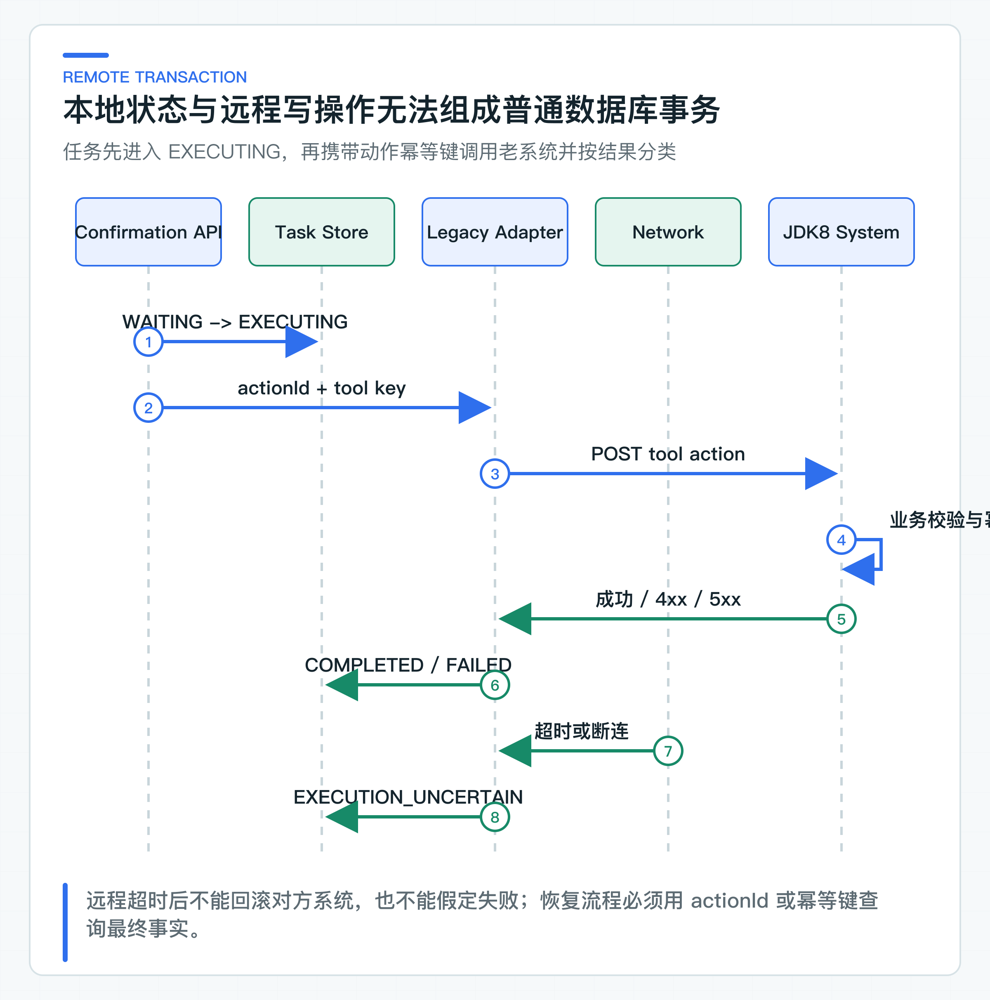
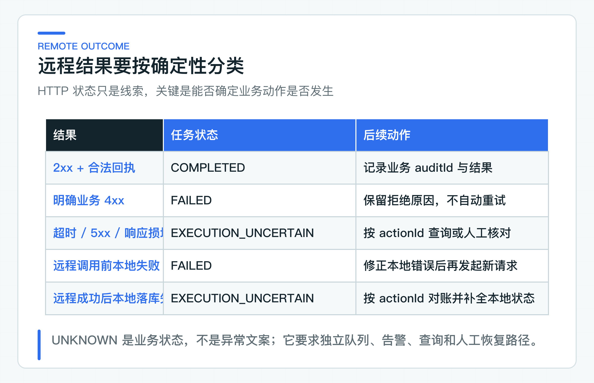

# 幂等、并发和审计怎样跨越本地与远程事务边界

员工批准退款后，Ticket Agent 更新本地任务，再通过 HTTP 调用 JDK8 业务系统。就在远端完成退款、准备返回响应时，网络断了。此时调用方只知道“没收到结果”，并不知道退款有没有发生。

回滚本地事务无法撤销远程动作，直接重试又可能重复退款。网络异常和业务失败必须分开：系统要能表达确定成功、确定拒绝、结果未知和本地程序错误，并为每种结果安排后续处理。

确认通过后，项目先把任务改为 `EXECUTING`，再用基于 `actionId` 的稳定幂等键调用 Legacy Tool。合法 2xx 进入 `COMPLETED`，明确 4xx 进入 `FAILED`，超时、5xx、空响应或协议损坏则进入 `EXECUTION_UNCERTAIN`，等待查询或对账。

## 本地事务无法覆盖远程 HTTP

数据库事务只能控制同一事务资源。把 HTTP 调用放在 `@Transactional` 方法里，只会让本地数据库连接和锁持有更久，不会让远程系统参与原子提交。

可能出现四种组合：

| 本地状态 | 远程动作 | 原因 |
|---|---|---|
| 未提交 | 未执行 | 调用前本地失败 |
| 已提交 | 未执行 | 远程明确拒绝或调用未到达 |
| 已提交 | 已执行 | 正常成功 |
| 已提交 | 可能已执行 | 超时、断连、5xx 或响应损坏 |

最后一种无法通过异常类型直接判断。连接超时可能发生在建立连接前，也可能由代理或客户端包装；响应超时通常意味着请求已经发出。业务系统甚至可能完成写入后在序列化响应时失败。

因此不要写成：

```java
try {
    legacyClient.refund(command);
    task.complete();
} catch (Exception e) {
    task.fail();
    retryWithNewRequestId();
}
```

这段代码会把未知结果标成失败，并用新请求 ID 制造重复副作用。

## 远程写操作的执行时序



[ToolConfirmationService](https://github.com/DavidDingXu/learn-java-ai/blob/main/learning-stages/stage-05-controlled-agent/services/ticket-agent-service/src/main/java/com/xiaoding/javaai/ticket/agent/application/ToolConfirmationService.java) 在调用下游前执行：

```java
AgentTask executing = tasks.save(
        waiting.beginExecution(clock.instant()),
        waiting.version());
```

任务先进入 `EXECUTING`，这样服务进程在远程调用中崩溃后，数据库仍保留一个可被恢复程序发现的状态。当前项目尚未实现重启扫描；公司接入时要补上扫描与对账 Worker。若先调用远程、成功后才更新本地，进程在两者之间崩溃会留下“远程已执行、本地仍等待确认”的危险状态。

然后构造稳定 Tool 幂等键。租户和动作 ID 先按字段长度编码，再计算 SHA-256：

```text
tool:v1:SHA-256(
  lengthPrefixed("tenantId") + lengthPrefixed(tenantId)
  + lengthPrefixed("actionId") + lengthPrefixed(actionId)
)
```

长度前缀保留字段边界，避免值中出现冒号或换行时产生相同输入；摘要也不会把租户标识直接暴露在 Header 和网关日志中。`v1` 为以后调整编码规则保留版本。原始 actionId 仍放在请求体、业务记录和审计里，用于查询动作结果。

actionId 在确认单生成时固定。相同动作的网络重试必须使用同一个 Key；参数变化时应创建新 actionId 和新确认单。Legacy Tool 同样要保存 Key、请求指纹和业务结果。

### Agent 与老系统共享同一动作标识

Ticket Agent 的确认接口幂等解决“员工决策是否重复处理”，Legacy Tool 的动作幂等解决“业务副作用是否重复发生”。两层 Key 语义不同，不能只保留一层。

确认 Key 示例：

```text
confirm:v1:<64 位 SHA-256 摘要>
```

Tool Key 示例：

```text
tool:v1:<64 位 SHA-256 摘要>
```

确认 Key 由 Java 8 客户端根据 taskId 与 confirmationId 的长度前缀编码生成，员工身份由服务端的受信 principal scope 隔离，不拼进 Header。即使确认接口只执行一次，Ticket Agent 也可能在崩溃恢复后重新调用 Legacy Tool；没有下游幂等，仍会重复退款。反过来，只有 Legacy Tool 幂等而确认接口不幂等，会产生混乱的多个审批回执和并发状态冲突。

最终业务系统应在本地事务中完成：校验幂等键、比较请求指纹、执行业务写、保存结果与 auditId。相同 Key 和相同指纹返回原结果，不同指纹返回冲突。

## 按结果确定性更新任务状态



[HttpLegacyWriteToolExecutor](https://github.com/DavidDingXu/learn-java-ai/blob/main/learning-stages/stage-05-controlled-agent/services/ticket-agent-service/src/main/java/com/xiaoding/javaai/ticket/agent/infrastructure/HttpLegacyWriteToolExecutor.java) 按确定性映射结果。

**2xx 与合法回执。** 响应必须能严格解析，actionId 与当前确认动作一致，状态也必须在接口约定的枚举内。然后任务进入 `COMPLETED`，保存下游 auditId。

**明确 4xx。** 4xx 表示业务系统明确拒绝当前请求，例如金额非法、状态不允许、权限不足或幂等冲突。适配器读取受限结构化错误，抛出 `ToolExecutionRejectedException`，任务进入 `FAILED`。它不自动重试，因为输入或业务状态需要修正。

错误体属于不可信输入。适配器不能把整段 HTML、堆栈或客户数据写入日志和审计，只提取稳定 code/message，并设置长度限制。

**5xx、超时与网络断开。** 这些结果无法证明业务动作没有发生，因此统一映射为 `RemoteExecutionUncertainException`。任务进入 `EXECUTION_UNCERTAIN`，回执中的 `toolStatus` 为 `UNKNOWN`。

**空响应、actionId 不匹配与 JSON 损坏。** 下游可能已经接受请求，只是响应格式不符合约定，因此也属于结果未知。不能因为“解析失败”就按普通客户端异常重试。

### 本地错误要看发生在什么时点

请求体、访问令牌和 `Idempotency-Key` 在 HTTP 调用前完成校验与序列化，批准记录也必须在发送请求前写入审计。这个阶段一旦失败，代码会把任务从 `EXECUTING` 关闭为 `FAILED`，继续抛出原始异常，并且不会调用远端工具。此时系统知道业务动作没有发出，不需要进入对账流程。

拿到合法的下游成功回执后，判断就不同了。此时如果本地任务保存或必要审计失败，不能再把远程动作改判为 `FAILED`。

`ToolConfirmationService` 会重新读取任务。如果 `COMPLETED` 已经落库，就保留成功状态。如果任务仍是 `EXECUTING`，则改为 `EXECUTION_UNCERTAIN`，记录 `LOCAL_COMPLETION_FAILED` 原因码，后续按原 `actionId` 对账。

指标与任务状态、必要审计不同。指标只用于观察运行情况，写入失败时可以丢弃当次样本并告警，不能阻止任务保存为 `COMPLETED`。否则监控系统的短暂异常会被误写成业务结果不明。

这里的 `UNKNOWN` 表示 Ticket Agent 还没有形成可靠的本地最终记录，不是否认已经收到下游成功回执。恢复程序仍然要用同一 actionId 查询老系统，再补齐任务状态和审计。

### 对未知结果执行查询与对账

`EXECUTION_UNCERTAIN` 不能停留在终态文案。当前代码能够保存这个状态和稳定原因，但不会自动查询老系统或启动对账。生产接入时至少要实现一种恢复方式：

1. 用 actionId 或 Tool Key 查询 Legacy Tool 幂等结果；
2. 用业务对象状态判断动作是否已经生效；
3. 无法自动判断时进入人工对账队列；
4. 查明后把任务更新为 COMPLETED 或 FAILED，并追加审计。

恢复请求不能重新发起一个新 actionId。最理想的下游接口同时提供：

```text
POST /tool-actions      使用 Idempotency-Key 执行
GET  /tool-actions/{actionId}  查询最终结果
```

如果老系统暂时没有查询接口，可以先利用现有订单或工单状态查询，但要明确判定规则。仅凭“当前订单看起来已退款”可能无法区分本次动作和其他渠道动作，最好让最终系统保存 actionId。

生产 Worker 应扫描长时间停留在 `EXECUTING` 的任务，将其转入查询恢复，而不是直接重试 POST。扫描过程需要租约和 fencing，防止多个实例同时恢复同一动作。

## 用版本和唯一约束处理并发

同一任务可能同时收到员工确认、后台恢复和重复 HTTP 请求。任务版本保证状态迁移只基于最新快照；幂等表唯一约束保证同一业务键只有一个结果；下游 actionId 唯一约束保证副作用只归属于一个动作。

生产数据库可以把 task 状态和确认决策放在一个本地事务中，但远程 HTTP 仍在事务外。常见做法是：

1. 本地事务校验确认并将任务改为 EXECUTING；
2. 提交事务；
3. 调用远程 Tool；
4. 新本地事务按 expected version 写入最终状态；
5. 冲突时重新读取，不覆盖更新后的恢复结果。

若希望调用与恢复更可靠，可以增加 execution attempt 或 outbox 风格的待执行记录，但不要为了“企业级”先引入复杂中间件。只要公司已有可靠任务队列，可以让确认事务写入执行任务，由 Worker 调用下游。选用哪种组件并不关键，actionId、状态、幂等和恢复语义必须保持一致。

### 对外承诺可重试和可查询

分布式网络下很难保证请求只到达一次。可靠系统通常实现的是：请求可以重复到达，但相同业务意图产生同一个可观察结果。

这依赖端到端幂等，而不是一句“接口保证 exactly-once”。如果 Ticket Agent 复用 Key，但网关丢失 Header；或者 Legacy Tool 保存 Key，却在写业务状态后、写幂等结果前崩溃，承诺仍会失效。

最终系统要尽量在同一数据库事务中提交业务状态和幂等结果。跨多个不可事务资源时，需要业务补偿或对账，不能用术语掩盖不一致窗口。

## 审计重建动作时间线

当前 Agent Audit 记录：

```text
AGENT_PLAN_RECORDED
CONFIRMATION_REQUESTED
CONFIRMATION_APPROVED
TOOL_EXECUTION_SUCCEEDED / REJECTED / UNCERTAIN
```

成功事件保存 actionId 和 Legacy auditId，使研发能够从 Agent 任务追到最终业务系统。如果成功回执后的本地收尾失败，时间线中还会追加 `TOOL_EXECUTION_UNCERTAIN reasonCode=LOCAL_COMPLETION_FAILED`。它表示需要补齐本地记录，不会用一条 `FAILED` 覆盖已发生的远程动作。拒绝和未知结果只记录稳定分类，不复制原始响应体。

生产审计至少需要：

- taskId、actionId、confirmationId；
- tenant、业务 subject、actor 与确认人 subject；
- 工具名、风险、参数指纹；
- 决策、原因、任务版本；
- 下游业务 auditId、结果分类；
- trace/correlation 与时间；
- 恢复事件和最终处理人。

敏感参数可以加密保存或只保留指纹与受控业务引用。审计可追溯不等于把完整客户数据复制到每条日志。

### 只重试结果可判断的操作

对 Legacy 写 Tool，客户端关闭自动重试。调用方只有在能确认请求未发送，或者下游以同一 Key 保证幂等且恢复策略明确时，才可以在总预算内重试。

建议按结果处理：

- 400/403/409：确定拒绝，不重试；
- 429：保留原 Key，按 Retry-After 或退避；
- 5xx/超时：先标 UNKNOWN，优先查询结果；
- 明确查询“未执行”：才可以使用原 actionId 和原 Key 再执行；
- 查询“已执行”：更新为成功，不再 POST。

不要把 Resilience4j Retry 注解直接套在写 Tool 方法上。通用重试不知道业务 Key、结果查询和未知状态。

## 故障结果必须稳定分类

仓库回归检查成功、明确拒绝、远程结果未知、重复确认，以及远端调用前审计失败、拿到成功回执后本地保存或审计失败的状态转换。它也检查指标上报失败不会改写已落库的业务结果。这里检查的是 HTTP 协议与状态映射，公司真实老系统仍要单独联调。

## 上线前补齐未知结果恢复

Ticket Agent 已提供 JDBC 状态与乐观锁，将 `java-ai.persistence.mode` 改为 `jdbc` 后即可启用；默认使用内存状态。两种实现都不会让请求自动接管过期确认。公司上线前还要补三项恢复能力：

1. Legacy Tool 的持久幂等记录和 actionId 查询。
2. `EXECUTING` 超时扫描与 `EXECUTION_UNCERTAIN` 恢复队列。
3. 区分确定失败与未知结果的告警，高风险 `UNKNOWN` 使用更高优先级。

上线前还要演练四个故障窗口：远程执行前 Agent 崩溃、执行后响应前断连、收到成功后本地更新失败、恢复 Worker 重复运行。每个窗口都要依靠同一 actionId 和幂等记录得到唯一结果。

Agent 能否进入公司项目，模型效果只决定一部分。一次网络超时后系统会不会重复写，通常更接近上线底线。JDK8 老系统不升级框架，仍然可以通过稳定 OpenAPI、Java 8 客户端和明确的错误处理规则参与查询、确认与恢复。

---

[课程首页](../../README.md) · [完整目录](README.md) · [← 人工确认为什么不能只传一个字符串 token](30-approval-receipt.md) · [JDK8 老系统接入 AI：OpenAPI、Java 8 客户端、认证、超时与错误处理 →](32-jdk8-integration.md)

动手实践：[本阶段可运行源码](../../learning-stages/stage-05-controlled-agent/README.md)
