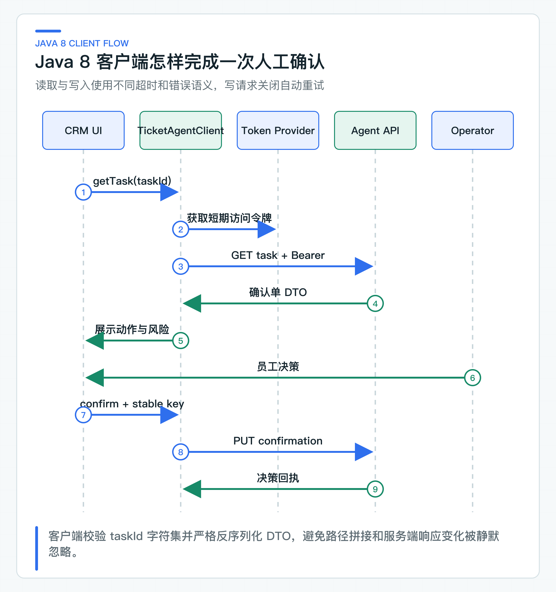

# JDK8 老系统接入 AI：OpenAPI、Java 8 客户端、认证、超时与错误处理

很多公司的 CRM 和订单系统还运行在 JDK8。为了接入 AI，直接把 Spring AI 及其依赖塞进老应用，往往会先撞上 JDK、Servlet、Jackson、日志和安全组件的版本冲突，业务价值还没验证，升级范围已经失控。

这套项目选择跨进程集成：Agent 编排留在 Java 21 服务，JDK8 端通过稳定 HTTP API 查询任务、展示确认单并提交员工决定。客户端只使用 Java 8 可编译 DTO、Apache HttpClient、Jackson 和 OpenAPI，不依赖 Spring AI，也不共享现代服务内部类。

老系统并不是被动兼容层。它仍保存最终业务数据，也是员工日常工作的入口；Agent 提出动作，员工身份、岗位权限、订单状态和最终写入继续由原系统负责。

## 现代 AI 依赖留在独立服务

Spring AI 2.0 对应 Spring Boot 4.x 和现代 JDK 基线。JDK8 老项目通常无法只加一个依赖就使用：

- 字节码版本不兼容；
- Spring Framework 与 Boot 大版本冲突；
- Jackson、Netty、Reactor 和日志依赖出现传递冲突；
- 老应用发布窗口和回归成本过高；
- 模型凭证、Prompt 和 Tool 权限进入本不该拥有它们的业务系统。

即使通过手写 HTTP 在老项目里直接调用模型，也会把模型响应、重试、限流和 Prompt 治理分散到多个老系统。更稳妥的边界是：现代服务提供稳定业务 API，JDK8 只消费 API。

这种服务拆分也方便后续升级。老系统迁移到新 JDK 时，HTTP API 可以保持不变；AI 框架从 Spring AI 换成其他实现时，JDK8 客户端同样无需修改。

## 用 OpenAPI 固定跨运行时接口

[agent-task-v1.yaml](https://github.com/DavidDingXu/learn-java-ai/blob/main/learning-stages/stage-05-controlled-agent/contracts/openapi/agent-task-v1.yaml) 定义五类入口：创建任务、读取任务、运行 Agent、提交确认和读取审计。JDK8 客户端只使用读取任务与提交确认，但仍共享同一任务状态和错误模型。

确认接口示意：

```yaml
/api/v1/agent/tasks/{taskId}/confirmation:
  put:
    parameters:
      - $ref: '#/components/parameters/TaskId'
      - $ref: '#/components/parameters/IdempotencyKey'
    requestBody:
      required: true
      content:
        application/json:
          schema:
            $ref: '#/components/schemas/ConfirmToolAction'
```

接口定义把 `Idempotency-Key` 放在 Header，把任务版本和 confirmationId 放在 body。状态枚举包含 `EXECUTION_UNCERTAIN`，错误响应区分 400、401、403、404、409 和 503。

跨团队联调时，OpenAPI 比 Java DTO 更合适，因为它不要求双方使用同一语言和依赖。客户端可以手写、生成或由公司 API 平台托管，但服务端行为、DTO 和错误码必须符合这份接口定义。

Eval Runner 解析全部 OpenAPI 与 JSON Schema，检查外部引用和正负样例。公司 CI 还可以增加 breaking change 检查：删除字段、收紧枚举、改变必填项或路径时，需要显式版本升级。

## Java 8 客户端的实现边界

OpenAPI Generator 可以生成 Java 8 客户端，但企业项目通常仍需要一层薄封装，统一 Token 获取、连接池、超时、幂等、错误分类和指标。直接让业务 Controller 调用生成代码，会让协议细节散到老项目各处。

[TicketAgentClient](https://github.com/DavidDingXu/learn-java-ai/blob/main/learning-stages/stage-05-controlled-agent/integrations/jdk8-client/src/main/java/com/xiaoding/javaai/legacy/ticket/TicketAgentClient.java) 对外只提供：

```java
AgentTaskView getTask(String taskId);

static String confirmationIdempotencyKey(
        String taskId, String confirmationId);

ConfirmationDecisionReceipt confirm(
        String taskId,
        String idempotencyKey,
        ConfirmToolActionRequest command);
```

业务页面不需要理解 HttpGet、HttpPut、JSON 解析和错误响应。以后更换 HTTP 客户端或引入公司统一 SDK，只改这一层。

### Java 8 DTO 只表达跨服务协议

JDK8 模块不能使用 record、sealed interface、`java.net.http.HttpClient` 或现代 Spring 类型。DTO 使用普通 final class、无参构造、getter/setter 和明确枚举。

服务端可以使用 Java 21 record，但跨边界 JSON 必须兼容。不要把服务端领域对象直接发布成共享 Jar：它会把 Java 版本、Jackson 注解、内部字段和发布节奏一起耦合给老系统。

客户端启用：

```java
new ObjectMapper()
    .configure(DeserializationFeature.FAIL_ON_UNKNOWN_PROPERTIES, true);
```

示例客户端启用严格未知字段策略，用于尽早发现服务端响应结构变化。公司若要求向前兼容，可以允许新增字段，但应通过兼容性测试管理，不能无意识地忽略所有变化。枚举新增仍可能导致旧客户端解析失败，需要版本策略。

### 明确连接池、超时与重试策略

[TicketAgentClientConfig](https://github.com/DavidDingXu/learn-java-ai/blob/main/learning-stages/stage-05-controlled-agent/integrations/jdk8-client/src/main/java/com/xiaoding/javaai/legacy/ticket/TicketAgentClientConfig.java) 明确五个参数：baseUrl、连接超时、响应超时、单路由最大连接和总连接数。

连接超时控制 TCP/TLS 建立，connection request timeout 控制从池中等待连接，response timeout 控制等待响应。它们不是同一个参数。若只配置一个“请求超时”，连接池耗尽时可能长时间阻塞，却在监控里误判为下游响应慢。

```java
RequestConfig requestConfig = RequestConfig.custom()
        .setConnectionRequestTimeout(
                Timeout.ofMilliseconds(connectTimeoutMillis))
        .setResponseTimeout(
                Timeout.ofMilliseconds(responseTimeoutMillis))
        .build();
```

连接池大小应根据 CRM 实例数、客服并发、Agent API SLO 和单请求耗时压测，不能复制一个很大的默认值。总连接数过大可能在 Agent 服务恢复时形成流量尖峰。

写请求关闭自动重试：

```java
HttpClients.custom()
        .setConnectionManager(manager)
        .setDefaultRequestConfig(requestConfig)
        .disableAutomaticRetries()
        .build();
```

确认写操作需要由业务层基于原 Idempotency-Key 决定是否查询或重试，HTTP 库不知道请求是否已经到达服务端。

### 使用短期、受众明确的访问令牌

客户端通过 `AccessTokenProvider` 每次请求获取 Bearer Token。它可以接入公司 OAuth2 Client、员工会话换取的委托令牌或受控凭证缓存，但业务代码不保存明文 Token。

确认 Token 至少需要：

- audience 为 `ticket-agent-service`；
- scope 包含确认能力；
- subject 是当前员工；
- actor 是 `jdk8-crm`；
- tenant 与任务一致；
- roles 包含确认单所需角色；
- 有较短有效期。

不要给 CRM 配一枚拥有全部租户和全部 Tool 权限的永久 Token。否则前端的员工登录与岗位校验失效后，服务间身份会成为绕过入口。

Token Provider 还要处理缓存和并发。短期 Token 可以按到期时间提前刷新，但不要在日志中打印 Token，也不要把它放在 URL 查询参数。

## 读取任务与提交确认的调用时序



CRM 页面先调用 `getTask(taskId)`，读取状态和确认单。只有 `WAITING_CONFIRMATION` 且确认单未过期时展示操作。员工点击后，页面提交 expectedTaskVersion 和 confirmationId。

客户端会校验 taskId 只包含 `[A-Za-z0-9._:-]` 且不超过 128 字符，避免直接拼接路径造成路径注入。baseUrl 只允许 HTTP(S)，并移除尾部斜杠。

确认成功返回 `ConfirmationDecisionReceipt`，页面根据 state 和 toolStatus 展示：

- `COMPLETED / SUCCEEDED`：业务动作有确定成功回执；
- `FAILED / REJECTED`：业务系统明确拒绝；
- `REJECTED / NOT_EXECUTED`：员工拒绝，未调用 Tool；
- `EXECUTION_UNCERTAIN / UNKNOWN`：结果未知，进入查询或人工核对。

HTTP 200 只表示确认接口成功返回了决策结果，不等于 Tool 必然成功。

### 按错误类型决定客户端动作

`TicketAgentClientException` 保存 statusCode、errorCode、message 和 retryable。4xx 通常标记为不可重试，429 和 5xx 标记为可由上层评估重试。这个标记不会触发 HTTP 客户端自动重放；当前客户端已经关闭 Apache HttpClient 的自动重试。写操作是否重新提交，仍要结合幂等键与结果查询判断。

响应体无法解析时，客户端返回受限的 `HTTP_{status}` 错误，不把未知 HTML 或代理页面直接展示给员工。服务端错误 message 也应视为不可信展示内容，生产 UI 最好按稳定 errorCode 映射本地文案。

对 `getTask` 这样的读请求，IOException 映射为 `TicketAgentTransportException`。调用方可以在总超时时间内重试。

确认请求进入 HTTP 调用后发生 IOException，映射为 `ConfirmationOutcomeUnknownException`。异常保留原 `Idempotency-Key`，调用方不能为重试生成新的 Key。

如果请求 JSON 在发送前序列化失败，远端不可能产生副作用。客户端直接返回本地程序错误，不进入未知结果对账。

这两个异常故意不同。若统一成 `RemoteCallException`，业务层很容易把写超时当作普通失败再次提交。

### 回调与轮询按实时性选择

当前接口不使用 callback。CRM 主动查询任务并提交确认，这种方式更适合内网老系统：网络方向简单，权限清晰，也避免 Agent Service 反向访问每个 CRM 实例。

如果业务需要异步通知，可以增加回调或消息通知，但要满足：

- callback 地址由服务端注册，不由模型或请求体任意传入；
- 回调有签名、重放防护和固定事件 Schema；
- 投递使用 eventId 幂等，消费者保存处理结果；
- 回调失败不改变任务真实状态；
- CRM 仍能主动查询，回调只是通知，不是唯一事实来源。

对老系统，先提供查询 API 往往比引入新消息客户端更容易落地。不要为了“异步架构”强迫 JDK8 项目接入一套它无法稳定维护的中间件。

## 用 OpenAPI 生成传输层代码

团队可以从 `agent-task-v1.yaml` 生成 Java 8 DTO 和接口骨架，再保留手写 Transport Wrapper。生成器版本和模板要固定，生成代码不手改；定制认证、超时和错误映射放在扩展层。

CI 至少包含以下步骤，具体构建命令由 Java 8 模块 README 统一维护：

1. OpenAPI 语法与引用校验；
2. 生成客户端；
3. 使用完整 JDK8 编译；
4. 在服务端联调环境走通读取与确认接口，并核对任务状态；
5. 检查新增枚举和必填字段的兼容性。

Java 8 客户端的契约测试使用本地 HTTP 测试服务器；身份、网关和老系统联调则通过环境配置指向公司共享测试环境。

## Java 8 客户端怎样检查协议

Maven Enforcer 会拒绝 Java 21 或其他非 Java 8 运行时，避免在开发机上“看似兼容”、到老系统环境才出现字节码错误。

Enforcer 校验的是 Java 版本，不能单独区分 JRE 与完整 JDK；编译阶段还要实际使用 `javac`。因此完整的 `verify` 必须在 JDK8 下执行，才能同时确认 Java 8 编译和测试结果。本机没有 JDK8 时，由已配置 JDK8 的 CI 执行这条独立构建即可。

## 接入现有 JDK8 系统的最小改动

保留 OpenAPI、客户端封装、错误分类和幂等语义；替换 baseUrl 获取、公司 HTTP 代理、TLS 证书、Token Provider、日志与指标接入。若公司已有统一 HTTP SDK，可以替换 Apache HttpClient，但必须确认它不会自动重试写请求。

CRM 页面要按结构化确认单展示，不要只嵌一段模型文本。服务端和老系统都要校验角色，最终业务写仍由老系统自己的应用服务完成。

JDK8 接入的关键不是让老系统理解 AI，而是让它调用稳定的业务 API。模型选择查询知识后，Ticket Agent 以委托身份调用 Knowledge Service，再把确定动作交给 JDK8 员工确认，三个系统只通过版本化接口协作。

---

[课程首页](../../README.md) · [完整目录](README.md) · [← 幂等、并发和审计怎样跨越本地与远程事务边界](31-action-consistency.md) · [串联工单 Agent 业务链：知识查询、人工确认与 JDK8 执行 →](33-ticket-agent-case.md)

动手实践：[本阶段可运行源码](../../learning-stages/stage-05-controlled-agent/README.md)
