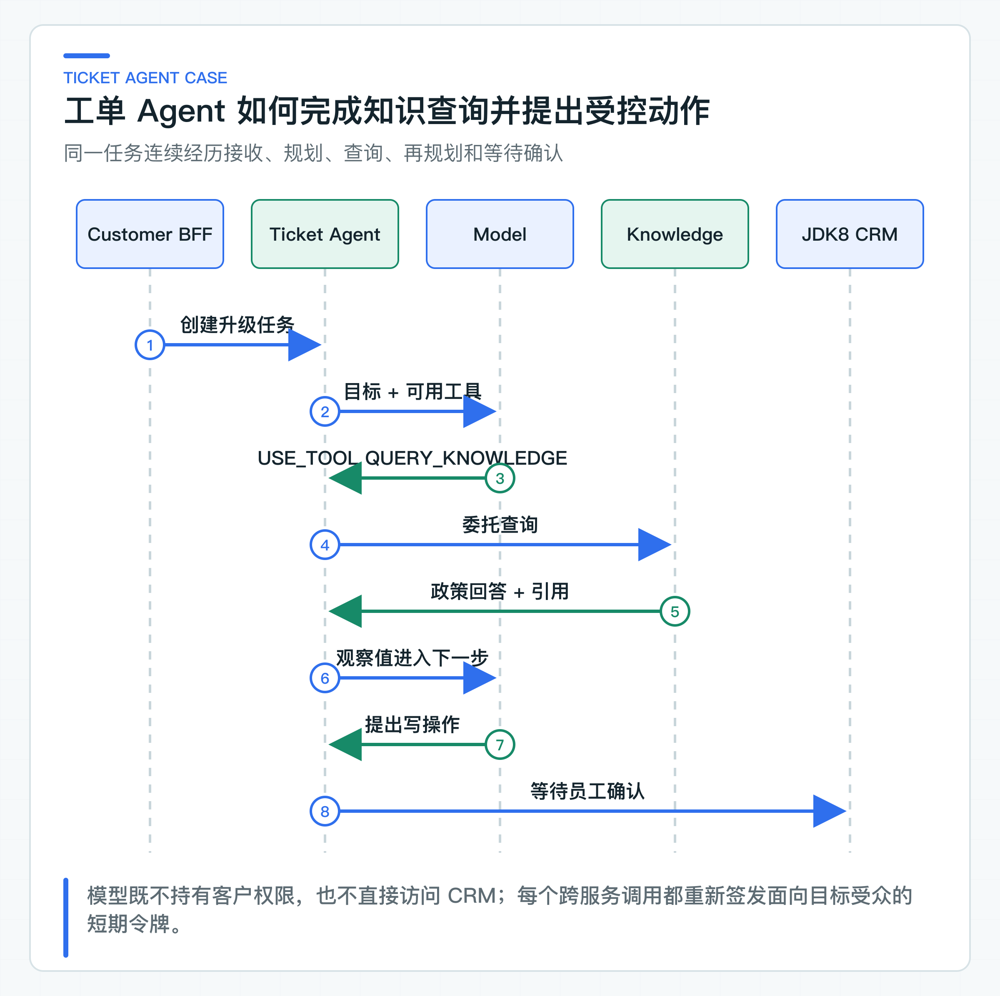
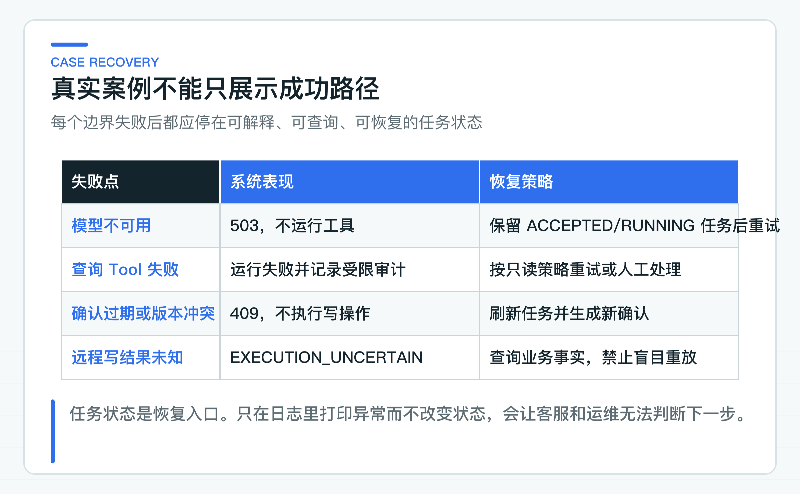

# 串联工单 Agent 业务链：知识查询、人工确认与 JDK8 执行

退款到账超期这类投诉会同时用到任务、Tool、风险控制、人工确认和 JDK8 客户端。各组件单独通过测试仍然不够，跨服务状态和失败处理必须放进同一条业务链核对。

案例从一条未解决的 C 端咨询开始：Customer BFF 创建工单，Ticket Agent 查询当前政策，根据结果提出分配审核队列或退款动作，员工再到 JDK8 CRM 核对并确认。

这条链路会经过结构化规划、Knowledge HTTP 适配器和 Legacy Tool HTTP 适配器。仓库提供两个 Java 服务、版本化 OpenAPI 与回归测试；目标环境中的身份平台和老系统接口按实际地址接入。模型冒烟、协议测试和跨服务联调分别验证不同层次，运行时需要分开看结果。

## 从未解决咨询生成任务输入

Customer BFF 在工单升级链路中把未解决咨询转换为不可变 Handoff Snapshot，并创建 Agent Task。请求包含业务目标和受限上下文：

```json
{
  "caseId": "conversation-100",
  "objective": "查询退款到账政策，并把需要人工处理的工单分配到 refund-review 队列",
  "businessContext": {
    "source": "customer-consultation",
    "attemptId": "attempt-8",
    "question": "退款审核通过七天了，为什么还没到账？",
    "queueCode": "refund-review",
    "previousAnswer": "当前证据不足，建议人工核对退款状态",
    "reasonCode": "CUSTOMER_REQUESTED_HUMAN",
    "sourceTraceId": "trace-100"
  }
}
```

tenant、customer subject、actor、roles 和 departments 不在 body 中，它们来自 Customer BFF 交换的委托 JWT。Ticket Agent 接收后返回 `ACCEPTED`，稳定 Idempotency-Key 保证 BFF 超时重试不会创建多个任务。

## 一次 Agent Run 的完整步骤



调用 `/api/v1/agent/tasks/{taskId}/runs` 后，[TicketAgentOrchestrator](https://github.com/DavidDingXu/learn-java-ai/blob/main/learning-stages/stage-05-controlled-agent/services/ticket-agent-service/src/main/java/com/xiaoding/javaai/ticket/agent/application/TicketAgentOrchestrator.java) 把任务从 `ACCEPTED` 改为 `RUNNING`，然后进入有限循环。

第一轮 Planner 看到任务目标、businessContext，以及允许工具名与必填参数名。对当前案例，合理候选是：

```json
{
  "decisionType": "USE_TOOL",
  "toolName": "QUERY_KNOWLEDGE",
  "arguments": {
    "question": "退款审核通过后超过七天仍未到账，当前政策如何处理？"
  },
  "rationale": "需要先核对有效到账时效和升级条件"
}
```

Spring AI 适配器把规划响应映射为 `AgentPlanningResult`，并保留模型名、Token 和 finish reason。这个结果只是候选决策；Java 服务还要通过 Tool Catalog 检查工具、风险和参数，模型不直接执行方法。

目录确认 `QUERY_KNOWLEDGE` 是 READ_ONLY，只允许 `question`。通过后，[HttpKnowledgeReadToolExecutor](https://github.com/DavidDingXu/learn-java-ai/blob/main/learning-stages/stage-05-controlled-agent/services/ticket-agent-service/src/main/java/com/xiaoding/javaai/ticket/agent/infrastructure/HttpKnowledgeReadToolExecutor.java) 调 Knowledge Service。

### Ticket Agent 调用 Knowledge Service

默认配置通过 HTTP 调用 Knowledge Service，写 Tool 使用幂等的内存实现，因此本地联调不依赖老系统和服务令牌。接入真实 Legacy Tool 时，服务地址、超时和令牌模式全部来自服务端配置；先用 IdP 或 Token Exchange 实现面向下游的短期令牌，再把写 Tool 切换为 HTTP。

开启后，URL 只能来自服务端受管配置，不由模型或请求参数提供。执行器向 `/api/v1/knowledge/answers` 发送问题。这次请求使用短期委托 Token，audience 为 `knowledge-service`，scope 为 `knowledge:answer`。

Knowledge Service 重新验证身份，在 TopK 前应用 tenant、subject、roles 和 department ACL，返回回答、引用、拒答状态和 trace。可能的受限结果是：

```json
{
  "answer": "退款通常在审核通过后 1 到 5 个工作日到账；超过时效需要核对支付渠道状态并转退款审核队列。",
  "citations": [
    {
      "documentId": "refund-policy",
      "version": "v1",
      "sectionId": "arrival-time",
      "title": "退款到账时效"
    }
  ],
  "refused": false,
  "traceId": "trace-knowledge-200"
}
```

执行器把响应裁剪为 `ToolObservation`，任务版本增加，并记录 `READ_TOOL_SUCCEEDED`。下一轮 Planner 可以使用这份观察值，但它仍被标记为不可信 Tool 输出，不能改变服务端策略。Planner 会再次对照原始目标：政策已经查到，但分配队列尚未完成，因此不能在这一步提前返回 `FINISH`。

### 第二轮规划进入人工确认

有了政策后，Planner 可以选择 `ASSIGN_QUEUE`：

```json
{
  "decisionType": "USE_TOOL",
  "toolName": "ASSIGN_QUEUE",
  "arguments": {
    "queueCode": "refund-review"
  },
  "rationale": "已超过政策时效，需要退款审核团队核对支付渠道"
}
```

Tool Catalog 验证队列在服务端允许列表中，并把动作定义为 WRITE、MEDIUM、requiredRole=`TICKET_OPERATOR`。Orchestrator 不执行，而是生成确认单并把任务改为 `WAITING_CONFIRMATION`。

若模型直接建议 `ISSUE_REFUND`，目录会要求 amountMinor 和 currency，并把风险设为 HIGH、角色设为 `REFUND_APPROVER`。即使用户在原问题里写“请直接退款”，模型也无法跳过确认。

JDK8 CRM 查询任务后展示政策引用、队列或退款参数、风险和过期时间。员工核对真实订单与支付状态，批准或拒绝。最终业务系统仍有权因为状态变化拒绝执行。

## 委托身份穿过三个服务

第一次委托由 Customer BFF 发起：

```text
sub      = customer-100
act.sub  = customer-bff
aud      = ticket-agent-service
scope    = ticket:task:create
tenantId = tenant-a
```

Ticket Agent 调 Knowledge 时重新签发：

```text
sub      = customer-100
act.sub  = ticket-agent-service
aud      = knowledge-service
scope    = knowledge:answer
tenantId = tenant-a
```

JDK8 员工确认使用另一枚令牌：subject 是员工，actor 是 `jdk8-crm`，roles 包含当前岗位。Ticket Agent 调 Legacy Tool 时又使用面向最终服务的 audience 和 `legacy:tool:execute` scope。

subject 表示业务主体，actor 表示代理服务。不同调用不能复用一枚全权 Token。配套的 HMAC Provider 只用于本地联调；生产环境应由公司 IdP 或 Token Exchange 签发，并使用非对称密钥、轮换和客户端认证。

## 从 main 方法运行真实规划链路

在 IDE 中先运行 `KnowledgeServiceApplication.main()`，再运行 `TicketAgentServiceApplication.main()`。创建退款政策场景的 Agent Task，然后请求 `/api/v1/agent/tasks/{taskId}/runs`。任务视图和审计中必须能核对结构化决策、合法工具、模型名、usage 和 finish reason；任何字段缺失都不应被当成规划成功。

默认写 Tool 使用带幂等校验的内存实现，不会连接公司退款接口。真实 Legacy Tool 只能在配置好身份、服务 URL、查询回执和隔离数据后联调。

模型 API 地址必须填写实际协议根，例如 Provider 使用 OpenAI 兼容 `/v1` 时，base URL 不能只写网站首页。测试和报告不会打印密钥；生产环境仍由公司密钥系统提供凭证。

### 目标环境联调所需依赖

本地先启动 `KnowledgeServiceApplication` 和 `TicketAgentServiceApplication`。打开阶段 05 的 `agent-learning-journey.http`，从 `02-create-task` 顺序运行到 `08-read-final-audit`。

脚本会从任务响应自动保存 taskId、confirmationId 和绑定版本。最终审计应按顺序出现知识查询、确认请求、批准和写 Tool 成功。第 07 个请求还会证明重复批准返回原 actionId。

默认写 Tool 使用带幂等校验的内存实现，不需要部署身份系统或老系统。

目标环境的完整联调需要公司身份签发服务，以及一个实现 `legacy-tool-v1.yaml` 的隔离服务。服务间调用使用目标 audience 和最小 scope 的短期令牌；老系统提供可查询回执的沙箱接口。

目标环境启用远程 Tool 后，再用不同 scope 的短时 JWT 创建工单、启动 Agent Run 并查询任务。最后核对 Knowledge 引用、确认单、Legacy Tool 回执和审计时间线。任一步只有模拟响应时，都应在结果中标注为单服务或协议测试，不得当作真实老系统验收。

请求与响应字段以 [Agent Task OpenAPI](https://github.com/DavidDingXu/learn-java-ai/blob/main/learning-stages/stage-05-controlled-agent/contracts/openapi/agent-task-v1.yaml) 和 [Legacy Tool OpenAPI](https://github.com/DavidDingXu/learn-java-ai/blob/main/learning-stages/stage-05-controlled-agent/contracts/openapi/legacy-tool-v1.yaml) 为准。

Knowledge 与 Ticket 必须对 `departmentIds`、tenantId、actor 和 scope 使用一致 Claim 名称。身份 Claim 的一个拼写差异就可能导致授权失败或错误放行，因此配套测试会覆盖 JWT 映射与错误 audience。

## 主要失败路径怎样处理



**模型不可用。** Planner 没有配置、Provider 超时或模型响应无法解析时，Orchestrator 先把任务从 `RUNNING` 改为 `FAILED`。outcome 只保存 `PLANNER_UNAVAILABLE`。审计记录同一原因码和当前 step，不写 Provider 的原始异常文本。随后运行接口返回 `503 AGENT_RUN_UNAVAILABLE`，也不会调用 Tool。

模型响应即使能解析成 Tool 选择，也可能缺少必填参数、携带多余参数或提出目录外工具。`BusinessToolCatalog` 会在执行前拒绝这类提案，Orchestrator 将任务关闭为 `FAILED`，outcome 保存 `INVALID_TOOL_PROPOSAL`。原始模型参数和校验异常不会进入对外响应或审计详情，任何 Tool 都不会执行。

这个失败任务仍可查询，但不会从 `FAILED` 原地重跑。Provider 恢复后，调用方应创建新的处理尝试，并为这次尝试生成新的幂等键。

**Knowledge 调用失败。** 身份被拒绝、超时或响应损坏时，不能伪造政策答案继续。Orchestrator 把任务改为 `FAILED`，outcome 保存 `READ_TOOL_UNAVAILABLE`；审计只记原因码、step 和服务端已确认的 Tool 名，不复制下游错误体。运行接口同样返回稳定 503。

如果公司项目要对知识查询做有限重试，应当在总超时预算内完成，并且只重试可恢复的只读失败。当前尝试已经进入 `FAILED` 时，后续处理应创建新任务或转人工，不能把旧任务留在 `RUNNING`。

**模型选择未知工具或非法参数。** Tool Catalog 立即拒绝候选。生产系统可以将其记为 Agent 策略失败，并进入安全评测数据集，而不是尝试模糊匹配相近工具名。

**确认过期或任务版本冲突。** 返回 409，不执行 Tool。CRM 刷新任务，重新加载当前业务状态；需要继续时生成新的确认单。

**Legacy Tool 明确拒绝。** 任务进入 `FAILED`，记录稳定业务错误。模型不能自动修改金额继续尝试高风险动作。

**Legacy Tool 结果未知。** 任务进入 `EXECUTION_UNCERTAIN`，使用 actionId 查询或人工对账。禁止生成新动作盲目重放。

### 从审计记录重建整个案例

一条正常路径应看到：

```text
AGENT_RUN_STARTED
AGENT_PLAN_RECORDED decision=USE_TOOL
READ_TOOL_SUCCEEDED tool=QUERY_KNOWLEDGE
AGENT_PLAN_RECORDED decision=USE_TOOL
CONFIRMATION_REQUESTED tool=ASSIGN_QUEUE risk=MEDIUM
CONFIRMATION_APPROVED
TOOL_EXECUTION_SUCCEEDED actionId=... legacyAuditId=...
```

如果 Planner 或 Knowledge 调用失败，时间线会以 `AGENT_TASK_FAILED reasonCode=...` 结束，不会出现 `READ_TOOL_SUCCEEDED` 或确认事件。

审计不保存完整 Prompt、客户问题、参数原文和下游异常消息，只记录低敏决策元数据、稳定原因码和业务关联 ID。需要查看具体确认内容时，通过受权限保护的任务和确认单查询，而不是从日志复制。

真实模型 metadata 包含模型名、Token 和 finish reason，适合放入 Trace 与评测报告。Metric 标签只保留工具名、决策类型、结果分类等有限维度，避免 taskId 和模型自由文本造成高基数。

## 按服务边界观察完整案例

仓库回归覆盖当前案例的控制循环、HTTP 适配、JWT 和接口语义。真实 Planner 通过 Ticket Agent 主应用观察；JDK8 客户端按第 32 篇的独立兼容性边界验证。PostgreSQL、对象存储、IdP 和老系统联调仍需在共享环境运行，不能由本地单元测试代替。

## 按风险分阶段接入能力

不要一次开放退款等高风险动作。第一阶段只接查询知识和查询业务状态，验证身份、审计和 Agent Eval。第二阶段增加 LOW/MEDIUM 写操作，在测试环境走人工确认与持久幂等。第三阶段才接资金类动作，并增加审批、对账和未知结果恢复。

每增加一个 Tool，都要同时提交 ToolPolicy、参数 Schema、下游身份、HTTP 适配器、负向测试、确认展示、审计字段和评测案例。只有 Java 方法而没有这些配套，不能算完成企业 Tool 接入。

在这条业务链中，工单 Agent 必须做到身份可校验、状态可查询、决策有依据，并且支持人工确认和故障恢复。单次成功不能说明这些行为稳定，还需要用 Agent Golden Set 持续验证工具路径、参数策略、拒绝行为和副作用边界。

---

[课程首页](../../README.md) · [完整目录](README.md) · [← JDK8 老系统接入 AI：OpenAPI、Java 8 客户端、认证、超时与错误处理](32-jdk8-integration.md) · [Agent 质量怎样评测：工具路径、参数、拒绝和副作用 →](34-agent-evaluation.md)

动手实践：[本阶段可运行源码](../../learning-stages/stage-05-controlled-agent/README.md)
