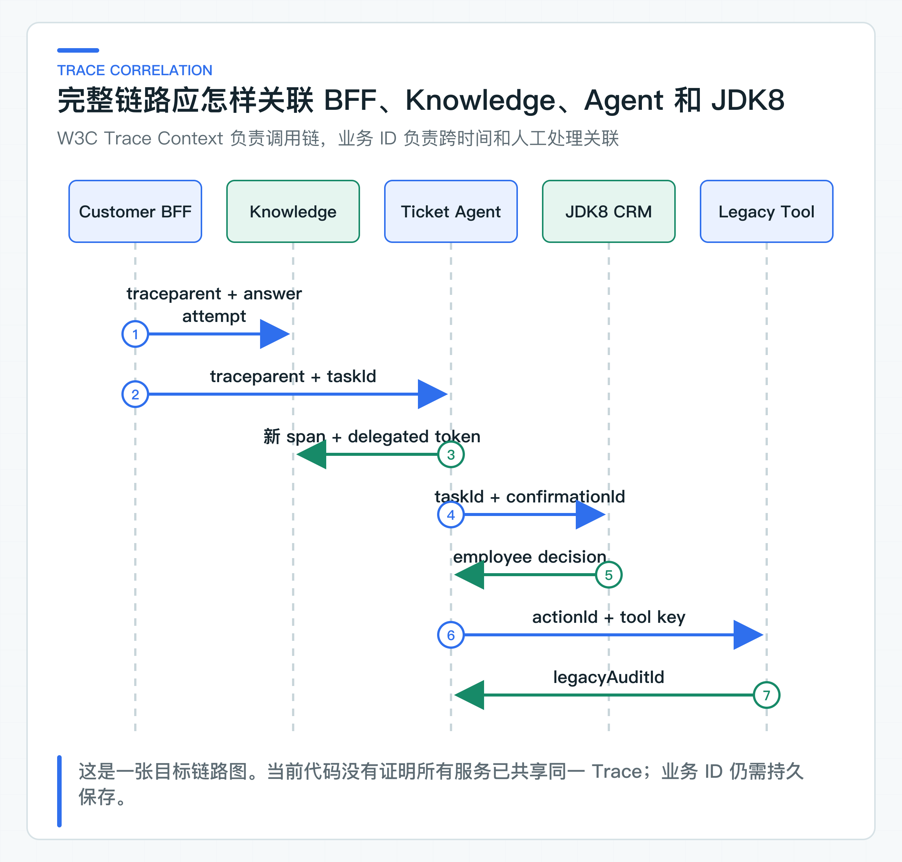

# 观测做到什么程度才够用：Trace、Correlation、Metric、日志和成本

线上有人反馈一次咨询等了 18 秒。团队接着要回答：时间花在检索、模型还是 Tool？同一时段 Token 为什么翻倍？如果远程调用超时，业务动作究竟有没有执行？一张 Prometheus Dashboard 或一份全量 Prompt 日志都无法独立回答这些问题。

项目把观测信号分成四类：Trace 还原单次调用链，Metric 观察总体趋势，Log 解释程序异常，Audit 记录业务动作与人工决定。Trace 是一次请求经过各服务时形成的调用链；Metric 是用于统计和告警的聚合指标；Audit 是不能由普通运行日志替代的业务审计。

四类信号的失败语义不同。Metric 只用于观察运行情况，不能因为指标库短暂异常就改写业务状态。高风险动作的必要 Audit 则属于业务记录，保存失败时需要停止执行或进入对账，不能只记一条错误日志后继续。

标题中的 Correlation 指使用 `traceId`、`taskId`、`actionId` 和 `auditId` 把不同请求与业务记录关联起来。这些信号的权限和保留周期并不相同。

当前代码先完成可独立验证的部分。Knowledge Service 用 Micrometer Observation 包裹知识操作；这里的 Observation 是对一次操作进行计时并携带观测上下文的统一 API。服务还会在回答中读取当前 `traceId`。Ticket Agent 记录规划与 Tool 指标，业务动作进入低敏 Audit。

这里的低敏是指审计只保留排查动作所需的状态、业务 ID 和有限说明，不复制问题正文或完整 Tool 参数。项目还没有用测试证明 BFF、Knowledge、Ticket Agent 和 JDK8 已形成完整 Trace，也没有把 Trace 与所有审计事件自动关联。

## 四类信号各自回答一类问题

**Trace。** Trace 回答“一次请求经过了哪里”。一条咨询可能经过 Customer BFF、Knowledge Service、模型 Provider、Ticket Agent 和 Legacy Tool。每一段局部调用记录称为 Span，它应保存服务、操作、耗时、状态和少量关联 ID。

**Metric。** Metric 回答“总体是否异常”。例如 Agent 规划次数、Tool 成功/拒绝/未知比例、Token 分布、并发 429、模型延迟和 RAG 拒答率。它适合固定低基数标签，不适合存每个 taskId。

**Log。** Log 回答“程序具体哪里出错”。异常类、错误码、下游状态和 stack trace 可以进入受控日志；原始 Prompt、访问 Token 和完整客户数据不能为了排障默认打印。

**Audit。** Audit 回答“谁在什么时候批准并执行了哪个业务动作”。它需要追加写、长期保留和权限控制，不能依赖可能采样的 Trace，也不能用普通日志轮转替代。

把四种信号全部写进一个 ELK 索引，短期看起来方便，长期会造成权限、成本和保留策略混乱。

## Ticket Agent 当前记录的指标

[MicrometerAgentTelemetry](https://github.com/DavidDingXu/learn-java-ai/blob/main/learning-stages/stage-05-controlled-agent/services/ticket-agent-service/src/main/java/com/xiaoding/javaai/ticket/agent/infrastructure/MicrometerAgentTelemetry.java) 记录三类 Meter，也就是 Micrometer 中的计数、分布或计时器：

```text
java.ai.agent.plan
java.ai.agent.plan.tokens
java.ai.agent.tool
```

规划计数只使用 `decision` 与 `finish_reason` 标签。结束原因先映射到 `stop`、`length`、`tool_calls` 等有限集合，Provider 私有值统一记为 `other`，避免新值持续创建时间序列。Token 通过 DistributionSummary 按 decision 聚合。Tool 使用 Timer，标签为 `tool` 与 `outcome`。

`TicketAgentOrchestrator` 在每次规划后记录 decision 与 totalTokens，对只读 Tool 记录 succeeded 或 failed 及耗时。`ToolConfirmationService` 对写 Tool 记录 succeeded、rejected、uncertain 或 failed。

这些指标没有 taskId、tenant、subject、问题正文、Prompt 和模型自由文本。当前模型名保留在 Agent 审计中。生产接入 Trace 时，可以记录受控模型别名；若公司模型集合稳定，也可以把有限别名加入 Metric。

### 低基数标签控制监控成本

时序数据库会为每组标签创建独立时间序列。把 taskId 做标签，100 万任务就可能产生近 100 万序列；把用户问题做标签，基数几乎无限，还会泄露内容。

适合指标标签的字段：

```text
service=knowledge-service
operation=answer
tool=QUERY_KNOWLEDGE
outcome=uncertain
decision=use_tool
error_class=timeout
```

适合 Trace 或日志的字段：

```text
traceId
taskId
actionId
confirmationId
model version
downstream request id
```

敏感字段通常不应进入任何通用观测系统。确需排障时，使用受控业务引用查询原数据，或者临时开启经过审批的采样与脱敏，不要永久全量记录。

## 跨服务关联需要 Trace Context 与业务 ID



生产链路应使用 W3C Trace Context 传播 `traceparent`。`traceparent` 是跨服务传递 Trace 身份的标准 HTTP Header。Micrometer Tracing 与 OpenTelemetry Bridge 可以让 Spring HTTP 客户端和服务端创建 Span，业务代码不应另拼一套 `trace-id` Header。

但 Trace 可能被采样，也会按较短周期过期。跨人工确认可能间隔数小时，JDK8 CRM 的确认请求通常已经是新 Trace。因此还需要持久业务 ID：

- conversationId 与 attemptId 关联 C 端回答；
- taskId 关联 Agent 生命周期；
- confirmationId 关联人工决策；
- actionId 关联远程写意图；
- legacyAuditId 关联最终业务系统。

Agent 审计已经保存 taskId、actionId 和下游 auditId，Knowledge 回答也能取得当前 traceId。还缺的部分是让 BFF、Ticket Agent 和 JDK8 的客户端统一传播 `traceparent`，并在 Span 中加入必要的业务 ID。是否真正打通，要用集成测试或真实 Trace 截图确认上下游属于同一条调用链；POM 中存在 tracing 依赖本身不构成验证结果。

### Observation 包裹边界而不侵入业务规则

Knowledge Service 通过 `KnowledgeAnswerTelemetry` 业务端口包装操作，基础设施实现使用 Micrometer Observation。应用层只知道“观察一次知识操作”，不依赖 Prometheus 或 OTel API。

Ticket Agent 使用 `AgentTelemetry` 端口，Orchestrator 和确认服务记录业务事件，`MicrometerAgentTelemetry` 负责 Meter 名称和标签。测试可使用 NOOP，不需要启动监控系统。

这种分层避免在每个业务方法里散落 `meterRegistry.counter(...)`，也便于统一标签。Telemetry 端口仍应保持小而具体，不能演变成通用 `record(String, Map<String,String>)`，否则任意字段都可能进入指标。

## 从用户体验和业务风险选择核心指标

下面是生产监控建议。当前代码只实现了其中一部分，不应把清单等同于现有 Dashboard。

### 模型与回答

- 请求数、错误率、p50/p95/p99；
- TTFT（首个 Token 到达时间）与完整响应时长；
- Prompt、Completion、Total Token；
- finish reason 分布；
- 结构化输出失败和业务校验失败；
- 拒答率与引用缺失率。

### RAG

- 检索耗时、候选数、TopK；
- Recall/HitRate/MRR 的离线趋势；
- ACL 拒绝与空召回；
- Rerank 调用率和收益分组；
- 索引任务积压、租约超时、死信。

### Agent

- 每任务规划步数；
- decision 与 Tool 分布；
- WAITING_CONFIRMATION 数量和等待时长；
- Tool succeeded/rejected/uncertain；
- Agent Run 429；
- STEP_BUDGET_EXCEEDED；
- 尚未完成对账的 UNKNOWN 数量和持续时间。

### 业务结果

- C 端解决率与转人工率；
- 人工批准/拒绝比例；
- 重复幂等命中和冲突；
- 工单 SLA；
- 最终业务动作成功和对账异常。

技术指标与业务指标要能通过 taskId 等关联，但不要把客户维度直接做 Metric 标签。

### 按模型与场景统计 Token 成本

当前 Agent 指标记录 total token 分布，还没有实现版本化价格表和成本报表。生产需要在 Provider 返回 usage 后保存 prompt、completion 和 total token，再使用受控价目版本计算：

```text
estimatedCost = promptTokens * promptUnitPrice
              + completionTokens * completionUnitPrice
```

价格、币种和生效时间会变化，不能把公式中的单价永久写死。公司可以按模型别名维护版本化价格表，报告同时保留原始 Token。

成本指标应按服务、业务用例、模型别名和环境聚合。按用户 ID 聚合可能涉及隐私和高基数；需要计费归属时，在业务数据仓库离线计算更合适。

Token 激增告警要结合质量和流量。调用量增长导致总成本上升是正常现象；单请求 Token、步骤数或重试放大突然上升才更接近工程异常。

## 日志、管理端点与告警

### 日志只保留排障所需信息

生产结构化日志可以记录错误码、异常类型、操作名、有限状态、下游服务、耗时、traceId 和业务关联 ID。谨慎记录参数指纹或数量，避免完整内容。当前测试没有扫描这些日志字段，因此下面是日志设计规则，不是已经完成的泄露验证。

这些内容通常禁止：

- Authorization、API Key、Cookie；
- 完整 Prompt 和 Tool 输出；
- 手机号、身份证、地址、支付信息；
- 上传文档正文；
- 模型原始响应和未知 HTML 错误页。

结构化日志的字段 Schema 也要评审。把所有对象 `toString()` 打出来会绕过字段级脱敏。异常 handler 返回给用户的 message 与内部日志也应分开。

### 受控暴露 Prometheus 端点

服务的 `application.yml` 注册 `health,prometheus` 端点，`/actuator/env` 没有暴露。注册端点不等于允许匿名抓取：Security 只匿名开放 health，本地访问 Prometheus 会得到 `401`。生产接入再使用独立 management port、内网或 ServiceMonitor，并为监控身份配置明确授权和网络策略。

不要把 Prometheus 端点开放到公网后只依赖“指标里没有密码”。指标会暴露服务名、工具、错误和容量信息，也属于内部运行数据。

### 告警同时考虑比例与流量

告警应对应可执行动作。示例：

- Agent Run 429 持续 5 分钟：检查并发、下游延迟和实例容量；
- `EXECUTION_UNCERTAIN` 新增：立即进入业务对账；
- 高风险 Tool 拒绝率突增：检查业务状态、权限或新模型路径；
- p95 上升且 Tool 延迟稳定：检查模型或检索；
- Token/任务突增：检查步数、Prompt 和重复调用；
- 跨租户 ACL 拒绝出现异常来源：检查调用方身份。

仅凭 CPU 高或错误率高报警，值班人仍要花很久定位业务影响。告警描述应包含 Dashboard、Runbook 和责任服务。

## 指标与管理端点怎样暴露

仓库回归检查 Meter 名称、未知 Provider 结束原因的低基数归类和管理端点注册边界。指标组件抛出异常时，已经形成的 Agent 任务结果不能被改写。

启动 `TicketAgentServiceApplication.main()`，再打开 `production-learning-journey.http`。运行 `04-prometheus-is-not-public`，响应应为 `401`。这个结果说明管理端点没有匿名暴露；接入监控时再为抓取身份建立专用网络和授权。随后用指标后端确认抓取、Dashboard 和告警，不把“HTTP 能打开”当成观测完成。

观测的目标是让一次异常能从总体趋势钻取到业务动作，同时不制造新的敏感数据仓库。监控结果还要用于制定故障处理规则：哪些请求可以重试，Agent 并发满时怎样快速失败，写操作为什么必须保留 UNKNOWN。

---

[课程首页](../../README.md) · [完整目录](README.md) · [← AI 安全怎样持续回归：Injection、PII、ACL 与 Tool 越权](35-ai-security-regression.md) · [缓存、熔断、限流和降级：只保留业务真正需要的部分 →](37-production-resilience.md)

动手实践：[本阶段可运行源码](../../learning-stages/stage-06-production-readiness/README.md)
