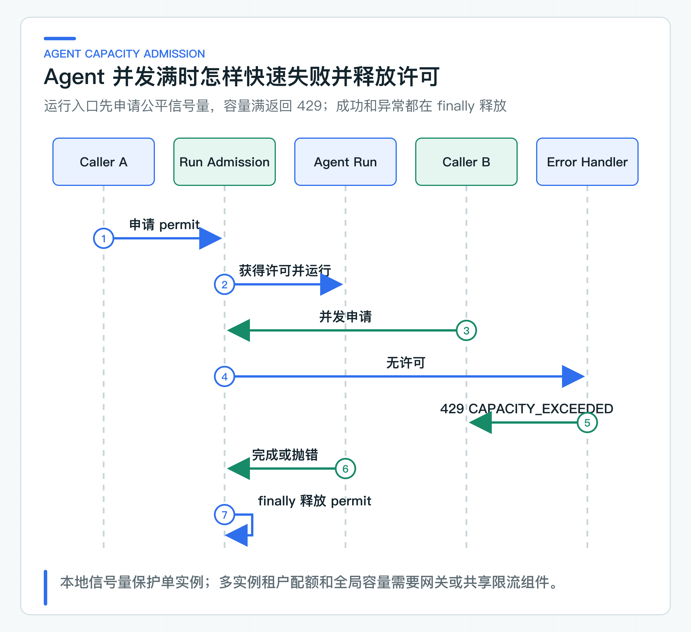
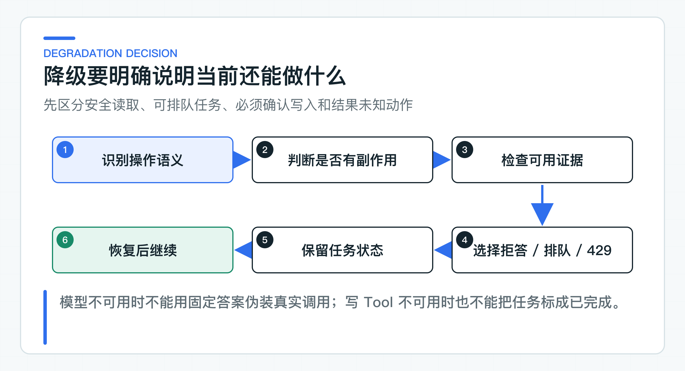

# 缓存、熔断、限流和降级：只保留业务真正需要的部分

项目准备上线时，架构图上很容易同时出现 Redis、Resilience4j、Sentinel、消息队列、网关限流和模型网关。组件越列越多，真正需要回答的问题却是：模型读取失败能不能重试，SSE 已经输出一半怎么办，退款调用超时又能不能再发一次。

这些操作的失败语义不同，不能共用一套“重试三次、失败降级”的模板。是否有副作用、能否幂等、结果是否确定、是否允许旧数据，都会改变超时、缓存和恢复策略。

项目只实现当前链路用得到的控制。Knowledge 的同步模型端口管理超时、并发、断路器和安全读重试；断路器是在远程依赖持续失败时暂时停止新调用，避免故障继续放大。Customer BFF 限制咨询流量；Ticket Agent 限制并发任务和步数，并把远程写超时保留为 `UNKNOWN`。流式回答另有边界，不能直接套用同步配置。

## 先区分四类操作语义

**1. 知识与模型读取。** 同步知识回答没有业务写副作用，可以设置超时、并发上限和断路器。当前模型适配器只对 Provider 5xx 或网络 I/O 异常重试一次；开始 SSE 输出后不能重试，否则客户端会收到重复片段。

当前 SSE 链路在 BFF 设置了 30 秒空闲超时和 2 分钟总时长上限。连续 30 秒没有收到任何事件会判定连接失活；即使 heartbeat 一直存在，超过 2 分钟仍会结束。BFF 客户端会保留取消信号，Knowledge Service 也会把这个信号传给模型流。这些行为由各自的单元测试固定，尚未做跨服务断开集成测试。

这 2 分钟是 BFF 对单段下游流的保护，并不是贯穿浏览器、BFF、Knowledge Service 和 Provider 的共享截止时间。流式适配器也没有复用同步端口的 Bulkhead、CircuitBreaker、30 秒整轮截止时间和受控重试。因此，现有实现能限制停滞连接和单段流时长，但流式容量控制还不完整。

**2. Agent Run。** 一次 Run 可能包含多次模型与查询 Tool 调用，会占用线程、连接和 Token。当前代码限制同时运行的任务数和最大步数，并允许查询任务状态。容量满时快速返回 429，比让请求在服务器排队到超时更可控。端到端总时间预算仍是生产接入时要补的能力。

**3. 确认写入。** 确认请求依赖任务版本和 Idempotency-Key。客户端关闭自动重试；超时后保留原 Key 查询任务。409 表示版本或幂等冲突，不应自动重试。

**4. Legacy Tool。** 最终写操作依赖 actionId 和下游幂等。5xx、超时和协议损坏进入 `EXECUTION_UNCERTAIN`，先查询或对账。通用 Retry 无法决定业务是否已经发生。

同一个“远程调用失败”在四类操作中含义不同，因此配置也不能共用。

## 在 Agent Run 入口控制并发

[SemaphoreAgentRunAdmission](https://github.com/DavidDingXu/learn-java-ai/blob/main/learning-stages/stage-05-controlled-agent/services/ticket-agent-service/src/main/java/com/xiaoding/javaai/ticket/agent/application/SemaphoreAgentRunAdmission.java) 使用公平 Semaphore 限制单实例同时运行的 Agent 数量。Controller 在身份与任务运行路径外层申请许可，容量满抛出 `AgentCapacityExceededException`，异常处理器返回：

```text
HTTP 429
code = AGENT_RUN_CAPACITY_EXCEEDED
```



许可在 `finally` 中释放，Planner 或 Tool 抛异常也不会永久吃掉容量。测试同时覆盖并发拒绝和异常后恢复。

单实例 Semaphore 不解决多实例全局配额，也不提供租户公平。生产可以在网关或共享限流系统增加每租户、每调用方和全局预算；服务内门禁仍可保护单实例资源。两层配额要避免重复排队，优先快速拒绝并给出合理重试提示。

`max-concurrent-runs` 不能凭经验填 100。它取决于模型延迟、每任务步数、HTTP 连接池、实例内存、下游容量和目标 SLO。SLO 是团队承诺的服务目标；p95 延迟表示 95% 的请求会在这个时间内完成。通过压测找到吞吐与 p95 的拐点，再留出故障余量。

### 步数预算与时间预算不同

`maxSteps=4` 限制 Agent 规划轮次，防止逻辑循环。它不能替代总时间预算：一次 Tool 等待 30 秒，4 步仍可能超过两分钟。

生产 Run 应有端到端 deadline，并把剩余预算传给模型和 Tool 适配器。每层 timeout 逐级缩短，保留状态更新和响应时间。超过预算时，任务应停在可继续或明确失败的状态，不能让后台线程无限运行。

SSE、同步回答和后台 Agent 的预算也不同。同步 C 端回答偏向短延迟；工单 Agent 可以异步排队，但用户要能查询任务状态。

## 重试共享同一总时间预算

假设 BFF、Knowledge Service 和模型 SDK 各自最多尝试 2 次，最坏可能形成 8 次模型调用。Agent 又有多步，成本会继续放大。

每条调用链应选一个理解业务语义的重试所有者，并记录最大总尝试次数。配套 Knowledge 同步模型端口在适配器内最多尝试 2 次，两次尝试共享 30 秒总预算。OpenAI Java SDK 的 `max-retries` 设为 0，避免两层重试叠加。

Resilience4j 在这条链路上只承担 Bulkhead 和 CircuitBreaker，也不覆盖流式适配器。Ticket Agent 没有应用层模型重试，同样把 SDK 重试设为 0。是否重新运行整个任务，要由任务状态和业务规则决定。

明确不重试：

- 400 参数错误；
- 401/403 身份权限错误；
- 409 状态或幂等冲突；
- 已经开始输出的 SSE；
- 结果未知的写操作；
- 业务系统明确拒绝。

当前 Knowledge 同步模型调用只对 Provider 5xx 和网络 I/O 异常重试一次，429 会直接返回限流错误。调用方是否稍后发起新的请求，还要看 Retry-After、总预算和幂等；写请求始终复用原 Key。

### 断路器包住外部模型端口

Knowledge Service 的断路器绑定同步 `KnowledgeAnswerModel`，保护模型 Provider。它不会把 RAG、Tool 和 Agent 全部压进一个名为 `aiGateway` 的断路器，也不会自动保护 `KnowledgeAnswerStreamModel`。

断路器适合阻止持续调用已经明显失败的远程依赖。阈值要基于样本数和窗口，不应因为低流量下两次失败就长时间打开。不同 Provider、模型和业务用例可以有独立实例。

远程写 Tool 可以有连接保护，但断路器打开时仍需明确当前动作是否尚未发送。已经进入 `EXECUTING` 后才发现断路器拒绝，若能确定没有调用下游，可以标为失败或回到等待；如果状态不清楚，仍要按 UNKNOWN 处理。简单注解很难表达这类细节。

## 只缓存可明确复用的数据

适合缓存的内容通常具备稳定版本和明确权限：

- 已发布 Prompt 模板；
- 模型能力与价格配置；
- 文档元数据和不可变版本；
- 权限范围内的短期只读查询；
- Token Exchange 结果，且缓存键包含主体、audience、scope 与到期时间。

谨慎或禁止缓存：

- Agent Task 当前状态；
- 待确认动作；
- 退款或订单最终状态；
- 跨租户 RAG 结果；
- 包含 PII 的模型回答；
- `EXECUTION_UNCERTAIN` 的推测结果。

缓存键必须包含所有影响结果的维度。知识回答若与 tenant、subject、部门、文档版本和 Prompt 版本有关，少一个维度都可能泄露或返回过期答案。很多场景下不缓存比设计错误缓存更便宜。

## 降级结果如实表达能力缺失



模型不可用时，可以返回明确“当前智能回答暂不可用”，提供人工入口或稍后重试。不能返回固定政策答案假装真实模型已调用，因为政策可能过期、权限也未校验。

Knowledge 检索可用但生成模型不可用时，是否展示引用列表取决于产品设计。可以提供“相关制度条款”而不生成结论，但必须标明没有完成回答。

Agent 容量满时返回 429 并保留已创建任务，后台或调用方稍后运行。高风险 Tool 不可用时任务不能标成 COMPLETED，应保持可恢复状态或明确失败。

Legacy Tool 结果未知时不做降级写。任何“先告诉用户成功，后台慢慢补”都需要最终业务系统具备可靠的异步处理、补偿和对账机制，不能由模型文案替代。

### 在渠道、模型与任务三层限流

一条完整链路可能需要：

- 网关：IP、客户端和全局保护；
- Customer BFF：每租户、每客户的咨询频率；
- Knowledge：模型并发与 Provider 配额；
- Ticket Agent：Run 并发和任务创建配额；
- Tool：每动作类型、员工和业务对象限制；
- Provider：官方 RPM/TPM 配额。

每层解决不同资源。不要在每层都排队，长队会把压力变成延迟和超时。服务内门禁优先快速拒绝，队列只用于明确异步任务，并有最大长度、租约和死信。

配套 BFF 的进程内固定窗口限流与 Ticket 的 Semaphore 都能在单实例中运行。多实例生产需要共享限流或网关能力，但服务内仍要保护连接池与线程。

### 区分 429、503 与业务拒绝

当前项目的 429 表示 BFF 入口限流、模型并发已满或 Agent Run 容量不足。Provider 返回的 429 不会原样透传，而是转换为 503 `MODEL_RATE_LIMITED`，表示模型能力当前不可用。409 表示状态或幂等冲突，需要刷新或修正；其他业务 4xx 表示最终系统明确拒绝动作。调用方可以根据稳定错误码决定是否稍后发起新请求，服务内不会立即重试 Provider 429。

错误码要稳定，例如：

```text
AGENT_RUN_CAPACITY_EXCEEDED
AGENT_CAPABILITY_UNAVAILABLE
AGENT_TASK_VERSION_CONFLICT
IDEMPOTENCY_CONFLICT
```

客户端根据 code 决定刷新、重试、人工处理或停止，不能解析自然语言 message。

## 故障发生时怎样观察保护策略

`ModelResilienceContractTest` 和 `TicketAgentModelConfigurationTest` 检查两条模型链路的重试配置。

`ProviderProtocolFixtureTest` 启动真实 Spring 上下文和本地模拟 Provider。它验证 503 最多重试一次、429 不重试、慢响应只调用一次，也检查 Provider 异常不会原样返回给调用方。其余测试分别检查并发拒绝、错误映射、流空闲超时和取消传递。

当前还没有覆盖断路器从关闭到打开、半开再恢复的完整状态变化，也没有跨服务验证 SSE 断开后的取消传播。

Agent Run 的 429 已进入 OpenAPI。公司接入网关后，还要验证 Retry-After、租户配额、实例扩缩容和下游容量，不应只用单元测试推断生产吞吐。

## 用目标流量确定生产参数

先用目标流量和真实延迟分布压测，再确定并发、队列、超时和断路器。记录实例规格、模型、数据集、请求比例、p50/p95/p99、错误率、Token 和下游限制。

超时还要按端到端预算倒推，不能让网关、BFF、知识服务和模型客户端各自设置同一个数值。若用户请求总预算是 10 秒，外层必须为错误映射、连接释放和响应传输保留时间，内层模型调用只能使用其中一部分。重试会消耗第二份预算，因此每次尝试的超时、最大次数和总截止时间必须一起设计；否则上游已经放弃请求，下游仍在占用线程、连接和 Token。

故障演练至少包括模型 429、模型 5xx、Knowledge 超时、Agent 容量满、确认重复、Legacy Tool 超时和恢复查询。观察任务状态、指标和用户提示是否一致。

组件数量不会自动带来可靠性。每项控制都要说清“保护什么资源、适用哪种操作、失败后进入什么状态”，这些规则才有可能长期维护。

---

[课程首页](../../README.md) · [完整目录](README.md) · [← 观测做到什么程度才够用：Trace、Correlation、Metric、日志和成本](36-observability.md) · [项目配置实战：让默认配置跑通，再按需替换基础设施 →](38-runtime-configuration.md)

动手实践：[本阶段可运行源码](../../learning-stages/stage-06-production-readiness/README.md)
