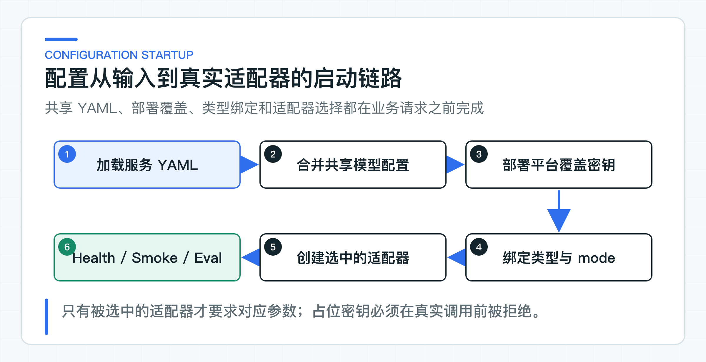

# 项目配置实战：让默认配置跑通，再按需替换基础设施

一个 Java 项目如果刚启动就要求准备模型、数据库、身份平台、缓存和消息队列，很多时间会消耗在环境排查上。但为了方便启动，把模型、数据库和下游调用全部换成固定返回值，也会让“接口成功”失去意义。

更实用的做法是先确定一条真实、足够短的默认链路：模型调用使用真实 Provider，服务之间走真实 HTTP；身份和状态类能力先用本地实现。学到完整 RAG 时，再加入 PostgreSQL 和 Embedding；接入公司系统时，只替换相应适配器，不重新维护一套运行模式。

## 一条默认链路跑通三个服务

配套项目只有一套面向本地运行的默认配置：

- Knowledge Service 使用固定身份和 classpath 上下文，调用真实 Chat Provider；
- Ticket Agent 使用内存任务、确认和审计，通过 HTTP 调用 Knowledge Service，写操作由幂等的内存 Tool 执行；
- Customer BFF 使用固定客户身份和本地委托令牌，通过 HTTP 调用 Knowledge Service 与 Ticket Agent；
- 自动化校验使用独立配置，不会替换默认运行时的真实模型和跨服务 HTTP。

这条链路有两个重要边界。第一，固定身份和内存状态降低的是本地依赖数量，不会替代模型响应或跨服务调用。第二，进程内状态只能验证领域规则，不能证明重启恢复和多实例并发已经满足生产要求。

第一次运行先复制根目录的 [config/application-default.example.yml](https://github.com/DavidDingXu/learn-java-ai/blob/main/config/application-default.example.yml)，并命名为被 Git 忽略的 `config/application-default.yml`。再填写模型 API Key：

```yaml
spring:
  ai:
    model:
      chat: openai
      embedding: openai
    openai:
      api-key: replace-with-your-api-key
      base-url: https://api.openai.com/v1
      chat:
        model: gpt-4.1-mini
      embedding:
        model: text-embedding-3-small
```

使用 OpenAI 兼容服务时，再调整 `base-url` 和模型名。Knowledge Service 与 Ticket Agent Service 会自动读取这份共享配置，不需要额外设置环境变量。

在 IDE 中先运行 `KnowledgeServiceApplication.main()`，再运行 `TicketAgentServiceApplication.main()`。最后运行 `CustomerBffApplication.main()`。默认端口依次是 8081、8082 和 8080。

三个进程启动后，先检查各自的 `/actuator/health`，再从 8080 的客户回答接口发起请求。这样能观察 BFF 会话、委托身份、Knowledge HTTP 调用和真实模型响应。将未解决的 attempt 升级后，还能观察 Ticket Agent 的任务接收和状态变化。

## 完整 RAG 只增加必要组件

classpath 上下文可以先讲清 Prompt、结构化输出、流式交互和错误处理，但它不等于向量检索。要验证完整 RAG，还需要文档入库、Embedding、TopK 前 ACL、pgvector 检索、引用映射和最终回答。

本地完整 RAG 需要准备：

- 安装了 `vector` 与 `pg_trgm` 扩展的 PostgreSQL；
- 能返回 1536 维向量的 Embedding Provider；
- 用于生成最终回答的 Chat Provider；
- 至少一份可上传、发布和索引的测试文档。

Redis、Kafka、MinIO、Query Rewrite 和 Rerank 都不是首次联调的前置条件。原文先写入本地文件目录，身份继续使用固定的 `tenant-a / local-user / support`。

只需把 Knowledge Service 的模式与数据库连接改为：

```yaml
java-ai:
  knowledge:
    mode: postgres-rag
    postgres:
      jdbc-url: jdbc:postgresql://localhost:5432/java_ai_knowledge
      username: java_ai_knowledge
      password: replace-with-your-database-password
```

Flyway 会创建业务表并尝试启用两个扩展，所以首次运行的数据库账号需要迁移权限。当前向量列定义为 `vector(1536)`；如果 Embedding 模型输出维度不同，应该建立新的索引版本并重新回填，而不是只改模型名。

## 本地实现与公司实现共用业务接口

项目没有一个“切到生产”的总开关。数据库、身份、服务令牌和远程 Tool 的上线条件不同，把它们绑进一个 Profile，反而很难判断当前真正启用了什么。

更清晰的方式是按能力替换适配器：

| 能力 | 本地默认 | 需要替换的场景 |
|---|---|---|
| 入站身份 | 固定身份 | 接入公司 JWT、网关身份或权限服务 |
| BFF 身份委托 | 本地短时令牌 | 接入 OAuth2 Token Exchange 或公司服务身份 |
| Knowledge 上下文 | classpath | 验证文档写入与真实 RAG |
| Agent 状态 | 进程内存储 | 验证重启恢复、多实例与并发写入 |
| Knowledge Tool | HTTP | 默认已经调用真实 Knowledge Service |
| 写 Tool | 幂等内存实现 | 有可调用的 Legacy Tool 和服务令牌后 |
| 原文、会话、限流 | 本地或进程内 | 多实例部署与容量验收前 |

业务层只依赖稳定接口。例如 Knowledge Controller 依赖 `KnowledgeAccessScopeProvider`，不直接读取某一种 JWT 字段。Ticket Agent 的确认流程依赖 Tool 执行接口，不关心执行发生在内存还是远程系统。这样替换基础设施时，权限、幂等和审计规则不需要重写。

### 接入公司身份

项目提供 JWT 适配器。Knowledge Service 和 Ticket Agent Service 可以将身份模式改为 `jwt`：

```yaml
java-ai:
  security:
    mode: jwt
    jwt:
      issuer: https://identity.example.com
      audience: knowledge-service
      jwk-set-uri: https://identity.example.com/.well-known/jwks.json
```

Customer BFF 使用自己的 audience。公司如果采用网关身份、Session 或内部权限服务，可以实现同一个身份接口，不必为了使用 RAG 强行引入 JWT。

### 接入服务身份委托

Customer BFF 默认生成短时本地委托令牌，让跨服务调用在没有身份平台时也能完整发生。公司提供 OAuth2 Token Exchange 后，再切换委托方式：

```yaml
java-ai:
  identity:
    delegation-mode: oauth2
    token-endpoint: https://identity.example.com/oauth2/token
    client-id: customer-bff
    client-secret: replace-with-secret-manager
```

BFF 仍然需要分别申请面向 Knowledge 和 Ticket 的最小权限令牌，不能把客户 Token 原样转发给所有下游。

### 持久化 Agent 状态

默认内存实现可以验证任务状态机、人工确认、幂等键和审计记录。要验证进程重启和多个实例争用同一任务，需要把 Ticket Agent 切换到独立 PostgreSQL：

```yaml
java-ai:
  persistence:
    mode: jdbc
    jdbc:
      url: jdbc:postgresql://localhost:5432/java_ai_ticket
      username: java_ai_ticket
      password: replace-with-your-database-password
```

有真实 Legacy Tool 后，再把 `java-ai.agent.write-tool.mode` 改为 `http`，填写下游地址，并接入公司的服务令牌实现。远程写操作还必须验证超时后的未知结果对账，不能只看一次成功响应。

## 配置加载顺序必须可预测



Spring Boot 会把多个 Property Source 合并为最终 Environment。配套项目采用三层来源：

1. 服务自己的 `application.yml` 定义端口、超时、适配器选择和非敏感默认值；
2. 根目录 `config/application-default.yml` 保存所有阶段共享的读者配置；
3. 部署平台在目标环境覆盖数据库密码、API Key、JWT 材料和客户端密钥。

Knowledge Service 和 Ticket Agent Service 同时声明了从项目根目录和模块目录启动时的可选导入路径。因此直接在 IDE 中运行启动类，也能找到同一份共享模型配置。

配置加载完成后，应用先绑定参数，再根据明确的 `mode` 创建适配器。`postgres-rag` 才创建数据库、Flyway 和检索组件，`jdbc` 才创建 Ticket Agent 的持久化仓储，`jwt` 才启用 JWT 校验。没有被选中的占位地址不会提前建立连接。

这种设计比一个大而全的环境 Profile 更容易排错。`java-ai.persistence.mode=memory` 表示任务不会写入数据库。`java-ai.agent.write-tool.mode=http` 表示还要检查下游地址和服务令牌。每个配置值都能直接对应实际创建的 Bean。

## 默认值只留给非敏感参数

端口、TopK、超时、重试次数和本地目录可以提供默认值，因为它们不会携带身份或直接授权外部访问。模型地址和公开模型名也可以提供本地默认值，但不能代表公司的最终选型。

API Key、数据库密码、JWT 私钥和 OAuth2 客户端密钥不能拥有可用的仓库默认值。项目保留 `replace-with-your-api-key` 和 `replace-with-secret-manager` 这类不可用占位值，让缺失配置在调用前暴露，同时避免真实凭证进入版本历史。

把个人 API Key 写进被 Git 忽略的本地 `application-default.yml` 是为了减少配置步骤，不是生产密钥管理方案。公司环境应由 Secret Manager、Vault 或部署平台 Secret 覆盖相同配置键，并确保日志和评测报告不输出凭证。

还有一类风险不是密钥泄露，而是假成功。模型未配置时返回固定退款答案，或者远程 Tool 未接入时直接返回“工单已创建”，都会让接口看似跑通，实际链路没有发生。配套项目的确定性模型只存在于测试配置；默认运行使用真实 Chat Provider，内存写 Tool 也会执行幂等和冲突校验，不会跳过业务规则。

## 直接运行和目标环境回答不同问题

只启动 Knowledge Service，可以确认当前模型地址、协议与回答映射是否可用，却看不到 pgvector、ACL 和跨服务身份。完整 RAG 还要上传文档、发布 ACL、执行索引，再检查回答与引用；Agent 上线还要连接真实 Tool，验证持久化、并发、超时对账和恢复。

| 验证 | 能回答的问题 |
|---|---|
| 直接调用 Knowledge Service | 当前模型地址、协议和响应映射是否可用 |
| 完整 RAG 联调 | 文档、Embedding、ACL、检索、引用和回答能否连通 |
| 三服务联调 | 会话、身份委托、Knowledge Tool 和工单转交是否连通 |
| 目标环境验收 | 公司身份、数据库、真实 Tool、容量和回滚是否满足上线条件 |

这些结果不能互相替代。单次模型回答正确，不代表权限、持久化和 Tool 副作用可以上线。

## 把配置项控制在真实需要的范围内

配置不是越集中越好，也不是越多越专业。一个配置项应该能对应到真实代码、明确的调用方和可验证的行为。

例如项目已经有本地文件对象存储，所以只配置本地目录。等接入 S3、OSS、COS 或公司对象存储时，再增加 endpoint、bucket、region 和凭证。没有实现 Redis、Kafka 或 MinIO 适配器之前，提前列出这些参数只会让人误以为组件已经接入。

接入公司项目时，可以按下面的顺序检查：

1. 当前要验证的业务链路依赖哪些组件；
2. 每个 `mode` 实际选择了哪个 Bean，失败由谁处理；
3. 占位值是否会在建立连接或执行请求前被拒绝；
4. 密钥是否由部署平台注入，日志和报告是否完成脱敏；
5. 本地内存实现是否在多实例部署前替换；
6. 数据库迁移、Embedding 维度和下游协议是否经过真实环境验证；
7. 回滚依据来自代码回归、模型评测还是目标环境验收。

配置的目的，是让默认链路只依赖当前实际使用的组件，并让公司环境中的每次替换都有清晰边界。先跑通真实模型和跨服务调用，再逐项加入 PostgreSQL、身份平台和远程 Tool，问题会更容易定位。

---

[课程首页](../../README.md) · [完整目录](README.md) · [← 缓存、熔断、限流和降级：只保留业务真正需要的部分](37-production-resilience.md) · [上线前最后核对什么：测试、Eval、密钥配置、发布和回滚 →](39-release-checklist.md)

动手实践：[本阶段可运行源码](../../learning-stages/stage-06-production-readiness/README.md)
