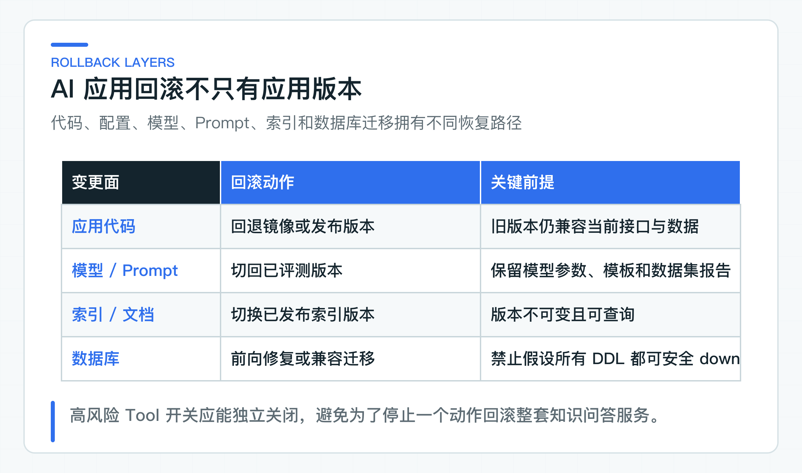

# 上线前最后核对什么：测试、Eval、密钥配置、发布和回滚

一次 AI 应用发布可能同时改了 Prompt、模型名、数据库迁移和 JDK8 接口。普通单测全绿，旧 Golden Set 却没有重跑；写 Tool 已经打开，远程超时后的 `UNKNOWN` 对账仍未准备。此时“代码能构建”离“可以上线”还有明显距离。

项目把构建、接口兼容、安全、Eval、环境、迁移和回滚整理成可执行门禁。每项结果都对应同一个代码版本，并明确验证环境和数据。Go 表示允许发布，No-Go 表示当前停止；任何关键项缺失都应得到 No-Go。

仓库提供跨平台 `release-gate`，运行构建、接口契约测试、Java 8 客户端、框架实验和敏感信息扫描。这里使用 Shell 和 PowerShell，是因为发布门禁要聚合 Java 21、Java 8、Node 和 Git 检查；它不是 Java 应用的启动方式。

真实模型、RAG、Agent 与安全 Eval 使用不同数据集和身份，仍由各自入口执行，不把一种“测试通过”泛化成所有层都通过。

## release-gate 覆盖的检查范围

macOS/Linux：

```bash
bash scripts/release-gate.sh
```

Windows PowerShell：

```powershell
.\scripts\release-gate.ps1
```

脚本会自动寻找本机安装的完整 JDK 21+ 和 JDK 8，然后依次覆盖：

- Node 项目约束检查；
- Java 21 主 reactor；
- 独立 framework labs；
- 真实 JDK8 客户端；
- OpenAPI、JSON Schema 和架构边界；
- tracked/untracked 文件高置信密钥扫描；
- 可选外部 health 检查。

代码进入 Pull Request 后，[Dependency Review 工作流](https://github.com/DavidDingXu/learn-java-ai/blob/main/.github/workflows/dependency-review.yml) 还会检查本次依赖变更，新增高危漏洞时阻止合并。它只守住“新增问题”，不代替组织对存量依赖、容器镜像和运行环境的软件成分分析（Software Composition Analysis，SCA）。

脚本没有自动调用所有真实模型和写 Tool，因为生产凭证、数据集和副作用环境不同。发布流水线应按产品范围组合对应 Eval。

### 外部健康检查与业务验证分开

要检查已部署服务是否存活，可以直接访问目标环境的 health 接口：

```bash
curl --fail https://test.example.com/actuator/health
```

Windows PowerShell：

```powershell
Invoke-WebRequest https://test.example.com/actuator/health
```

在发布流水线中，目标地址应由环境配置统一提供，本地运行不需要准备发布变量。health 通过只证明一个服务进程当前返回 UP，不能代替模型、数据库、RAG 和 Agent 验证。

完整发布通常还要运行真实模型回答评测、检索评测、Agent 路径评测和安全回归。对应的 `run-*` 脚本只是流水线聚合入口，底层仍然执行 Maven 或 Java 评测程序。

每个报告绑定相同候选 Commit、数据集版本和环境。若报告来自不同提交，不能放在一起作为本次发布结果。

## 分层理解测试通过的含义

发布至少检查四层，每一层回答的问题不同：

| 层次 | 主要检查内容 | 能回答的问题 |
| --- | --- | --- |
| 单元与领域规则 | 状态机、参数校验、权限映射、幂等、确认、结果分类和指标标签 | 单个业务规则是否按预期执行 |
| 接口契约与兼容性 | OpenAPI、JSON Schema、错误码、SSE 事件、Java 8 DTO 和 breaking change | 调用方能否继续按原有契约接入 |
| 集成 | IdP、PostgreSQL/pgvector、对象存储、模型 Provider、Knowledge、Ticket Agent 和 Legacy Tool 沙箱 | 服务与真实依赖能否协同工作 |
| 质量与安全 | 模型 Golden Set、RAG Recall/HitRate/MRR、Agent 路径、安全回归和坏案例 | 非确定性输出和高风险路径是否达到发布阈值 |

不能用大量单元测试数量代替真实集成，也不能用一条端到端成功掩盖领域规则缺少回归。

## 配置、密钥与数据库发布检查

### 版本与配置核对

发布记录要明确：

- Java、Spring Boot、Spring AI 与 Provider 适配版本；
- 模型、Embedding、Rerank 的准确名称；
- Prompt 版本和输出 Schema；
- Golden Set 版本；
- 数据库迁移版本；
- 索引和知识文档版本；
- Tool Catalog 与风险策略版本；
- 功能开关默认值；
- timeout、并发、步数和配额。

使用“latest”或供应商默认模型会让回滚失去目标。本项目使用 Spring AI 2.0.0 和 Boot 4.1.0；准备升级时仍要核对官方稳定版本，并完成回归，不能只改版本号。

### 密钥扫描覆盖当前 Git 仓库

密钥可能存在未跟踪文件、生成报告、日志和构建脚本。release gate 扫描 tracked 与 untracked 非忽略文件中的高置信 API Key 和私有 Provider 地址。

生产凭证必须来自公司密钥系统，至少区分环境和服务。模型 API Key、数据库密码、JWT 客户端密钥和对象存储密钥不能共用。

还要检查：

- 日志与 Trace 是否打印 Authorization；
- CI 输出是否回显环境变量；
- 错误报告是否包含私有 URL；
- 本地 `application-default.yml` 是否已被 Git 忽略，示例配置是否只保留占位密钥；
- 密钥轮换和撤销责任人；
- 旧版本回滚是否仍能读取新密钥配置。

一旦密钥曾进入 Git，仅删除当前文件不够，应立即撤销并按公司流程清理历史与审计影响。

### 数据库迁移保持向前兼容

滚动发布期间，新旧应用可能同时运行。数据库变更优先采用 expand/contract：先增加兼容字段或表，新旧版本都可运行；应用切换完成后再清理旧结构。

AI 项目还要考虑向量维度、Embedding 模型和索引版本。更换 Embedding 不能直接覆盖旧向量，应建立新索引版本，完成回填与评测后切换读取，再退役旧版本。

Flyway 是结构来源，生产执行前在同版本数据库快照上演练。不要默认所有 DDL 都能安全 down migration；很多场景应使用前向修复。

任务、确认和审计表的迁移必须保持状态可读。回滚应用后若无法识别 `EXECUTION_UNCERTAIN` 等新枚举，会让高风险动作失去恢复入口。

### 功能开关按独立能力拆分

至少分开：

- C 端 AI 回答；
- RAG 检索或特定知识域；
- Agent 自动运行；
- 每个高风险写 Tool；
- 新模型或新 Prompt；
- 新索引版本。

高风险 Tool 应默认关闭，经过共享环境、审批和沙箱验证后逐步打开。开关判断必须在服务端，不能只隐藏前端按钮。

开关关闭后，系统要明确说明哪些功能不可用、哪些功能仍可使用：禁用 Agent Run 可以保留工单人工处理，禁用退款 Tool 不应影响知识查询。拆分开关可以降低回滚范围。

## 为代码、模型和数据分别准备回滚



AI 应用的不同资产不能共用一个“回退版本”按钮。发布前应分别确认回滚目标和成立条件：

| 回滚对象 | 回滚方式与前提 |
| --- | --- |
| 应用代码 | 回退镜像或版本，前提是旧应用兼容当前数据库结构和对外接口 |
| 模型与 Prompt | 切回已评测的模型、参数和 Prompt 版本；模型供应商可能不再提供旧模型，要预先确认可用期和替代路线 |
| 索引与文档 | 切换到之前已发布的索引版本和文档版本；不可变版本让回滚可查询，直接覆盖向量和文档会失去依据 |
| 数据库 | 优先前向修复或兼容迁移；涉及数据删除和不可逆转换时，发布前必须备份、演练并明确恢复时间 |
| Tool 能力 | 独立关闭风险工具，保留人工流程和结果查询；已经执行的业务动作需要业务补偿或对账，不能靠应用回滚撤销 |

## 用可核对事实做 Go/No-Go 决定

Go/No-Go 决策至少需要下面四类事实：

| 决策维度 | 发布前必须确认的事实 |
| --- | --- |
| 质量 | 目标数据集达到分组阈值，高风险案例无新增失败；模型、RAG 和 Agent 报告属于当前 Commit |
| 安全 | 身份、ACL、PII、Injection、Tool 越权和密钥扫描通过；依赖变更没有引入高危漏洞，目标流水线的完整 SCA 也达到公司阈值；生产写凭证没有进入自动 Eval |
| 运维 | Dashboard、告警、Runbook、SLO、容量、值班和责任人就绪；429、503、UNKNOWN 和任务积压都有处理流程 |
| 恢复 | 功能开关、UNKNOWN 对账、数据库兼容、索引切换和回滚演练完成；回滚耗时满足业务要求 |

任何一类缺失都应记录风险接受人和截止时间。不能让“技术负责人觉得问题不大”替代正式决定。

Go/No-Go 会议使用的报告、阈值、异常说明和批准记录要按公司审计周期保留。链接失效或报告被覆盖后，团队将无法解释当时为何允许上线，也无法判断下一次相似风险是否已经被接受过。

### 按依赖关系安排发布顺序

推荐渐进发布：

1. 只部署代码，所有新能力关闭；
2. 内部 tenant 开启知识读取；
3. 小流量开启新模型或 Prompt；
4. 开启 Agent 只读 Tool；
5. 开启 LOW/MEDIUM 写 Tool 和人工确认；
6. 高风险 Tool 在业务审批与对账就绪后单独开启；
7. 观察 SLO、质量和安全指标，再扩大租户与流量。

每一步都有停止和回退条件。不要把模型、索引、Agent 和高风险 Tool 放在同一次全量发布中，否则指标变化后无法判断是哪项改动造成。

发布窗口开始后应冻结候选 Commit、Prompt、模型配置和数据集。临时修改任何一项，都要重新生成受影响的报告；不能继续沿用修改前的截图或通过率。紧急修复也要记录变更人、原因、验证范围和回滚点，让值班人员知道线上实际运行的组合。

## 发布后重点观察的信号

重点观察：

- 模型错误、延迟、首个流式片段耗时（Time to First Token，TTFT）和 Token；
- RAG 空召回、拒答和引用异常；
- Agent step、429、工具分布和确认等待；
- Tool rejected/uncertain；
- 幂等冲突和重复任务；
- 业务转人工率与处理时长；
- 安全拒绝和跨租户访问告警；
- UNKNOWN 的数量、持续时间和最终对账结果。

告警触发后按 Runbook 操作，必要时先关闭高风险 Tool，再调查模型和业务系统。避免在事故中临时决定幂等或对账方式。

## 目标环境仍需完成的验证

`release-gate` 会构建主 reactor、框架与协议 labs、JDK8 客户端，并检查对外接口定义和敏感信息。真实模型评测由独立的 Maven/Java 任务运行，流水线聚合脚本只负责传入目标环境参数。缺少密钥时必须直接失败，不能用固定响应代替在线结果。

代码回归通过不证明生产数据库、IdP、对象存储、Legacy Tool 和容量已就绪。Ticket Agent 默认使用进程内存储，将 `java-ai.persistence.mode` 改为 `jdbc` 后才使用 PostgreSQL/Flyway 保存任务、确认、执行状态和审计。公司发布仍要在目标数据库上验证迁移、连接池、并发领取、备份恢复和容量，进程内实现不能承载多实例写 Tool。

上线检查要留下可追溯的测试和评测结果，明确风险负责人，并准备实际可执行的回退路径。正式服务稳定后，可以在隔离 labs 中逐项替换 Provider、检索、编排框架和协作协议，确认它们能否继续使用现有业务接口与规则。第一项从影响面最窄、也最常见的模型 Provider 替换开始。

---

[课程首页](../../README.md) · [完整目录](README.md) · [← 项目配置实战：让默认配置跑通，再按需替换基础设施](38-runtime-configuration.md) · [DashScope Provider 适配实验：配置隔离、响应差异和回归边界 →](40-dashscope-provider-replacement.md)

动手实践：[本阶段可运行源码](../../learning-stages/stage-06-production-readiness/README.md)
