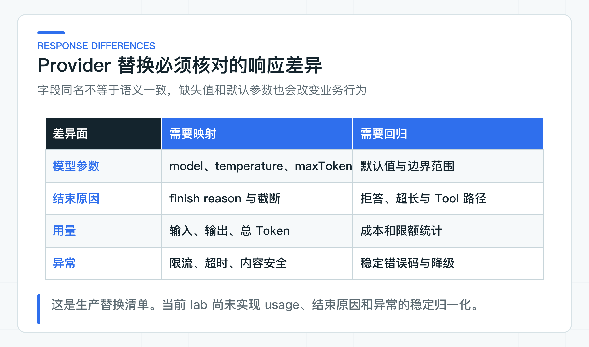

# DashScope Provider 适配实验：配置隔离、响应差异和回归边界

当业务方提出“把模型切到 DashScope”时，第一反应通常是改 `base-url`、`api-key` 和 `model`。Provider 指模型服务商及其 API 实现。实际联调会发现，参数默认值、Token 统计、结束原因、异常、Tool Calling 和流式事件都可能出现差异。业务代码如果直接返回供应商对象，改动很快会扩散到 Controller 和 BFF。

这次实验只替换知识回答用例的模型适配器。上层仍调用“依据制度回答问题”的业务端口，再用相同问题、Prompt、阈值和校验规则比较结果。范围足够小，变化来自哪里也更容易判断。

Spring AI Alibaba 实验放在独立 labs reactor 中，不与正式服务的依赖混编。这样可以真实使用框架类型，又不会为了一个 Provider 实验改动主项目基线。

## 先固定业务接口与校验规则

模型供应商可以替换，业务规则不能跟着改变。对知识回答用例来说，以下内容应保持不变：

- 输入仍然是受信系统规则、已授权知识上下文和用户问题；
- 对外仍然返回项目自己的答案与模型信息，不能暴露供应商响应类型；
- 身份、ACL、引用成员校验和内容安全仍由服务端控制；
- 超时、并发、降级和 Eval 阈值仍属于该业务用例；
- Controller、BFF、JDK8 客户端和 OpenAPI 不感知 Provider 类型。

需要重新适配的内容包括模型名、参数范围、默认值、响应元数据、限流错误、流式行为和供应商特有能力。这些差异应限制在基础设施适配器与配置中。

配套代码中的 `DashScopeProviderAdapter` 接收 Spring AI 的 `ChatModel`，对外返回项目自己的 `ProviderAnswer`。调用方不会拿到 `DashScopeChatOptions` 或 `ChatResponse`。当前适配器尚未转换供应商异常，异常仍会沿 `ChatModel.call` 抛出；业务服务接入前必须补上稳定错误分类。

```java
public final class DashScopeProviderAdapter {

    private final ChatModel chatModel;
    private final String modelName;
    private final double temperature;
    private final int maxTokens;

    public ProviderAnswer answer(String systemInstruction, String question) {
        DashScopeChatOptions options = DashScopeChatOptions.builder()
                .model(modelName)
                .temperature(temperature)
                .maxToken(maxTokens)
                .enableSearch(false)
                .build();

        Prompt prompt = new Prompt(
                List.of(
                        new SystemMessage(systemInstruction),
                        new UserMessage(question)),
                options);

        ChatResponse response = chatModel.call(prompt);
        Generation generation = response.getResult();
        return mapAnswer(response, generation);
    }
}
```

这里显式关闭模型内置搜索。企业制度问答已经有自己的文档、版本、ACL 和引用链路，若同时开启供应商联网搜索，答案会混入没有经过当前知识发布、权限过滤和引用校验的内容。是否启用搜索属于具体产品决策，不能因为 Provider 支持就默认打开。

## Provider 配置留在实验模块

公司项目通常至少有本地、共享测试、预生产和生产环境。每个环境都应明确以下配置：

```text
provider=dashscope
model=qwen-plus
temperature=0.2
maxTokens=512
timeout=...
apiKey=<secret reference>
```

模型名和参数可以进入受版本管理的默认配置。本地联调仍在项目根目录唯一且不会提交的 `application-default.yml` 中填写 API Key。共享测试、预生产和生产环境必须由公司密钥系统注入，不能把真实密钥带进 Git 历史、测试报告或文章命令。

配置还要区分“业务默认”和“供应商默认”。如果不显式设置 temperature，旧 Provider 可能默认 0.7，新 Provider 可能默认另一个值。代码能跑通，但回答稳定性已经变化。对需要回归的用例，关键参数必须显式锁定。

建议把 Provider 配置绑定在具体适配器上，例如 `knowledge-answer.dashscope.*`。不要创建全局 `ai.model.*`，再让 Chat、RAG、Agent 和多模态能力共用。不同用例对延迟、随机性、Token、重试和内容安全的要求并不相同。

## 逐项核对响应字段语义



生产替换至少要核对四类响应差异。配套入口已经把请求参数、消息、模型名、Token、耗时、响应 ID 和结束原因收进自有 DTO；异常分类、流式事件和 Tool 行为仍要结合目标用例补齐。

**1. 模型与结束原因**

返回的模型名可能是请求别名、实际路由版本或空值。当前适配器优先使用响应模型，缺失时回退到配置模型。

当前代码只把原始 finish reason 放进 `providerMetadata`，没有做稳定枚举归一化。生产适配器需要把它映射为正常完成、长度截断、内容安全、Tool Calling、服务端中止和未知。不能把所有非 `stop` 都当成成功，也不能让上层根据供应商字符串写分支。

**2. Token 与成本**

不同供应商可能返回输入、输出、缓存、推理或总 Token。`ProviderAnswer` 保留稳定的输入、输出、总量字段；供应商没有返回时用 `unavailable` 表达，而不是填零。缓存与推理等额外明细可以继续放进受控 metadata。计费统计仍以供应商账单口径为准，不能只依赖客户端 usage。

**3. 异常**

HTTP 429 可能代表账户限额、瞬时并发、模型级配额或组织级配额。超时也要区分连接、读取、整体调用和流式空闲。当前 lab 没有异常转换代码和故障测试。真实接入时，适配器应根据实际异常类型转换为项目稳定错误分类，再由业务用例决定是否重试、降级或拒绝。

**4. Tool 与结构化输出**

模型支持 Tool Calling，不代表工具选择和参数质量与旧模型一致。结构化输出能返回 JSON，也不代表枚举、引用和业务状态正确。Provider 替换后必须重跑 Tool 路径、参数和业务校验数据集。

## 直接使用 SDK 也要留在适配器内

直接 SDK 并非错误。以下情况可以使用：

- Spring AI Alibaba 尚未暴露业务必需的新能力；
- 供应商 SDK 能提供不可替代的流式事件或多模态数据；
- 项目愿意承担认证、序列化、异常、观测和升级适配；
- SDK 仍被封装在一个明确的基础设施适配器内。

对于标准 Chat、Embedding、Rerank 或 Tool Calling，优先使用当前框架适配可以减少自建协议代码。选型要综合能力完整性、升级成本和可观测性，不能只看代码行数。

## 用同一条件比较新旧 Provider

一条真实请求成功只证明密钥、网络和基本协议可用。可替换结论至少需要：

1. 固定 Golden Set（稳定的评测问题集）、Prompt 版本和知识版本；
2. 锁定旧、新 Provider 的模型名与参数；
3. 分别运行答案、引用、拒答、延迟和 Token 评测；
4. 按业务域和风险查看坏案例，不只看总通过率；
5. 对限流、超时、截断和内容安全做故障验证；
6. 明确切换阈值、灰度范围和回退条件。

模型输出有随机性，关键样例可重复运行多次，观察路径抖动和最差结果。不能为了让新 Provider 通过，临时修改问题或放宽所有阈值；确有标准变化时，应升级数据集版本并记录原因。

### 接入真实 DashScope 调用

单元测试中的确定性 `ChatModel` 用来验证适配器是否正确构造 Message、Options 和基础响应，不证明 DashScope 在线质量。下面的 `SpringAiAlibabaLabApplication` 是密钥门控的 Smoke 入口，只发送一条低风险固定问题：

- 在项目唯一的 `config/application-default.yml` 中填写 DashScope API Key；
- 调用一个低风险、无隐私的固定问题；
- 记录模型名、结束原因、Token、耗时和响应摘要；
- 报告不保存密钥、Authorization 或完整客户内容；
- 失败时保留供应商 request id，便于排查。

真实 Smoke 通过后仍要运行 Golden Set。Smoke 回答“能不能调用”，Eval 回答“是否适合切换”，两者不能互相代替。

## 这段适配器能回答什么

业务适配入口是 [DashScopeProviderAdapter](https://github.com/DavidDingXu/learn-java-ai/blob/main/learning-stages/stage-07-framework-boundaries/labs/spring-ai-alibaba-lab/src/main/java/com/xiaoding/javaai/labs/alibaba/DashScopeProviderAdapter.java)：它接收项目自有输入，把 DashScope Options 和框架响应类型留在适配器内。`SpringAiAlibabaLabApplication` 使用真实 `DashScopeApi` 和 `DashScopeChatModel` 调用它。

在项目根 `config/application-default.yml` 填好 `lab.dashscope` 后，直接运行 `SpringAiAlibabaLabApplication`。控制台会打印模型名、Token、耗时、响应 ID 和回答。系统提示词与用户问题分开传递，联网搜索保持关闭。

结束原因保留在受控 metadata，供应商异常尚未归一化为主线错误类型。Smoke 跑通后，再用同一 Golden Set 比较在线质量、限流和内容安全。

## 从影子流量开始生产切换

建议先让新 Provider 以影子方式接收同一批脱敏请求，结果不返回用户，只生成对比报告。随后对内部租户或低风险知识域灰度，观察质量、p95、429、成本和拒答率。高风险 Agent Tool 不应与 Provider 迁移同一批放量，否则出现问题时无法判断是模型切换还是工具变化造成。

回滚点至少包括 Provider 开关、模型名、Prompt 版本和旧 Provider 凭证有效期。切换后不要立即撤销旧链路，先保留覆盖故障峰值和业务周期的观察窗口。

只有响应映射、异常分类和同数据集回归都成立，上层业务才不需要理解供应商差异，团队也才能按事实决定切换或回退。Chat 模型只影响生成链路；Embedding 会改变向量空间，Rerank 会改变候选顺序，后两项必须分别评估。

参考资料：

- [Spring AI Alibaba Releases](https://github.com/alibaba/spring-ai-alibaba/releases)
- [Spring AI Alibaba BOM 1.1.2.3](https://central.sonatype.com/artifact/com.alibaba.cloud.ai/spring-ai-alibaba-bom/1.1.2.3)

---

[课程首页](../../README.md) · [完整目录](README.md) · [← 上线前最后核对什么：测试、Eval、密钥配置、发布和回滚](39-release-checklist.md) · [Embedding 与 Rerank 替换实验：怎样设计同集评测 →](41-domestic-embedding-rerank.md)

动手实践：[本阶段可运行源码](../../learning-stages/stage-07-framework-boundaries/README.md)
