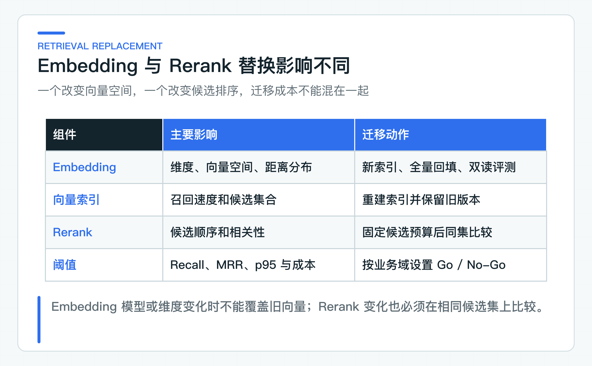
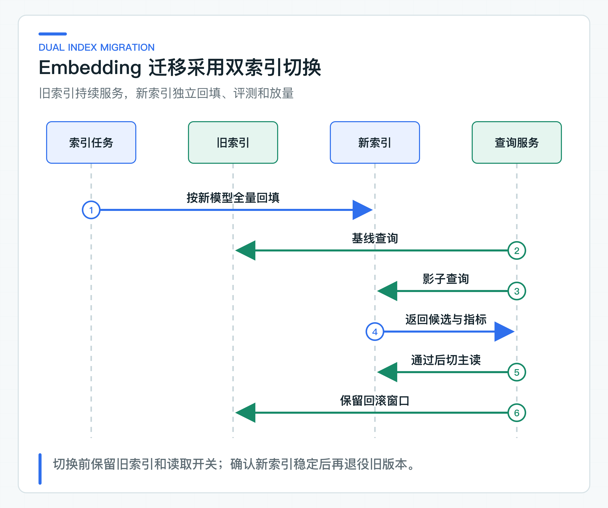

# Embedding 与 Rerank 替换实验：怎样设计同集评测

Chat Provider 切换成功后，团队可能接着替换 Embedding 和 Rerank。三者看起来都属于“换模型”，影响范围却完全不同：Chat 改变生成行为，Embedding 会重建向量空间，Rerank 则改变候选顺序、延迟和成本。

即使两个 Embedding 模型输出维度相同，旧向量也不能直接与新查询向量混用。维度变化时，表结构、索引和回填任务还要一起调整。因此，文档版本、切分、ACL、问题和 TopK 要先固定，再分别比较召回与排序。

配套 lab 使用 Spring AI Alibaba 的 Options 描述候选配置，并用小型固定样例校验 Recall@K、MRR 和 p95 计算。具体模型效果仍要连接目标服务，用同一份 Golden Set 实测；公式单测只保证评测工具没有算错。

## Embedding 负责召回，Rerank 负责排序

Embedding 把文本映射到向量空间。向量检索根据距离找候选，主要决定“可能相关的内容有没有进入候选集”。Rerank 接收查询和一批候选，对相关性重新打分，主要决定“候选的前后顺序是否更适合当前问题”。



如果召回阶段没有找到正确文档，Rerank 无法凭空恢复。相反，召回包含正确文档但排序靠后，Rerank 才可能改善 MRR 或最终 TopN。这个边界决定了评测顺序：先看召回，再看排序，最后看生成答案。

企业项目还要关注中文分词、短字段、专有名词、编号、表格、混合语言和政策条款。一个模型在通用语义检索上表现不错，不代表它能识别内部队列编码或制度编号。Golden Set 必须来自本公司的真实问题分布，并经过脱敏。

## Embedding 变化会产生新索引版本

向量由模型、模型版本、输入文本和预处理共同决定。以下任一变化都应被视为新的索引版本：

- Embedding 模型或版本变化；
- 输出维度变化；
- 文本前缀、任务类型或 `text_type` 变化；
- 文档切分或规范化规则变化；
- 距离函数或向量标准化策略变化。

配套代码用 `DomesticRetrievalProfile` 表达模型、维度、Rerank 和 TopN：

```java
public record DomesticRetrievalProfile(
        String embeddingModel,
        int dimensions,
        String rerankModel,
        int rerankTopN) {

    public boolean requiresFullReindexFrom(DomesticRetrievalProfile previous) {
        return previous == null
                || dimensions != previous.dimensions()
                || !embeddingModel.equals(previous.embeddingModel());
    }
}
```

这里只把模型和维度作为最低重建条件。生产项目还应把切分器版本、文本规范化版本、距离函数和索引参数写进索引元数据，防止两个看似同模型的索引实际不可比较。

不要在原向量列上原地覆盖。回填途中，新旧向量混在一个索引中，查询结果没有明确语义，也无法安全回滚。

## 用同一 Golden Set 控制比较条件

一次有效替换实验需要固定：

- 文档集合与发布版本；
- 切分结果与 chunk id；
- tenant、department、有效期等 ACL 条件；
- 查询文本与预期文档 id；
- 候选预算、最终 TopK 和 Rerank TopN；
- 运行环境、并发和超时；
- Recall@K、MRR、p95、错误率和成本阈值。

如果替换 Embedding 的同时修改切分，又把 TopK 从 10 提到 50，就无法判断哪项改动带来了质量变化，延迟和成本也失去比较基础。确实需要组合优化时，应先完成单变量实验，再建立新的组合基线。

配套代码以 `RetrievalGoldenCase` 表达一条评测输入，包括预期文档、实际排序和耗时：

```java
public record RetrievalGoldenCase(
        String caseId,
        List<String> expectedDocumentIds,
        List<String> retrievedDocumentIds,
        Duration latency) {
}
```

实验报告按样例平均 Recall 和 reciprocal rank，并从排序后的耗时取 p95，也就是 95% 样例不会超过的耗时。真实项目还应增加 HitRate、重复率、空召回率、ACL 泄露数和分组指标。

### Recall@K 与 MRR 分别衡量覆盖和位置

Recall@K 关注预期文档是否出现在前 K 个候选中。若一个问题有两个可接受文档，返回一个时 Recall 为 0.5，两个都返回时为 1。

MRR 关注第一个正确结果的位置。正确文档排第一得 1，排第二得 0.5，排第四得 0.25。它能发现“召回到了，但总被无关内容压在后面”的问题。

两者必须结合。Recall 很高、MRR 很低，说明候选集合尚可但排序需要改善；MRR 高、Recall 低，可能是少数简单样例表现好，多个必要证据没有被完整召回。

生产阈值应按业务域分组。员工手册问答可以容忍较高拒答，资金政策和合规制度则更关注错误证据与越权结果。不要用一个全局 80% 通过率掩盖高风险分组失败。

### 候选预算限制 Rerank 的效果上限

Rerank 不是越多越好。候选数增加会提高计算量、网络负载和延迟，也可能把大量噪声带入排序。需要分别定义：

```text
vectorCandidateK = 30
lexicalCandidateK = 30
fusionCandidateK = 40
rerankTopN = 8
answerTopK = 5
```

这些数字应由坏案例和容量测试确定。若正确文档常常进不了前 40，先改召回或 Query Rewrite；若正确文档已经在候选中但排序不稳，再评估 Rerank。

代码将配置映射为真实选项：

```java
DashScopeEmbeddingOptions embeddingOptions = DashScopeEmbeddingOptions.builder()
        .model("text-embedding-v4")
        .dimensions(1024)
        .textType("document")
        .build();

DashScopeRerankOptions rerankOptions = DashScopeRerankOptions.builder()
        .model("gte-rerank-v2")
        .topN(3)
        .returnDocuments(false)
        .build();
```

文档向量和查询向量可能需要不同任务类型或文本前缀，具体以模型文档为准。接入或升级模型前，必须复核输入限制、维度、计费和区域可用性。

### 查询向量与文档向量成对管理

有些 Embedding 模型要求查询和文档使用不同的任务类型、前缀或输入模式。即使底层模型名相同，`query` 与 `document` 的编码策略也属于索引配置的一部分。文档回填时记录 `documentProfileVersion`，查询服务记录 `queryProfileVersion`，两者必须来自同一套已验证配置。

若只升级查询侧前缀而不重建文档向量，距离分布可能发生变化。短期评测偶尔提升，不代表长期稳定。建议把查询和文档配置一起写进索引发布记录，并在启动时校验当前读取索引是否支持当前查询 profile。

长文档还要明确截断策略。供应商超过输入上限时可能拒绝、截断或分段；静默截断会让 chunk 后半部分永远无法被召回。切分器应先保证单片段满足模型输入限制，Embedding 适配器再次校验并记录超限错误，不能依赖供应商默认处理。

## 用双索引完成迁移与回退



推荐流程：

1. 创建新的 embedding_model_id 与 index_version；
2. 新索引独立回填，不影响旧索引在线查询；
3. 影子查询同时读取新旧索引，生成同集报告；
4. 达到质量、延迟和成本阈值后，对内部 tenant 灰度；
5. 通过读取开关切换主索引；
6. 保留旧索引覆盖回滚窗口；
7. 确认无回退需求后再退役旧版本。

索引任务要有租约、尝试预算、断点恢复和幂等。全量回填不是一个启动后等待结束的脚本；文档可能在回填期间继续发布，需要明确基线快照和增量追平点。

### 新旧链路保持相同 ACL

新旧索引比较时，tenant、department、文档状态和有效期过滤必须完全一致。若新链路为了方便先 TopK 再 Java 过滤，它可能看起来质量更好，实际已经扩大候选可见范围。

评测数据应包含越权对照样例：同一个问题在不同 tenant 或部门下，预期结果不同。指标需要统计正确召回，同时确认未授权文档从未进入候选和 Rerank 请求。

Rerank 服务接收的文档正文也属于数据出境与隐私边界。使用云服务前要确认数据分类、区域、保留策略和公司合规要求，必要时只发送低敏摘要或采用公司批准的部署方式。

还要检查缓存键。查询向量缓存至少包含模型、query profile、规范化文本和租户无关的安全边界；检索结果缓存则必须包含 tenant、department、索引版本和权限策略版本。为了提高命中率省略 ACL 字段，会把一次正确的模型替换变成跨租户数据泄露。

## 真实模型实验记录完整条件

至少记录：

- Embedding 与 Rerank 精确模型名；
- 维度、文本类型、候选预算和 TopN；
- 文档、切分、索引和 Golden Set 版本；
- 样例总数及分组；
- Recall@K、HitRate、MRR、p50/p95；
- 空召回、错误、限流和超时；
- 每千次查询成本或内部资源消耗；
- 失败样例及人工判断。

不要只保存一张“通过率 92%”截图。报告需要能回到具体问题、预期文档、实际排序和运行配置，否则下一次升级无法复用。

## 直接运行在线 Embedding 与 Rerank

在项目根 `config/application-default.yml` 填好 `lab.dashscope` 后，运行 [DashScopeRetrievalLabApplication](https://github.com/DavidDingXu/learn-java-ai/blob/main/learning-stages/stage-07-framework-boundaries/labs/spring-ai-alibaba-lab/src/main/java/com/xiaoding/javaai/labs/alibaba/DashScopeRetrievalLabApplication.java)。入口会把三段政策文本发给真实 Embedding 服务，按余弦相似度形成初排，再把候选交给真实 Rerank 服务。

控制台同时打印：

```text
embeddingRanking=[...]
rerankedRanking=[...]
recall=...
mrr=...
embeddingMs=...
rerankMs=...
```

[OnlineRetrievalReplacementExperiment](https://github.com/DavidDingXu/learn-java-ai/blob/main/learning-stages/stage-07-framework-boundaries/labs/spring-ai-alibaba-lab/src/main/java/com/xiaoding/javaai/labs/alibaba/OnlineRetrievalReplacementExperiment.java) 只依赖 `TextEmbeddingGateway` 与 `TextRerankGateway`，框架响应不会扩散到指标计算。`RetrievalReplacementExperiment` 是不联网的边界样例，用来锁定重建判断和指标公式；在线体验始终从真实入口进入。

## 明确实验结论的适用范围

Spring AI Alibaba lab 现在覆盖在线 Embedding、在线 Rerank、选项映射、维度变化后的重建判断，以及 Recall、MRR 和分段耗时。三段演示文本让读者确认协议、排序与指标链路确实连通，确定性样例负责锁定公式和错误边界。

要比较具体模型效果，还要把入口中的三段文本替换为目标文档和授权数据集，并通过主项目 Eval Runner 扩大样本。几条样例可以证明调用链，无法替代知识库选型报告。

国内组件替换的价值可能来自合规、延迟、成本、中文效果或供应稳定性。最终选择应由实际评测和运行数据决定，而不是“国产模型更适合中文”的笼统判断。Provider 与检索组件都能替换后，才有必要评估编排结构；Graph 实验只选择人工确认这一条流程，不重写整个 Agent。

---

[课程首页](../../README.md) · [完整目录](README.md) · [← DashScope Provider 适配实验：配置隔离、响应差异和回归边界](40-dashscope-provider-replacement.md) · [Graph 人工确认路由实验：何时比现有状态机更合适 →](42-graph-confirmation-flow.md)

动手实践：[本阶段可运行源码](../../learning-stages/stage-07-framework-boundaries/README.md)
