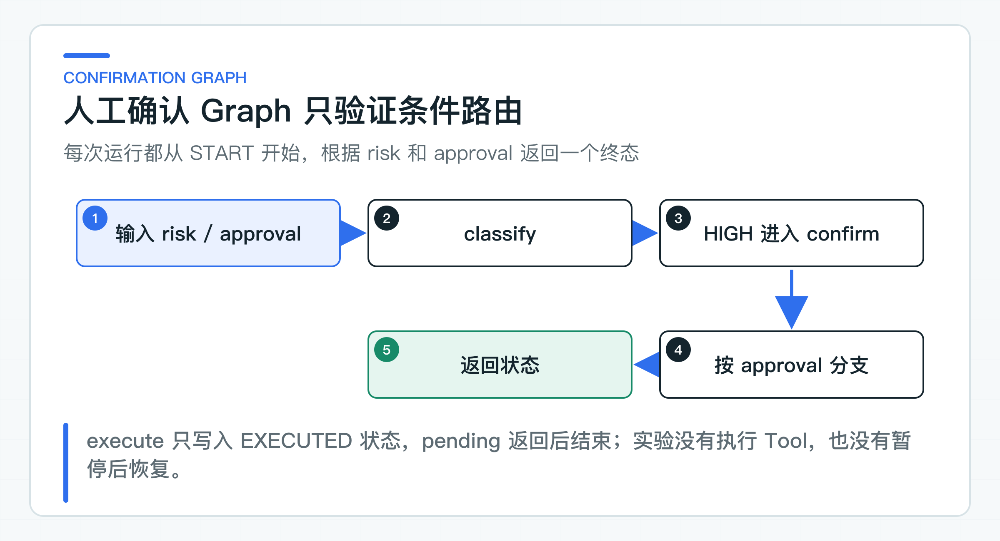

# Graph 人工确认路由实验：何时比现有状态机更合适

Agent 框架提供 Graph 之后，最容易出现的误区是把已有状态机整体改成节点和边。对于“创建、运行、等待确认、完成、失败”这类状态有限的流程，Java 枚举加显式方法已经足够清楚。换一种编排写法，并不会自动减少业务复杂度。

对照实验聚焦高风险 Tool 的确认分支：低风险请求返回可执行，高风险请求根据确认结果返回待确认、可执行或已拒绝。条件边负责路由，真实 Tool 调用和服务重启后的恢复仍由工单服务处理。

## 先判断 Graph 解决了什么问题

状态机适合迁移规则稳定、执行顺序明确的流程。代码路径可以直接与业务状态对照，排查问题时也容易定位。Graph 的优势通常出现在分支继续增多、独立任务可以并行，或者流程要在某个节点暂停后再继续的场景。

评估现有流程时，可以看四件事：

1. 流程是否存在多个可独立演进的分支？
2. 是否真的存在暂停很久、稍后继续的流程？
3. 是否需要并行执行独立任务后汇合？
4. 现有 `switch` 是否已经难以表达和测试，而不是单纯代码较长？

如果四项都没有出现，保留原状态机通常更省事。Graph 值不值得引入，要看它是否降低了分支维护和测试成本，而不是节点图是否更好看。

## 用条件边表达确认路由

`ConfirmationGraph` 接收两个已经确定的业务事实：风险等级 `risk` 和确认结果 `approval`。它们都由调用方传入，图本身不调用模型，也不判断当前用户是否有审批权限。



图中有五个节点：

```text
classify
confirm
execute
pending
reject
```

`classify` 根据 `risk` 选择下一条边。`LOW` 进入 `execute`，`HIGH` 进入 `confirm`。随后，`confirm` 再根据调用方给出的 `approval` 路由到 `execute`、`pending` 或 `reject`。

```java
stateGraph.addConditionalEdges(
        "classify",
        AsyncEdgeAction.edge_async(state ->
                state.<String>value("risk").orElseThrow().equals("LOW")
                        ? "execute"
                        : "confirm"),
        Map.of("execute", "execute", "confirm", "confirm"));
```

这里的 `execute` 只是把 `status` 写成 `EXECUTED`，并没有调用任何业务 Tool。`pending` 也只是返回 `PENDING` 后结束本次运行，并没有把线程挂起等待用户操作。

这两个细节决定了实验结论的边界：它验证了条件边和终态映射，却没有验证人工确认单、真实副作用或暂停后继续执行。生产系统中的风险与审批事实，仍要来自服务端业务规则和确认记录。

## 三个字段怎样驱动条件边

当前 Graph State 只有 `risk`、`approval` 和 `status`。前两个字段用于选择条件边，最后一个字段承接终态。taskId、confirmationId、actionId、用户身份和审计信息都没有进入这段实验代码。

Spring AI Alibaba Graph 会为状态中的每个 key 指定更新策略。这里三个字段在新值到来时都覆盖旧值，因此统一使用 `ReplaceStrategy`：

```java
private static Map<String, KeyStrategy> stateStrategies() {
    Map<String, KeyStrategy> strategies = new LinkedHashMap<>();
    strategies.put("risk", new ReplaceStrategy());
    strategies.put("approval", new ReplaceStrategy());
    strategies.put("status", new ReplaceStrategy());
    return strategies;
}
```

这种写法适合验证路由，也暴露了 Map 状态的代价：字段名写错只能在运行时发现，状态一多，节点之间的依赖会变得隐蔽。若后续把消息列表加入 State，还要单独决定是覆盖还是追加，不能沿用这里的策略。

## checkpoint 解决暂停后的继续执行

checkpoint 可以理解为流程运行到某个节点时保存的状态快照。后续运行读取这份快照，从指定位置继续，而不是重新从起点执行。要支持服务重启后的恢复，快照还要写入数据库等进程外存储。

当前构造函数直接调用 `buildGraph().compile()`，编译时没有传入 Saver，也没有创建 `MemorySaver`：

```java
public ConfirmationGraph() {
    try {
        this.graph = buildGraph().compile();
    } catch (GraphStateException exception) {
        throw new IllegalStateException("cannot compile confirmation graph", exception);
    }
}
```

因此，这段代码没有保存 checkpoint。`HIGH + MISSING` 返回 `PENDING` 后，本次图运行已经结束。稍后用 `HIGH + APPROVED` 调用 `run`，会从 `START` 重新走一遍，只是输入变了；它不是从上一次的 `confirm` 节点恢复。

观察节点路径时要特别留意这一点：第二次运行仍会再次访问 `classify`，而真正的断点恢复应从已保存的等待位置继续。两者最终都可能得到 `EXECUTED`，过程语义却完全不同；只看终态会误以为 checkpoint 已经生效。

即使未来接入 `MemorySaver`，它也只适合验证单进程内的保存与继续。跨重启恢复还要选择持久化 Saver，并处理状态版本、并发恢复和旧数据兼容。这些能力目前都不在实验结论中。

## 把路由接入真实确认链路

当前实验用四组输入观察访问节点和最终状态：

```text
LOW + NOT_REQUIRED -> EXECUTED
HIGH + MISSING     -> PENDING
HIGH + APPROVED    -> EXECUTED
HIGH + REJECTED    -> REJECTED
```

结果显示 LOW 直接访问 `classify -> execute`，HIGH 必须经过 `confirm`，然后再落到预期终态。这个实验没有接入 checkpoint、跨重启继续、并发审批或 Tool 副作用，也没有证明同一动作只会执行一次。

真实的人工确认通常横跨两次 HTTP 请求。第一次创建确认单并返回给前端，第二次由员工提交批准或拒绝。等待期间，任务状态要落在业务数据库中，而不是只停留在 Graph 的 Java 对象里。

如果把这条路由接入工单服务，业务层还要提供以下事实：

- 从 JWT 或服务间凭证得到的 tenant、subject 和角色；
- 与 taskId、动作参数哈希、策略版本和过期时间绑定的确认单；
- 带版本号的任务状态，用于拒绝过期审批和并发更新；
- actionId、业务幂等键和远端回执，用于识别重复执行；
- 可按 taskId、confirmationId、actionId 和 traceId 查询的审计记录。

Graph 可以消费这些事实并决定下一节点，但不适合成为它们唯一的存储。等待确认期间，工单可能已经关闭，审批人的角色也可能被收回。恢复执行前重新读取确认单、任务版本和业务对象，可以避免旧批准覆盖新状态。

写 Tool 的失败处理还要比路由更谨慎。连接超时只说明调用方没有拿到结果，远端可能已经完成操作。此时任务更适合进入 `EXECUTION_UNCERTAIN`，再用 actionId 查询回执，而不是让 Graph 自动重放 `execute` 节点。

因此，生产接入要同时验证两件事：图的路径没有绕过确认，业务执行也没有因重试或并发产生第二次副作用。前者属于这次实验的方向，后者仍由应用服务、数据库约束和目标系统共同保证。

## 直接观察 Graph 走过哪些节点

运行 `ConfirmationGraphLabApplication` 不需要 API Key。入口从同一份配置读取 `lab.graph.risk` 与 `lab.graph.approval`，然后打印输入、终态和访问节点。例如默认的 `HIGH + APPROVED` 会输出经过 `classify`、`confirm`、`execute` 的路径。

依次把 approval 改成 `MISSING`、`APPROVED` 和 `REJECTED`，再把 risk 改成 `LOW`，可以看到四条分支的真实 Graph 运行结果。这里改的是实验输入，不需要切换运行模式或换主类。

## 用分支复杂度决定是否保留 Graph

[ConfirmationGraph](https://github.com/DavidDingXu/learn-java-ai/blob/main/learning-stages/stage-07-framework-boundaries/labs/spring-ai-alibaba-lab/src/main/java/com/xiaoding/javaai/labs/alibaba/ConfirmationGraph.java) 使用真实的 `StateGraph`、条件边和状态更新策略，主类直接执行这段路由代码。

当前实验同时断言节点路径和终态。这只能说明 Graph 的本地路由按预期工作，不是业务执行结果；真实工单的确认、幂等和远程回执仍由主应用链路负责。

是否接入保存与恢复，取决于实际业务有没有长时间暂停。如果确认通常在同一个请求内完成，现有状态机可能更简单；如果任务要跨进程等待、包含更多条件分支，并且团队愿意维护状态版本，Graph 才可能带来明显收益。

还有一个很实用的判断：新增节点后，普通日志和路径测试是否仍能还原一次运行。如果业务判断开始大量藏在字符串 key 中，或者为了适配 Graph 复制一套权限、事务和审计逻辑，迁移已经偏离了目标。

Graph 不是 Agent 工程成熟度的标志。这次对照实验的价值，是让团队先看清条件路由的表达方式，再决定是否投入持久化恢复。收益说不清时，保留现有 Java 状态机依然是可靠的工程选择，也是一项明确的实验结论。

---

[课程首页](../../README.md) · [完整目录](README.md) · [← Embedding 与 Rerank 替换实验：怎样设计同集评测](41-domestic-embedding-rerank.md) · [Spring AI Alibaba 兼容性实验：依赖隔离、迁移 ADR 和回归成本 →](43-spring-ai-alibaba-compatibility.md)

动手实践：[本阶段可运行源码](../../learning-stages/stage-07-framework-boundaries/README.md)
