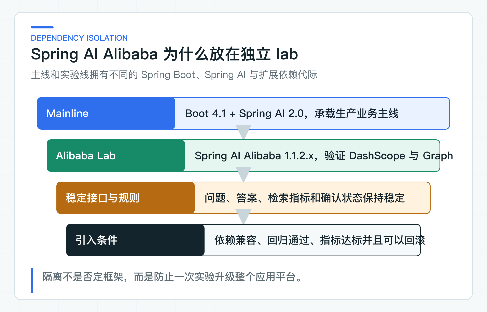
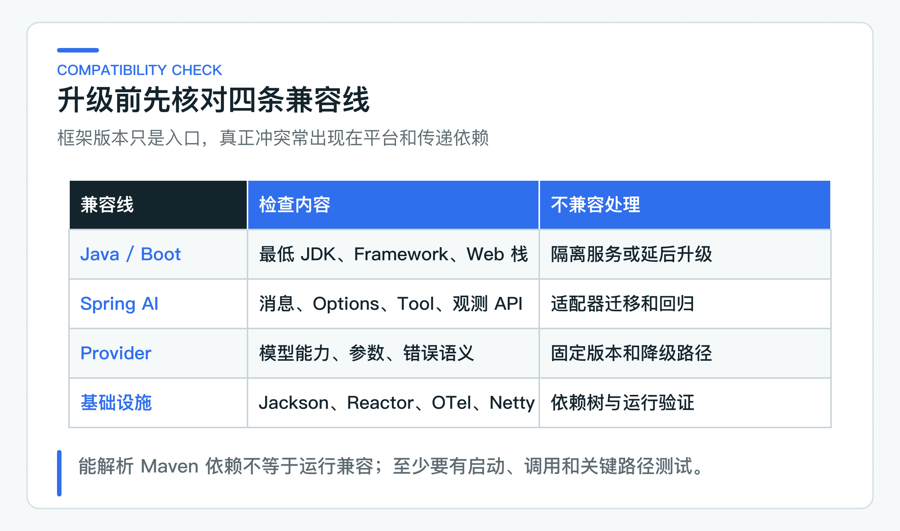

# Spring AI Alibaba 兼容性实验：依赖隔离、迁移 ADR 和回归成本

三个实验都能运行后，评审通常会问：“那为什么不直接把 Spring AI Alibaba 的最新版本放进正式服务？”这个问题不能只比较依赖坐标里的版本号。

Java 框架能否进入生产，要看完整兼容线。除了 JDK、Spring Boot、Spring AI 和扩展模块，还要核对 Jackson、Reactor、Micrometer、OpenTelemetry 与 Netty。候选版本即使更新，也可能仍处于 Milestone，或者要求整个应用平台一起升级。

因此，正式服务和实验模块分别固定自己的兼容基线，并通过独立 reactor 隔离依赖。这里记录的是当前项目已经验证的组合，不是对未来版本的永久判断；每次升级仍要重新核对官方发布信息并跑完整回归。

## 先分清四种“最新版本”

常见版本状态包括：

- Maven 仓库中排序最高的 artifact；
- 官方 Release 页面标记的 Latest；
- 最新稳定 GA；
- 当前项目依赖代际中最新、经过验证的版本。

四者可能不同。Maven metadata 的 `latest` 可能指向 Milestone；官方 Release 页面可能暂时没有补最新 Patch 的说明；GA 版本也可能与当前 Boot 主版本不兼容。

生产项目通常应选择兼容当前技术平台的 GA 版本，并且完成项目自己的回归。试验分支可以验证 Milestone 或 RC，但要与正式依赖隔离，不能让预发布版本通过传递依赖进入生产服务。

## 两代依赖先放在独立 reactor



正式服务的 Spring AI 2.0 面向 Boot 4 代际。当前 lab 使用的 Spring AI Alibaba 1.1.2.x 属于 Spring AI 1.1 与 Boot 3.5 代际。两边在 API 和传递依赖上都可能不同，例如 Message、Options、Tool、自动配置和观测接口。

Maven 能解析一组依赖，不代表运行时兼容。强行在一个应用中覆盖版本，可能出现：

- `NoSuchMethodError` 或 `ClassNotFoundException`；
- 自动配置条件失效；
- Jackson 2/3 或相关模块冲突；
- Reactor、Netty、Micrometer 版本不一致；
- Tool Calling 或 Observation 行为变化；
- 本地检查通过但实际应用启动失败。

因此，仓库使用独立 `labs/pom.xml`。每个子模块只导入自己的框架 BOM，主 reactor 明确禁止 LangChain4j、AgentScope 和 Spring AI Alibaba 依赖泄漏。

### 用构建规则阻止依赖泄漏

项目用自动化架构检查限制各实验模块的依赖白名单：

```text
spring-ai-alibaba-lab:
  spring-ai-alibaba-dashscope
  spring-ai-alibaba-graph-core

langchain4j-lab:
  langchain4j

agentscope-lab:
  agentscope-core
  agentscope-extensions-a2a-client
```

Provider starter、数据库、消息队列或其他框架依赖不会因为放在 labs 就自动允许。这样可以防止实验模块慢慢变成第二套应用平台。

如果公司采用多仓库，也应保持相同原则：实验服务拥有独立 POM、镜像和发布单元，通过 HTTP/OpenAPI 与主系统协作，不共享框架对象或领域 JAR。

## ADR 同时记录迁移与退出条件

ADR 是架构决策记录（Architecture Decision Record），它保留当时的问题、取舍和退出条件。一份能支持生产决策的 ADR 至少回答六个问题：

| 决策维度 | 必须回答的问题 |
| --- | --- |
| 业务收益 | 要解决什么现有问题？是国内 Provider 接入、中文效果、Graph 恢复、成本、合规，还是团队维护效率？收益如何量化？ |
| 版本兼容 | 目标 JDK、Boot、Spring AI、框架和 Provider 版本是什么？有哪些传递依赖冲突？是否需要独立服务？ |
| 代码改动 | 哪些业务端口保持不变，哪些适配器重写？Controller、数据库、OpenAPI、JDK8 客户端是否受影响？ |
| 质量回归 | 使用哪个 Golden Set？比较哪些质量、延迟、Token、Tool 路径和安全指标？ |
| 运维成本 | Trace、Metric、日志、告警、限流、连接池、密钥、Runbook 和值班怎样接入现有平台？ |
| 回滚条件 | 如何切回旧实现？数据和状态是否兼容？旧模型、旧索引和旧镜像保留多久？ |

“社区活跃”“API 更优雅”可以作为参考，不能代替业务收益、兼容性和回归结果。

## 逐项检查四条兼容线



兼容性检查不能只看框架自己的 artifact，要沿着运行链路逐项确认：

| 兼容线 | 检查重点 |
| --- | --- |
| Java 与 Boot | 确认最低 JDK、字节码版本、Servlet/WebFlux 代际和构建插件。JDK21 主服务与 JDK8 老系统仍通过 HTTP API 隔离，不能为了框架升级强迫老系统升级运行时 |
| Spring AI API | 核对 ChatModel/ChatClient、Message、Options、结构化输出、Tool Callback、Advisor、VectorStore 和 Observation。编译错误容易发现，默认行为变化更需要回归 |
| Provider 扩展 | 核对模型参数、流式、Tool、Embedding、Rerank、内容安全、错误类型和区域。框架支持某个 Provider，不等于支持该 Provider 的所有新能力 |
| 基础设施传递依赖 | 在 IDEA 的 Maven 依赖视图中检查 Jackson、Reactor、Netty、Micrometer、OTel、HTTP Client 和日志；还要启动应用并走一条真实请求，因为很多冲突只在自动配置或运行时出现 |

## 本项目使用的版本组合

仓库当前使用的兼容基线如下：

```text
Spring Boot          4.1.0
Spring AI            2.0.0 GA
Spring AI Alibaba    1.1.2.3
LangChain4j          1.18.1
AgentScope Java      2.0.2
MCP Java SDK         2.0.0
A2A Java SDK         1.2.0.Final
Java mainline        21
Java legacy client   8
```

这组版本只是本项目的兼容基线，不要求公司项目照抄。仍在 Boot 3 的业务系统，应选择官方支持该代际的 Spring AI 版本，或通过独立 AI 服务接入。不要只为引入 AI 框架升级整个生产平台。

正式服务使用 Spring AI 2.0 GA。项目没有引入 Spring AI Alibaba `2.0.0-M1.1`，因为版本号中的 `M1` 表明它仍是里程碑版，不是 GA。后续即使发布 GA，也要先在独立 lab 更新，检查依赖树并运行框架与协议测试，再决定是否替换。

### Patch 升级同样经过回归

Patch 版本通常修复缺陷，但仍可能改变默认值、传递依赖或边界行为。最低回归包括：

- 四个 lab 的直接运行入口与回归检查；
- 主 reactor 和 JDK8 独立构建；
- Provider 请求、响应和异常映射；
- Embedding 维度与索引元数据；
- Graph 路由与恢复；
- AI Services、Tool 和结构化输出；
- AgentScope Permission、MCP Streamable HTTP 和 A2A Agent Card/JSON-RPC；
- 敏感信息和依赖边界扫描。

涉及真实 Provider 的 Patch，还要补一条真实调用和相应 Golden Set。不能因为本地代码检查通过，就认为供应商协议与在线模型行为没变。

### 用隔离实验控制大版本升级成本

大版本升级先在 lab 完成三件事：

1. 对比 IDEA 依赖视图中的旧、新依赖树；
2. 确认现有业务行为在不修改预期的情况下仍然成立；
3. 单独记录为通过升级而修改的代码和行为。

如果迁移需要同时改业务端口、数据结构、Prompt 和测试期望，说明变更面过大。应拆分：先建立兼容适配器，再切框架，最后按独立需求优化业务。

公司项目还要评估维护者数量、Release 节奏、漏洞响应、文档完整性和内部熟悉度。框架能做更多，不代表团队能稳定运营更多。

## 达到这些条件后再进入正式服务

至少满足：

- 在同一业务用例和输入输出下取得可测收益；
- 目标服务依赖兼容，或有独立部署边界；
- 真实 Provider、数据库或协议联调通过；
- Trace、Metric、日志、告警和成本已接入；
- 安全、权限和幂等检查仍然生效，`UNKNOWN` 状态仍可恢复；
- 有灰度开关、数据兼容和回滚演练；
- 负责团队接受后续升级与事故处理成本。

通过 lab 单元测试只说明适配代码能运行，不能单独支持生产采用。

## 依赖兼容性实验暴露哪些风险

[FrameworkCompatibilityDecision](https://github.com/DavidDingXu/learn-java-ai/blob/main/learning-stages/stage-07-framework-boundaries/labs/spring-ai-alibaba-lab/src/main/java/com/xiaoding/javaai/labs/alibaba/FrameworkCompatibilityDecision.java) 会比较正式服务与候选框架的框架主版本和 Boot 主版本。任意一项不同，就返回 `ISOLATED_SERVICE_OR_LAB`。ADR 0003 记录了隔离理由、采用条件和代价。

直接运行 `FrameworkCompatibilityLabApplication`，控制台会打印 `inPlace`、推荐边界和具体原因。默认输入会明确指出 Spring AI 2.0/Boot 4 主线与 Spring AI Alibaba 1.1/Boot 3.5 候选线应保持隔离。修改同一配置文件中的候选版本即可重新观察决策，不需要启动 Provider 或准备 API Key。

所有 lab 的回归范围只覆盖 Java 21 构建、框架迁移和协议互操作，不包括框架的全部扩展模块。候选框架或协议 SDK 是否进入正式服务，仍要结合真实用例、依赖冲突、运行指标和回滚成本判断。

版本管理不追求“永远最新”。团队应清楚当前使用哪个版本、为什么适合现有平台、怎样验证、何时升级，以及失败后怎样退回。评估其他框架时也使用同样方法：先迁移一个低风险业务用例，再逐步验证 RAG、Tool 和共存方式。

参考资料：

- [Spring AI 2.0 Reference](https://docs.spring.io/spring-ai/reference/)
- [Spring AI Alibaba Releases](https://github.com/alibaba/spring-ai-alibaba/releases)
- [LangChain4j Releases](https://github.com/langchain4j/langchain4j/releases)
- [AgentScope Java Releases](https://github.com/agentscope-ai/agentscope-java/releases)
- [MCP Java SDK Releases](https://github.com/modelcontextprotocol/java-sdk/releases)
- [A2A Java SDK Releases](https://github.com/a2aproject/a2a-java/releases)

---

[课程首页](../../README.md) · [完整目录](README.md) · [← Graph 人工确认路由实验：何时比现有状态机更合适](42-graph-confirmation-flow.md) · [LangChain4j AI Services 适配实验：迁移一个低风险用例 →](44-langchain4j-ai-services.md)

动手实践：[本阶段可运行源码](../../learning-stages/stage-07-framework-boundaries/README.md)
