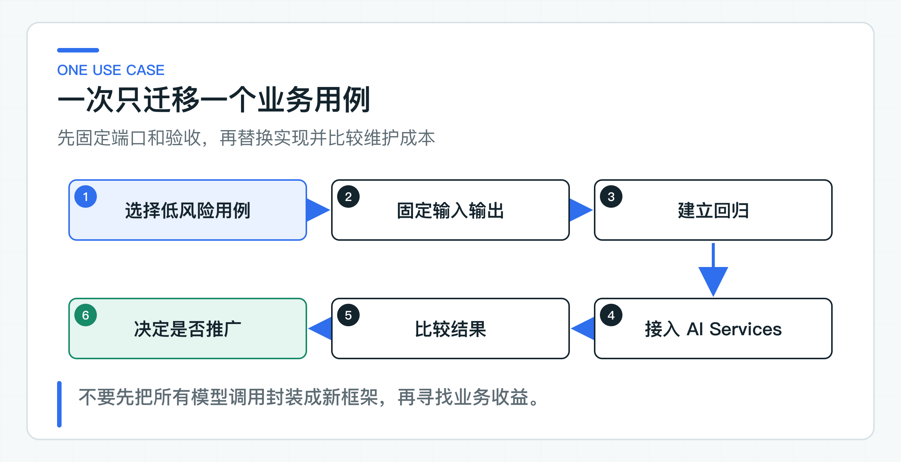

# LangChain4j AI Services 适配实验：迁移一个低风险用例

对熟悉 Spring Data 或 Retrofit 的 Java 开发者，LangChain4j AI Services 很容易上手。定义接口、写 Prompt 注解并配置 `ChatModel` 后，框架会生成代理实现。相比手工组装 Message 和解析输出，代码确实更紧凑。

但这个代理接口属于框架适配器，不等于应用层的业务 Service。Controller 和其他模块一旦直接依赖 LangChain4j 注解，框架类型就会扩散，下一次替换仍然要改整条调用链。

实验只迁移一个低风险制度问答用例。应用层继续依赖 `PolicyAnswerPort`，LangChain4j 在基础设施层实现它。这样可以比较代码量、Prompt 管理、测试和运行成本，又不触碰现有身份、ACL、OpenAPI 与数据模型。

## AI Services 收拢模型调用样板代码

低层 ChatModel 调用通常包含：

- 把方法参数转换为 System/User Message；
- 绑定模板变量；
- 合并 Memory 或检索内容；
- 生成 Tool Schema；
- 执行 Tool 循环；
- 把模型文本解析为 String、枚举、POJO 或流；
- 调用监听器和错误处理。

AI Services 把这些常见动作放进声明式代理。它不了解当前业务数据和规则，也不会替代权限、幂等、数据库事务和输出校验。

配套代码的上层端口很普通：

```java
public interface PolicyAnswerPort {
    PolicyAnswer answer(PolicyQuestion question);
}
```

适配器内部才定义 AI Service：

```java
interface PolicyAssistant {

    @SystemMessage("你是企业制度助手。只处理当前租户的问题；没有可靠依据时明确拒答。")
    @UserMessage("租户：{{tenantId}}\n问题：{{question}}")
    String answer(
            @V("tenantId") String tenantId,
            @V("question") String question);
}
```

`LangChain4jPolicyAnswerAdapter` 在构造时创建代理，实现应用端口：

```java
public final class LangChain4jPolicyAnswerAdapter implements PolicyAnswerPort {

    private final PolicyAssistant assistant;

    public LangChain4jPolicyAnswerAdapter(ChatModel chatModel) {
        this.assistant = AiServices.builder(PolicyAssistant.class)
                .chatModel(chatModel)
                .build();
    }

    public PolicyAnswer answer(PolicyQuestion question) {
        String modelAnswer;
        try {
            modelAnswer = assistant.answer(question.tenantId(), question.question());
        } catch (RuntimeException exception) {
            throw new IllegalStateException("MODEL_INVOCATION_FAILED", exception);
        }

        try {
            return new PolicyAnswer(modelAnswer);
        } catch (IllegalArgumentException exception) {
            throw new IllegalStateException("MODEL_OUTPUT_INVALID", exception);
        }
    }
}
```

调用方只看到 `PolicyAnswer`，不会拿到 `AiMessage`、`ChatResponse` 或框架注解。

## 先迁移一个低风险用例



合理的迁移顺序是：

1. 选择低风险、边界清晰的用例；
2. 固定业务输入、输出和错误处理规则；
3. 先有旧实现的回归数据和基线；
4. 用 AI Services 实现同一端口；
5. 比较质量、延迟、Token、故障和维护成本；
6. 决定保留、扩大或放弃。

不要先在公共模块封装一套 `GenericAiService<T>`，再要求所有用例迁移。AI 功能之间差异很大：知识回答需要引用和拒答，工单决策需要结构化输出，Agent 需要 Tool、确认和状态。过早统一只会把框架能力压成最低公共部分。

### Prompt 注解只放稳定模板

短而稳定的模板可以放在注解中，便于看清接口语义。长 Prompt、频繁调整的业务规则和多语言模板，仍建议放在版本化资源文件或 Prompt Registry 中。

注解模板要注意：

- `@SystemMessage` 与 `@UserMessage` 的信任级别不同；
- 用户输入只能作为变量值，不能动态拼成系统规则；
- tenantId 出现在 Prompt 只用于上下文说明，不能代替服务端权限；
- 模板变化需要版本、评测和回滚；
- 不要在注解里放密钥、内部 URL 或大段生产数据。

AI Services 支持从资源加载模板。公司项目可以保留自己的 `promptVersion`，在适配器创建时选择资源，并把版本写入 Trace 和评测报告。

### String 返回值仍要经过业务校验

String 返回值让迁移面保持最小，`PolicyAnswer` 构造器也只拒绝空答案。长度、敏感内容、引用和拒答原因没有进入这个返回类型，因此它适合低风险迁移对照，不能直接替换现有知识服务。

若业务需要结构化输出，可以让 AI Service 返回 record 或 POJO；解析成功后还要校验 tenant、对象 id、状态和允许动作。

框架输出解析解决“文本怎样变成 Java 对象”，不解决“这个对象能不能用于业务”。RAG 迁移同样不能绕开知识管理、权限过滤和引用校验；Tool 迁移还要在解析后继续执行权限、状态和参数检查。

## 用四种结果看清适配器边界

配套测试使用一个捕获 `ChatRequest` 的确定性 `ChatModel`。它返回固定答案，同时断言 tenant 和问题进入了消息：

```java
final class CapturingModel implements ChatModel {

    private ChatRequest request;

    @Override
    public ChatResponse doChat(ChatRequest request) {
        this.request = request;
        return ChatResponse.builder()
                .aiMessage(new AiMessage("退款将在三个工作日内原路退回。"))
                .modelName("test-model")
                .build();
    }
}
```

一套完整的适配器测试应该检查：

- AI Service 是否使用正确模型；
- System/User Message 是否分区；
- 模板变量是否完整；
- 业务端口是否不暴露框架类型；
- 输出是否映射成项目 DTO；
- 异常是否转成稳定错误。

`PolicyAiServiceAdapterTest` 检查 tenant、问题和返回值映射，并分别验证模型调用失败与非法输出会变成稳定错误。测试不重复验证 LangChain4j 动态代理的内部实现，只锁定项目代码与框架连接处的行为。

### 用真实模型跑一条 Smoke

可控模型先把代理调用和 Prompt 构造固定下来。填好项目根 `config/application-default.yml` 后，直接运行 `LangChain4jLabApplication`。它会使用真实 `OpenAiChatModel` 调用同一个适配器并打印回答。是否值得迁移还要看：

- 一条密钥门控 Smoke，验证网络、认证、模型名和响应元数据；
- 同一 Golden Set 的旧、新实现比较；
- Prompt Injection、拒答和敏感问题；
- 超时、429、截断和内容安全；
- 多次运行的稳定性；
- Token 与成本变化。

真实测试不能取代单元测试。在线模型会变化、网络会抖动，若所有测试都依赖 Provider，失败很难定位，也会增加成本和泄露风险。

## 用例确实需要时再加入 Memory

AI Services 可以很方便地配置 ChatMemory，但这不意味着每个用例都需要多轮状态。制度问答如果每次调用独立，先保持无状态更容易做权限、缓存和评测。

需要会话时，要明确：

- memoryId 如何绑定 tenant 与用户；
- 历史消息保存多久；
- 裁剪和总结策略；
- 多实例共享存储；
- 删除与隐私请求；
- 同一用户并发会话；
- 历史中的不可信内容如何防止注入。

框架提供 Memory 接口，生产语义仍由应用设计。不要用进程内 Memory 证明多实例会话已完成。

## 保持 Streaming、观测与错误语义一致

若 AI Service 返回流式类型，适配器仍要映射为项目的 SSE 事件：`start`、`delta`、`complete`、`error`、`heartbeat`。不能让框架 Token 流直接成为前端接口。

开始输出后不能盲目重试；客户端断连要取消上游流式请求；TTFT 和总耗时要进入观测。框架替换时，公开事件名与完成语义保持不变，前端和 JDK8 客户端才不会被迫同步升级。

两套框架可能有不同 Listener 或 Observation API，但应用层至少要保留统一指标：

```text
use_case
provider
model
outcome
finish_reason
latency
input_tokens
output_tokens
```

标签只能使用低基数字段，tenant、用户、问题正文和 Prompt 不能成为 Metric 标签。异常映射保持项目稳定分类，例如 `MODEL_TIMEOUT`、`MODEL_RATE_LIMITED`、`MODEL_BAD_RESPONSE`，不要把供应商类名返回给客户端。

## 从整体维护成本判断迁移收益

AI Services 可能显著减少样板代码，但生产判断还要看：

- Prompt 和输出规则是否更容易审查；
- 测试是否更清晰；
- Tool、RAG、Memory 是否满足所需能力；
- 观测和故障处理是否接得上公司平台；
- 团队是否熟悉升级与排障；
- 与现有 Spring Boot 应用的依赖成本；
- 将来退出框架时能否保持对外接口不变。

少 50 行代码，不值得换来依赖冲突或无法统一的观测。

## 运行入口与确定性检查各负责什么

LangChain4j lab 使用 `1.18.1`。[LangChain4jPolicyAnswerAdapter](https://github.com/DavidDingXu/learn-java-ai/blob/main/learning-stages/stage-07-framework-boundaries/labs/langchain4j-lab/src/main/java/com/xiaoding/javaai/labs/langchain4j/LangChain4jPolicyAnswerAdapter.java) 在适配器内创建 AI Services 代理。直接运行入口连接真实 Provider；确定性检查覆盖模板变量、正常返回、非法输出和模型调用失败。两者共用同一适配器，不存在另一套演示实现。

直接运行能看到真实回答，但一个问题不能说明迁移收益。确定性检查负责定位适配错误，Golden Set 才用于比较回答质量和稳定性。

AI Services 更适合留在适配器内，让业务端口继续稳定。这样迁移成功可以扩大使用，迁移失败也能低成本删除。低风险问答迁移成立后，企业 RAG 还要单独确认文档、ACL、索引和引用校验是否仍由知识服务掌握。

参考资料：

- [LangChain4j AI Services](https://docs.langchain4j.dev/tutorials/ai-services/)
- [LangChain4j Releases](https://github.com/langchain4j/langchain4j/releases)

---

[课程首页](../../README.md) · [完整目录](README.md) · [← Spring AI Alibaba 兼容性实验：依赖隔离、迁移 ADR 和回归成本](43-spring-ai-alibaba-compatibility.md) · [LangChain4j RAG 适配实验：复用现有业务契约 →](45-langchain4j-rag-contract.md)

动手实践：[本阶段可运行源码](../../learning-stages/stage-07-framework-boundaries/README.md)
