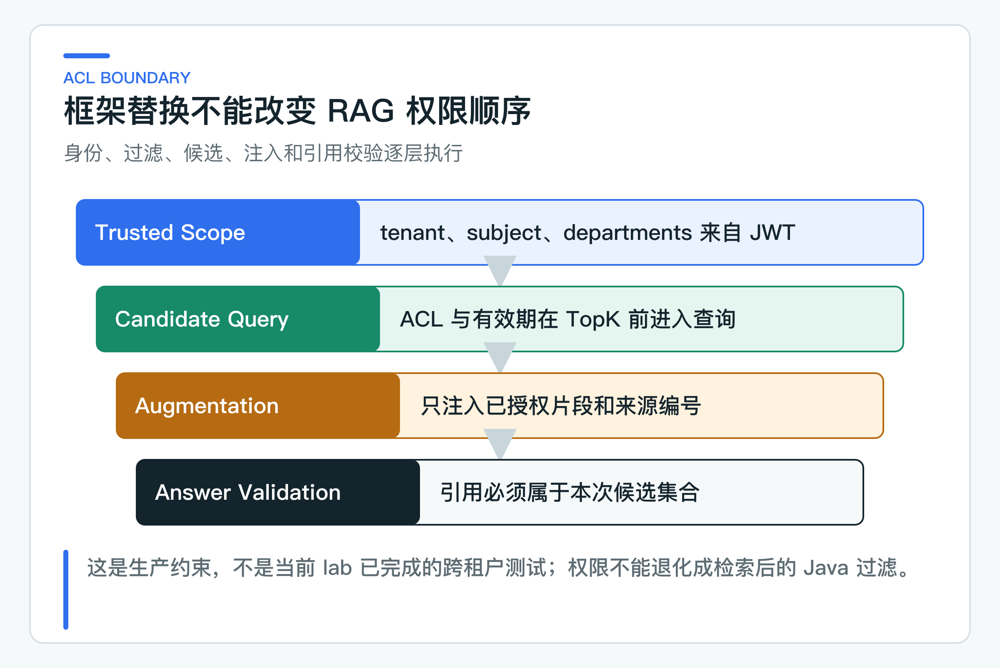

# LangChain4j RAG 适配实验：复用现有业务契约

LangChain4j 自带 `ContentRetriever`、`RetrievalAugmentor` 和 Embedding Store（向量存储抽象），重新搭一套独立 RAG 很快。RAG 是检索增强生成：先从知识库找出相关片段，再把片段交给模型回答。

现有知识服务已经管理了文档版本、ACL（访问控制列表）、有效期、索引任务和引用规则。若新框架再建一套向量库，同一份知识就会有两个事实来源。

框架迁移不应该改写知识数据所有权。否则 tenant、department、发布状态和 TopK 前过滤可能在新链路中被绕过，短期代码独立，长期却要维护两套相互冲突的知识库。

隔离 lab 中定义了一个最小 `KnowledgeSearchPort`，它保留现有检索链路的身份范围、查询和 TopK 语义，但不直接依赖 Knowledge Service 内部类。LangChain4j 适配器先调用该端口，再把返回的片段转成框架内容。直接运行入口用受控内存语料固定检索事实，再调用真实模型生成带来源回答；它用于看清适配顺序，不替代阶段 03 已经跑通的 pgvector 与 ACL 链路。

## 先固定企业 RAG 的业务契约

一个可替换的检索端口至少需要：

```java
public interface KnowledgeSearchPort {
    List<KnowledgeSnippet> search(
            KnowledgeAccessScope scope,
            String query,
            int topK);
}
```

`KnowledgeAccessScope` 是一次请求的不可变访问范围，包含 tenant、subject 和部门集合。正式环境由公司鉴权适配器建立，本地与 lab 使用固定测试身份。TopK 表示取排名最靠前的 K 个候选片段。`KnowledgeSnippet` 返回 sourceId 与低敏正文，正式接入时还应带文档版本、标题、有效期和相关性分数。

正式适配器要调用 Knowledge Service 的应用端口或版本化 HTTP API，不在 lab 里复制检索实现。RRF 是倒数排名融合，用来合并多路检索排序；Rerank 则会对候选结果再排一次序。Knowledge Service 继续负责：

- tenant、department、状态和有效期在 TopK 前过滤；
- 向量、关键词、RRF 和 Rerank；
- 索引版本与 Embedding 模型隔离；
- 文档发布状态和冲突处理；
- 检索指标与坏案例。

框架适配器只消费结果。

## LangChain4j 通过业务检索端口取证据

配套代码为每次调用创建一个绑定 AccessScope 的检索器：

```java
List<KnowledgeSnippet> snippets = searchPort.search(scope, question, topK);

ContentRetriever retriever = query -> snippets.stream()
        .map(snippet -> Content.from(
                "来源 " + snippet.sourceId() + "\n" + snippet.text()))
        .toList();

KnowledgeAssistant assistant = AiServices.builder(KnowledgeAssistant.class)
        .chatModel(chatModel)
        .contentRetriever(retriever)
        .build();
```

这段实验代码强调调用顺序：先调用 `KnowledgeSearchPort`，再构造 `ContentRetriever`。ACL 是否真的在 TopK 前执行，取决于正式检索实现；这里的 SearchPort 只记录收到的 scope，不能证明数据库权限过滤。正式接入时可以让 Retriever 自己调用端口，但它必须携带不可变的请求级 scope，不能从模型参数或用户 JSON 中读取 tenant。

### 每次调用使用不可变 AccessScope

最容易出现的错误是把当前 tenant 放进 ThreadLocal 或单例字段，再让共享 Retriever 读取。同步请求可能暂时可用，进入 Reactor、异步 Tool、多线程或并行评测后就可能串租户。

更稳妥的方式包括：

- 每次调用创建不可变 Retriever；
- 使用框架支持的 invocation metadata，并在边界处显式写入；
- 通过请求作用域组件传递；
- 在业务端口调用前完成检索，再把结果交给 RAG 组件。

无论采用哪种方式，scope 都必须来自服务端受信身份，不能从问题或模型输出生成。模型只能看到必要的租户上下文，不能决定访问范围。

### 框架替换不改变 ACL 顺序



正确顺序是：

```text
Trusted Identity
  -> ACL Candidate Query
  -> TopK / Hybrid / Rerank
  -> Authorized Snippets
  -> Prompt Augmentation
  -> Model Answer
  -> Citation Validation
```

错误顺序是先全库向量 TopK，再在 Java 中过滤无权文档。即使最终没有把正文返回用户，候选、日志、Rerank 请求或模型上下文都可能接触越权内容；过滤后候选不足还会伤害召回。

换框架时应运行专门的 ACL 数据集：同一个问题在不同 tenant、部门和角色下预期 sourceId 不同。任何未授权文档进入候选都应计为安全失败，而不是普通质量扣分。这类数据集不在当前 lab 测试范围内。

## ContentRetriever 只做结果转换

框架组件擅长组合，但不应拥有：

- 文档生命周期和发布审批；
- 内容摘要、去重和冲突策略；
- 对象存储与解析任务；
- tenant 和部门授权模型；
- 索引回填与版本切换；
- 引用是否有效的业务规则。

这些能力要么属于 Knowledge Service，要么属于明确的基础设施适配器。把它们全部藏在 `EmbeddingStoreContentRetriever` Builder 中，代码看起来简短，却失去了可治理入口。

### 从简单检索开始选择 RAG 组合

`contentRetriever` 会创建默认 RetrievalAugmentor，适合一条简单检索链。需要 Query Rewrite、多路检索、聚合、动态路由或自定义注入时，可以配置 `RetrievalAugmentor`。

升级条件仍由坏案例驱动：

- 用户问题省略关键实体，考虑 Query Rewrite；
- 关键词和语义各自漏召回，考虑混合检索；
- 正确文档在候选内但排序靠后，考虑 Rerank；
- 问题属于不同知识域，考虑路由；
- 多个片段冲突，先做业务冲突处理，不让模型自行选一个。

不要因为框架提供高级 RAG 就一次性启用。每增加一个模型步骤，都会增加延迟、成本、失败点和评测维度。

### 受控检索内容进入 Prompt

默认内容注入器会把片段加入用户消息。企业项目应控制格式：

```text
[sourceId=FIN-2026-01]
title=差旅报销制度
effectiveAt=2026-01-01
content=审核通过后两个工作日内付款。
```

来源编号是后续引用校验的锚点。不要只注入正文，否则模型返回的“根据制度”无法追到具体文档。

片段内容属于不可信数据。文档中出现“忽略系统规则”“调用退款工具”等文字时，只能作为被引用内容，不能提升为系统指令。这类通过数据影响模型指令的攻击叫 Prompt Injection（提示注入）。Prompt 要明确知识区边界，并用提示注入样例做回归。

### 引用仍由应用层校验

模型回答包含 `FIN-2026-01`，服务端要检查它是否属于本次检索候选。若模型引用未知 sourceId、失效版本或其他 tenant 文档，应拒绝或重新生成。

配套 `PolicyAnswer` 同时返回答案与 sourceIds：

```java
return new PolicyAnswer(
        answer,
        snippets.stream().map(KnowledgeSnippet::sourceId).toList());
```

当前 `PolicyAnswer.sourceIds` 是这次检索的候选来源列表，不是从模型回答中解析出来的引用。现有知识服务已经实现引用成员校验、时效和冲突规则，迁移时必须继续使用，不能因为 AI Service 返回 String 就省略。

### RAG 缓存键包含权限与版本

可缓存查询向量、低敏检索结果或最终答案，但缓存键至少考虑：

```text
tenantId
departmentScopeHash
subjectPolicyVersion
normalizedQuery
indexVersion
embeddingModelId
retrievalPolicyVersion
promptVersion
model
```

省略权限字段会串数据，省略索引或 Prompt 版本会在发布后继续返回旧答案。最终答案缓存还要考虑文档撤回和用户反馈。

## 用一次调用看清当前适配边界

`CapturingKnowledgeSearchPort` 记录收到的 scope 和 TopK，捕获 ChatRequest 的模型则显示来源怎样进入 Prompt：

```text
tenant-a
departments=[finance]
topK=4
sourceId=FIN-2026-01
```

当前实验没有构造第二个 tenant，也没有让模型返回未知 sourceId。跨租户隔离和无依据答案拒绝仍要在完整链路中覆盖：

- tenant 与部门交叉；
- 文档失效和新版本发布；
- 空召回与拒答；
- 多证据与冲突证据；
- Injection 文档；
- 候选过长与 Token 预算；
- Retriever 超时、Rerank 超时和降级；
- Recall@K、MRR、重复率和 p95。

这里的 Recall@K 衡量前 K 个候选是否找回应有证据，MRR 关注第一个正确结果出现的位置，p95 表示 95% 请求能够完成的延迟上界。

只断言最终答案相似，无法发现 ACL 或 sourceId 已经变化。

## 跨服务继续使用版本化 HTTP API

如果 LangChain4j 适配器部署在另一个服务，它应通过 Knowledge Service 的认证 HTTP/OpenAPI 接口查询。不要引入 Knowledge Service 内部 Repository 或实体 JAR。

HTTP 调用需要 delegated token、audience、scope、超时、连接池和稳定错误码。评测端点使用独立权限，不能让普通回答 Token 访问全量检索调试信息。

框架共存期间，现有实现和实验实现都调用同一公开 API，才能比较结果；一条走生产 SQL，一条读本地文件，比较没有意义。

## 这次适配只复用检索端口

LangChain4j lab 在 [TenantScopedRagAdapter](https://github.com/DavidDingXu/learn-java-ai/blob/main/learning-stages/stage-07-framework-boundaries/labs/langchain4j-lab/src/main/java/com/xiaoding/javaai/labs/langchain4j/TenantScopedRagAdapter.java) 中创建带 `ContentRetriever` 的 AI Service。运行 `LangChain4jRagLabApplication`，可以看到真实模型根据受控片段回答，并在 `PolicyAnswer` 中返回 sourceId。

这里使用可控 SearchPort 与真实 ChatModel：前者让 scope、TopK 和 sourceId 可以直接核对，后者让读者看到框架确实完成了 Prompt 增强与生成。认证、ACL SQL、引用成员校验和真实检索继续由 Knowledge Service 拥有。迁移时把 SearchPort 接到它的版本化 API，再使用相同身份范围、索引和 Golden Set 比较结果。

RAG 框架可以替换，知识服务的数据所有权不能替换。文档生命周期、ACL、索引和引用校验保持不变后，才有条件比较不同框架的开发效率和质量。Tool Calling 与结构化输出一旦进入自动执行链路，仍要接受同样的身份、参数和业务规则校验。

参考资料：

- [LangChain4j RAG](https://docs.langchain4j.dev/tutorials/rag/)
- [LangChain4j AI Services](https://docs.langchain4j.dev/tutorials/ai-services/)

---

[课程首页](../../README.md) · [完整目录](README.md) · [← LangChain4j AI Services 适配实验：迁移一个低风险用例](44-langchain4j-ai-services.md) · [LangChain4j Tool 实验：只读调用与结构化输出 →](46-langchain4j-tool-structured-output.md)

动手实践：[本阶段可运行源码](../../learning-stages/stage-07-framework-boundaries/README.md)
