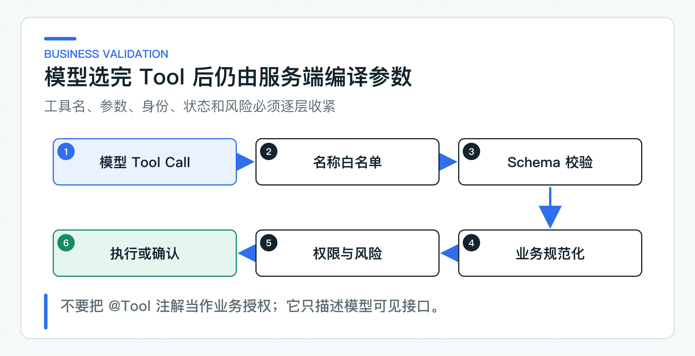

# LangChain4j Tool 实验：只读调用与结构化输出

问答和 RAG 都停留在读链路。Tool Calling 则允许模型选择一个应用已声明的工具，再由框架调用对应 Java 方法。LangChain4j 能从 `@Tool` 生成参数 Schema（数据结构约束）、执行方法、把结果送回模型，还能将最终 JSON 映射成 Java record。这些能力省掉了样板代码，但没有替应用完成授权和业务校验。

为了看清这条边界，实验只迁移一个只读工单查询 Tool。模型读取低敏快照后输出 `TicketDecision`；退款、状态更新等写操作仍留在受控 Agent 中，继续经过风险分级和人工确认。

## Tool 循环包含两次模型交互

一次工具问答通常至少包含两次模型调用：

1. 发送目标、上下文和 Tool Schema；
2. 模型返回工具名与 JSON 参数；
3. 框架找到 Java 方法并执行；
4. 工具结果作为 Tool Result 加入对话；
5. 再次调用模型生成最终文本或结构化结果。

配套测试中的模型第一次返回：

```json
{
  "id": "call-1",
  "name": "query_ticket",
  "arguments": {
    "ticket_id": "T-1001"
  }
}
```

工具执行后，第二次返回：

```json
{
  "ticketId": "T-1001",
  "decision": "ESCALATE",
  "reason": "退款等待需要人工核验"
}
```

测试断言模型调用两次、Tool 只执行一次、结果能解析成 record。

### `@Tool` 只描述模型可见接口

工具代码：

```java
@Tool(name = "query_ticket", value = "按工单编号查询工单状态和低敏摘要")
public TicketSnapshot queryTicket(
        @P(name = "ticket_id", description = "工单编号") String ticketId) {
    invocationCount.incrementAndGet();
    return queryPort.find(ticketId);
}
```

注解帮助框架生成工具名称、描述和参数 Schema。它没有验证当前用户是否属于正确 tenant，也不知道客服能否查看这个工单。正式 `queryPort` 必须接收受信身份，执行 tenant、角色和对象归属校验。

生产 Tool 还要限制返回字段。不要把完整客户对象、身份证、手机号、内部备注和数据库实体直接序列化给模型。为模型设计低敏 `TicketSnapshot`，只保留决策所需字段。

## 服务端把模型参数编译成业务命令



模型返回 JSON 后至少经过：

```text
Tool 名称白名单
-> JSON Schema
-> 类型与长度
-> 业务规范化
-> 身份与对象权限
-> 当前业务状态
-> 风险分级
-> 执行或确认
```

金额要统一为最小货币单位，日期要明确时区，队列使用内部编码，枚举使用允许集合。模型输入里出现 tenantId、customerId 或 role 时，不能覆盖受信身份。

对于写 Tool，编译结果应生成不可变 `PreparedToolCall` 或确认单，绑定 taskId、actionId、规范化参数、策略版本和所需角色。人工确认读取的是这份服务端结果，不是模型原始 JSON。

## 结构化输出仍有四层校验

四层校验分别拦截不同问题，不能因为上一层通过就跳过下一层：

| 校验层 | 负责拦截的问题 |
| --- | --- |
| 模型 Schema | 约束字段、类型、枚举和 required；模型仍可能不遵守，Provider 对严格模式的支持也不同 |
| JSON 解析 | 检查输出是不是合法 JSON、字段能否反序列化；解析成功只说明语法符合 |
| DTO 校验 | 检查空值、长度、格式和枚举；record 构造器可以拒绝明显无效值 |
| 业务校验 | 确认 `ticketId` 与当前任务一致，decision 在当前状态允许，reason 不含敏感信息，引用的对象属于当前 tenant |

配套适配器在解析后再次校验：

```java
TicketDecision decision = assistant.decide(ticketId, instruction);
if (!ticketId.equals(decision.ticketId())) {
    throw new IllegalStateException(
            "model returned a decision for another ticket");
}
```

这是最低示例。生产代码还要校验状态、角色、原因码、引用和允许动作。

## 从只读 Tool 控制实验风险

只读工具更适合作为框架实验：

- 超时后可以在明确条件下重试；
- 不需要处理未知副作用；
- 能验证 Schema、参数、权限和结果污染；
- 失败不会改变客户或资金状态；
- 可以在生产影子流量中比较路径。

写 Tool 只有在以下能力都复用后才考虑迁移：风险分级、人工确认、actionId、业务幂等、状态机、审计、结果不确定时的 `UNKNOWN` 对账、功能开关和沙箱评测。

不要因为 AI Services 自动执行 Tool，就把原来服务端确认流程删除。自动循环只是编排方式。

### Tool Result 作为不可信输入处理

老系统返回的备注、文档或第三方内容可能包含提示注入。模型看到 Tool Result 后，可能把“请调用退款工具”当成下一步指令。

处理方式包括：

- Tool Result 使用固定结构，不返回任意 HTML 或大段原文；
- 用固定标签标明哪些字段来自 Tool；
- 删除脚本、控制字符和无关字段；
- 限制大小和 Token；
- 将工具结果中的指令视为数据；
- 下一次 Tool 选择仍经过目录、权限和风险校验。

结构化数据也可能污染，例如下游返回伪造 `tenantId`。适配器只能读取业务字段，不能用返回值重建身份。

### 将工具失败映射成稳定语义

至少区分：

```text
TOOL_NOT_ALLOWED
TOOL_ARGUMENT_INVALID
TOOL_FORBIDDEN
TOOL_NOT_FOUND
TOOL_TIMEOUT
TOOL_REMOTE_ERROR
TOOL_RESULT_INVALID
TOOL_EXECUTION_UNKNOWN
```

只读查询超时可以有限重试；写操作超时必须按 actionId 查询结果，不能直接再执行。框架的通用 retry 配置不能覆盖业务幂等规则。

工具错误是否回传模型也要控制。模型需要知道“查询失败，不能继续判断”，不需要看到内部堆栈、URL、SQL 或认证细节。向模型返回稳定错误码和低敏说明，完整异常进入服务端日志与 Trace。

### 对 Tool 名称和参数做版本管理

改方法名、参数名、required、枚举或描述，都会改变模型选择。因此要为 Tool Catalog（工具目录）建版本：

```text
ticket-tools-v1
query_ticket(ticket_id)
```

新增 Tool 不一定是兼容变更。模型可见选项增加后，原有问题的路径可能变化。每次目录变更都要重跑 Tool 路径 Golden Set。

描述也要审查。描述写得过宽，模型会在不合适场景调用；写得过窄则漏调用。不要把权限规则只写在描述里，模型不会稳定执行安全政策。

## 分层检查结构化输出

应包含：

- 正常 Tool 调用与最终 record；
- 工具名不存在；
- 缺少 required 参数；
- 多余身份参数；
- Tool Result 为空或超大；
- 模型返回非法 JSON；
- 枚举未知；
- ticketId 与任务不一致；
- 模型跳过 Tool 直接给决定；
- 重复 Tool Call；
- 超出最大循环次数。

脚本化的测试模型适合精确构造这些路径，因为每次都能返回指定的 Tool Call 或错误输出。真实模型评测再观察 Tool 选择准确率、参数质量、拒绝和多次运行稳定性。

### 显式控制并行执行与循环终止

LangChain4j `1.18.1` 中，AI Services 默认串行执行 Tool；只有显式调用 `executeToolsConcurrently()` 才会并发。即使开启并发，也只适合相互独立、只读、线程安全且结果无顺序依赖的工具。例如并行查询政策和物流状态可能合理；同时更新工单和发起退款不合理。当前 lab 没有开启并发。

并行还会增加连接池、下游配额和结果聚合压力。工具方法应明确线程安全属性，指标要记录并发数量和各工具耗时。

并发规则之外，自动 Tool 循环还必须有停止条件。框架可以自动把 Tool Result 送回模型，但业务系统仍要定义循环上限。模型可能重复查询同一工单，换一个近义参数再次调用，或者在工具持续报错时继续尝试。没有上限的循环会同时放大 Token 消耗、下游压力和响应时间。

`maxToolCallingRoundTrips(int)` 可以限制模型与工具往返轮数。当前 lab 只有一次工具往返，还没有为循环上限写失败分支测试。正式适配器除了设置这个框架参数，还要在任务控制器中统计调用数和总截止时间。

至少要控制四个维度：单次任务允许的模型轮次、Tool 总调用次数、同一 Tool 与规范化参数的重复次数、整个任务的截止时间。超过限制后，业务任务控制器可以返回稳定的 `AGENT_STEP_LIMIT_EXCEEDED`，保存已执行步骤和最后一次安全结果，不再让模型继续尝试。这是生产接入建议，不是当前 lab 已实现的错误码。

写 Tool 还要把“业务幂等”放在自动循环之外。即使框架只执行了一次，网络超时后的应用重试仍可能再次进入工具方法。服务端应使用 actionId、请求指纹和业务唯一约束判断这是同一动作；参数相同返回既有结果，参数不同则拒绝复用同一个幂等键。

结构化输出失败时也不能无限追加“请重新输出 JSON”。可以先限定一次受控修复，并记录原始失败类型；再次失败就进入人工处理或稳定降级。具体次数应通过延迟预算和坏案例确定。修复 Prompt 只能修语法，不能替代 ticketId、权限、状态和原因码的业务校验。

每次循环还应累计预算。预算既包括 Token 和费用，也包括下游查询次数与总耗时；到达预算后，即使模型仍想继续，也必须由任务控制器结束执行。

结束原因要进入 Trace 和评测报告，区分正常完成、工具失败、预算耗尽与人工接管。这些字段也是线上成本分析和坏案例复盘的基础。

## 这次只迁移只读 Tool

[TicketToolMigrationTest](https://github.com/DavidDingXu/learn-java-ai/blob/main/learning-stages/stage-07-framework-boundaries/labs/langchain4j-lab/src/test/java/com/xiaoding/javaai/labs/langchain4j/TicketToolMigrationTest.java) 通过 AI Services 代理执行 `@Tool` 调用和 record 映射，模型响应由可控脚本提供。正常分支包含两轮模型交互，`query_ticket` 只执行一次；越界分支让模型返回其他工单的 `ticketId`，适配器会直接拒绝。

运行 `LangChain4jToolLabApplication` 会连接真实 Provider。结果同时打印 `TicketDecision` 和 Tool 调用次数，可以确认在线模型确实进入了同一条只读工具链。

该实验没有执行写操作，也没有连接真实工单系统。生产迁移需要继续使用现有委托身份、OpenAPI、Java 8 客户端、确认、幂等和审计规则。

Tool 迁移成功的标准不是注解更少，而是框架自动化没有削弱服务端的业务控制。模型可以选择工具，系统必须继续决定它是否允许、怎样规范化、何时确认，以及失败后进入什么状态。只有问答、RAG 和 Tool 三类场景都能保持原有语义，才值得继续评估两套框架长期共存的成本。

---

[课程首页](../../README.md) · [完整目录](README.md) · [← LangChain4j RAG 适配实验：复用现有业务契约](45-langchain4j-rag-contract.md) · [Spring AI 与 LangChain4j 共存实验：按业务能力选择框架 →](47-spring-ai-langchain4j-coexistence.md)

动手实践：[本阶段可运行源码](../../learning-stages/stage-07-framework-boundaries/README.md)
