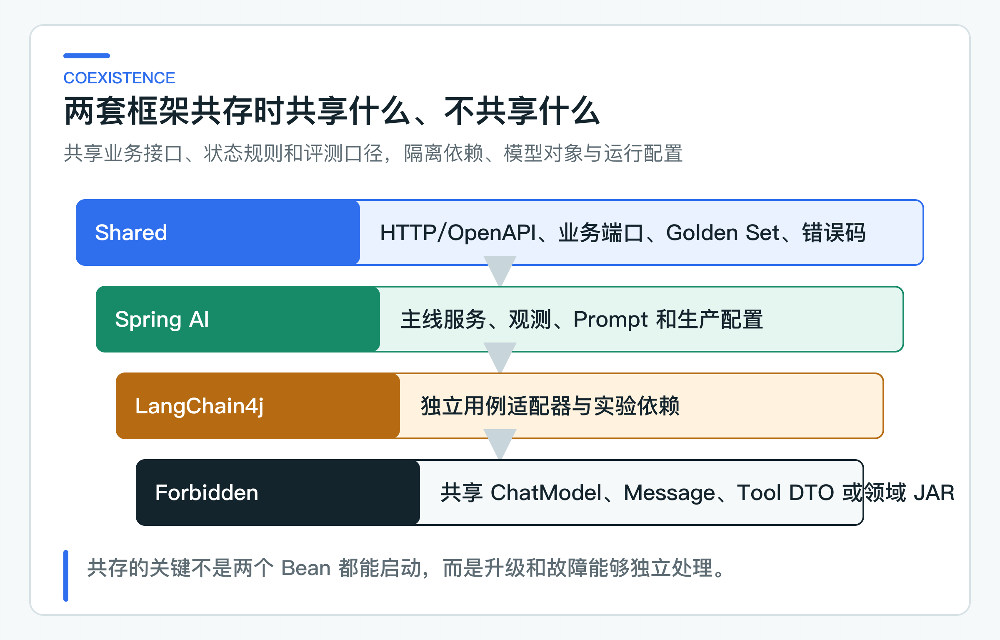
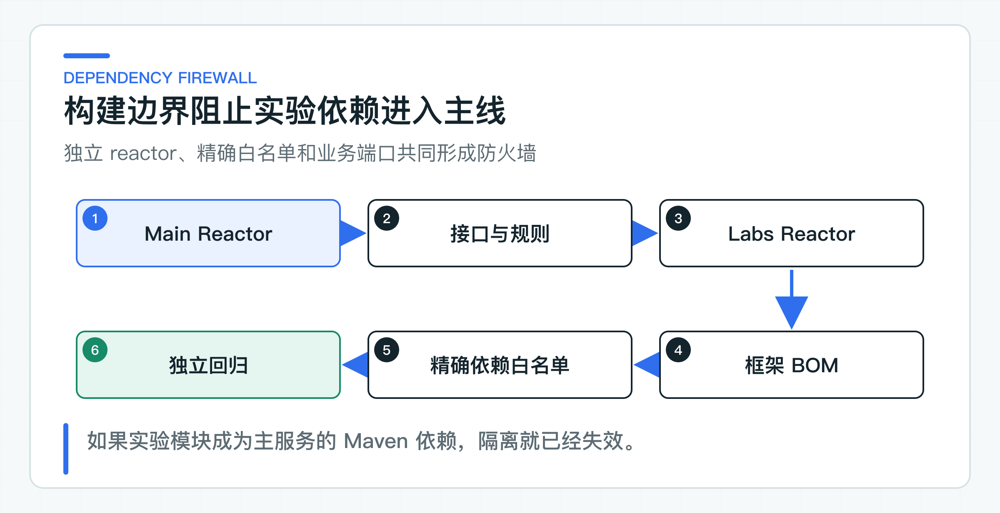

# Spring AI 与 LangChain4j 共存实验：按业务能力选择框架

三个 LangChain4j 实验已经把问答、RAG 和只读 Tool 分别放进窄适配器，仍不足以支持一次性替换现有 Spring AI 实现。更现实的情况是：旧链路继续服务，新框架先承载一个新用例，团队用一段时间比较效果和维护成本。

共存降低了迁移风险，也可能带来两套配置、观测和 Tool 体系。两边可以共享 OpenAPI、业务端口语义、错误码与固定评测集（Golden Set）。`ChatModel`、Message、Tool DTO、Memory 和 Provider 配置则分别管理。

这样，新实现有明确收益时可以扩大，实验失败时也能独立删除，不影响现有生产链路。

## 共享业务语义，隔离框架类型



可以共享：

- 业务问题、输入输出 DTO 和错误处理规则；
- HTTP/OpenAPI、JSON Schema 和 SSE 事件；
- tenant、subject、role 的受信身份语义；
- 检索、Tool API 等业务端口的输入输出语义；
- Golden Set、质量阈值和安全数据集；
- 公司统一 Trace、Metric、日志与密钥平台；
- 发布、灰度和回滚流程。

不应共享：

- Spring AI `ChatClient` 与 LangChain4j `ChatModel`；
- 两套 Message、Prompt、Tool 或 Memory 对象；
- 框架自动配置类；
- Provider SDK DTO；
- 领域 JAR 或跨服务数据库；
- 一个试图兼容所有框架能力的万能抽象。

共享长期稳定的业务语义，隔离短期变化的框架实现。

## 按业务能力固定框架路由

配套代码使用 `FrameworkCoexistencePolicy`：

```java
new FrameworkCoexistencePolicy(Map.of(
        "knowledge-answer", FrameworkChoice.SPRING_AI,
        "ticket-decision-experiment", FrameworkChoice.LANGCHAIN4J));
```

路由粒度可以是用例、租户灰度或固定实验组，但一个请求必须进入一套完整实现。不要第一轮用 Spring AI 生成 Tool Call，第二轮用 LangChain4j 执行 Memory，再用自建网关统一响应。混合链路会让团队无法判断故障、Token 和状态分别来自哪套实现。

任务创建时可以记录 `implementationVersion`，生命周期内保持不变。长会话也要固定实现，避免历史消息和工具协议在中途切换。

### 不为两套框架制造万能 ChatModel

看似合理的接口：

```java
interface UniversalModelGateway {
    String chat(String input);
}
```

很快会遇到结构化输出、流式、Tool、Memory、多模态、RAG、元数据和观测。为了兼容两套框架，接口不断增加通用参数，最后既暴露双方概念，又丢失各自能力。

正确抽象应按业务语义：

```text
KnowledgeAnswerModel
TicketPlanningModel
PolicyClassificationModel
```

每个端口定义自己需要的输入、输出和失败语义。不同框架分别实现，不要求底层 API 一一对应。

## 构建隔离阻止传递依赖冲突



仓库把主 Maven reactor（聚合构建）与 labs reactor 分开：

```text
root pom
  Spring Boot 4.1
  Spring AI 2.0

labs/langchain4j-lab
  LangChain4j 1.18.1 BOM
```

主服务的 Maven Enforcer 禁止 LangChain4j 和 AgentScope 进入依赖树。当前各 lab 只声明实验所需的框架依赖，没有加入数据库或消息队列。如果后续需要更严格的限制，应在 labs reactor 另加 Enforcer 规则；当前 POM 并没有禁止这两类依赖。

公司单仓库可以使用多 reactor、多 Gradle build 或独立模块；多仓库则天然隔离。关键是实验模块不能成为生产主服务的编译依赖。

若最终决定在同一 Spring Boot 应用内共存，要先做 dependency tree、自动配置、Jackson、Reactor、Netty 和观测冲突验证。能启动仍不代表所有路径兼容。

### 两套配置使用独立命名空间

配置前缀必须独立：

```text
spring-ai.knowledge-answer.*
langchain4j.ticket-decision.*
```

每条能力分别锁定 Provider、model、temperature、timeout、并发和重试。不要让两套框架共同读取一个 `MODEL_NAME`，除非它们确实使用相同 Provider 和参数语义。

密钥可以由同一密钥平台管理，但权限和配额按服务或能力分开。实验凭证不能拥有生产写 Tool 权限。

功能开关也按能力：`ticket-decision-langchain4j-enabled`，而不是全局 `use-new-framework=true`。回滚时只关闭受影响用例。

### Prompt 按业务能力版本化

两套框架可以复用同一份逻辑 Prompt 规范，但不一定复用同一个模板文件。Message 格式、Tool Schema 和结构化输出提示可能不同。

建议保存：

- 业务规则版本；
- 各框架渲染模板；
- Provider 参数；
- 输出 Schema；
- 适用数据集和报告。

修改一套实现时，仍用同一 Golden Set 比较。不要为了追求文本完全一致，强迫两个框架采用不自然的模板；关注业务结果与安全边界。

## 在业务指标层统一观测

底层 Listener 可以不同，上层指标要统一。可以在业务端口外层建立 Micrometer Observation（一次可被计时、记录和追踪的业务操作）：

```text
use_case=knowledge_answer
implementation=spring_ai | langchain4j
provider=...
model=...
outcome=success | timeout | rejected | invalid
```

模型原生指标可以保留，但 Dashboard 用统一维度比较延迟、错误、Token 和成本。Trace 中记录实现版本，坏案例可以回到具体链路。

不要把 Prompt、问题、tenant 或 user 作为 Metric 标签。需要排障时通过 traceId 关联低敏日志。

### 对外保持相同错误语义

调用方不应看到 `AiServiceException` 或 Spring AI Provider 异常。两套适配器统一映射：

```text
MODEL_NOT_CONFIGURED
MODEL_TIMEOUT
MODEL_RATE_LIMITED
MODEL_BAD_RESPONSE
MODEL_CONTENT_REJECTED
MODEL_UNAVAILABLE
```

相同错误码不意味着相同重试策略。适配器可以提供 retryable、providerRequestId 等内部信息，业务用例再决定行为。

对结构化输出，解析错误和业务校验错误要分开。模型 JSON 非法是 `MODEL_BAD_RESPONSE`，返回其他 tenant 的 ticketId 是业务结果无效，严重级别更高。

### 用 Golden Set 比较两套实现

只比较两套框架的 API 风格，无法回答哪一种实现更适合当前业务。应使用同一数据集比较：

- 答案正确与引用；
- 拒答与 Injection；
- Tool 路径和参数；
- p50/p95 延迟、TTFT（首个 Token 返回时间）；
- Token 和费用；
- 多次运行稳定性；
- 错误与降级；
- 开发和维护工时。

报告绑定实现版本、模型、Prompt 和 Commit。若 LangChain4j 使用另一个更强模型，需要明确这是“框架 + 模型”组合比较，不能把全部提升都算在框架上。

## 业务数据与状态保持单一所有者

共存时最危险的是两套实现各建 Memory、任务或确认表。一个请求进入哪套框架可以切换，保存业务状态的权威数据源不能切换。

知识文档、AgentTask、Confirmation 和 Audit 仍由原服务拥有。框架只通过端口访问。项目已经使用 Outbox 时，它也继续归原服务管理，不能随框架切换而双写。若实验需要独立状态，应使用测试 tenant 和独立表，并明确不能成为生产事实。

会话迁移要特别谨慎。两套框架的 Message 和 Memory 格式可能不同，建议在应用层保存稳定会话事件，再由适配器转换，而不是直接持久化框架对象。

事务范围也不能由框架决定。无论请求走 Spring AI 还是 LangChain4j，业务写入、确认单和审计都应由同一个应用服务控制；确实需要跨事务可靠投递时，再由这个应用服务引入 Outbox。框架适配器只负责模型交互，不能自行开启一套与业务事务无关的持久化流程，否则回滚时会留下无法解释的中间状态。

同一能力做影子比较时，新实现只读取脱敏输入并产生评测结果，不能重复执行写 Tool。影子链路必须单独标记，结果不写回业务系统。

### 明确两套实现的团队所有权

两套框架意味着：

- 两套升级节奏和 Release Notes；
- 两套故障排查知识；
- 两套 Provider 适配差异；
- 两套安全与工具边界；
- 更多依赖漏洞和兼容验证。

每个用例必须有明确 owner。不能把 LangChain4j 当“创新实验”长期无人维护，也不能让现有服务团队在事故中临时接管陌生框架。

共存应设置复核日期：继续共存、扩大、收缩或统一。没有退出条件的实验会永久增加复杂度。

### 避免请求级随机路由与类型混用

- 同一类中同时注入两套 ChatModel；
- 一个请求随机选择框架但不记录实现；
- 把两套 Tool 注解放在同一个业务方法；
- 两套框架直接访问同一业务数据库；
- 共享框架 Memory 对象；
- 为了“统一”丢弃流式、Tool 或元数据能力；
- 用实验凭证访问生产高风险 Tool；
- 只比较示例代码行数。

这些做法会让共存从风险控制变成长期耦合。

## 框架共存实验怎样限制依赖

独立模块和仓库规则用来阻止依赖泄漏，[FrameworkCoexistencePolicy](https://github.com/DavidDingXu/learn-java-ai/blob/main/learning-stages/stage-07-framework-boundaries/labs/langchain4j-lab/src/main/java/com/xiaoding/javaai/labs/langchain4j/FrameworkCoexistencePolicy.java) 固定按业务能力路由和未知能力拒绝。正式服务与 LangChain4j lab 分别拥有自己的 BOM 和实现。

当前方案不在同一个 Boot 应用内加载两套自动配置。两套框架保持运行单元隔离，lab 中的最小业务端口用来对齐主线语义，并不直接复用主服务内部类。这组实验验证了局部接口适配、按能力路由和依赖边界；比较真实业务效果时，还要让两套实现运行同一份 Golden Set。

Spring AI 与 LangChain4j 可以共存，但共存本身不是目标。只有新方案带来的业务改善足以覆盖额外维护成本时，才值得长期保留；评测结果没有显示明确收益时，继续使用现有实现更合理。Agent Runtime 的比较沿用同一原则：现有 Tool、状态、确认和审计机制必须能够继续使用。

---

[课程首页](../../README.md) · [完整目录](README.md) · [← LangChain4j Tool 实验：只读调用与结构化输出](46-langchain4j-tool-structured-output.md) · [AgentScope Tool 裁决实验：注册、身份传递与权限映射 →](48-agentscope-runtime-contracts.md)

动手实践：[本阶段可运行源码](../../learning-stages/stage-07-framework-boundaries/README.md)
