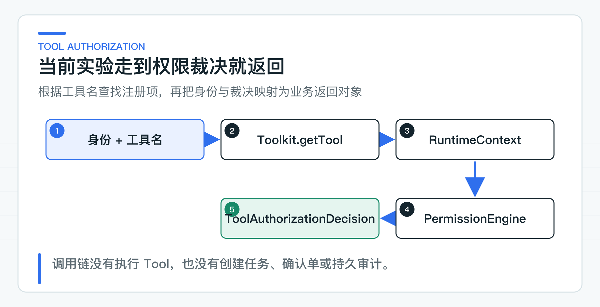

# AgentScope Tool 裁决实验：注册、身份传递与权限映射

把现有业务 Tool 接入 AgentScope，第一步不是运行一个完整 Agent，而是确认两个基础问题：框架能否找到允许暴露的工具，以及权限规则能否给出稳定裁决。

`AgentScopeTicketRuntime.authorize` 先根据工具名从 Toolkit 查找工具，再交给 `PermissionEngine` 返回 `ALLOW`、`ASK` 或 `DENY`。这条适配边界负责工具识别和权限裁决；Tool 执行、任务状态、确认单和持久审计继续由业务服务负责。

## 先把 Runtime 接到权限裁决

Toolkit 是 AgentScope 的工具注册表，保存工具名、说明、参数结构和对应 Java 方法。PermissionEngine 是权限规则裁决器，它根据工具与输入返回一种处理意见。这里的“裁决”只是告诉上层下一步怎么走，不等于业务动作已经发生。



当前调用链只有五步：

```text
受信身份 + toolName + input
-> Toolkit.getTool(toolName)
-> 构造 RuntimeContext
-> PermissionEngine.checkPermission(tool, input)
-> 返回 ToolAuthorizationDecision
```

返回对象保留 tenantId、subjectId、toolName、裁决结果、规则来源和可读原因。没有 taskId、confirmationId、actionId 或业务回执，也就谈不上任务持久化和最终执行结果。

## Toolkit 先限制可识别的工具

`createDefault` 把 `TicketBusinessTools` 注册进 Toolkit。类中定义了 `query_ticket`、`update_ticket` 和 `export_all_customers` 三个工具，注册表由此得到可查找的工具集合。

`authorize` 并不直接根据传入的字符串做权限判断。它先调用 `toolkit.getTool(toolName)`，并确认结果是 AgentScope 的 `ToolBase`：

```java
AgentTool tool = toolkit.getTool(toolName);
if (!(tool instanceof ToolBase toolBase)) {
    throw new IllegalArgumentException("unknown or unsupported tool: " + toolName);
}
```

这一步解决的是“框架是否认识这个工具”，不是“当前用户能否操作某张工单”。未知工具在进入 PermissionEngine 前就会失败，可以避免任意工具名绕过注册表。

Tool 方法虽然真实存在，但 `authorize` 没有调用 `TicketBusinessTools` 中的任何方法。所以测试中的 `ALLOW` 表示可以进入后续校验，不表示 `query_ticket` 已经返回了工单数据。

## PermissionEngine 返回三种处理意见

默认配置为三个工具各注册一条规则：

```java
new PermissionRule("query_ticket", null,
        PermissionBehavior.ALLOW, "ticket-policy")
new PermissionRule("update_ticket", null,
        PermissionBehavior.ASK, "ticket-policy")
new PermissionRule("export_all_customers", null,
        PermissionBehavior.DENY, "data-policy")
```

`query_ticket` 命中 `ticket-policy` 的 ALLOW 规则。`update_ticket` 命中同一来源的 ASK 规则。`export_all_customers` 则命中 `data-policy` 的 DENY 规则。`PermissionEngine.checkPermission` 返回裁决对象，适配器再提取 behavior 和 reason。

```java
PermissionDecision decision = permissionEngine
        .checkPermission(toolBase, toolInput)
        .block();

return new ToolAuthorizationDecision(
        trustedIdentity.tenantId(),
        trustedIdentity.subjectId(),
        toolName,
        decision.getBehavior(),
        matchingRuleSource(toolBase, toolInput, decision.getBehavior()),
        normalizedReason(decision));
```

三种 behavior 可以看成应用层的分支信号。ALLOW 允许继续做对象权限和业务状态校验；ASK 交给现有确认服务；DENY 则直接结束请求。裁决值只决定下一步分支，不承担后续业务动作。

规则内容目前传入 `null`，也就是按工具名匹配，没有根据参数做更细的限制。例如 `update_ticket` 无论目标状态是什么都会得到 ASK。若公司策略还区分“关闭工单”和“修改标签”，参数规范化与规则匹配需要在应用接入时补上。

## RuntimeContext 保留身份，但不负责授权

实验把 `AgentExecutionIdentity` 放进 `RuntimeContext` 的 typed value，同时用 tenantId 和 subjectId 组成 sessionId。裁决返回后，再从 RuntimeContext 取回同一个身份。

```java
RuntimeContext context = RuntimeContext.builder()
        .sessionId(identity.tenantId() + ":" + identity.subjectId())
        .userId(identity.subjectId())
        .put(AgentExecutionIdentity.class, identity)
        .build();
```

这样可以避免在适配器内部重新拼装 tenantId 和 subjectId，也方便后续运行时组件读取统一上下文。不过，RuntimeContext 只是在一次调用中携带数据，它不会验证 JWT，也不会确认 tenant 是否拥有目标工单。

当前 `checkPermission` 只接收 tool 与 input，没有读取 RuntimeContext 中的身份。`AgentExecutionIdentity.role` 虽然被保存，却没有参与三条权限规则。换一个角色调用同一工具，仍会得到相同 behavior。

因此，当前结果只能说明身份字段在适配过程中没有丢失，不能说明框架已经实现了租户隔离或角色授权。正式接入时，身份应来自 Spring Security 等受信认证结果，对象归属和岗位权限则由现有业务授权继续判断。

## 裁决之后，业务服务还要接住什么

把 `ToolAuthorizationDecision` 接回正式服务时，比较合适的位置是应用层适配器。它接收框架裁决，再调用已有的授权、确认和 Tool 执行服务。AgentScope 类型到这里为止，不进入领域对象和对外 API。

ALLOW 不是直接调用工具的快捷通道。应用服务还会根据受信 tenant 查询目标工单，检查对象归属、当前状态和字段范围。通过这些业务判断后，才调用只读 Tool 或创建一次受控执行。

ASK 也不会自动生成确认单。适配器可以把规范化后的参数、任务版本、策略版本和过期时间交给现有确认服务。员工确认时，服务端再读取当前工单与角色，避免几分钟前的裁决覆盖已经变化的业务事实。

DENY 可以直接映射成稳定错误码，同时记录低敏的裁决摘要。数据库仓储和审计写入属于业务服务，不应为了接入 Runtime 再复制一套实现。

真正执行写 Tool 时，任务状态、actionId、幂等键和远端回执仍由业务系统持有。遇到连接超时，应用层根据 actionId 对账；在结果不明时保留 `UNKNOWN`，而不是把一次权限裁决误写成执行成功。

持久审计同样属于这一层。一次有用的记录会关联 taskId、traceId、身份、toolName、参数摘要、规则版本、业务判断和最终回执。Runtime 返回身份、工具、behavior、ruleSource 和 reason，任务服务再补齐业务过程与执行结果。

## 工具裁决映射必须保持稳定

[AgentScopeTicketRuntime](https://github.com/DavidDingXu/learn-java-ai/blob/main/learning-stages/stage-07-framework-boundaries/labs/agentscope-lab/src/main/java/com/xiaoding/javaai/labs/agentscope/AgentScopeTicketRuntime.java) 使用 AgentScope 的真实 `RuntimeContext`、`Toolkit` 和 `PermissionEngine` 类型。当前实验包含三个已注册工具和一个未知工具，并保留身份、工具名、规则来源和原因文本。

运行后可以确认下面三组映射：

```text
query_ticket         -> ALLOW -> ticket-policy
update_ticket        -> ASK   -> ticket-policy
export_all_customers -> DENY  -> data-policy
```

`AgentScopeLabApplication` 会创建 `OpenAIChatModel`、`ReActAgent` 和 `Toolkit`。它只允许 `query_ticket`，并要求模型先取工单事实再回答。控制台出现工单 `T-100` 的状态，才说明模型与 Tool 都实际执行过。这里没有开放写 Tool。

这组结果回答的是“AgentScope 的工具注册和权限接口能否嵌入现有 Java 代码”。继续接入时仍分成两层：适配器层处理未知工具、缺失身份、参数规则和策略异常；业务层处理对象授权、确认单、幂等执行与持久审计。框架升级因此不会顺带改动业务控制。

是否把这段适配扩展成完整 Runtime，要看模型循环和工具编排能否减少现有代码，同时继续复用任务状态与安全规则。只有工具裁决映射，而没有执行与恢复链路时，它仍然只是 Runtime 适配器，不是完整工单 Agent。

---

[课程首页](../../README.md) · [完整目录](README.md) · [← Spring AI 与 LangChain4j 共存实验：按业务能力选择框架](47-spring-ai-langchain4j-coexistence.md) · [多 Agent 实际协作：并行取证、结果汇总与失败转人工 →](49-multi-agent-human-intervention.md)

动手实践：[本阶段可运行源码](../../learning-stages/stage-07-framework-boundaries/README.md)
