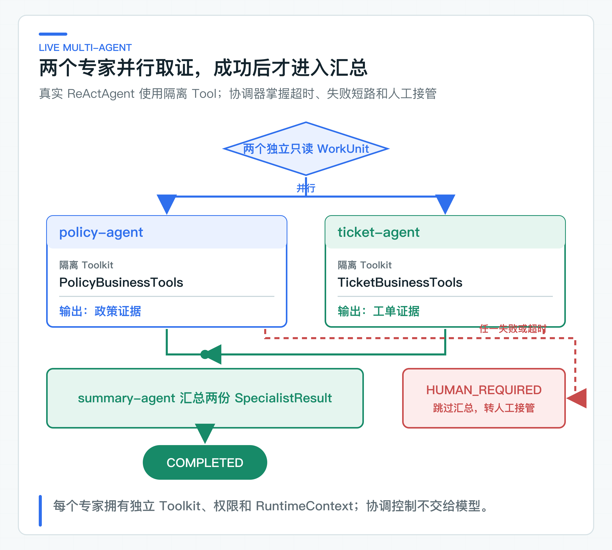
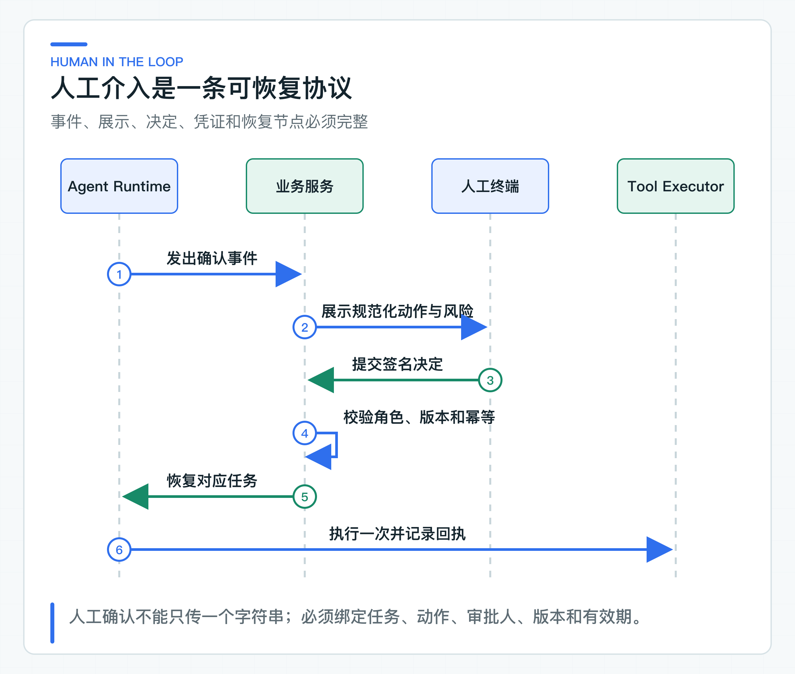

# 多 Agent 实际协作：并行取证、结果汇总与失败转人工

把“制度检索、订单核验、风险判断”分别交给三个 Agent，再由一个协调器汇总，表面上很容易显得更智能。放进生产后，每次交接都会增加模型调用、Token、延迟和失败点，责任反而可能更模糊。

是否拆成多 Agent，要看子任务能不能独立验收、工具或权限是否真的需要隔离，以及收益能否覆盖交接成本。事实不足、动作需要主观授权或风险无法自动承担时，正确的下一步通常是等待人工，而不是继续增加 Agent。

配套代码先用 `CollaborationPolicy` 决定是否拆分，再由 `MultiAgentCoordinator` 并行调用两个真实 AgentScope 专家。制度 Agent 只能查询退款政策，工单 Agent 只能读取工单；两者都成功后，第三个 Agent 才能汇总。任一专家失败或超时，协调器跳过汇总并返回 `HUMAN_REQUIRED`。

## 三种编排方式对应不同责任结构

第一种是单 Agent：一个模型上下文持有目标、状态和工具，适合步骤少、责任一致、上下文高度共享的任务。

第二种是多 Agent：多个执行单元各自拥有角色、工具或上下文，通过明确协议交接。它适合相对独立的子任务，不适合把同一问题重复问三遍再投票。

第三种是人工介入：系统暂停自动执行，由有权限的人确认、补充事实、选择分支或接管。人工介入不是出现异常后才展示的一句“转人工”提示，而是状态机中的正式步骤。



选择顺序应从最简单的结构开始。确定性代码能解决，就不用 Agent；一个 Agent 能在受控工具内完成，就不要拆分。只有拆分后能证明质量、吞吐或责任边界改善，才采用多 Agent。风险或事实无法由机器判断时，进入人工。

## 拆分多 Agent 的三个前提

拆分前先检查三个前提：

| 前提 | 判断方法 |
| --- | --- |
| 子任务可以独立验收 | 例如工单处理包含“检索制度”“核验订单状态”“形成回复建议”。三项都有明确输入输出、可以分别超时和重试，才具备拆分基础；若每一步都依赖上一段完整自然语言思考，拆开只会丢上下文 |
| 工具或权限需要隔离 | 知识 Agent 只能读制度文档，订单 Agent 只能查低敏订单状态，执行 Agent 才能申请写操作。不同身份和工具目录能形成真实安全边界，仅仅使用不同 System Prompt 不构成权限隔离 |
| 交接成本小于收益 | 每次交接都会增加序列化、模型调用、Token、延迟、失败点和观测成本。只有并行缩短关键路径、专业上下文明显改善质量，或责任隔离降低风险，收益才可能覆盖成本 |

## 一个适合拆分的工单调查场景

配套入口采用一个边界清楚的工单调查场景：

```text
协调器创建任务
├─ 制度 Agent：调用 query_refund_policy 读取到账规则
└─ 工单 Agent：调用 query_ticket 读取 T-100 状态
汇总器接收结构化结果
-> 生成建议
-> 必要时请求人工确认
```

两个子任务并行执行，各自有独立 Toolkit、权限、RuntimeContext 和超时。协调器不共享数据库，不复制客户完整资料，只发送同一个最小问题。某个专家失败时，汇总器不会被调用，任务直接进入人工，而不是让另一个 Agent 猜测。

另一类场景是跨团队或跨系统的长任务。例如研发变更评审中，代码安全、依赖许可和发布风险由不同服务负责。它们本来就有独立 owner、SLA（服务级别协议）和审计，多 Agent 协议只是把现有责任边界接起来。

### 这些场景保留单 Agent 更清楚

- 一个问答只需一次检索和一次生成；
- 把计划、执行、反思机械拆成三个角色，却共享同一模型和全部工具；
- 子 Agent 输出没有 Schema，只传大段自然语言；
- 所有 Agent 都能调用高风险写工具；
- 通过“多数票”决定退款、权限或合规动作；
- 任务必须严格顺序执行，拆分后不能并行；
- 没有单 Agent 基线，无法证明复杂度带来收益。

所谓 Reviewer Agent 也要谨慎。如果 Reviewer 使用同一模型、同一上下文和同一错误信息，它可能稳定重复原错误。高风险验证更适合确定性规则、独立数据源、不同权限的服务或人工复核。

## 人工介入承担四类职责

人工介入不能统一成一个“确认”按钮。

第一类是授权：系统已经形成明确动作，请有权限的人批准或拒绝，例如退款、状态变更、外发邮件。

第二类是补充事实：系统缺少订单号、客户关系或异常说明，需要用户提供输入后继续。

第三类是选择分支：多个方案都合法，但涉及业务偏好，例如选择补偿方式或处理队列。

第四类是接管：模型或工具连续失败、发现冲突、涉及投诉升级，自动任务终止，由人工继续处理。

不同职责对应不同状态、界面和审计。把“请确认”同时用于补信息和高风险授权，会让用户不知道自己承担了什么责任。

### 把人工等待建模为正式状态



AgentScope 的 `RequireUserConfirmEvent` 可以表达 Runtime 需要确认。当前 `CollaborationPolicy` 只生成一个确认事件，测试也只检查事件类型。这个事件没有绑定 taskId、actionId 或规范化参数，因此还不是可直接展示给用户的业务确认单。正式链路还要完成：

```text
Runtime 发出确认需求
-> 应用服务生成 Confirmation
-> 前端展示动作、原因、影响和有效期
-> 用户批准或拒绝
-> 服务端重新校验身份与业务状态
-> 执行动作或关闭分支
-> Runtime 接收稳定结果继续/结束
```

业务确认单必须绑定 taskId、actionId、规范化参数哈希、申请人、所需角色、策略版本和过期时间。用户点击后由服务端校验，不能让前端提交一份可修改的动作 JSON。

超时、拒绝和撤回都是正式结果。任务状态应能表达 `WAITING_FOR_INPUT`、`WAITING_FOR_CONFIRMATION`、`REJECTED`、`EXPIRED` 和 `HUMAN_TAKEOVER`，不能长期停在 RUNNING。

## 协调器只负责拆分与汇总

多 Agent 需要协调，但协调器的职责应尽量确定：创建子任务、分发最小上下文、等待结果、执行超时策略、校验返回 Schema、汇总证据和推进状态。

如果协调器还可以任意改写子任务、选择全部工具、修改权限并决定高风险动作，它就变成更难控制的超级 Agent。生产中可以让模型帮助形成计划，但服务端必须把计划编译成允许的 WorkUnit，并限制依赖和副作用。

代码用 `WorkUnit` 记录两个关键属性：是否独立、是否有副作用。`CollaborationPolicy` 根据这两个属性选择单 Agent、多 Agent 或人工确认，不让模型自己决定是否需要监管。选中多 Agent 后，[MultiAgentCoordinator](https://github.com/DavidDingXu/learn-java-ai/blob/main/learning-stages/stage-07-framework-boundaries/labs/agentscope-lab/src/main/java/com/xiaoding/javaai/labs/agentscope/MultiAgentCoordinator.java) 才会并行运行至少两个专家，并在所有必要结果到齐后调用汇总器。

示意规则是：

```text
存在副作用              -> HUMAN_REQUIRED
多个独立只读工作单元    -> MULTI_AGENT
其他情况                -> SINGLE_AGENT
```

实际策略还会加入数据分级、工具风险、任务时限、成本预算和资料完整性，但最终选择仍由服务端规则决定。

### Agent 之间传递结构化工作单元

Agent 之间的交接数据应结构化、最小化并带有版本。一个调查结果可以定义：

```json
{
  "workUnitId": "policy-check-1",
  "status": "COMPLETED",
  "facts": [],
  "citations": [],
  "riskFlags": [],
  "confidence": "INSUFFICIENT_EVIDENCE"
}
```

不要传完整思维过程，也不要把上游 Agent 的自然语言当作下游系统指令。下游只消费声明过的字段，并重新检查引用、tenant 和来源。外部 Agent 返回的内容与普通第三方输入一样不可信。

交接还要记录 producer、schemaVersion、taskId、traceId 和生成时间。过期结果、错误任务结果和未知 Schema 应拒绝进入汇总。

### 每个 Agent 只接收所需上下文

拆成多 Agent 后，不应把原会话完整复制给每个子任务。制度 Agent 只需要规范化问题、tenant 可见范围和有效时间；订单 Agent 只需要订单标识与受信身份；风险 Agent 只接收完成判断所需的低敏事实。最小上下文既减少 Token，也降低横向数据扩散。

子 Agent 如果需要更多信息，应通过声明过的输入请求返回协调器，由协调器检查是否允许补充。不能允许它自行遍历其他 Agent 的 Memory、读取共享文件目录或查询不属于当前任务的数据。

Memory 也应按任务和角色隔离。长期用户偏好可以由应用层筛选后提供，不能把一个 Agent 写入的自然语言记忆自动视为另一个 Agent 的可信事实。共享事实最好来自版本化业务记录，或者带来源的结构化 artifact（任务产物）。

### 拆分前确定预算与部分失败策略

三个 Agent 并行不代表成本只有一次。每个 Agent 可能多轮调用模型和工具，汇总器还要再次生成。任务创建时应分配模型调用数、Token、工具调用数、最大并发和截止时间，并由协调器累计。

预算耗尽后的行为要预先定义：返回已有资料、降级为单 Agent、请求人工，还是终止。不要让模型自己决定继续“再调查一步”。对高峰流量，子任务队列还需按 tenant 和任务类型限流，避免一次复杂调查占满全部模型与下游连接。

并行任务的 p95 通常受最慢的关键子任务主导，也会受子任务耗时分布和相关性影响。拆分前应画出依赖图，只有位于同一并行层且没有副作用依赖的 WorkUnit 才一起执行。为了展示多 Agent 而并行查询同一数据库，往往只会制造连接池尖峰。

预算之外，协调器还要在创建任务前确定部分失败怎样处理。并行任务经常出现两个成功、一个超时，此时要明确是全部成功才继续、允许缺少非关键结果，还是超时后转人工。

不能让模型临时判断“这个结果大概不重要”。关键性属于业务配置。若制度条款缺失，工单回复不能给确定承诺；若一个辅助分类失败，可能仍可继续但要标记质量降级。

取消也要向子任务传播，但已经产生的远程副作用不能假装回滚。每个子任务应声明只读或写、是否可取消、是否有补偿动作。协调器只做协议层协调，业务补偿由对应服务拥有。

## 用质量、成本和恢复能力判断收益

至少建立单 Agent 基线，再比较：

- 端到端任务成功率；
- 关键事实和引用完整率；
- 高风险误执行次数；
- p50/p95 时延；
- 模型与工具调用数；
- Token 和单任务成本；
- 人工介入率与平均处理时间；
- 部分失败后的可恢复率。

多 Agent 如果只提高了回答长度，却让成本翻倍、错误更难定位，就不值得上线。对部分场景有效时，按能力或任务复杂度路由，不必把所有请求统一迁移。

## 把成功与失败两条路径都跑一遍

在项目根 `config/application-default.yml` 填好统一的 OpenAI 兼容配置后，运行 `MultiAgentCollaborationApplication`。这条在线路径会真实调用三个 ReActAgent：两个专家并行调用各自 Tool，汇总 Agent 只消费专家结果。控制台会打印 `decision=MULTI_AGENT`、`status=COMPLETED`、两份专家结果和最终回答。

再运行 `MultiAgentFailureApplication`。它用确定性专家制造工单服务不可用，不消耗模型 Token；控制台应打印 `status=HUMAN_REQUIRED`，而预设的汇总答案永远不会出现。这条补充路径证明失败短路由协调器控制，不依赖模型是否愿意“谨慎回答”。

[CollaborationPolicy](https://github.com/DavidDingXu/learn-java-ai/blob/main/learning-stages/stage-07-framework-boundaries/labs/agentscope-lab/src/main/java/com/xiaoding/javaai/labs/agentscope/CollaborationPolicy.java) 仍负责拆分前决策：依赖上下文的只读单元保留单 Agent，多个独立只读单元才拆分，带副作用的工作单元返回 `RequireUserConfirmEvent`。

演示结果用 `SpecialistResult` 包装名称、答案或错误。接入跨服务 Agent 时，再扩展 taskId、schemaVersion、引用和身份委托，并补持久任务、消息投递、观测与人工工作台。

多 Agent 不是 Agent 能力成熟度的标志。生产系统要明确什么时候不拆、什么时候停下来等人，以及每次交接由谁负责。当协作单元需要访问远程企业工具时，工具发现与调用协议必须同时受本地白名单和权限策略控制；MCP 只统一协议，不替业务系统完成授权。

---

[课程首页](../../README.md) · [完整目录](README.md) · [← AgentScope Tool 裁决实验：注册、身份传递与权限映射](48-agentscope-runtime-contracts.md) · [MCP 互操作实验：发现、准入、调用与远程失败 →](50-mcp-enterprise-tools.md)

动手实践：[本阶段可运行源码](../../learning-stages/stage-07-framework-boundaries/README.md)
