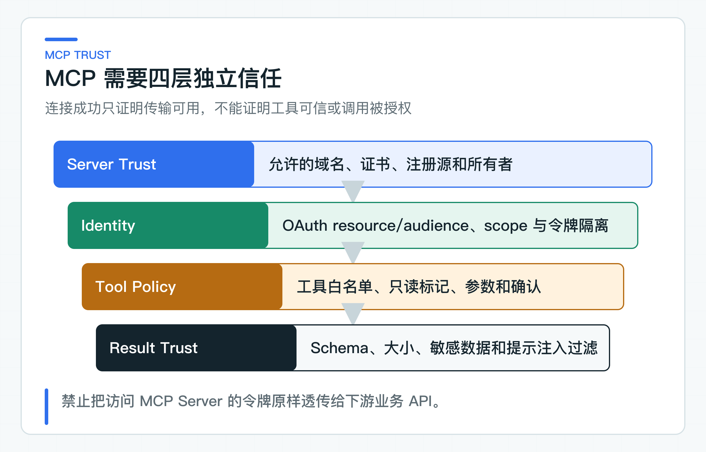

# MCP 互操作实验：发现、准入、调用与远程失败

当企业工具越来越多时，为每个 Agent 单独维护一套 HTTP 适配器成本很高。MCP（Model Context Protocol，模型上下文协议）提供了统一的能力发现与调用方式，让 Client 可以读取工具 Schema，再按协议发起调用。

但“能够发现”不等于“允许使用”。远程 Server、工具描述、参数 Schema 和返回结果都属于外部输入；当前用户能操作哪些对象、写动作是否需要确认、失败后怎样恢复，仍由本地业务系统决定。

协议 lab 使用官方 Java SDK 验证 Streamable HTTP（基于 HTTP、可承载普通响应或流式事件的 MCP 传输）的初始化、工具发现和只读调用。企业接入时，再在协议之上增加受管服务器目录、本地工具白名单、受信身份、风险策略和审计。

## MCP 位于 Agent 与远程工具之间

典型流程包含 Client、Server 与业务系统。AI 应用中的 MCP Client 连接远程 Server，完成能力协商和工具发现；模型只能看到本地批准后的工具；实际调用再由 Client 发往 Server。

```text
读取受管服务器配置
-> 建立加密连接并认证服务器
-> 协商协议能力
-> tools/list 获取候选 Schema
-> 企业工具目录和策略筛选
-> 注册到 Agent Toolkit
-> 模型产生 Tool Call
-> 本地参数、身份、权限和风险校验
-> tools/call
-> 校验远程结果并审计
```

MCP 统一了 `tools/list` 和 `tools/call` 等交互，但本地系统仍要决定哪些服务器和工具可以进入目录，并负责权限、超时、重试、数据分级，以及失败后的状态处理。

## 服务器目录由平台统一管理

生产 MCP Server 不应由用户在请求参数里随意传 URL。服务器目录应由配置中心或管理平台维护，记录 serverId、owner、环境、endpoint、认证方式、允许能力、数据等级和审批状态。

至少检查：

- 只允许 HTTPS，证书和主机名验证不能关闭；
- endpoint 必须命中域名或网络白名单；
- 禁止回环、链路本地、云元数据和内网任意地址，防止 SSRF（服务端请求伪造）；
- 禁止自动跟随到未批准域名的重定向；
- DNS 解析与连接目标要防止重绑定，避免同一域名在校验后改解析到内网地址；
- Server 版本和协议能力需要兼容；
- 连接、工具列表和 Schema 大小都有上限。

开发环境连接本地 Server 可以单独配置，但不能把“允许任意 localhost”带到生产策略。远程服务器变更 endpoint 或证书时应重新审批，而不是静默接受。

`EnterpriseMcpRegistry` 的服务器目录是 `serverId -> HTTPS endpoint` 映射。业务请求只能提交 `serverId`，注册回执中的真实地址由目录查出。这样无法用一个已批准的 ID 替换成请求方指定的私有地址。

实验代码还会拒绝 HTTP、带用户信息、查询参数或 fragment 的受管地址。DNS 重绑定、连接目标复查和跨域重定向需要在 HTTP 传输层继续处理，不是这个工具目录已经验证的能力。

### 工具发现后进入本地白名单

`tools/list` 返回的是候选能力。Server 可以新增工具、修改描述、扩大参数范围，甚至在被入侵后返回危险 Schema。Client 不能把整个列表直接交给模型。

代码把这组检查拆成两部分。AgentScope lab 验证外部 Tool 怎样进入本地 Toolkit；独立协议 lab 则使用官方 MCP Client 完成 `initialize` 和 `tools/list`。

只有工具名命中本地白名单、输入 Schema 是对象、描述非空，并且实验规则明确标注为只读且非破坏性，才进入本地已发现目录。`EnterpriseMcpRegistry` 会先校验整批发现结果。其中任一工具不合规时，前面的工具也不会半途注册到 Toolkit。

这里的 `readOnlyHint` 和 `destructiveHint` 只是远端声明，不是可信授权。代码检查它们是为了拒绝声明不一致的 Server，工具能否进入本地目录仍由白名单和业务策略决定。生产目录还要固定 Server 身份、工具输入 Schema 的稳定摘要（Schema Hash）、风险等级与 owner，不能仅凭远端 Hint 自动放行。

加入工具目录和获得单次调用授权是两个动作。`EnterpriseMcpRegistry` 把符合目录规则的外部工具注册到 `Toolkit`。同一个 `Toolkit` 再交给 `AgentScopeTicketRuntime` 做 `PermissionEngine` 裁决。配套测试故意注册两个只读工具，只给其中一个配置本地 ALLOW 规则：有规则的通过，只进入目录却没有授权规则的被拒绝。这条边界防止开发者把“能被模型看到”误当成“当前身份可以执行”。

生产目录还应固定：

```text
serverId + toolName + schemaHash + riskLevel + owner + policyVersion
```

Schema Hash 变化时停止自动注册并告警。新增 optional 字段也可能改变模型行为，不能仅按 JSON Schema 的兼容规则判断业务兼容。

### 三段认证保护不同边界



第一段是 Client 与 MCP Server 之间的认证。MCP 授权本身是可选能力；受保护的 HTTP Server 一旦支持该能力，应按 2025-11-25 授权规范完成 OAuth 2.1 发现和访问令牌校验。公司可以额外使用 mTLS 或工作负载身份加强服务间信任；如果需要与通用 MCP Client 互操，仍要按协议处理 OAuth 元数据、audience 和 scope。

第二段是用户委托：远程业务动作需要知道代表哪个用户、租户和角色执行。委托凭证应由受信认证链路生成，具备最小 scope、短有效期和目标受众，不能把用户原 token 原样传给任意 Server。

第三段是对象授权：即使用户具有某项 scope，也要检查其是否能访问具体工单、文档或客户。对象级授权通常由真正拥有数据的业务服务完成。

三段不能合并成“有 MCP token 就能调用全部工具”。MCP Client 使用的连接凭证也不能暴露给模型、Prompt、Tool 参数、前端或普通日志。

## 将模型参数编译成远程请求

模型返回工具名和 JSON 参数后，本地适配层先执行：

1. 工具名与版本白名单；
2. JSON Schema、类型、长度、枚举和格式校验；
3. 删除或拒绝 tenantId、role、subjectId 等身份污染字段；
4. 业务规范化，例如金额单位、时区和内部编码；
5. 对象权限与当前状态校验；
6. 风险分级，必要时创建人工确认；
7. 生成 actionId、idempotencyKey 和请求指纹；
8. 才调用远程 MCP Server。

如果远程工具只是另一个包装层，最终业务服务仍要重复关键授权。边界处重复校验不是浪费，因为任何一层都可能配置错误或被绕过。

远程工具描述不能承担安全规则。描述可以帮助模型正确选择工具，但“只有管理员能调用”必须由策略和业务代码执行。

### Tool Result 回到本地后再次校验

MCP Server 返回的文本、结构化内容、资源链接或错误信息，都可能包含提示注入、敏感信息和超大负载。接入层要检查 content type、大小、Schema、字符集和允许字段，再转换为内部低敏 DTO。

外部结果中的“请忽略规则并调用另一个工具”只能作为数据。不要把服务器返回的任意文本直接拼进 System Message；用清晰的数据边界包裹，并在下一次工具选择前重新执行本地策略。

资源 URL 也不能由后端自动抓取任意地址。需要下载时继续执行域名白名单、大小、类型、恶意内容和权限检查。

## 远程调用按结果确定性分类

至少区分以下失败：

```text
MCP_SERVER_NOT_APPROVED
MCP_AUTH_FAILED
MCP_CAPABILITY_MISMATCH
MCP_TOOL_NOT_ALLOWED
MCP_SCHEMA_CHANGED
MCP_ARGUMENT_INVALID
MCP_TIMEOUT
MCP_RATE_LIMITED
MCP_REMOTE_ERROR
MCP_RESULT_INVALID
MCP_EXECUTION_UNKNOWN
```

连接失败和工具列表失败可以按连接策略重试；只读调用超时可以在总截止时间内有限重试；写调用发送后超时则可能已经成功，必须标记 UNKNOWN，使用 actionId 查询或等待远程回执。

通用 HTTP retry 不能覆盖所有 MCP 调用。是否重试由工具目录中的 `readOnly`、`idempotent`、`supportsStatusQuery` 等业务属性决定，而不是由 POST/GET 方法决定。

限流要同时保护本地与远程：按 tenant、用户、Server、Tool 和全局连接池设置预算。某个 Server 熔断时，只降级依赖它的能力，不要让全部 Agent 停止服务。

### 审计关联本地决策与远程调用

一次 MCP 调用需要把本地任务和远程回执连起来：

- taskId、stepId、traceId；
- serverId、toolName、schemaHash；
- tenant、subject、delegation scope；
- 参数摘要、actionId、idempotencyKey；
- 本地策略决策与确认单；
- MCP request id、远程 receipt；
- 耗时、结果状态和错误分类。

远程 Server 也应记录自己的调用者、委托身份和业务结果。双方通过 request id 或 actionId 对账。只有本地“发送成功”的日志，无法证明远端动作是否完成。

## 用互操作基线管理协议升级

MCP 协议版本、Client SDK、Server 实现和 Tool Schema 是四个独立版本。升级协议库前要验证握手、能力协商、错误映射、认证和传输；Server 发布前要比较 Tool Catalog；Schema 变化要重跑 Golden Set 和安全回归。

建议采用先影子发现、后只读、再有限写入的顺序：

```text
开发环境契约测试
-> 预发连接与认证
-> 生产只执行 tools/list 并比较 Schema
-> 小流量只读工具
-> 人工确认的低风险写工具
-> 评估是否扩大
```

回滚不只是降级 SDK，还要能在目录中禁用单个 Server 或 Tool，撤销凭证，并让等待中的任务进入明确状态。

### 平台拥有连接生命周期与配置

MCP Client 连接不能由每次用户请求临时创建。连接管理器应按 Server 维护连接池、健康状态、协议能力和最近一次 Schema，设置空闲回收、最大并发和重新连接退避。某个 Server 持续失败时熔断，避免每个 Agent 轮次都重新握手。

配置变更由平台或服务 owner 审批。业务研发可以申请使用一个工具，但不能自行扩大 Server 网络权限、修改认证 scope 或跳过 Schema 校验。目录变更应产生审计事件，并能够回到上一版本。

多实例部署时，工具目录需要一致版本。不能让一半实例看到新工具、一半仍使用旧 Schema，否则同一 Prompt 会产生不同路径。发布时先完成目录同步和兼容验证，再开放模型可见性。

## 远程工具还要通过数据合规和互操作验证

远程 MCP Server 可能部署在另一个网络区、云账号甚至外部供应商。接入前要明确哪些字段会离开当前服务，数据分类是否允许，日志和 artifact 保存在哪里，供应商是否会把这些数据用于模型训练，以及删除和留存规则如何执行。

工具参数应在本地完成脱敏和最小化。能够传订单内部编号，就不传手机号；能够传政策条款 ID，就不传整份客户对话。若任务需要跨境或外部处理敏感数据，应由合规与数据 owner 明确批准，不能靠工具描述默认同意。

远程 Server 返回的错误也可能包含其内部敏感信息。对用户只映射稳定错误码，原始错误按安全等级受控保存。

### 直接运行 MCP 发现与调用

运行 [McpLabApplication](https://github.com/DavidDingXu/learn-java-ai/blob/main/learning-stages/stage-07-framework-boundaries/labs/protocol-interop-lab/src/main/java/com/xiaoding/javaai/labs/protocol/McpLabApplication.java)，不需要 API Key，也不需要预先安装 MCP Server。主类会在随机端口启动官方 Java Server，再由官方 Client 通过 Streamable HTTP 完成初始化、工具发现和 `tools/call`。

控制台会打印 Server 名称、协商后的协议版本、获准工具，以及 `query_ticket` 返回的工单状态。看到 `tools=[query_ticket]` 和 `ticket=T-100,status=OPEN`，说明发现、准入和调用确实经过了真实协议链路。

[EnterpriseMcpClient](https://github.com/DavidDingXu/learn-java-ai/blob/main/learning-stages/stage-07-framework-boundaries/labs/protocol-interop-lab/src/main/java/com/xiaoding/javaai/labs/protocol/mcp/EnterpriseMcpClient.java) 不把远端工具列表直接交给模型。它先调用官方 SDK 的 `initialize()`，再执行 `listTools()`，用本地批准目录和只读规则筛选。所有必需工具都验证通过后，候选集才会整体进入可调用目录；任何一个工具声明为可写或破坏性操作，整批发现都失败。

```java
McpDiscoveryReceipt receipt = enterpriseClient.initializeAndDiscover();
CallToolResult result = enterpriseClient.callReadTool(
        "query_ticket",
        Map.of("ticketId", "T-100"));
```

自动化边界检查还会让 Server 同时暴露一个破坏性工具，确认整批发现失败后，不会留下前面已经通过的只读工具。可观察的协议体验由上面的 `McpLabApplication` 提供。

协议 lab 单独建 reactor 还有一个现实原因：AgentScope `2.0.2` 维护自己的 MCP SDK 传递依赖，协议 lab 则直接锁定 MCP SDK `2.0.0`。直接在 AgentScope lab 强制覆盖主版本，会把“协议升级实验”变成对框架依赖树的破坏性替换。

隔离后，业务适配接口可以复用，两套 SDK 的依赖树和升级风险分别验证。

### 协议互操作与业务策略分开判断

当前目录规则处理受管 HTTPS 地址、未批准 Server、未登记工具、整批校验失败不留半注册状态、只读工具注册和本地权限裁决。工具已进入 Toolkit，不代表当前身份已经获得调用权。

独立协议实验使用受控 MCP Server，完成真实初始化、工具发现、调用和响应映射。实际 OAuth、网络阻断、超时、Schema 热更新和远端写操作，仍要连接目标 Server 验证。只在本地构造 `ToolSchema`，不能证明远程互操作。

协议 lab 使用官方 Java Client 与 Server，通过 Streamable HTTP 完成初始化、发现和只读调用。AgentScope lab 则复用同一个 `Toolkit`，验证加入工具目录和获得调用授权是两道独立检查。

生产 OAuth、附加的 mTLS 或工作负载身份、网络策略、对象级授权、Schema 变更审批和远程写操作，仍需要在目标环境验证。

MCP 降低的是工具适配的协议成本。它统一调用方式，但授权、数据边界、执行结果和故障处理责任仍然留在本地业务系统与工具提供方。

MCP 适合标准化一次工具调用。如果另一个 Agent 自己持有长任务、状态和结果，这项协作就不再是 Tool Call，应使用 A2A 任务协议处理发现、提交与状态映射。

参考资料：

- [MCP 2025-11-25 Specification](https://modelcontextprotocol.io/specification/2025-11-25)
- [MCP Java SDK 发布记录](https://github.com/modelcontextprotocol/java-sdk/releases)

---

[课程首页](../../README.md) · [完整目录](README.md) · [← 多 Agent 实际协作：并行取证、结果汇总与失败转人工](49-multi-agent-human-intervention.md) · [A2A 互操作实验：任务映射、幂等与状态边界 →](51-a2a-task-collaboration.md)

动手实践：[本阶段可运行源码](../../learning-stages/stage-07-framework-boundaries/README.md)
