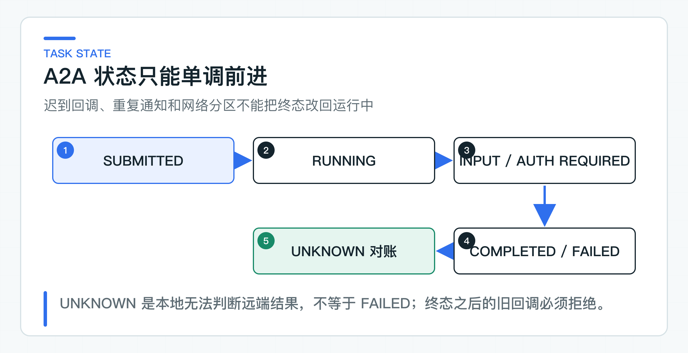

# A2A 互操作实验：任务映射、幂等与状态边界

查询订单状态适合一次 Tool Call，委托另一个团队的风险 Agent 完成长时间分析则更像一项独立任务。它会跨服务持续存在，产生中间状态，可能需要查询、回调、取消和最终结果对账。

A2A（Agent-to-Agent）处理的是后一类协作：一个 Agent 以任务方式委托另一个 Agent。协议 lab 用官方 Java SDK 完成 Agent Card 发现、消息发送，并把返回结果映射为带 artifact 的完成态 Task。它没有查询远程任务状态。本地工单 Agent 则继续保存业务任务、幂等键和 `UNKNOWN` 状态。远端 SDK 的 Task 是协议对象，不直接充当本地数据库领域模型。

这样即使回调乱序、提交超时或远端状态变化，本地系统仍有自己的任务身份和恢复规则。

## Tool Call 与远程 Agent 任务的边界

Tool Calling 通常是当前 Agent 调用一个明确能力，调用方掌握主流程和工具调用规则。A2A 的远端 Agent 可能自己规划、调用工具、产生中间状态，并在稍后返回 artifact。这里的 artifact 是远端任务产生的结构化结果，例如风险报告或文件引用。

适合 A2A 的任务通常具备：

- 由独立团队或服务拥有；
- 执行时间可能超过一次同步请求；
- 需要状态查询、回调、取消或补充输入；
- 结果有明确 artifact/Schema；
- 调用方不需要知道远端内部步骤。

如果只是查一个订单状态，普通业务 API 或 MCP Tool 更直接。不要为了使用 A2A，把毫秒级 RPC 包装成长任务。

## 远程提交前先保存本地任务

面向异步生产链路的可靠顺序是：

```text
本地创建 AgentTask / A2aTask
-> 保存 idempotencyKey 与请求指纹
-> Outbox 投递远程请求
-> 记录 remoteTaskId
-> 接收状态或结果回调
-> 校验并推进本地状态
-> 保存 artifact/receipt
-> 通知上游任务
```

不能先调用远端，成功后再写本地任务。远端已接收而本地事务失败时，系统会失去追踪对象。Outbox 是与业务数据在同一事务中写入的待投递事件表，它让任务记录与远程请求原子落库，再由投递器重试发送。

`A2aTaskCoordinator` 为了聚焦状态规则使用内存 Map；它没有实现数据库事务、Outbox 投递器或 HTTP 回调端点。公司代码应把唯一约束和状态迁移放入数据库事务。只有远程提交必须与本地任务解耦、并且需要可靠异步投递时，才引入 Outbox；需要对重复回调做持久化去重时，再加入已处理事件表 Inbox。同步只读协作不必为了架构形式额外增加消息表。

## 幂等键与请求指纹一起保存

调用方重试提交时使用稳定 `idempotencyKey`。相同键、相同业务请求应返回同一个任务；相同键、不同请求必须拒绝。

`A2aTaskRequest` 同时包含：

```text
tenantId
idempotencyKey
remoteAgent
taskType
businessObjectId
dataScope
instruction
inputVersion
```

请求体不接收调用方提供的 Hash。`A2aTaskRequest` 会去掉各字段首尾空白，并把 instruction 中连续的空白合并为一个空格。`requestFingerprint()` 再对租户、目标 Agent、任务类型、业务对象、数据范围、指令和输入版本计算 SHA-256。每个字段都先写入字节长度，因此字段边界不会因简单字符串拼接而混淆。

幂等存储还使用 `tenantId + idempotencyKey` 作为命名空间。这样即使两个租户恰好使用相同的 Key，也不会复用对方的任务。

四种情况要分开：

- 同键同指纹：返回既有 taskId；
- 同键不同指纹：报幂等冲突；
- 不同键同业务动作：由业务唯一约束判断是否重复；
- 重复回调同状态同回执：幂等接受，不重复触发下游。

幂等记录的保留时间要覆盖远端最长任务与重试窗口。任务已经归档后复用旧键，仍应返回历史结果或明确过期，不能悄悄创建第二个动作。

## 状态只向前推进



本地任务状态为：

```text
SUBMITTED -> RUNNING -> COMPLETED
                    -> FAILED
                    -> UNKNOWN
SUBMITTED ----------> COMPLETED / FAILED / UNKNOWN
UNKNOWN ------------> COMPLETED / FAILED
```

远端可能处理很快，第一次回调就是 COMPLETED，所以不能强制必须经过 RUNNING。网络也可能让 RUNNING 回调晚于 COMPLETED，本地必须拒绝完成态回退。

终态回调重复到达时，如果状态和结果指纹相同，可以视为幂等。若同一 taskId 先返回 `COMPLETED`，之后又返回不同 artifact 或 `FAILED`，应进入协议冲突和人工对账，不能覆盖历史事实。

本地状态名不必与协议字段完全相同。适配器负责映射，业务层保留自己需要的 WAITING_INPUT、CANCEL_REQUESTED、UNKNOWN 等语义。不要直接把 SDK 枚举作为长期数据库字段。

### UNKNOWN 保留远程结果的不确定性

提交请求超时存在三种可能：远端未收到、收到但响应丢失、收到且已经执行。把它直接标为 FAILED 并重试，可能创建重复任务；把它标为 SUBMITTED，又会假装系统知道远端已接收。

UNKNOWN 表示投递或执行结果不确定。系统接下来可以：

1. 用 idempotencyKey 或 remoteTaskId 查询；
2. 等待经过认证的回调；
3. 由对账任务扫描；
4. 超过时限后进入人工处理。

UNKNOWN 是可恢复状态，不是模糊错误。它要有告警、处理时限和明确的负责团队。状态机只允许 SUBMITTED/RUNNING 进入 UNKNOWN，已经 COMPLETED 的任务不能因为一个晚到的网络错误被改成 UNKNOWN。

## 按高风险写接口保护回调端点

远端回调会改变本地任务状态，必须完成服务身份认证、请求完整性验证、重放防护和对象校验。

至少校验：

- 发送方是否是任务绑定的目标 Agent；
- token audience、scope 和有效期；
- taskId、tenant 与本地记录是否一致；
- callback event id 是否已消费；
- 状态迁移是否合法；
- artifact Schema、大小和内容类型；
- receipt 与请求指纹是否匹配。

生产实现可以用 Inbox 上的唯一约束拒绝重复 event id，先在同一数据库事务中保存回调事件并推进状态，再发布内部事件。只有完成可靠落库后，HTTP 才能返回成功。

当前内存实验只校验 taskId、状态迁移和终态回执：相同状态与回执的重复回调会幂等返回，迟到状态或被替换的回执会报协议冲突。进程重启后这些记录会丢失，因此不能把它当作已完成 Inbox 可靠接收。

错误回调不能在响应中暴露任务详情。未知 taskId、无权限 taskId 和其他 tenant taskId 对外可返回统一错误，完整原因写入安全日志。

### 重新校验远端结果与委托身份

远端 Agent 返回的分析结论、报告或文件，与第三方内容一样不可信。调用方要验证 Schema、来源、版本、数据权限和引用，再转换成内部 DTO。

例如风险分析结果应包含明确的规则命中、证据引用和不确定项，而不是只有一段“建议拒绝退款”。本地业务系统仍负责最终风险规则和人工确认。远端 Agent 的建议不能直接触发写 Tool。

如果 artifact 包含 URL，下载仍要经过域名白名单、认证、大小和恶意内容检查。若 artifact 引用了本地无权访问的数据，整项结果应拒绝使用并记录协议违规。

除了结果内容，A2A 任务还要区分调用服务身份和最终用户委托。目标 Agent 只能获得完成任务所需的 scope、业务对象与低敏字段。不要把完整会话、用户 token 和所有工具权限打包发送。

委托凭证要绑定：目标 audience、tenant、subject、允许任务类型、数据范围和过期时间。长任务超过凭证有效期时，目标 Agent 不能私自延长，应通过受控刷新或回调请求重新授权。

跨公司或不可信网络协作时，不要假设双方 role 名称和 tenant 语义相同。应按双方约定映射 claims，并把最终对象授权留给数据拥有方。

### 取消请求保留任务与审计

当前 `A2aTaskStatus` 还没有取消状态，`A2aTaskCoordinator` 也没有发送取消请求。正式支持取消时，调用方发起请求后可以先进入 `CANCEL_REQUESTED`，再根据远程回执转为已取消、无法取消或已完成。这个过程不能删除本地记录，也不能假装远程副作用已回滚。

若任务可能产生业务写入，协议要定义 actionId、补偿能力和最终回执。A2A 负责协调取消消息，真正的业务补偿仍由拥有该动作的服务执行。

超时同样不等于取消。调用方可以停止等待并向用户返回“处理中”，后台任务继续接收结果。同步 HTTP/SSE 生命周期不应决定长任务生命周期。

### 用本地与远端任务 ID 关联观测

建议统一记录：

```text
localTaskId / remoteTaskId
idempotencyKey / requestFingerprint
sourceAgent / targetAgent
tenant / delegatedSubject
protocolVersion / schemaVersion
statusFrom / statusTo
callbackEventId / remoteReceipt
traceId / elapsedMs / outcome
```

Metric 统计按目标 Agent、任务类型、状态和错误类别聚合，不把 taskId、tenant 或自然语言 instruction 放入标签。单任务排障通过 Trace 和审计查询。

双方时钟可能不一致，状态排序依赖本地接收序列和协议事件 ID，不能只看远端时间戳。所有回调保留原始低敏信封和校验结果，便于争议对账。

## 协议兼容性必须固定哪些内容

调用方和目标 Agent 可能使用不同语言、SDK 与发布节奏。双方应固定支持的协议版本、任务类型、状态映射、artifact Schema 和错误码。未知字段可以按协议规则忽略，未知状态和未知 artifact 版本必须保守拒绝。

升级采用双读或双版本窗口：先让接收方兼容新旧 Schema，再升级发送方，确认旧任务全部完成、失败或转入人工处理后删除旧版本。长任务尤其不能在执行中途切换协议解释。task 记录要保存创建时的 protocolVersion 和 schemaVersion，回调按原版本解析。

协议层成功不代表业务兼容。远端把风险等级从三档改成五档，即使 JSON 仍合法，本地决策也可能失真。这类语义变化必须走版本升级和业务回归。

## 直接运行 Agent Card 发现与任务响应

运行 [A2aLabApplication](https://github.com/DavidDingXu/learn-java-ai/blob/main/learning-stages/stage-07-framework-boundaries/labs/protocol-interop-lab/src/main/java/com/xiaoding/javaai/labs/protocol/A2aLabApplication.java)，不需要 API Key，也不需要预先部署远端 Agent。主类会启动一个本地最小服务，公开标准 Agent Card 和 JSON-RPC 接口，再由官方 Java Client 完成发现、消息发送和 Task 读取。

控制台会打印 Agent 名称、协议版本、获准 Skill、远端任务 ID、完成态和 `risk=MEDIUM` 结果。`skills=[risk-review]` 说明 Skill 准入生效。`state=TASK_STATE_COMPLETED` 与风险结果表明 JSON-RPC 请求和带 artifact 的 Task 已经连通。

[EnterpriseA2aClient](https://github.com/DavidDingXu/learn-java-ai/blob/main/learning-stages/stage-07-framework-boundaries/labs/protocol-interop-lab/src/main/java/com/xiaoding/javaai/labs/protocol/a2a/EnterpriseA2aClient.java) 读取标准 Agent Card，只接受 JSON-RPC（使用 JSON 编码的远程调用协议）接口和本地批准的 Skill。随后通过官方 Client 发送消息，并把返回事件映射成标准 `Task`。

自动化边界检查还会固定 Agent Card、Skill 和完成态 artifact，防止 SDK 升级静默改变映射。可观察的协议体验由上面的 `A2aLabApplication` 提供。

## 哪些互操作仍要补

当前内存协调器处理服务端指纹、字段边界碰撞、同键同请求、同键不同请求和跨租户同键隔离。状态方面，它覆盖直接完成、UNKNOWN 后完成、完成后晚到的 RUNNING 以及未知 taskId。终态重复回调只有在状态与 receipt 都相同时才幂等返回；receipt 改变或终态冲突会明确报协议冲突。它还没有穷尽 RUNNING 和 FAILED 的每一条允许迁移。

本地服务不是官方参考 Server。生产认证、流式事件、Push Notification、取消、远程长任务和跨网络回调，仍需连接实际 Agent 验证。经过认证的远端回调、重放防护、长任务断网恢复和真实 artifact Schema，也不属于这个内存协调器已经证明的能力。

契约由双方共同维护，固定任务请求、状态事件、错误和 artifact Schema。预发环境还要验证证书、代理、网关超时和回调公网或内网可达性。线上先运行只读、可人工核对的任务，再逐步扩大。

AgentScope lab 继续负责业务层的 `A2aTaskCoordinator`：重复提交复用任务、请求指纹冲突被拒绝、终态不回退、不确定投递进入 UNKNOWN。协议层和业务状态层分别守住自己的规则，才能避免 SDK 升级直接改变长期数据库语义。

A2A 的价值，是让独立 Agent 以任务而不是聊天片段协作。能否用于生产，取决于任务定义是否足够明确、状态能否抵抗乱序和重试，以及每个副作用是否仍有明确责任方。

无论使用现有 Spring AI 实现、其他框架实验、MCP 还是 A2A，都必须遵守同一组业务接口和规则。框架功能只是手段，能否继续使用身份、权限、状态、幂等和审计机制，才决定它是否适合进入公司项目。

参考资料：

- [A2A Protocol Specification](https://a2a-protocol.org/latest/specification/)
- [A2A Java SDK 发布记录](https://github.com/a2aproject/a2a-java/releases)

---

[课程首页](../../README.md) · [完整目录](README.md) · [← MCP 互操作实验：发现、准入、调用与远程失败](50-mcp-enterprise-tools.md) · [结束语：把 Java + AI 能力迁移到真实公司项目 →](52-column-conclusion.md)

动手实践：[本阶段可运行源码](../../learning-stages/stage-07-framework-boundaries/README.md)
