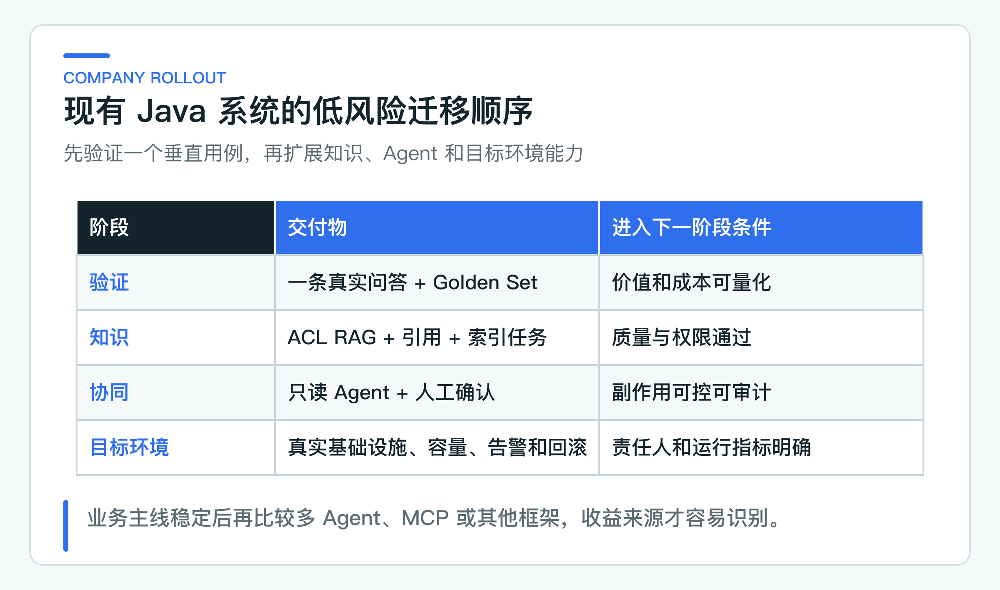

# 结束语：把 Java + AI 能力迁移到真实公司项目

这套配套代码围绕客户服务场景，连起了模型交互、知识检索、C 端接口、工单 Agent、人工确认、评测和框架实验。三个主应用可以直接启动；labs 用窄适配器展示框架与协议边界。它适合作为迁移样板，但不是任何一家公司的完整生产系统。

真正可以带回项目的，是稳定业务接口、失败处理规则和可重复验证的数据。公司里的认证平台、真实业务数据、容量目标、告警体系和发布审批，仍要在目标环境接入和验证。

## 这套专栏留下四类工程样板

第一类是模型交互。它包括 Provider 配置、Prompt 分区、结构化输出、流式响应、错误映射和基础评测。Java 应用不再只拿到一段自由文本，而是拥有稳定 DTO、超时语义和可观察的调用结果。

第二类是企业知识问答。文档版本、Chunk、索引任务、租户权限、检索、引用和坏案例评测被放进同一条用例。这里最重要的不是向量库名称，而是权限过滤在召回阶段生效，回答中的引用能回到真实文档版本。

第三类是受控工单 Agent。模型可以提出候选 Tool，应用服务仍掌握任务状态、风险判断、人工确认、幂等执行和结果不明时的对账。它展示了生成式能力怎样进入有副作用的业务流程，也保留了人工和老系统的控制权。

第四类是交付与迁移。Golden Set、安全样例、Trace、超时限流、配置、发布和回滚共同回答“这次改动是否值得上线”。Spring AI Alibaba、LangChain4j、AgentScope、MCP 与 A2A 位于隔离实验中，用于比较接口和依赖边界，不等同于主服务已经采用这些框架或协议。

## 同一条业务主线带来的价值

知识服务负责文档和检索，Customer BFF 负责面向用户的接口与流式体验，工单服务负责 AgentTask、确认和 Tool 控制。三个应用围绕同一客户服务领域协作，因此前面形成的身份、引用和错误语义可以继续沿用。

同一业务主线能把一个工程决定的后果继续传下去。例如 tenant 不来自请求体之后，知识检索、工单创建和人工确认都沿用受信身份；Tool 写操作引入 actionId 之后，JDK8 客户端的重试方式也必须跟着改变。这比一组互不相关的演示代码更接近真实开发。

框架实验则刻意放在另一条构建边界里。主线使用 Spring AI，其他框架用相同业务输入做局部对照。实验成功只说明某个适配方式可行，是否迁入正式服务还取决于质量、依赖、运维和退出成本。

这条主线提供的是“能力如何连接”的参考实现。真实浏览器、公司 IdP、生产数据库、对象存储、模型配额和告警平台仍要在目标环境中接入。把这条边界说清楚，示例代码才方便迁移，而不会给团队错误的完成感。

## 可复用的结论与目标环境验证

仓库中的单元测试和接口测试适合守住确定性规则，例如 tenant 过滤、引用校验、任务状态迁移、权限裁决和幂等冲突。它们运行快，也不依赖真实模型临时发挥，因此适合作为日常回归。

真实 Provider 的运行用于观察协议、流式响应、结构化输出和模型质量。它能说明某组模型与配置在当时可用，却不能替代长期容量测试，也不能推导出另一家公司的问题分布和安全要求。

PostgreSQL、pgvector、对象存储、IdP、Collector 与业务 OpenAPI 更依赖目标环境。示例中的配置键、SQL、适配器和测试方式可以复用，连接拓扑、凭证管理、备份恢复和容量阈值则要按公司基础设施重新验证。

框架与协议 lab 的边界更窄。Graph lab 只验证条件路由，AgentScope Runtime lab 只验证 Toolkit 查找与权限裁决；MCP、A2A 也只覆盖已声明的协议互操和本地状态规则。它们没有组成一套同时在线运行的多框架生产系统。

这三类结果放在一起，能避免两个常见误判：单测通过不等于外部系统可靠，一次真实请求成功也不等于业务质量稳定。迁移时先确认手里的证据属于哪一类，后续投入会更准确。

以知识问答为例，仓库测试可以锁住 SQL 中的 tenant 条件、引用必须属于候选集合等规则。接入公司环境后，还要看真实数据量下的查询计划、索引回填时间、Embedding 配额和对象存储故障。两组验证共同成立，才能判断这个用例是否适合放量。

工单 Agent 也是一样。状态机测试可以覆盖重复确认、过期版本和结果不明等分支，真实联调则要观察老系统是否正确识别 actionId，以及超时后能否查询最终回执。只测其中一边，都可能把重复副作用留到线上。

迁移时可以把验证拆成三份：代码规则由日常构建守住，模型质量用固定数据集比较，基础设施行为放到目标环境检查。责任边界清楚以后，失败时也更容易判断应该修改 Prompt、Java 代码，还是调整运行平台。

一次迁移是否完成，不看仓库里接入了多少框架，而看目标用户能否完成业务操作、失败任务能否进入稳定状态、引用能否回到授权事实，以及团队能否用同一批样例解释版本变化。四项结果都能重复观察，才适合进入下一轮放量。

## 替换组件时先固定业务不变量

替换模型、向量库或 Agent 框架，不只是修改 Maven 坐标。更稳妥的起点是固定业务接口、行为规则和验证数据，再让新旧实现处理同一组输入。

以向量库替换为例，需要保持不变的接口包括：

```text
upsert(indexVersion, tenantId, chunks)
search(indexVersion, trustedScope, query, topK)
deleteByDocumentVersion(...)
```

新的向量库仍然要在召回阶段应用 tenant 范围，保留文档与 Chunk 版本，并让重复写入和删除可以对账。随后用同一 Golden Set 比较 Recall@K、MRR、p95、资源成本和索引恢复时间。

模型 Provider 替换也一样。ChatClient 上层用例、结构化 DTO、错误码和观测维度保持不变；适配器处理模型名、参数差异、usage、finish reason、限流和内容审核。真实调用检查协议和链路，Golden Set 比较业务质量，两类验证回答的问题不同。

框架迁移可以从五个角度看结果。业务上关注准确率、召回和人工耗时，工程上看依赖、适配层与回归范围。运行侧比较 p95、并发、Token 和故障恢复，安全侧检查 ACL、提示注入、个人敏感信息（PII）与越权 Tool。维护侧则确认升级、排障和退出由谁负责。

如果新框架只是让示例少写几行，却要求领域层接收框架 DTO，或者让原有权限、确认和审计失效，保留旧实现反而更合理。实验没有产生迁移收益，同样是有价值的结论。

确实准备切换时，可以按单个用例或单项能力灰度。任务创建时记录 implementationVersion，任务生命周期内保持同一实现，回滚也只影响新任务。这样一轮比较不会演变成同时维护两套长期业务状态。

## 带回现有 Java 系统的一条实际路径



一个比较合适的起点，是公司里已经有数据、人工流程和效果基线的小问题。内部制度问答、客服回复建议或工单分类都可以，前提是能说清当前耗时、错误率和合规限制。这样模型带来的变化才有参照。

第一版可以只做一个 Spring Boot 垂直用例：受信身份进入应用，调用真实模型，返回稳定 DTO，并留下基础 Trace。与此同时建立少量 Golden Set，让 Prompt、模型或代码变化都能回到同一批问题比较，而不是凭几次主观试用判断效果。

如果用例依赖企业知识，就需要接入文档版本、对象存储、Chunk、索引任务和 tenant ACL。检索范围在 TopK 前收紧，答案带引用，证据不足时返回拒答。公司已有业务 API 时，AI 服务通过 API 取事实，不直接绕过原系统的数据边界。

Agent 可以先开放只读查询。等工具目录、参数校验、错误映射和结果污染都能稳定处理，再增加风险分级、人工确认、actionId、幂等和对账。模型提出候选动作，业务服务决定能否执行，这条分工在更换框架后也保持不变。

进入小流量之前，目标环境还会补上真实数据库、对象存储、模型配额、容量、安全回归、告警和回滚。项目级 YAML 为本地运行提供必要默认值，生产密钥则由公司的密钥平台或部署系统覆盖，不进入代码仓库。

业务链路稳定之后，再比较 Rerank、Graph、LangChain4j、AgentScope、MCP 或 A2A 会更有意义。每次只改变一个能力，问题、接口和数据集保持一致，团队能看清收益究竟来自哪里。

每引入一项新能力，都应留下一份简短 ADR（架构决策记录）：记录它解决的业务问题、不变的接口、当前证据、尚未验证的外部条件和回退入口。这份记录比“已接入某框架”更有用，因为它能在人员和版本变化后继续解释当初为什么这样做。

## 结束在一个可以继续演进的位置

[框架迁移验证报告](https://github.com/DavidDingXu/learn-java-ai/blob/main/docs/reports/milestone-52-framework-migration.md) 把主线服务、隔离实验、协议验证和外部边界放在一起。它适合用来了解代码覆盖面，也提醒团队哪些结论仍要回到公司环境验证。

把示例带回现有项目时，不必整仓复制后改包名。知识检索、C 端交付和受控 Agent 都可以单独取用。真正值得保留的是错误码、任务状态、确认单、业务端口和评测数据；Provider、数据库、对象存储与观测适配器则根据现有基础设施替换。

模型和框架只是实现的一部分。系统能否长期运行，更取决于业务接口在组件变化后是否仍然成立，质量与安全能否重复验证，以及异常状态是否有明确的处理方式。

这也是 Java 团队最熟悉、最有优势的部分。数据库约束、事务、接口版本、状态机、监控和故障处理并没有因为接入大模型而失效，只是多了一个不确定的外部依赖和一组新的质量指标。

面对一个具体 AI 需求时，可以先从现有业务瓶颈出发，再到这套代码中寻找对应样板。能用一条小链路验证价值，就先把它做稳；当数据、权限和运行结果给出足够理由时，再扩大模型、Agent 或协议的范围。

这种推进方式也方便团队复盘：每次只增加一个可观察的变量，出现质量下降或运行故障时，能够回到上一版稳定实现，而不是在多套框架之间猜测原因。

稳定接口、可重复验证和清楚的失败去向，不会因为模型或框架升级而失效。把这三件事保留在项目里，Java 应用才能在技术继续变化时，可靠地交付并持续演进 AI 能力。

---

[课程首页](../../README.md) · [完整目录](README.md) · [← A2A 互操作实验：任务映射、幂等与状态边界](51-a2a-task-collaboration.md)

动手实践：[本阶段可运行源码](../../learning-stages/stage-07-framework-boundaries/README.md)
